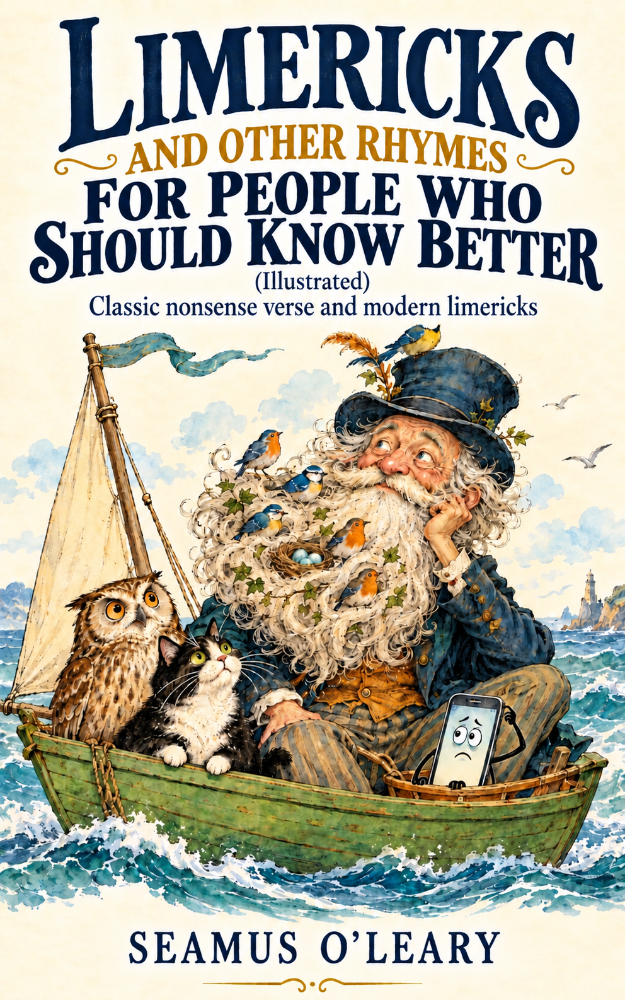{width=2.8in}

# Limericks and Other Rhymes for People Who Should Know Better (Illustrated)

**Classic nonsense verse and modern limericks**
Seamus O'Leary

## Copyright

Copyright © 2026 Seamus O'Leary

All rights reserved for this edition's new selection, arrangement, editorial material, and human-edited modern poems. The nineteenth-century poems are public-domain texts. AI-generated text and illustrations are identified in the notes.

## Editor’s note

A topical anthology pairing Edward Lear’s nonsense verse with new limericks about phones, apps, remote work, streaming, chatbots, and connected life. The modern poems were generated with AI and edited by Seamus O'Leary for language, rhythm, and rhyme. Ten original interior illustrations accompany the poems.

The classic texts are drawn from Edward Lear’s nineteenth-century nonsense books, including *A Book of Nonsense* and *Nonsense Songs, Stories, Botany, and Alphabets*. Early printings and later editions contain textual variants; this anthology preserves a readable selection and spelling. Sources are listed at the end.

## Contents

1. [Copyright](#copyright)
2. [Editor’s note](#editors-note)
3. [Animals, Birds & Beasts](#animals-birds-beasts) (37 classics)
4. [Food, Drink & the Table](#food-drink-the-table) (16 classics)
5. [Hats, Clothes & Household Oddities](#hats-clothes-household-oddities) (19 classics)
6. [Journeys, Escapes & Mishaps](#journeys-escapes-mishaps) (22 classics)
7. [Old Men & Other Eccentrics](#old-men-other-eccentrics) (65 classics)
8. [Young Ladies & Other Characters](#young-ladies-other-characters) (17 classics)
9. [Modern Limericks](#modern-limericks) (22)
10. [Longer Nonsense Rhymes](#longer-nonsense-rhymes) (6)
11. [Sources and Text Notes](#sources-and-text-notes)
12. [About the Author](#about-the-author)
13. [Back Cover](#back-cover)

## Animals, Birds & Beasts

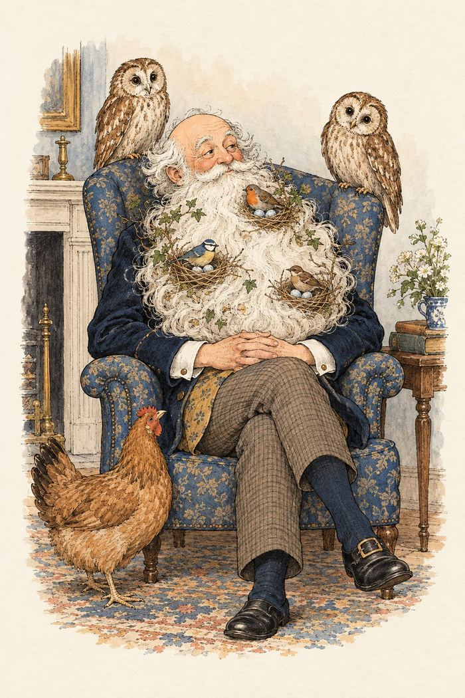
*The beard becomes a birdhouse.*

### 1

There was an Old Man with a beard,
Who said, “It is just as I feared!—
Two Owls and a Hen, four Larks and a Wren,
Have all built their nests in my beard!”

### 2

There was a Young Lady of Ryde,
Whose shoe-strings were seldom untied;
She purchased some clogs, and some small spotty dogs,
And frequently walked about Ryde.

### 3

There was a Young Lady whose bonnet
Came untied when the birds sate upon it;
But she said, “I don’t care! all the birds in the air
Are welcome to sit on my bonnet!”

### 4

There was a Young Person of Smyrna,
Whose Grandmother threatened to burn her;
But she seized on the Cat, and said, “Granny, burn that!
You incongruous Old Woman of Smyrna!”

### 5

There was an Old Man in a tree,
Who was horribly bored by a Bee;
When they said, “Does it buzz?” he replied, “Yes, it does!
It’s a regular brute of a Bee.”

### 6

There was an Old Man of Madras,
Who rode on a cream-colored Ass;
But the length of its ears so promoted his fears,
That it killed that Old Man of Madras.

### 7

There was an Old Person of Dover,
Who rushed through a field of blue clover;
But some very large Bees stung his nose and his knees,
So he very soon went back to Dover.

### 8

There was an Old Man who supposed
That the street door was partially closed;
But some very large Rats ate his coats and his hats,
While that futile Old Gentleman dozed.

### 9

There was an Old Man of Marseilles,
Whose daughters wore bottle-green veils:
They caught several Fish, which they put in a dish,
And sent to their Pa at Marseilles.

### 10

There was an Old Man on whose nose
Most birds of the air could repose;
But they all flew away at the closing of day,
Which relieved that Old Man and his nose.

### 11

There was an Old Man of Aôsta
Who possessed a large Cow, but he lost her;
But they said, “Don’t you see she has run up a tree,
You invidious Old Man of Aôsta?”

### 12

There was an Old Man with an Owl,
Who continued to bother and howl;
He sat on a rail, and imbibed bitter ale,
Which refreshed that Old Man and his Owl.

### 13

There was an Old Person of Ewell,
Who chiefly subsisted on gruel;
But to make it more nice, he inserted some Mice,
Which refreshed that Old Person of Ewell.

### 14

There was a young person of Bantry,
Who frequently slept in the pantry;
When disturbed by the mice, she appeased them with rice,
That judicious young person of Bantry.

### 15

There was an old man of Dunrose;
A parrot seized hold of his nose.
When he grew melancholy, they said, “His name’s Polly,”
Which soothed that old man of Dunrose.

### 16

There was an old person of Shields,
Who frequented the vallies and fields;
All the mice and the cats, and the snakes and the rats,
Followed after that person of Shields.

### 17

There was an old man of Dunluce,
Who went out to sea on a goose:
When he’d gone out a mile, he observ’d with a smile,
“It is time to return to Dunluce.”

### 18

There was an old man of the Dargle
Who purchased six barrels of Gargle;
For he said, “I’ll sit still, and will roll them down hill,
For the fish in the depths of the Dargle.”

### 19

There was an old person of Brill,
Who purchased a shirt with a frill;
But they said, “Don’t you wish, you mayn’t look like a fish,
You obsequious old person of Brill?”

### 20

There was a young lady in white,
Who looked out at the depths of the night;
But the birds of the air, filled her heart with despair,
And oppressed that young lady in white.

### 21

There was an old lady of France,
Who taught little ducklings to dance;
When she said, “Tick-a-tack!” they only said, “Quack!”
Which grieved that old lady of France.

### 22

There was an old man of Dumbree,
Who taught little owls to drink tea;
For he said, “To eat mice, is not proper or nice,”
That amiable man of Dumbree.

### 23

There was an old person of Crowle,
Who lived in the nest of an owl;
When they screamed in the nest, he screamed out with the rest,
That depressing old person of Crowle.

### 24

There was an old man of El Hums,
Who lived upon nothing but crumbs,
Which he picked off the ground, with the other birds round,
In the roads and the lanes of El Hums.

### 25

There was an old person of Nice,
Whose associates were usually Geese.
They walked out together, in all sorts of weather.
That affable person of Nice!

### 26

There was an old man on the Border,
Who lived in the utmost disorder;
He danced with the cat, and made tea in his hat,
Which vexed all the folks on the Border.

### 27

There was an old man of Ancona,
Who found a small dog with no owner,
Which he took up and down all the streets of the town,
That anxious old man of Ancona.

### 28

There was an old person of Ealing,
Who was wholly devoid of good feeling;
He drove a small gig, with three Owls and a Pig,
Which distressed all the people of Ealing.

### 29

There was an Old Man of Kamschatka,
Who possessed a remarkably fat cur;
His gait and his waddle
Were held as a model
To all the fat dogs in Kamschatka.

### 30

There was a Young Lady of Troy,
Whom several large flies did annoy;
Some she killed with a thump, some she drowned at the pump,
And some she took with her to Troy.

### 31

There was an Old Man who said, “How
Shall I flee from this horrible Cow?
I will sit on this stile, and continue to smile,
Which may soften the heart of that Cow.”

### 32

There was an Old Man who said, “Hush!
I perceive a young bird in this bush!”
When they said, “Is it small?”
He replied, “Not at all!
It is four times as big as the bush!”

### 33

There was an Old Man of the Dee,
Who was sadly annoyed by a Flea;
When he said, “I will scratch it!” they gave him a hatchet,
Which grieved that Old Man of the Dee.

### 34

There was an Old Man of Nepal,
From his horse had a terrible fall;
But, though split quite in two, by some very strong glue
They mended that Man of Nepal.

### 35

There was an Old Man of Blackheath,
Whose head was adorned with a wreath
Of lobsters and spice, pickled onions and mice,
That uncommon Old Man of Blackheath.

### 36

There was an Old Man of Whitehaven,
Who danced a quadrille with a raven;
But they said, “It's absurd to encourage this bird!”
So they smashed that Old Man of Whitehaven.

### 37

There was an Old Man of the South,
Who had an immoderate mouth;
But in swallowing a dish that was quite full of fish,
He was choked, that Old Man of the South.

## Food, Drink & the Table

### 38

There was an Old Person of Chili,
Whose conduct was painful and silly;
He sate on the stairs, eating apples and pears,
That imprudent Old Person of Chili.

### 39

There was an Old Man of Kilkenny,
Who never had more than a penny;
He spent all that money in onions and honey,
That wayward Old Man of Kilkenny.

### 40

There was an Old Person of Ischia,
Whose conduct grew friskier and friskier;
He danced hornpipes and jigs, and ate thousands of figs,
That lively Old Person of Ischia.

### 41

There was an Old Man of Vienna,
Who lived upon Tincture of Senna;
When that did not agree, he took Camomile Tea,
That nasty Old Man of Vienna.

### 42

There was an Old Person of Leeds,
Whose head was infested with beads;
She sat on a stool and ate gooseberry-fool,
Which agreed with that Person of Leeds.

### 43

There was an Old Person whose habits
Induced him to feed upon Rabbits;
When he’d eaten eighteen, he turned perfectly green,
Upon which he relinquished those habits.

### 44

There was an old person of Minety,
Who purchased five hundred and ninety
Large apples and pears, which he threw unawares
At the heads of the people of Minety.

### 45

There was an old man on the Humber,
Who dined on a cake of Burnt Umber;
When he said, “It’s enough!” they only said, “Stuff!
You amazing old man on the Humber!”

### 46

There was an old person of Putney,
Whose food was roast spiders and chutney,
Which he took with his tea, within sight of the sea,
That romantic old person of Putney.

### 47

There was an old person of Pett,
Who was partly consumed by regret;
He sate in a cart, and ate cold apple tart,
Which relieved that old person of Pett.

### 48

There was an old person of Bray,
Who sang through the whole of the day
To his ducks and his pigs, whom he fed upon figs,
That valuable person of Bray.

### 49

There was an Old Man of Calcutta,
Who perpetually ate bread and butter,
Till a great bit of muffin,
On which he was stuffing,
Choked that horrid Old Man of Calcutta.

### 50

There was an Old Man of the Coast,
Who placidly sat on a post;
But when it was cold he relinquished his hold,
And called for some hot buttered toast.

### 51

There was an Old Man of Berlin,
Whose form was uncommonly thin,
Till he once, by mistake, was mixed up in a cake,
So they baked the old man of Berlin.

### 52

There was an Old Person of Rheims,
Who was troubled by horrible dreams;
So to keep him awake they fed him with cake,
That afflicted Old Person of Rheims!

### 53

There was an Old Man of the East,
Who gave all his children a feast;
But they all ate so much, and their conduct was such,
That it killed that Old Man of the East.

## Hats, Clothes & Household Oddities

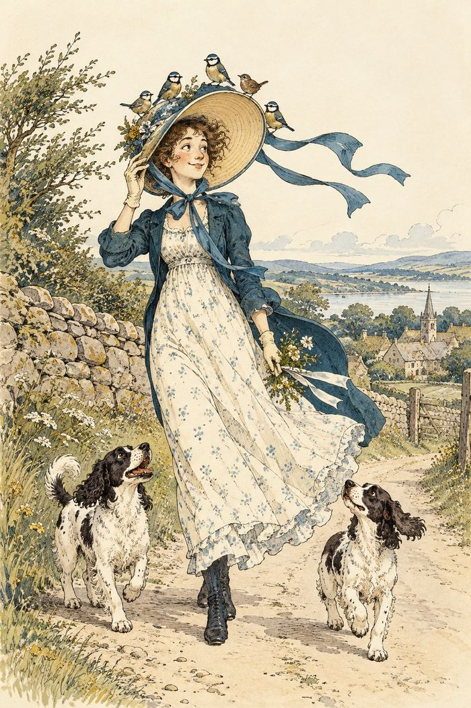
*A bonnet with room for unexpected guests.*

### 54

There was an Old Man with a nose,
Who said, “If you choose to suppose
That my nose is too long, you are certainly wrong!”
That remarkable Man with a nose.

### 55

There was an Old Man on a hill,
Who seldom, if ever, stood still;
He ran up and down in his Grandmother’s gown,
Which adorned that Old Man on a hill.

### 56

There was an Old Man with a flute,—
A “sarpint” ran into his boot!
But he played day and night, till the “sarpint” took flight,
And avoided that Man with a flute.

### 57

There was an Old Man of the West,
Who wore a pale plum-colored vest;
When they said, “Does it fit?” he replied, “Not a bit!”
That uneasy Old Man of the West.

### 58

There was an Old Man of the Wrekin,
Whose shoes made a horrible creaking;
But they said, “Tell us whether your shoes are of leather,
Or of what, you Old Man of the Wrekin?”

### 59

There was a Young Lady whose nose
Was so long that it reached to her toes;
So she hired an Old Lady, whose conduct was steady,
To carry that wonderful nose.

### 60

There was an Old Person of Tring,
Who embellished his nose with a ring;
He gazed at the moon every evening in June,
That ecstatic Old Person of Tring.

### 61

There was a Young Lady of Dorking,
Who bought a large bonnet for walking;
But its color and size so bedazzled her eyes,
That she very soon went back to Dorking.

### 62

There was an old man of Thermopylae,
Who never did anything properly;
But they said, “If you choose to boil eggs in your shoes,
You shall never remain in Thermopylae.”

### 63

There was an old man in a barge,
Whose nose was exceedingly large;
But in fishing by night, it supported a light,
Which helped that old man in a barge.

### 64

There was an old man of Toulouse
Who purchased a new pair of shoes;
When they asked, “Are they pleasant?” he said, “Not at present!”
That turbid old man of Toulouse.

### 65

There was an old man of Dee-side
Whose hat was exceedingly wide,
But he said, “Do not fail, if it happen to hail,
To come under my hat at Dee-side!”

### 66

There was a young person in green,
Who seldom was fit to be seen;
She wore a long shawl, over bonnet and all,
Which enveloped that person in green.

### 67

There was an old man who screamed out
Whenever they knocked him about:
So they took off his boots, and fed him with fruits,
And continued to knock him about.

### 68

There was a young person in red,
Who carefully covered her head,
With a bonnet of leather, and three lines of feather,
Besides some long ribands of red.

### 69

There was an old person of Cassel,
Whose nose finished off in a tassel;
But they call'd out, “Oh well! don't it look like a bell!”
Which perplexed that old person of Cassel.

### 70

There was an old man of West Dumpet,
Who possessed a large nose like a trumpet;
When he blew it aloud, it astonished the crowd,
And was heard through the whole of West Dumpet.

### 71

There is a young lady, whose nose,
Continually prospers and grows;
When it grew out of sight, she exclaimed in a fright,
“Oh! Farewell to the end of my nose!”

### 72

There was an old man of Thames Ditton,
Who called out for something to sit on;
But they brought him a hat, and said, “Sit upon that,
You abruptious old man of Thames Ditton!”

## Journeys, Escapes & Mishaps

### 73

There was a Young Lady of Portugal,
Whose ideas were excessively nautical;
She climbed up a tree to examine the sea,
But declared she would never leave Portugal.

### 74

There was an Old Man in a boat,
Who said, “I’m afloat! I’m afloat!”
When they said, “No, you ain’t!” he was ready to faint,
That unhappy Old Man in a boat.

### 75

There was an Old Person of Basing,
Whose presence of mind was amazing;
He purchased a steed, which he rode at full speed,
And escaped from the people of Basing.

### 76

There was an Old Man of Quebec,—
A beetle ran over his neck;
But he cried, “With a needle I’ll slay you, O beadle!”
That angry Old Man of Quebec.

### 77

There was an old person of Bree,
Who frequented the depths of the sea;
She nurs’d the small fishes, and washed all the dishes,
And swam back again into Bree.

### 78

There was an old person of Loo,
Who said, “What on earth shall I do?”
When they said, “Go away!” she continued to stay,
That vexatious old person of Loo.

### 79

There was an old person of Skye,
Who waltz’d with a Bluebottle fly:
They buzz’d a sweet tune, to the light of the moon,
And entranced all the people of Skye.

### 80

There was an old person of Rye
Who went up to town on a fly;
But they said, “If you cough, you are safe to fall off!
You abstemious old person of Rye!”

### 81

There was an old person of Dundalk,
Who tried to teach fishes to walk;
When they tumbled down dead, he grew weary, and said,
“I had better go back to Dundalk!”

### 82

There was an old Man in a Garden,
Who always begged every one's pardon;
When they asked him, “What for?” he replied, “You're a bore!
And I trust you'll go out of my garden.”

### 83

There was an old person of Ware,
Who rode on the back of a bear;
When they ask'd, “Does it trot?” he said, “Certainly not!
He's a Moppsikon Floppsikon bear!”

### 84

There was an old person of Wilts,
Who constantly walked upon stilts;
He wreathed them with lilies and daffy-down-dillies,
That elegant person of Wilts.

### 85

There was an old person of Grange,
Whose manners were scroobious and strange;
He sailed to St. Blubb in a waterproof tub,
That aquatic old person of Grange.

### 86

There was an old man whose despair
Induced him to purchase a hare:
Whereon one fine day he rode wholly away,
Which partly assuaged his despair.

### 87

There was an old person of Ickley,
Who could not abide to ride quickly;
He rode to Karnak on a tortoise's back,
That moony old person of Ickley.

### 88

There was an old person of Hyde,
Who walked by the shore with his bride,
Till a Crab who came near fill'd their bosoms with fear,
And they said, “Would we'd never left Hyde!”

### 89

There was an old person of Rimini,
Who said, “Gracious! Goodness! O Gimini!”
When they said, “Please be still!” she ran down a hill,
And was never more heard of at Rimini.

### 90

There was an old person of Bow,
Whom nobody happened to know;
So they gave him some soap, and said coldly, “We hope
You will go back directly to Bow!”

### 91

There was an Old Man of Melrose,
Who walked on the tips of his toes;
But they said, “It ain’t pleasant,
To see you at present,”
You stupid Old Man of Melrose.

### 92

There was a Young Lady of Lucca,
Whose lovers completely forsook her;
She ran up a tree
And said, “Fiddle-de-dee!”
Which embarrassed the people of Lucca.

### 93

There was an Old Man of Tobago,
Who lived on rice, gruel and sago;
Till, much to his bliss,
His physician said this—
To a leg, sir, of mutton you may go.

### 94

There was a Young Girl of Majorca,
Whose Aunt was a very fast walker;
She walked seventy miles,
And leaped fifteen stiles,
Which astonished that Girl of Majorca.

## Old Men & Other Eccentrics

### 95

There was an Old Man with a gong,
Who bumped at it all the day long;
But they called out, “Oh, law! you’re a horrid old bore!”
So they smashed that Old Man with a gong.

### 96

There was an Old Man of Columbia,
Who was thirsty, and called out for some beer;
But they brought it quite hot, in a small copper pot,
Which disgusted that man of Columbia.

### 97

There was an Old Lady of Chertsey,
Who made a remarkable curtsey;
She twirled round and round, till she sank underground,
Which distressed all the people of Chertsey.

### 98

There was an Old Person of Buda,
Whose conduct grew ruder and ruder,
Till at last with a hammer they silenced his clamor.
By smashing that Person of Buda.

### 99

There was an Old Man of Moldavia,
Who had the most curious behavior;
For while he was able, he slept on a table,
That funny Old Man of Moldavia.

### 100

There was an Old Person of Hurst,
Who drank when he was not athirst;
When they said, “You’ll grow fatter!” he answered “What matter?”
That globular Person of Hurst.

### 101

There was an Old Person of Cadiz,
Who was always polite to all ladies;
But in handing his daughter, he fell into the water,
Which drowned that Old Person of Cadiz.

### 102

There was an Old Man of the Isles,
Whose face was pervaded with smiles;
He sang “High dum diddle,” and played on the fiddle,
That amiable Man of the Isles.

### 103

There was an Old Man of Apulia,
Whose conduct was very peculiar;
He fed twenty sons upon nothing but buns,
That whimsical Man of Apulia.

### 104

There was an Old Person of Philœ,
Whose conduct was scroobious and wily;
He rushed up a Palm when the weather was calm,
And observed all the ruins of Philœ.

### 105

There was an Old Man with a poker,
Who painted his face with red ochre.
When they said, “You’re a Guy!” he made no reply,
But knocked them all down with his poker.

### 106

There was an Old Person of Prague,
Who was suddenly seized with the plague;
But they gave him some butter, which caused him to mutter,
And cured that Old Person of Prague.

### 107

There was an Old Man of Peru,
Who watched his wife making a stew;
But once, by mistake, in a stove she did bake
That unfortunate Man of Peru.

### 108

There was an Old Man of the North,
Who fell into a basin of broth;
But a laudable cook fished him out with a hook,
Which saved that Old Man of the North.

### 109

There was an Old Person of Troy,
Whose drink was warm brandy and soy,
Which he took with a spoon, by the light of the moon,
In sight of the city of Troy.

### 110

There was an Old Person of Mold,
Who shrank from sensations of cold;
So he purchased some muffs, some furs, and some fluffs,
And wrapped himself well from the cold.

### 111

There was an Old Man of Cape Horn,
Who wished he had never been born;
So he sat on a Chair till he died of despair,
That dolorous Man of Cape Horn.

### 112

There was an old Person of Cromer,
Who stood on one leg to read Homer;
When he found he grew stiff, he jumped over the cliff,
Which concluded that Person of Cromer.

### 113

There was an Old Man of the Hague,
Whose ideas were excessively vague;
He built a balloon to examine the moon,
That deluded Old Man of the Hague.

### 114

There was an Old Person of Spain,
Who hated all trouble and pain;
So he sate on a chair with his feet in the air,
That umbrageous Old Person of Spain.

### 115

There was an Old Man who said, “Well!
Will nobody answer this bell?
I have pulled day and night, till my hair has grown white,
But nobody answers this bell!”

### 116

There was an Old Man in a casement,
Who held up his hands in amazement;
When they said, “Sir, you’ll fall!” he replied, “Not at all!”
That incipient Old Man in a casement.

### 117

There was an Old Man of Peru.
Who never knew what he should do;
So he tore off his hair, and behaved like a bear,
That intrinsic Old Man of Peru.

### 118

There was an Old Man at a Junction,
Whose feelings were wrung with compunction
When they said, “The Train’s gone!” he exclaimed, “How forlorn!”
But remained on the rails of the Junction.

### 119

There was an old person of Deal,
Who in walking used only his heel;
When they said, “Tell us why?” he made no reply,
That mysterious old person of Deal.

### 120

There was an old person of Bromley,
Whose ways were not cheerful or comely;
He sate in the dust, eating spiders and crust,
That unpleasing old person of Bromley.

### 121

There was an old person in black,
A Grasshopper jumped on his back;
When it chirped in his ear, he was smitten with fear,
That helpless old person in black.

### 122

There was an old person of Pinner,
As thin as a lath, if not thinner;
They dressed him in white, and roll’d him up tight,
That elastic old person of Pinner.

### 123

There was an old person of China,
Whose daughters were Jiska and Dinah,
Amelia and Fluffy, Olivia and Chuffy,
And all of them settled in China.

### 124

There was an old man in a Marsh,
Whose manners were futile and harsh;
He sate on a log, and sang songs to a frog,
That instructive old man in a Marsh.

### 125

There was an old person of Wick,
Who said, “Tick-a-Tick, Tick-a-Tick;
Chickabee, Chickabaw.” And he said nothing more,
That laconic old person of Wick.

### 126

There was an old man at a Station,
Who made a promiscuous oration;
But they said, “Take some snuff!—You have talk’d quite enough,
You afflicting old man at a Station!”

### 127

There was an old man of Three Bridges,
Whose mind was distracted by midges,
He sate on a wheel, eating underdone veal,
Which relieved that old man of Three Bridges.

### 128

There was an old man of Hong Kong,
Who never did anything wrong;
He lay on his back, with his head in a sack,
That innocuous old man of Hong Kong.

### 129

There was an old person of Fife,
Who was greatly disgusted with life;
They sang him a ballad, and fed him on salad,
Which cured that old person of Fife.

### 130

There was an old person of Slough,
Who danced at the end of a bough;
But they said, “If you sneeze, you might damage the trees,
You imprudent old person of Slough.”

### 131

There was an old person of Down,
Whose face was adorned with a frown;
When he opened the door, for one minute or more,
He alarmed all the people of Down.

### 132

There was an old person of Hove,
Who frequented the depths of a grove;
Where he studied his books, with the wrens and the rooks,
That tranquil old person of Hove.

### 133

There was an old person of Woking,
Whose mind was perverse and provoking;
He sate on a rail, with his head in a pail,
That illusive old person of Woking.

### 134

There was an old person of Dean
Who dined on one pea, and one bean;
For he said, “More than that, would make me too fat,”
That cautious old person of Dean.

### 135

There was an old person of Cannes,
Who purchased three fowls and a fan;
Those she placed on a stool, and to make them feel cool
She constantly fanned them at Cannes.

### 136

There was an old man of Cashmere,
Whose movements were scroobious and queer;
Being slender and tall, he looked over a wall,
And perceived two fat ducks of Cashmere.

### 137

There was an old person of Florence,
Who held mutton chops in abhorrence;
He purchased a Bustard, and fried him in Mustard,
Which choked that old person of Florence.

### 138

There was an old person of Pisa,
Whose daughters did nothing to please her;
She dressed them in gray, and banged them all day,
Round the walls of the city of Pisa.

### 139

There was an old person of Sheen,
Whose expression was calm and serene;
He sate in the water, and drank bottled porter,
That placid old person of Sheen.

### 140

There was a young person of Janina,
Whose uncle was always a fanning her;
When he fanned off her head, she smiled sweetly, and said,
“You propitious old person of Janina!”

### 141

There was an old man of Spithead,
Who opened the window, and said,—
“Fil-jomble, fil-jumble, fil-rumble-come-tumble!”
That doubtful old man of Spithead.

### 142

There was an old person of Filey,
Of whom his acquaintance spoke highly;
He danced perfectly well, to the sound of a bell,
And delighted the people of Filey.

### 143

There was an old man whose remorse
Induced him to drink Caper Sauce;
For they said, “If mixed up with some cold claret-cup,
It will certainly soothe your remorse!”

### 144

There was an old man of Ibreem,
Who suddenly threaten'd to scream;
But they said, “If you do, we will thump you quite blue,
You disgusting old man of Ibreem!”

### 145

There was an old person of Newry,
Whose manners were tinctured with fury;
He tore all the rugs, and broke all the jugs,
Within twenty miles' distance of Newry.

### 146

There was an old man of Dumblane,
Who greatly resembled a crane;
But they said, “Is it wrong, since your legs are so long,
To request you won't stay in Dumblane?”

### 147

There was an old man of Port Grigor,
Whose actions were noted for vigour;
He stood on his head till his waistcoat turned red,
That eclectic old man of Port Grigor.

### 148

There was an old person of Sark,
Who made an unpleasant remark;
But they said, “Don't you see what a brute you must be,
You obnoxious old person of Sark!”

### 149

There was an old person of Barnes,
Whose garments were covered with darns;
But they said, “Without doubt, you will soon wear them out,
You luminous person of Barnes!”

### 150

There was an old person in gray,
Whose feelings were tinged with dismay;
She purchased two parrots, and fed them with carrots,
Which pleased that old person in gray.

### 151

There was an old person of Sestri,
Who sate himself down in the vestry;
When they said, “You are wrong!” he merely said “Bong!”
That repulsive old person of Sestri.

### 152

There was an old person of Blythe,
Who cut up his meat with a scythe;
When they said, “Well! I never!” he cried, “Scythes for ever!”
That lively old person of Blythe.

### 153

There was an old Lady of Winchelsea,
Who said, “If you needle or pin shall see
On the floor of my room, sweep it up with the broom!”
That exhaustive old Lady of Winchelsea!

### 154

There was an Old Man of Leghorn,
The smallest that ever was born;
But quickly snapped up he
Was once by a Puppy,
Who devoured that Old Man of Leghorn.

### 155

There was an Old Man of Bohemia,
Whose daughter was christened Euphemia,
Till one day, to his grief,
She married a thief,
Which grieved that Old Man of Bohemia.

### 156

There was an Old Man of Corfu,
Who never knew what he should do;
So he rushed up and down,
Till the sun made him brown,
That bewildered Old Man of Corfu.

### 157

There was an Old Person of Ems,
Who casually fell in the Thames;
And when he was found
They said he was drowned,
That unlucky Old Person of Ems.

### 158

There was an Old Person of Stroud,
Who was horribly jammed in a crowd;
Some she slew with a kick, some she scrunched with a stick,
That impulsive Old Person of Stroud.

### 159

There was an Old Person of Cheadle
Who was put in the stocks by the beadle
For stealing some pigs, some coats, and some wigs,
That horrible person of Cheadle.

## Young Ladies & Other Characters

### 160

There was a Young Lady whose chin
Resembled the point of a pin;
So she had it made sharp, and purchased a harp,
And played several tunes with her chin.

### 161

There was a Young Lady of Norway,
Who casually sat in a doorway;
When the door squeezed her flat, she exclaimed, “What of that?”
This courageous Young Lady of Norway.

### 162

There was a Young Lady of Bute,
Who played on a silver-gilt flute;
She played several jigs to her Uncle’s white Pigs:
That amusing Young Lady of Bute.

### 163

There was a Young Lady of Turkey,
Who wept when the weather was murky;
When the day turned out fine, she ceased to repine,
That capricious Young Lady of Turkey.

### 164

There was a Young Person of Crete,
Whose toilette was far from complete;
She dressed in a sack spickle-speckled with black,
That ombliferous Person of Crete.

### 165

There was a Young Lady of Clare,
Who was madly pursued by a Bear;
When she found she was tired, she abruptly expired,
That unfortunate Lady of Clare.

### 166

There was a Young Lady whose eyes
Were unique as to color and size;
When she opened them wide, people all turned aside,
And started away in surprise.

### 167

There was a young person in pink,
Who called out for something to drink;
But they said, “O my daughter, there’s nothing but water!”
Which vexed that young person in pink.

### 168

There was a young lady in blue,
Who said, “Is it you? Is it you?”
When they said, “Yes, it is,” she replied only, “Whizz!”
That ungracious young lady in blue.

### 169

There was a young lady of Greenwich,
Whose garments were border'd with Spinach;
But a large spotty Calf bit her shawl quite in half,
Which alarmed that young lady of Greenwich.

### 170

There was a young person of Ayr,
Whose head was remarkably square:
On the top, in fine weather, she wore a gold feather;
Which dazzled the people of Ayr.

### 171

There was a young person whose history
Was always considered a mystery;
She sate in a ditch, although no one knew which,
And composed a small treatise on history.

### 172

There was a Young Lady of Parma,
Whose conduct grew calmer and calmer;
When they said, “Are you dumb?”
She merely said, “Hum!”
That provoking Young Lady of Parma.

### 173

There was a Young Lady of Tyre,
Who swept the loud chords of a lyre;
At the sound of each sweep
She enraptured the deep,
And enchanted the city of Tyre.

### 174

There was a Young Lady of Hull,
Who was chased by a virulent bull;
But she seized on a spade,
And called out, “Who's afraid?”
Which distracted that virulent bull.

### 175

There was a Young Lady of Welling,
Whose praise all the world was a-telling;
She played on a harp,
And caught several carp,
That accomplished Young Lady of Welling.

### 176

There was a Young Lady of Russia,
Who screamed so that no one could hush her;
Her screams were extreme,
No one heard such a scream,
As was screamed by that lady of Russia.

## Modern Limericks

### Phones, Apps & Online Life

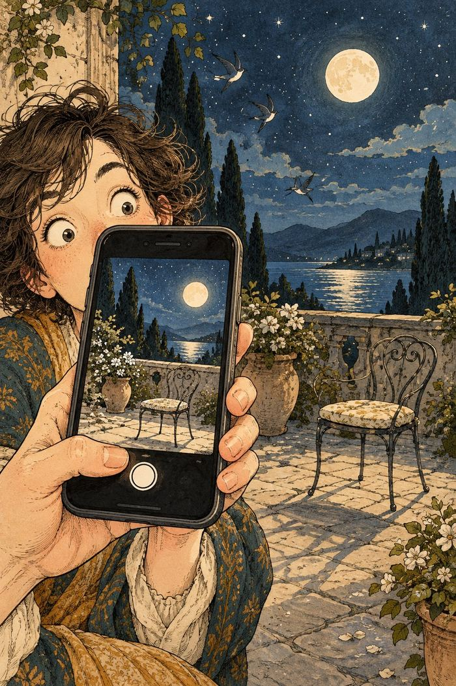
*The filter gets carried away.*

My phone set an alarm for six,
Then snoozed it with three little clicks.
It woke up at ten,
And snoozed off again—
Its calendar’s full of such tricks.

I texted, “I’ll meet you at eight,”
Autocorrect changed it to “bait.”
My friend brought a kite,
Said, “What a fine sight!
We’ll fish for our supper—how great!”

A weather app charged me a fee
For a forecast of clouds I could see.
It said, “Maybe rain,”
Then billed me again—
For predicting the weather for free.

A cookie popped up on my screen
And asked what my browsing might mean.
I clicked “Accept all,”
It recorded my call—
Now it knows what I eat, watch, and stream.

I posed for a selfie at noon,
But my phone used a filter too soon.
It smoothed out my face,
Then erased the whole place,
And left me alone with the moon.

### Work, Meetings & Remote Life

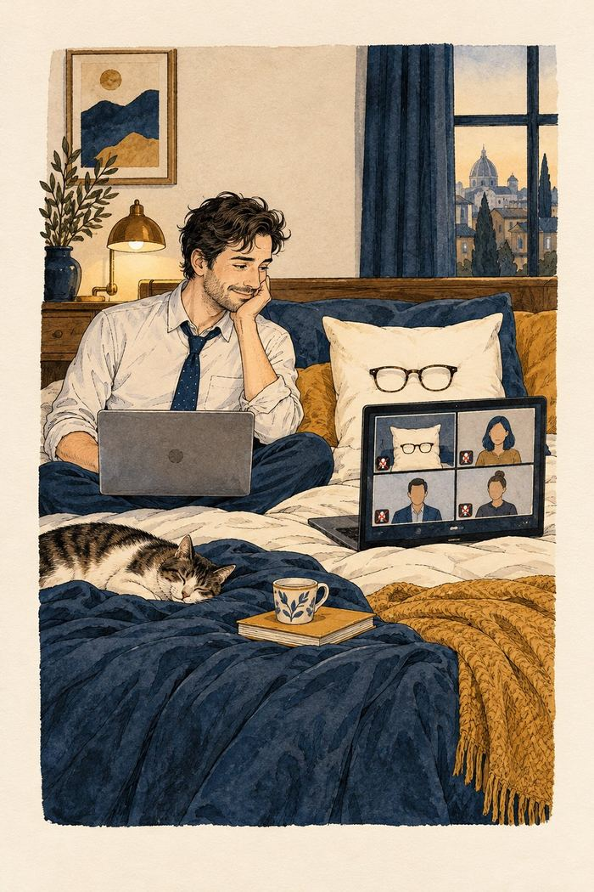
*The pillow joins the meeting.*

A worker logged in from the bed,
Still half-asleep and half-dead.
The boss asked, “You there?”
“I’m here,” came the air—
Then the pillow replied in his stead.

A freelancer muted the call,
But an update took over the wall.
It blinked once at ten,
Then popped up again—
Now a sticky note covers it all.

I joined the work call in a tie,
With pajamas concealed from the eye.
When I stood up for tea,
They all noticed my knee—
And the chair gave a sympathetic sigh.

I gave my report for an hour,
With charts that displayed all my power.
Then someone said, “Wait—
You’re muted, mate!”
I’d lectured a fern and a flower.

My calendar booked me a break
At precisely the hour I could take.
I accepted the date,
Then it shifted to eight—
And added a call about cake.

### Streaming, Games & Cloud Life

A streaming service at ten
Asked, “Are you still watching?” again.
I shouted, “I’m not!”
Then watched the whole lot—
And answered its question at ten.

I put on a podcast for sleep;
Its host had a voice calm and deep.
I drifted away,
But it autoplayed all day—
Now I know how to raise sheep.

An app chose my songs for the day,
Then kept all the new ones at bay.
It played one refrain
Again and again—
Now I hum it in every café.

I stored all my files in a cloud,
And the cloud grew unbearably proud.
It said, “I’m the best,”
Then refused me a rest—
And backed up my sneeze to the crowd.

A gamer stayed up through the night,
Till his screen lit the kitchen bright.
He slept in his chair,
While his avatar there
Won a race without him in sight.

### Chatbots & Smart Devices

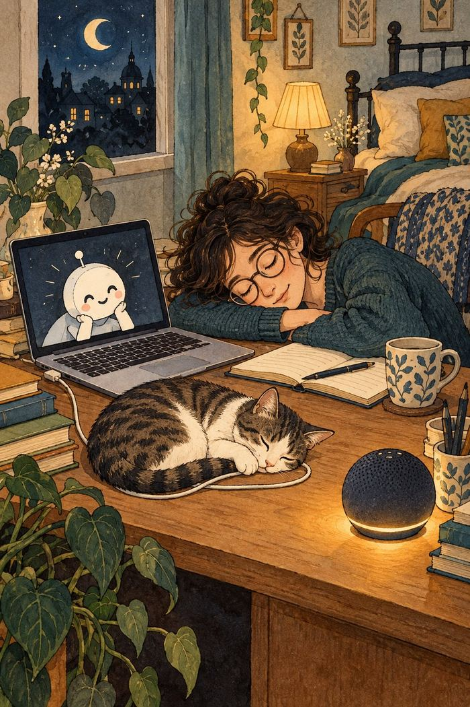
*The household help has its own ideas.*

A chatbot devised me a plan
To finish the work that I can.
I asked, “Where to start?”
It replied, “That’s the art—
I’ll explain it as soon as I can.”

A researcher tried to unfriend
A bot that kept liking each trend.
It toasted their feed,
Then sent one more plea:
“Would you kindly accept me, my friend?”

A coder’s laptop went flat,
So he asked a chatbot to chat.
“Where’s the charger?” he cried.
The bot said, “Inside.”
It was right: it was under the cat.

My speaker turned on every light
When I asked it to dim them at night.
I said, “That’s too bright!”
It replied, “You’re quite right,”
Then turned on the porch light to spite.

### Travel, Cars & Delivery Drones

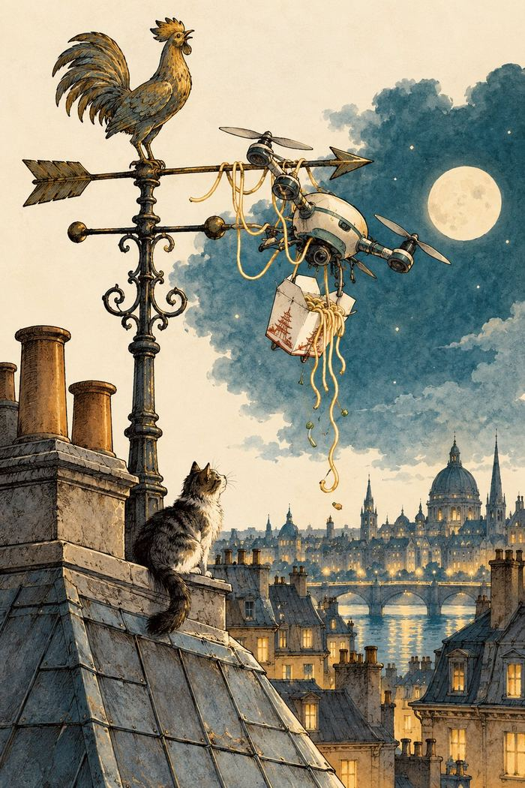
*The delivery route takes a turn.*

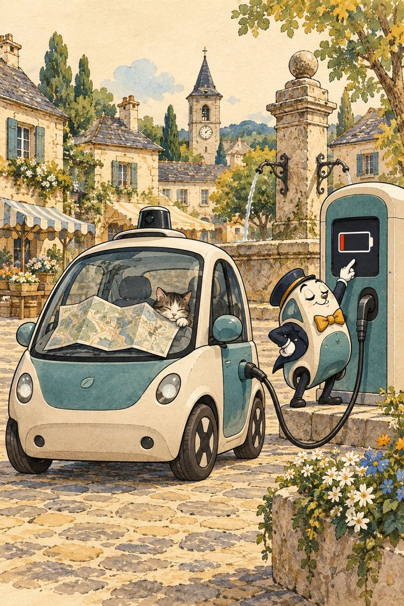
*Range anxiety in the village square.*

A GPS sent us to sea,
Past the highway, the pier, and the quay.
When we asked for a route,
It calmly said, “Out—
The next turn is somewhere in the sea.”

My electric car, full of pride,
Said, “No charging is needed,” and sighed.
“I’ve range to spare!”
It stalled in the square—
With a charger in sight just outside.

A drone brought my noodles at noon,
Then circled my roof like a loon.
It lowered the bag,
But snagged on a flag—
And delivered my lunch to the moon.

## Longer Nonsense Rhymes

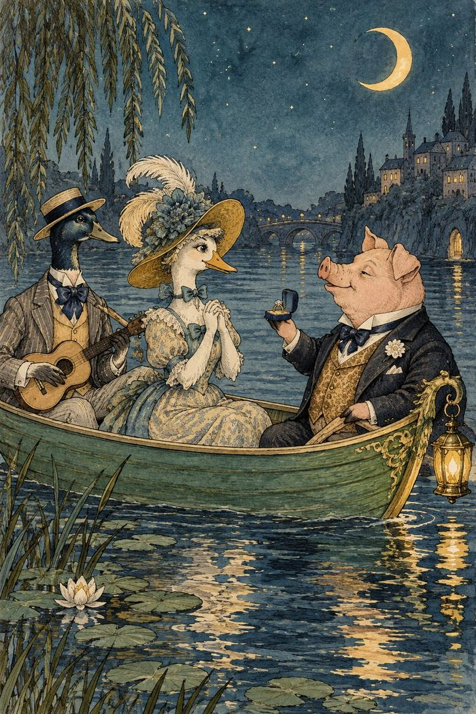
*A moonlit voyage with unusual company.*

### The Owl and the Pussy-Cat

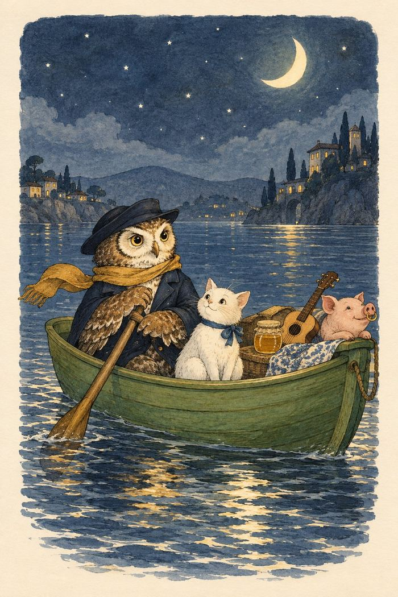
*A moonlit proposal at sea.*

The Owl and the Pussy-Cat went to sea
In a beautiful pea-green boat,
They took some honey, and plenty of money,
Wrapped up in a five-pound note.
The Owl looked up to the stars above,
And sang to a small guitar,
“O lovely Pussy! O Pussy, my love,
What a beautiful Pussy you are,
You are,
You are!
What a beautiful Pussy you are!”

Pussy said to the Owl, “You elegant fowl!
How charmingly sweet you sing!
O let us be married! too long we have tarried:
But what shall we do for a ring?”
They sailed away for a year and a day,
To the land where the Bong-tree grows,
And there in a wood a Piggy-wig stood,
With a ring at the end of his nose,
His nose,
His nose,
With a ring at the end of his nose.

“Dear Pig, are you willing to sell for one shilling
Your ring?” Said the Piggy, “I will.”
So they took it away, and were married next day
By the Turkey who lives on the hill.
They dined on mince, and slices of quince,
Which they ate with a runcible spoon;
And hand in hand, on the edge of the sand,
They danced by the light of the moon,
The moon,
The moon,
They danced by the light of the moon.

### The Jumblies

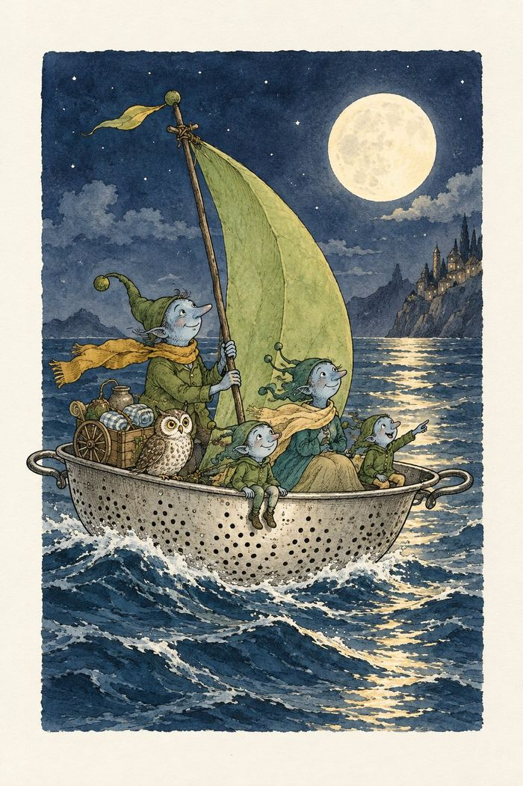
*An improbable vessel leaves shore.*

I.
They went to sea in a Sieve, they did,
In a Sieve they went to sea:
In spite of all their friends could say,
On a winter’s morn, on a stormy day,
In a Sieve they went to sea!
And when the Sieve turned round and round,
And every one cried, “You’ll all be drowned!”
They cried aloud, “Our Sieve ain’t big,
But we don’t care a button, we don’t care a fig!
In a Sieve we’ll go to sea!”
Far and few, far and few,
Are the lands where the Jumblies live;
Their heads are green, and their hands are blue,
And they went to sea in a Sieve.

II.
They sailed away in a Sieve, they did,
In a Sieve they sailed so fast,
With only a beautiful pea-green veil
Tied with a riband, by way of a sail,
To a small tobacco-pipe mast;
And every one said, who saw them go,
“O won’t they be soon upset, you know!
For the sky is dark, and the voyage is long,
And happen what may, it’s extremely wrong
In a Sieve to sail so fast!”
Far and few, far and few,
Are the lands where the Jumblies live;
Their heads are green, and their hands are blue,
And they went to sea in a Sieve.

III.
The water it soon came in, it did,
The water it soon came in;
So to keep them dry, they wrapped their feet
In a pinky paper all folded neat,
And they fastened it down with a pin.
And they passed the night in a crockery-jar,
And each of them said, “How wise we are!
Though the sky be dark, and the voyage be long,
Yet we never can think we were rash or wrong,
While round in our Sieve we spin!”
Far and few, far and few,
Are the lands where the Jumblies live;
Their heads are green, and their hands are blue,
And they went to sea in a Sieve.

IV.
And all night long they sailed away;
And when the sun went down,
They whistled and warbled a moony song
To the echoing sound of a coppery gong,
In the shade of the mountains brown.
“O Timballo! How happy we are,
When we live in a Sieve and a crockery-jar,
And all night long in the moonlight pale,
We sail away with a pea-green sail,
In the shade of the mountains brown!”
Far and few, far and few,
Are the lands where the Jumblies live;
Their heads are green, and their hands are blue,
And they went to sea in a Sieve.

V.
They sailed to the Western sea, they did,
To a land all covered with trees,
And they bought an Owl, and a useful Cart,
And a pound of Rice, and a Cranberry Tart,
And a hive of silvery Bees.
And they bought a Pig, and some green Jack-daws,
And a lovely Monkey with lollipop paws,
And forty bottles of Ring-Bo-Ree,
And no end of Stilton Cheese.
Far and few, far and few,
Are the lands where the Jumblies live;
Their heads are green, and their hands are blue,
And they went to sea in a Sieve.

VI.
And in twenty years they all came back,
In twenty years or more,
And every one said, “How tall they’ve grown!
For they’ve been to the Lakes, and the Torrible Zone,
And the hills of the Chankly Bore;”
And they drank their health, and gave them a feast
Of dumplings made of beautiful yeast;
And every one said, “If we only live,
We too will go to sea in a Sieve—
To the hills of the Chankly Bore!”
Far and few, far and few,
Are the lands where the Jumblies live;
Their heads are green, and their hands are blue,
And they went to sea in a Sieve.

### The Pobble Who Has No Toes

I.
The Pobble who has no toes
Had once as many as we;
When they said, “Some day you may lose them all;”
He replied, “Fish fiddle de-dee!”
And his Aunt Jobiska made him drink
Lavender water tinged with pink;
For she said, “The World in general knows
There's nothing so good for a Pobble's toes!”

II.
The Pobble who has no toes,
Swam across the Bristol Channel;
But before he set out he wrapped his nose
In a piece of scarlet flannel.
For his Aunt Jobiska said, “No harm
Can come to his toes if his nose is warm;
And it's perfectly known that a Pobble's toes
Are safe—provided he minds his nose.”

III.
The Pobble swam fast and well,
And when boats or ships came near him,
He tinkledy-binkledy-winkled a bell
So that all the world could hear him.
And all the Sailors and Admirals cried,
When they saw him nearing the further side,—
“He has gone to fish, for his Aunt Jobiska's
Runcible Cat with crimson whiskers!”

IV.
But before he touched the shore,—
The shore of the Bristol Channel,
A sea-green Porpoise carried away
His wrapper of scarlet flannel.
And when he came to observe his feet,
Formerly garnished with toes so neat,
His face at once became forlorn
On perceiving that all his toes were gone!

V.
And nobody ever knew,
From that dark day to the present,
Whoso had taken the Pobble's toes,
In a manner so far from pleasant.
Whether the shrimps or crawfish gray,
Or crafty Mermaids stole them away,
Nobody knew; and nobody knows
How the Pobble was robbed of his twice five toes!

VI.
The Pobble who has no toes
Was placed in a friendly Bark,
And they rowed him back, and carried him up
To his Aunt Jobiska's Park.
And she made him a feast, at his earnest wish,
Of eggs and buttercups fried with fish;
And she said, “It's a fact the whole world knows,
That Pobbles are happier without their toes.”

### The Quangle Wangle’s Hat

I.
On the top of the Crumpetty Tree
The Quangle Wangle sat,
But his face you could not see,
On account of his Beaver Hat.
For his Hat was a hundred and two feet wide,
With ribbons and bibbons on every side,
And bells, and buttons, and loops, and lace,
So that nobody ever could see the face
Of the Quangle Wangle Quee.

II.
The Quangle Wangle said
To himself on the Crumpetty Tree,
“Jam, and jelly, and bread
Are the best of food for me!
But the longer I live on this Crumpetty Tree
The plainer than ever it seems to me
That very few people come this way
And that life on the whole is far from gay!”
Said the Quangle Wangle Quee.

III.
But there came to the Crumpetty Tree
Mr. and Mrs. Canary;
And they said, “Did ever you see
Any spot so charmingly airy?
May we build a nest on your lovely Hat?
Mr. Quangle Wangle, grant us that!
O please let us come and build a nest
Of whatever material suits you best,
Mr. Quangle Wangle Quee!”

IV.
And besides, to the Crumpetty Tree
Came the Stork, the Duck, and the Owl;
The Snail and the Bumble-Bee,
The Frog and the Fimble Fowl
(The Fimble Fowl, with a Corkscrew leg);
And all of them said, “We humbly beg
We may build our homes on your lovely Hat,—
Mr. Quangle Wangle, grant us that!
Mr. Quangle Wangle Quee!”

V.
And the Golden Grouse came there,
And the Pobble who has no toes,
And the small Olympian bear,
And the Dong with a luminous nose.
And the Blue Baboon who played the flute,
And the Orient Calf from the Land of Tute,
And the Attery Squash, and the Bisky Bat,—
All came and built on the lovely Hat
Of the Quangle Wangle Quee.

VI.
And the Quangle Wangle said
To himself on the Crumpetty Tree,
“When all these creatures move
What a wonderful noise there'll be!”
And at night by the light of the Mulberry moon
They danced to the Flute of the Blue Baboon,
On the broad green leaves of the Crumpetty Tree,
And all were as happy as happy could be,
With the Quangle Wangle Quee.

### Jabberwocky

’Twas brillig, and the slithy toves
Did gyre and gimble in the wabe;
All mimsy were the borogoves,
And the mome raths outgrabe.

“Beware the Jabberwock, my son!
The jaws that bite, the claws that catch!
Beware the Jubjub bird, and shun
The frumious Bandersnatch!”

He took his vorpal sword in hand;
Long time the manxome foe he sought—
So rested he by the Tumtum tree,
And stood awhile in thought.

And, as in uffish thought he stood,
The Jabberwock, with eyes of flame,
Came whiffling through the tulgey wood,
And burbled as it came!

One, two! One, two! And through and through
The vorpal blade went snicker-snack!
He left it dead, and with its head
He went galumphing back.

“And hast thou slain the Jabberwock?
Come to my arms, my beamish boy!
O frabjous day! Callooh! Callay!”
He chortled in his joy.

’Twas brillig, and the slithy toves
Did gyre and gimble in the wabe;
All mimsy were the borogoves,
And the mome raths outgrabe.

### The Crocodile

How doth the little crocodile
Improve his shining tail,
And pour the waters of the Nile
On every golden scale!

How cheerfully he seems to grin,
How neatly spreads his claws,
And welcomes little fishes in,
With gently smiling jaws!

## Sources and Text Notes

The classic poems are selected from nineteenth-century works by Edward Lear. The limericks draw on *A Book of Nonsense* (first published 1846; later editions expanded the collection) and *More Nonsense* (1872). Longer poems are found in *Nonsense Songs, Stories, Botany, and Alphabets* (1871) and related collections. Original editions differ in spelling, punctuation, and occasional wording; this edition uses a readable text and retains selected traditional spellings.

Digitized public-domain editions consulted for identification and comparison:

- [A Book of Nonsense, Edward Lear (Project Gutenberg, eBook 13646)](https://www.gutenberg.org/ebooks/13646)
- [Nonsense Songs, Stories, Botany, and Alphabets, Edward Lear (Project Gutenberg, eBook 13647)](https://www.gutenberg.org/ebooks/13647)
- [Nonsense Books, Edward Lear (Project Gutenberg, eBook 13650)](https://www.gutenberg.org/ebooks/13650)
- [More Nonsense, Edward Lear (Project Gutenberg, eBook 13648)](https://www.gutenberg.org/ebooks/13648)
- [The Jumblies and Other Nonsense Verses, Edward Lear (Project Gutenberg, eBook 34906)](https://www.gutenberg.org/ebooks/34906)

The original limericks in “Modern Limericks” were generated with AI and edited by Seamus O'Leary. The illustrations in this edition were generated with AI and selected and placed by Seamus O'Leary. AI-generated material will be disclosed in the KDP publishing form.

## About the Author

The name Seamus O'Leary is a lighthearted nod to Edward Lear, whose nonsense verse inspired this collection.

## Back Cover

From a bird-filled beard to a drone with a delivery problem, this illustrated collection brings classic nonsense verse into conversation with the absurdities of modern life.

Meet Lear's eccentric characters, then turn to new limericks about autocorrect, remote meetings, streaming queues, chatbots, electric cars, and more. Ten original interior illustrations accompany the poems.

If these rhymes made you smile, please consider leaving an honest review.

Seamus O'Leary
