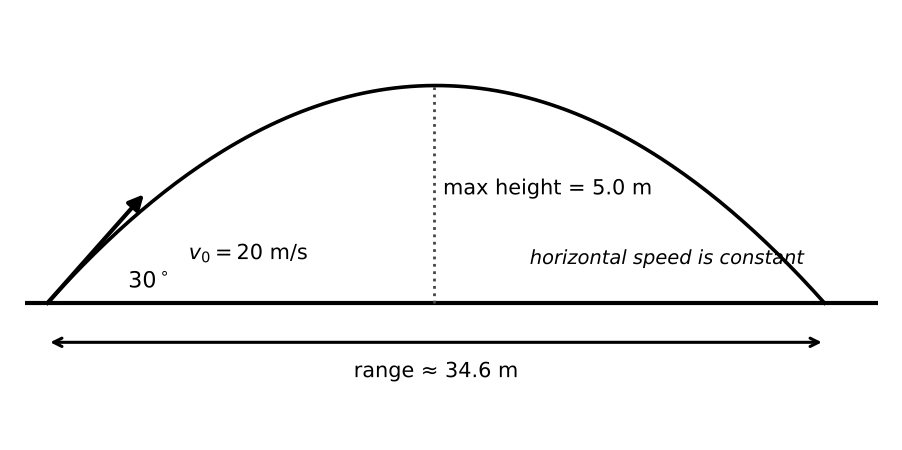
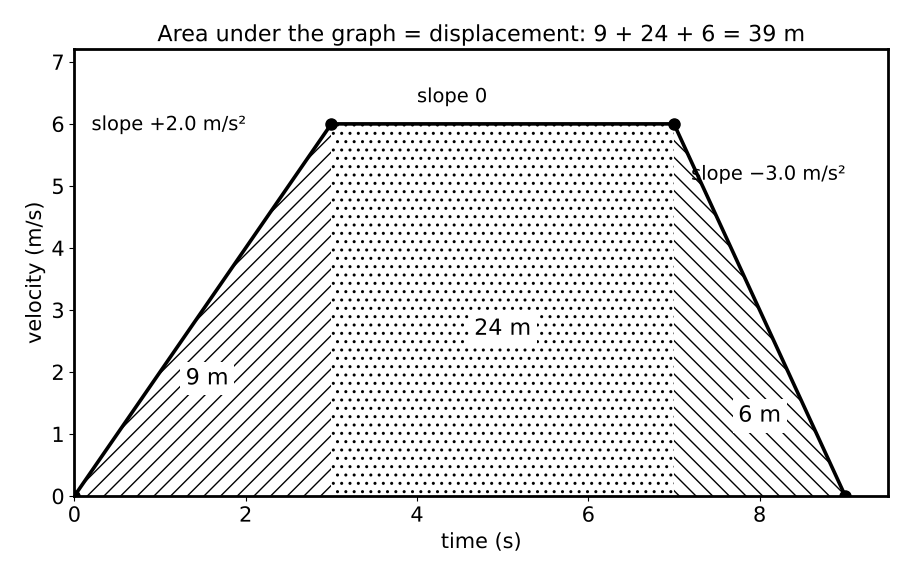

# Lesson 1: Motion in One and Two Dimensions

**What you will be able to do**

- Tell scalars from vectors, and distance from displacement, speed from velocity.
- Choose the right constant-acceleration equation from the quantities you have and the one you want.
- Read position, velocity and acceleration graphs, including slopes and areas.
- Solve free-fall and projectile problems by treating the horizontal and vertical motions separately.
- Combine velocities with vector addition, as in a swimmer crossing a river.

**Why it matters for the exam**

Motion is the first topic in category 4A (translational motion, forces, work, energy and equilibrium in living systems), and everything else in physics sits on it. It also dresses up well: a blood cell accelerating through a vessel, a sprinter, a jumping frog, a droplet leaving a pipette. The test rarely asks "how long does a ball take to fall?" for its own sake. It asks you to use the same four equations in an unfamiliar costume. This lesson gives you the equations, the graphs, and the habit of splitting motion into independent parts.

Praxis Tip: Treat this lesson as the foundation for the next seven. If you can do motion problems without thinking, the force and energy lessons become a matter of adding one idea at a time, instead of two.

**Concept Review**

**Scalars and vectors.** A **scalar** has only size (a magnitude): distance, speed, time, mass, energy. A **vector** has size and direction: displacement, velocity, acceleration, force. When you add vectors, you must account for direction.

- **Distance** is the total length traveled. **Displacement** is the straight-line change in position from start to finish, with a direction.
- **Speed** is distance divided by time. **Velocity** is displacement divided by time.
- A runner who completes a lap of a 400 m track in 80 s has an average speed of 5 m/s and an average velocity of zero, because the displacement is zero. The runner is tired in either case.

Praxis Tip: Whenever a question says "displacement" or "velocity," ask whether the starting and ending points are the same. If they are, the answer for the whole trip is zero.

**Average and instantaneous values.** Average velocity is displacement divided by the time interval: v_avg = Δx / Δt. Instantaneous velocity is the velocity at one moment, which is the slope of the position-time graph at that point. **Acceleration** is the rate of change of velocity: a = Δv / Δt. It is a vector, and it can be nonzero even when the speed is not changing (circular motion; see [Lesson 2](chapter:8)).

**Units and dimensions.** Position: meters (m). Velocity: m/s. Acceleration: m/s². A quick consistency check: a correct formula for distance must have the dimension of length. For example, v t has (m/s)(s) = m; ½ a t² has (m/s²)(s²) = m. A formula that fails this test is wrong.

Praxis Tip: Check the units of your final answer before you pick a choice. If you were asked for a time and your answer comes out in m/s, a step is missing.

**Components and vector addition.** To work with a vector at an angle θ above the horizontal, resolve it into components: horizontal = magnitude × cos θ, vertical = magnitude × sin θ (see [Strategy: The Quantitative Toolkit](chapter:5)). To add vectors, add their components separately. For two perpendicular vectors, the magnitude of the sum comes from the Pythagorean theorem. To subtract, add the negative.

**Constant acceleration: the four equations.** When acceleration is constant, five quantities describe the motion: displacement Δx, initial velocity v₀, final velocity v, acceleration a, and time t. Each of these four equations contains four of the five, leaving one out:

1. v = v₀ + a t  (no Δx)
2. Δx = v₀ t + ½ a t²  (no v)
3. v² = v₀² + 2 a Δx  (no t)
4. Δx = ½ (v₀ + v) t  (no a)

Pick the equation that omits the quantity you neither know nor want.

Praxis Tip: List the five quantities on your scratch paper and note which you know, which you want, and which is missing. The missing one tells you which equation to use. It takes five seconds and almost never fails.

**Free fall.** Near Earth's surface, with air resistance ignored, every object accelerates downward at g ≈ 9.8 m/s² (use 10 m/s² for estimates). The motion up and down is symmetric: an object thrown straight up returns to its starting height with the same speed it had on launch, and the time up equals the time down. At the very top, the velocity is momentarily zero but the acceleration is still g, downward.

Praxis Tip: At the top of a vertical throw, velocity is zero and acceleration is not. This is among the most commonly tested confusions in all of physics.

**Reading motion graphs.**

| Graph | Slope gives | Area under the curve gives |
|---|---|---|
| Position vs time | velocity | (not usually used) |
| Velocity vs time | acceleration | displacement |
| Acceleration vs time | (rate of change of acceleration, rarely used) | change in velocity |

A horizontal line on a velocity-time graph means constant velocity. A straight sloped line means constant acceleration. A curve means changing acceleration. Area below the time axis counts as negative displacement.

*Figure: A projectile: horizontal velocity stays constant while vertical velocity changes at g.*

**Projectile motion.** A projectile moves under gravity alone. The key idea: the horizontal and vertical motions are **independent**.

- Horizontally: no acceleration, so constant velocity. x = v_x t.
- Vertically: constant downward acceleration g, so the free-fall equations apply.

For a launch at speed v and angle θ above the horizontal from level ground:

- v_x = v cos θ and v_y = v sin θ
- time of flight = 2 v_y / g
- maximum height = v_y² / (2g)
- range = v_x × time of flight = v² sin(2θ) / g (maximum at 45° when launch and landing heights are equal)

Launch angles that add to 90° (such as 30° and 60°) give the same range at the same speed, but the larger angle gives the greater height and the longer time in the air.

Praxis Tip: Time is the only quantity that links the horizontal and vertical halves. Solve one half for time, then carry the time over to the other.

**Relative velocity.** Velocities add as vectors. If a boat moves at velocity v_b relative to the water, and the water moves at velocity v_w relative to the ground, the boat's velocity relative to the ground is v_b + v_w. The component of motion perpendicular to the current is not affected by the current; the component along the current is.

*Figure: On a velocity-time graph, slope is acceleration and area is displacement.*

**Worked Example 1: Constant acceleration (skill: choosing the equation)**

A car speeds up from 10 m/s to 30 m/s in 8.0 s with constant acceleration. Find the acceleration and the distance covered.

*Known:* v₀ = 10 m/s, v = 30 m/s, t = 8.0 s. *Wanted:* a and Δx.

*Acceleration (equation 1):* a = (v − v₀)/t = (30 − 10)/8.0 = 2.5 m/s².

*Distance (equation 4, which omits a, so it is independent of the first answer):* Δx = ½ (10 + 30)(8.0) = 160 m.

*Check with equation 3:* v² = v₀² + 2 a Δx gives 900 = 100 + 2(2.5)(160) = 100 + 800 = 900 ✓.

*Skill used:* choosing the equation by what is missing, then verifying with a second equation.

Praxis Tip: Use the equation that avoids your first answer for the second part. If the first part contains an arithmetic slip, a second part built on it inherits the slip.

**Worked Example 2: Free fall (skill: symmetry and estimation)**

A stone is dropped from the top of a 45 m cliff. How long does it take to reach the ground, and how fast is it moving then? (Use g = 10 m/s².)

*Known:* v₀ = 0, a = 10 m/s² (downward positive), Δx = 45 m. *Wanted:* t and v.

*Time (equation 2 with v₀ = 0):* 45 = ½ (10) t², so t² = 9 and t = 3.0 s.

*Speed:* v = g t = 10 × 3.0 = 30 m/s.

*Check (equation 3):* v² = 2 g Δx = 2 × 10 × 45 = 900, so v = 30 ✓.

*Estimation habit:* 45 m is an unusually friendly number, √9 = 3. When an exam picks nice numbers, it is telling you the intended route.

**Worked Example 3: A projectile (skill: independent components)**

A ball is kicked from level ground at 20 m/s, 30° above the horizontal. Ignore air resistance. Find the time in the air, the maximum height and the range. (g = 10 m/s².)

*Components:* v_x = 20 cos 30° ≈ 17.3 m/s; v_y = 20 sin 30° = 10 m/s.

*Time of flight:* 2 v_y / g = 2 × 10 / 10 = 2.0 s.

*Maximum height:* v_y² / (2g) = 100 / 20 = 5.0 m.

*Range:* v_x × t = 17.3 × 2.0 ≈ 34.6 m.

*Check.* Using range = v² sin(2θ)/g = 400 × sin 60° / 10 = 40 × 0.866 = 34.6 m ✓. A ball launched at 60° with the same speed would land in the same place, spend 2 × 17.3 / 10 = 3.46 s in the air, and reach 15 m high (17.3² / 20 ≈ 15 m).

*Skill used:* solving two one-dimensional problems linked only by time.

**Worked Example 4: Reading a velocity-time graph (skill: slopes and areas)**

An object's velocity rises uniformly from 0 to 6.0 m/s over 3.0 s, stays at 6.0 m/s for 4.0 s, then falls uniformly to 0 over 2.0 s. Find the acceleration in each stage and the total displacement.

*Accelerations (slopes):* stage 1: 6.0 / 3.0 = +2.0 m/s². Stage 2: 0. Stage 3: (0 − 6.0)/2.0 = −3.0 m/s².

*Displacement (areas):* stage 1 triangle: ½ × 3.0 × 6.0 = 9.0 m. Stage 2 rectangle: 4.0 × 6.0 = 24 m. Stage 3 triangle: ½ × 2.0 × 6.0 = 6.0 m. Total = 9.0 + 24 + 6.0 = 39 m.

*Check.* Average velocity = 39 m / 9.0 s ≈ 4.3 m/s, which is below the peak velocity of 6.0 m/s, as it must be.

**Worked Example 5: A swimmer in a current (skill: relative velocity)**

A swimmer heads straight across a 60 m wide river at 1.5 m/s relative to the water. The current flows at 2.0 m/s parallel to the banks. How long does the crossing take, how far downstream does the swimmer land, and what is the swimmer's speed relative to the bank?

*Crossing time:* only the cross-stream component matters: 60 / 1.5 = 40 s.

*Downstream drift:* 2.0 m/s × 40 s = 80 m.

*Speed relative to the bank:* the two components are perpendicular, so √(1.5² + 2.0²) = √(2.25 + 4.0) = √6.25 = 2.5 m/s.

*Skill used:* treating perpendicular components independently, then combining them with the Pythagorean theorem.

Praxis Tip: The current does not change how long the crossing takes. It only changes where the swimmer lands. People are often surprised by this, including some river guides.

**More Praxis Tips**

Praxis Tip: Draw a quick sketch with a coordinate system and a sign convention before any motion problem. Decide "up is positive" once, then keep to it, including for g.

Praxis Tip: For two-stage problems (accelerate, then coast), solve each stage separately. The final velocity of stage one is the initial velocity of stage two.

Praxis Tip: When a question gives you the answer in "seconds" but you got a negative time, you have a sign-convention slip. Time is not negative, even on Mondays.

Praxis Tip: Use graph areas to find displacement when the motion is piecewise. Triangles and rectangles beat equations for a staged journey.

Praxis Tip: On a position-time graph, a steeper line is a faster object. A line that curves upward (for motion in the positive direction) is speeding up. Draw the slope with a pencil to be sure.

**Common Mistakes**

- Confusing distance with displacement, and speed with velocity.
- Using the constant-acceleration equations when acceleration is changing.
- Thinking acceleration is zero at the top of a toss.
- Forgetting that horizontal velocity in a projectile stays constant.
- Mixing up the sign of g when "up" is positive.
- Using range = v² sin(2θ)/g when the launch and landing heights differ.
- Treating a slope as an area, or the reverse.

**Checkpoint Questions**

1. A runner completes one lap of a 400 m track in 80 s. For the whole lap, the runner's average speed and the magnitude of average velocity are
   A. both 5 m/s
   B. speed 0, velocity 5 m/s
   C. speed 5 m/s, velocity 0
   D. both 0

2. A ball is thrown straight up. At the highest point of its path, ignoring air resistance, its velocity and acceleration are
   A. velocity zero, acceleration 10 m/s² downward
   B. velocity zero, acceleration zero
   C. velocity upward, acceleration upward
   D. velocity downward, acceleration zero

3. A car moving at 20 m/s brakes uniformly and stops in 5.0 s. How far does it travel while braking?
   A. 4 m
   B. 20 m
   C. 40 m
   D. 50 m

4. Two balls are launched from level ground with the same speed, one at 30° and one at 60° above the horizontal. Ignoring air resistance, which statement is true?
   A. The 30° ball travels farther.
   B. They land at the same distance, but the 60° ball is in the air longer.
   C. They land at the same distance and spend the same time in the air.
   D. The 60° ball travels farther.

5. On a velocity-time graph, an object's velocity is a constant +4.0 m/s from t = 0 to t = 6.0 s. What is its displacement during this time?
   A. 4.0 m
   B. 10 m
   C. 24 m
   D. 48 m

6. An airplane flies due north at 100 m/s relative to the air. A wind blows due east at 100 m/s. The plane's speed relative to the ground is closest to
   A. 140 m/s
   B. 100 m/s
   C. 200 m/s
   D. 0 m/s

7. A ball rolls off a horizontal table 1.25 m high with a horizontal speed of 4.0 m/s. Ignoring air resistance (g = 10 m/s²), how far from the base of the table does it land?
   A. 0.5 m
   B. 1.0 m
   C. 1.5 m
   D. 2.0 m

---

**Stop here.** Answer every question on scratch paper before you read the reasons.

**Answers and reasons**

1. **C.** Average speed = 400 m / 80 s = 5 m/s. The displacement is zero (the runner is back at the start), so the average velocity is zero. (A and B each treat distance and displacement as the same thing.)
2. **A.** At the top, the velocity is momentarily zero but gravity still acts, so the acceleration is g downward. (B is the common misconception. C and D confuse direction.)
3. **D.** Average velocity = (20 + 0)/2 = 10 m/s; distance = 10 × 5.0 = 50 m. (A is the deceleration, 20/5 = 4 m/s². B is the initial speed. C does not follow from any correct method.)
4. **B.** Complementary angles (30° and 60°) give equal ranges at equal speed, but the steeper launch has a larger vertical velocity and therefore a longer time of flight. (A and D contradict the range symmetry. C misses the time difference.)
5. **C.** Displacement is the area under the graph: 4.0 × 6.0 = 24 m. (A is the velocity. B is not related. D doubles the area.)
6. **A.** The two velocity components are perpendicular, so the speed is √(100² + 100²) = 141 m/s ≈ 140 m/s. (B ignores the wind. C adds magnitudes as if both were in the same direction.)
7. **D.** Fall time: 1.25 = ½ (10) t², so t² = 0.25 and t = 0.5 s. Horizontal distance = 4.0 × 0.5 = 2.0 m. (A is the fall time. B and C are not derived from the data.)

Praxis Tip: After the checkpoint questions, look at each wrong choice and name the slip (distance versus displacement, sign, unit, wrong equation). Log it in your error log ([Strategy: The Question Method](chapter:4)).

**Teach-Back and Spaced Review**

*Say this aloud in one breath:* "Motion problems split into horizontal and vertical parts that share only time; for constant acceleration I pick the equation that leaves out the quantity I do not have; and graphs give me acceleration from slopes and displacement from areas."

*Review schedule:* revisit this lesson after 1 day (redo Worked Examples 1 and 3 without looking), after 3 days (checkpoint questions from a blank page), after 7 days (a mixed set that includes [Lesson 2](chapter:8) forces problems, where acceleration comes from a net force), and after 21 days (explain the lesson aloud).

*Interleave:* alternate a kinematics problem with a force problem and with a unit-conversion problem from [Strategy: The Quantitative Toolkit](chapter:5).

Praxis Tip: End each study session by writing, from memory, the four constant-acceleration equations and the projectile formulas (time of flight, maximum height, range). Check them against this chapter tomorrow.

---

**Author verification note (remove before publishing)**

- All examples and questions are original. Verified: ½(10 + 30)(8) = 160; (30² − 10²)/(2 × 160) = 2.5; √(2 × 45/10) = 3.0; 20 cos 30° = 17.32; range 34.6 m; areas 9 + 24 + 6 = 39 m; √(1.5² + 2.0²) = 2.5; 60/1.5 = 40 s; drift 80 m; √(100² + 100²) = 141; fall time 0.5 s; distance 2.0 m.
- Answer key positions: C, A, D, B, C, A, D (C 2, A 2, D 2, B 1).
- Content is mapped to category 4A of the published content outline (units and dimensions, vectors and components, speed and velocity, acceleration). Confirm against the current edition of the outline.
- Confirm that the range formula statement (maximum at 45° for equal launch and landing height, symmetric about 45°) is stated with that condition.
