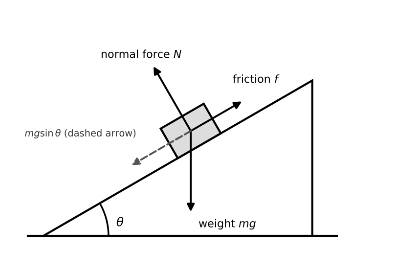

# Lesson 2: Forces, Equilibrium and Torque

**What you will be able to do**

- Draw a correct free-body diagram for any single object and write Newton's second law along each axis.
- Resolve forces on an incline and find acceleration with and without friction.
- Tell static friction from kinetic friction and use each correctly.
- Explain circular motion as a net force toward the center, and compute centripetal acceleration (including in a centrifuge).
- Use the inverse-square law for gravity and recognize the same pattern elsewhere.
- Use torque, lever arms and the center of mass to analyze static equilibrium, including levers in the human body.
- Spot the common wrong answers: the "extra" outward force, the misidentified third-law pair, and the sine/cosine swap.

**Why it matters for the exam**

Force problems rarely appear as "a block on a ramp" alone, although the block on a ramp remains a firm favorite, much like the British weather as a topic of conversation. They show up dressed in biology and lab settings: a centrifuge separating cell components, a bone bearing load, a catheter pulled through a vessel, a particle settling in a tube. The setup changes; the method does not. If you can draw the diagram and write the equation along each axis, you can handle the dressing. Physics is not especially imaginative about this. This lesson builds on [Lesson 1](chapter:7) (vectors and acceleration), and feeds directly into [Lesson 3](chapter:9) (work and energy) and [Lesson 4](chapter:11) (pressure is force per area).

Praxis Tip: Treat every force problem as a three-step routine: diagram, axes, equation. Do it the same way every time, even on easy problems. The routine is what holds up when you are tired in the last hour of the section and your brain has gone to make tea.

**Concept Review**

**Force, mass, and the second law.** A force is a push or pull, and it is a vector: it has a size and a direction. When several forces act on one object, what matters is their vector sum, the **net force**. Newton's second law says the net force on an object equals its mass times its acceleration:

    F_net = m a

The unit is the newton: 1 N = 1 kg·m/s². Because both sides are vectors, the law works along each axis separately: the sum of forces along x equals m·a_x, and the sum along y equals m·a_y. Choosing axes that line up with the motion makes one of those equations trivial.

Praxis Tip: Always make the direction of acceleration one of your axes. On a ramp, tilt the axes so x runs along the slope. The acceleration then lies on one axis only, and the other axis equation is simply "forces add to zero."

**The first law.** If the net force is zero, velocity does not change. That means at rest *or* moving at constant velocity. "Constant speed in a straight line" is equilibrium just as much as sitting still is. Nothing is happening, only more quickly.

Praxis Tip: When a passage says "constant velocity" or "steady speed," translate it immediately into "net force = 0." That one phrase often turns a hard-looking problem into two equal-and-opposite force statements.

**The third law, and why it trips people up.** When object A pushes on object B, B pushes back on A with equal size and opposite direction. These two forces act on *different* objects, so they never cancel each other in a free-body diagram. Newton was quite firm about this, and he did not enjoy being contradicted. A book on a table illustrates it. Earth pulls the book down (its weight). The table pushes the book up (the normal force). These two are *not* a third-law pair, even though they are equal in size when the book is at rest, because both act on the book. The partner of "Earth pulls book down" is "book pulls Earth up." The partner of "table pushes book up" is "book pushes table down."

Praxis Tip: To find a third-law partner, swap the two objects in the sentence: "Earth pulls on book" becomes "book pulls on Earth." If the partner acts on the same object as the original, you have made a mistake.

**Free-body diagrams.** A free-body diagram shows one object, isolated, with an arrow for every force acting *on it*. Steps:

1. Pick the object. Draw it as a dot or box.
2. List the forces on it, by asking what touches it (normal, friction, tension, applied push) and what acts at a distance (gravity).
3. Draw each as an arrow from the object, labeled, in the correct direction.
4. Choose axes. Resolve any angled force into components.
5. Write F_net = m a for each axis.

Praxis Tip: Draw only forces on your chosen object, never forces it exerts on others. Each arrow should answer "what pushes or pulls on my object?" If an arrow describes your object pushing on something else (for example, the block pushing down on the ramp), it belongs to the other object's diagram, not yours.

**Weight, mass and the normal force.** Mass is how much matter the object has and how strongly it resists acceleration; it does not change with location. Weight is the gravitational force on the object: W = m g, with g ≈ 9.8 m/s² at Earth's surface. The **normal force** N is the contact force from a surface, always perpendicular to that surface. It is *not* automatically equal to the weight. It is whatever the surface must supply to prevent the object from sinking into it. The floor is simply doing its job, without complaint, as is traditional. On a flat floor with nothing else vertical, N = m g. On an incline, or with an extra push or an upward acceleration, N changes.

Praxis Tip: Never write "N = mg" from habit. Write the y-equation first (sum of forces along y = m a_y) and solve for N from that.

**Friction.** Friction acts parallel to the surface and opposes sliding (or the tendency to slide).

- **Static friction** acts while the surfaces are not slipping. It adjusts to match whatever is needed, up to a maximum: f_s ≤ μ_s N.
- **Kinetic friction** acts once sliding starts, with a fixed size: f_k = μ_k N.

For a given pair of surfaces, μ_s is usually larger than μ_k, which is why it takes more effort to start a heavy box moving than to keep it moving. Anyone who has tried to push a wardrobe will confirm this with feeling. Notice that friction depends on N, not directly on weight or on contact area at this level of treatment.

Praxis Tip: If the object is not moving, do not automatically use f = μN. Static friction is only *at most* μ_s N. Use the equilibrium equations to find how much friction is actually needed, then compare with the maximum.

*Figure: Forces on an incline: mg sin θ down the slope, mg cos θ into it, friction up the slope.*

**Inclines.** On a ramp at angle θ above the horizontal, replace the weight with two components: m g sin θ *along* the slope (down the slope) and m g cos θ *perpendicular* to it (into the slope). Then:

- N = m g cos θ (if nothing else pushes perpendicular to the ramp)
- Without friction, acceleration down the slope is a = g sin θ.
- With kinetic friction, a = g (sin θ − μ_k cos θ).
- An object starts to slip when tan θ exceeds μ_s, so the critical angle satisfies tan θ = μ_s.

Praxis Tip: Check your sine/cosine assignment with two extreme cases. At θ = 0 (flat), nothing should pull along the surface: sin 0 = 0, good, so sine goes with the along-slope part. At θ = 90° (a vertical wall), all of the weight should be along the "slope": sin 90° = 1, good.

**Tension and pulleys.** A rope pulls along its length with a tension T. An ideal rope (massless, not stretching) carries the same tension throughout, and an ideal frictionless pulley only changes its direction. For two masses over a pulley, write Newton's second law for each mass separately, with the same acceleration magnitude, and solve.

Praxis Tip: For connected objects, first decide which way the system will accelerate and *call that direction positive for both*. Mixed sign conventions are the number one source of algebra errors in pulley problems.

**Circular motion.** An object moving in a circle of radius r at speed v is accelerating, even at constant speed, because its direction keeps changing. The acceleration points toward the center and has size

    a_c = v² / r

so the net force toward the center must be F_c = m v² / r. **Centripetal force is not a new kind of force.** It is the name for whichever real forces (tension, friction, gravity, normal force) add up to point toward the center. Do not draw it as a separate arrow in addition to those. There is also no real outward force acting on the object; the feeling of being thrown outward in a turning car is your body's inertia trying to continue in a straight line. Your body is not being thrown anywhere; it is merely declining to cooperate.

If the string is cut, the object leaves along a straight line *tangent* to the circle at that point, not outward along the radius.

For rotation described by angular speed ω (in rad/s), v = ω r, so a_c = ω² r. To convert revolutions per minute to rad/s, multiply by 2π/60.

Praxis Tip: When speed or radius changes in a circular motion question, do not recompute from scratch. Use proportional reasoning: force goes as v² and as 1/r. Double the speed and the required force quadruples. Half the radius and it doubles.

**Gravitation.** Every two masses attract with a force

    F = G m₁ m₂ / r²

where r is the distance between centers. This is an **inverse-square law**: double the distance and the force drops to one quarter; triple it and the force is one ninth. Gravity is, in this respect, much like a distant relative: the further away, the less it bothers you. The same inverse-square pattern appears for the electric force in [Lesson 5](chapter:12), so learning it once pays twice.

Praxis Tip: Memorize the shape "1/r²" and the scaling table (×2 distance gives ÷4, ×3 gives ÷9, ×½ gives ×4). Most questions are about the ratio, so you rarely need the value of G.

**Torque, center of mass, and static equilibrium.** A force can change an object's rotation as well as its motion. The **torque** of a force about a pivot is

    τ = r F sin θ

where r is the distance from the pivot to the point where the force acts and θ is the angle between the force and the line from the pivot. The quantity r sin θ is the **lever arm**, the perpendicular distance from the pivot to the line of the force. Torque is measured in newton-meters (N·m). By convention, torques that would turn the object counterclockwise are positive and clockwise are negative (or the reverse; pick one and say so).

An object is in **static equilibrium** when two conditions hold: the net force is zero, and the net torque about any chosen point is zero. Because the torque condition holds about *any* point, you may choose the pivot to be the point where an unknown force acts. That removes the unknown from the torque equation, which is the sharpest shortcut in this lesson.

The **center of mass** is the point at which an object's weight can be treated as acting. For a uniform object it is at the geometric center. For point masses along a line, x_cm = (m₁x₁ + m₂x₂ + ...) / (m₁ + m₂ + ...). A lever is any rigid body that can rotate about a pivot, and the ratio of the output force to the input force is its **mechanical advantage** ([Lesson 3](chapter:9) returns to this).

Praxis Tip: When a rotation problem has an unknown force at some point, take torques about that point. The unknown has a lever arm of zero and vanishes from the equation.

Praxis Tip: Draw the line of action of the force and then drop the perpendicular from the pivot. That perpendicular length is your lever arm. Using the whole distance to the pivot when the force is angled is the classic slip.

**Drag and terminal velocity.** A fluid pushes back against a moving object, and the push grows with speed. A falling object speeds up until the drag equals its weight. At that point net force is zero, so it falls at constant velocity: the **terminal velocity**. This is the same reasoning that describes a cell settling slowly through a solution.

Praxis Tip: Whenever you see "reaches a constant speed" in a passage with a resisting medium, write "drag = driving force" and stop. You do not need the drag formula.

**Worked Example 1: A crate on an incline (skill: resolve forces, find a)**

A 20 kg crate slides down a 30° incline. The coefficient of kinetic friction is 0.20. Find its acceleration.

*Step 1, diagram.* Three forces act on the crate: weight (straight down), normal force (perpendicular to the slope, away from it), and kinetic friction (up the slope, opposing the sliding).

*Step 2, axes.* Put x along the slope (down-slope positive) and y perpendicular to it.

*Step 3, y-equation.* Nothing accelerates perpendicular to the slope, so
N − m g cos θ = 0, giving N = (20)(9.8)(cos 30°) = (20)(9.8)(0.866) ≈ 170 N.

*Step 4, friction.* f_k = μ_k N = 0.20 × 170 ≈ 34 N, directed up the slope.

*Step 5, x-equation.* m g sin θ − f_k = m a, so
(20)(9.8)(0.5) − 34 = 98 − 34 = 64 N = 20 a, giving a ≈ 3.2 m/s² down the slope.

*Check.* The shortcut formula gives a = g (sin θ − μ_k cos θ) = 9.8 (0.50 − 0.20 × 0.866) = 9.8 × 0.327 ≈ 3.2 m/s². ✓ Mass cancels, which is why the answer is the same for any crate. The crate is unmoved by this news.

Praxis Tip: Notice that the mass canceled. On the exam, when every force in a problem is proportional to m (weight components and friction), you can skip the number entirely and compute with g alone.

*Exam skill used:* applying a model (forces on an incline) to a new situation, then checking the result with a second method.

**Worked Example 2: A centrifuge (skill: connect rotation to force)**

A sample sits 0.10 m from the axis of a centrifuge spinning at 6000 revolutions per minute. How large is its centripetal acceleration, in multiples of g?

*Step 1, convert units.* 6000 rev/min = 100 rev/s. ω = 2π × 100 ≈ 628 rad/s.

*Step 2, speed.* v = ω r = 628 × 0.10 ≈ 62.8 m/s.

*Step 3, acceleration.* a_c = ω² r = (628)² × 0.10 ≈ 3.95 × 10⁵ × 0.10 ≈ 3.9 × 10⁴ m/s². (Check with v²/r = (62.8)²/0.10 ≈ 3.9 × 10⁴ m/s². ✓)

*Step 4, express in g.* 3.9 × 10⁴ ÷ 9.8 ≈ 4.0 × 10³. The sample experiences about 4000 g. This is considerably more than a rollercoaster, and it is quieter about it.

*What if the rpm doubles?* Acceleration scales as ω², so it quadruples to about 16,000 g. You can state that without redoing the arithmetic.

Praxis Tip: Learners often forget the 2π/60 conversion, and then proceed with great confidence to the wrong answer. Do it first, write the result down, and circle it. A wrong ω ruins every later step.

*Exam skill used:* unit conversion, then proportional reasoning to answer "what if" variants quickly.

**Worked Example 3: Two masses over a pulley (skill: connected objects)**

A 3.0 kg mass and a 5.0 kg mass hang from opposite ends of a rope over a frictionless, massless pulley. Find the acceleration and the tension.

*Step 1.* The heavier mass will go down, so take "5 kg moves down, 3 kg moves up" as positive for both.

*Step 2, equations.*
5.0 kg mass: m₂ g − T = m₂ a
3.0 kg mass: T − m₁ g = m₁ a

*Step 3, add them.* The tensions cancel: (m₂ − m₁) g = (m₁ + m₂) a. So a = (5.0 − 3.0)(9.8)/(8.0) = 2.45 m/s² ≈ 2.5 m/s².

*Step 4, tension.* T = m₁ (g + a) = 3.0 (9.8 + 2.45) ≈ 37 N.

*Check.* From the other mass, T = m₂ (g − a) = 5.0 (9.8 − 2.45) ≈ 37 N. ✓ Note T is *less* than the heavier weight (49 N) and *more* than the lighter weight (29 N), as it must be.

Praxis Tip: Always run the "between" check: tension in an accelerating pulley system sits between the two weights. If your answer falls outside, you have a sign error.

*Exam skill used:* setting up simultaneous equations and checking the answer for reasonableness. The 5 kg mass will win. This is not a close contest.

**Worked Example 4: The forearm as a lever (skill: torque balance)**

A person holds a 5.0 kg mass in the hand with the forearm horizontal. The biceps tendon attaches 4.0 cm from the elbow, and the hand is 35 cm from the elbow. Ignore the weight of the forearm. What force must the biceps exert? (Use g = 10 m/s².)

*Step 1, forces and pivot.* The elbow is the pivot. The weight of the mass is 5.0 × 10 = 50 N, acting down at 0.35 m. The biceps pulls up at 0.040 m. The joint also supplies a force at the elbow, but it has a lever arm of zero about the elbow, so it drops out.

*Step 2, torques about the elbow.* The biceps torque (counterclockwise) balances the weight's torque (clockwise):

F × 0.040 = 50 × 0.35, so F = 17.5 / 0.040 = 437.5 N ≈ 440 N.

*Check.* The biceps force is about 8.75 times the weight it holds (0.35 / 0.040 = 8.75). The body trades force for reach and speed: a short lever arm for the muscle means a large muscle force, but a small muscle contraction moves the hand a long way.

*Skill used:* choosing the pivot to eliminate an unknown, and checking the answer against the lever-arm ratio.

Praxis Tip: The ratio of lever arms gives the answer before you multiply anything: 0.35 / 0.040 is almost 9, so the force must be almost nine times the 50 N load. Estimate first.

**Common Mistakes**

- Drawing an extra "centrifugal" or "centripetal" arrow on top of the real forces. The forces are already there; they do not need reinforcements.
- Naming the normal force as the third-law partner of weight.
- Writing N = mg on a ramp or in an accelerating elevator.
- Swapping sin and cos on an incline.
- Using f = μN for an object that is not slipping (static friction is only "up to" μ_s N).
- Forgetting that constant velocity means zero net force, not zero motion.
- Doubling the distance in an inverse-square law and halving the force instead of quartering it.
- Mixing units in rotation problems (rpm treated as rad/s).
- Using the whole distance to the pivot as the lever arm when the force is angled to the lever.
- Taking torques about a point that leaves the unknown force in the equation, when a better pivot was available. The units will notice.

**Checkpoint Questions**

1. A book rests on a table. Which force is the third-law partner of Earth's gravitational pull on the book?
   A. The book's gravitational pull on Earth
   B. The table's upward push on the book
   C. The book's downward push on the table
   D. The Earth's upward push on the table

2. A box begins to slide when a plank is tilted to 25°. What is the approximate coefficient of static friction between the box and plank?
   A. 0.42
   B. 0.91
   C. 0.21
   D. 0.47

3. A satellite's orbit is changed so that its distance from Earth's center doubles. How does the gravitational force on it change?
   A. It is halved
   B. It doubles
   C. It becomes one quarter
   D. It quadruples

4. A stone on a string is swung in a horizontal circle at constant speed. The string snaps. Immediately afterward, the stone moves
   A. in a straight line tangent to the circle
   B. radially outward, away from the center
   C. along a curve that continues inward
   D. backward along the circle's path

5. A 60 kg person stands on a bathroom scale in an elevator that is accelerating upward at 2.0 m/s². What is the scale's reading, in newtons? (g = 9.8 m/s²)
   A. 120 N
   B. 708 N
   C. 588 N
   D. 468 N

6. A car rounds a flat circular curve, with friction providing the entire centripetal force. If the car's speed doubles on the same curve, the friction force required
   A. doubles
   B. is halved
   C. is unchanged
   D. quadruples

7. A skydiver falls at terminal velocity. Which statement is correct?
   A. Air drag is greater than her weight
   B. Air drag is zero
   C. Air drag is equal to her weight
   D. Her weight is zero

8. A uniform seesaw balances on a pivot at its center. A 300 N child sits 1.5 m to the left of the pivot. How far to the right of the pivot must a 450 N child sit for the seesaw to balance?
   A. 0.75 m
   B. 1.0 m
   C. 1.5 m
   D. 2.25 m

---

**Stop here.** Answer every question on scratch paper before you read the reasons.

**Answers and reasons**

1. **A.** Swap the objects: Earth pulls book, so book pulls Earth. (B is a force on the same object as the weight; it only equals weight in equilibrium. C is the partner of B. D is unrelated.)
2. **D.** At the critical angle, μ_s = tan θ = tan 25° ≈ 0.47. (A uses sin 25° ≈ 0.42, the wrong function. B uses cos 25° ≈ 0.91. C is half of 0.42, which has no basis.)
3. **C.** Inverse square: (1/2)² = 1/4.
4. **A.** With no net force, the stone keeps the velocity it had at that instant, which is tangent to the circle. (B is the "thrown outward" misconception.)
5. **B.** N − mg = ma, so N = m (g + a) = 60 × 11.8 = 708 N. (C is the at-rest reading. D is the reading for a downward acceleration. A is just ma.)
6. **D.** F_c = m v² / r, so doubling v multiplies the force by 4.
7. **C.** At terminal velocity, acceleration is zero, so drag balances weight.
8. **B.** Balance torques about the pivot: 300 × 1.5 = 450 × d, so d = 450 / 450 = 1.0 m. (C assumes equal distances. D inverts the ratio. A halves the left distance without a reason.)

Praxis Tip: After checkpoint questions, look at your *wrong* choices and name the exact slip (wrong function, wrong pair, wrong sign). Record that name in your error log from [Strategy 4](chapter:4). The pattern of slips tells you what to drill.

**Teach-Back and Spaced Review**

*Say this aloud in one breath:* "To solve any force problem, I draw the object alone, mark every force on it, pick axes along the acceleration, and write F_net = m a for each axis; circular motion just means the net force points to the center with size m v² over r."

*Review schedule:* revisit this lesson after 1 day (redo the four worked examples without looking), after 3 days (checkpoint questions from a blank page), after 7 days (one mixed set that includes [Lesson 1](chapter:7) motion problems), and after 21 days (explain the lesson aloud to someone, or to an empty room).

*Interleave:* alternate one force problem with one kinematics problem and one fluids or pressure problem from [Lesson 4](chapter:11). Mixing topics feels harder and makes recall more reliable later.

Praxis Tip: End each study session by writing, from memory, the six formulas you most expect to use: F_net = m a, f_k = μ_k N, a_c = v²/r, F = G m₁ m₂ / r², tan θ_crit = μ_s, and τ = r F sin θ. Check them against this chapter tomorrow.

---

**Author verification note (remove before publishing)**

- Original content: all examples and questions are original; no passages were drawn from outside sources, so no ledger entry is needed for this chapter.
- Items for a qualified reviewer to re-check: sin 30° = 0.5 and cos 30° = 0.866; the incline result a ≈ 3.2 m/s²; the centrifuge result ≈ 4.0 × 10³ g from 6000 rpm at 0.10 m; the pulley results a ≈ 2.45 m/s² and T ≈ 37 N; the biceps force 437.5 N (50 × 0.35 / 0.040); tan 25° ≈ 0.47; the elevator reading 708 N; the seesaw distance 1.0 m; and that the answer key letters match the explanations. Answer positions: A, D, C, A, B, D, C, B.
- Confirm that the chapter's depth and the claim that μ_s is "usually larger" than μ_k fit the exam's published content outline for the intended edition.
- Style check: confirm cross-reference chapter numbers (7, 9, 11, 12, 4) match the final outline numbering.
