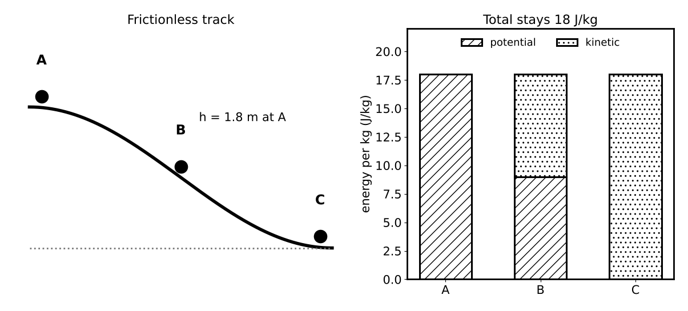

# Lesson 3: Work, Energy and Power

**What you will be able to do**

- Calculate the work done by a force, including angled and opposing forces, and say when work is positive, negative or zero.
- Use the work-energy theorem and conservation of mechanical energy to find speeds and heights without tracking forces.
- Account for energy lost to friction and other nonconservative forces.
- Compute power, and connect mechanical work to the energy a body must take in as food.
- Use mechanical advantage to trade force for distance.

**Why it matters for the exam**

This lesson finishes category 4A (translational motion, forces, work, energy and equilibrium in living systems). Energy methods are the shortcut through problems that look ruinous in force language: a roller coaster, a pendulum, a bouncing ball, a muscle lifting a load. Instead of tracking a changing force along a curved path, you compare the energy at two moments. The exam also likes to attach energy to living systems, where the "fuel" is food and the efficiency is modest.

Praxis Tip: If a problem gives you heights and speeds at two points but says nothing about time, reach for energy before you reach for forces. Energy ignores the path, which is exactly why it is useful.

**Concept Review**

**Work.** When a constant force F acts on an object that moves a distance d, the work done by that force is

    W = F d cos θ

where θ is the angle between the force and the displacement. The unit is the joule (J): 1 J = 1 N·m = 1 kg·m²/s². Work is a scalar.

- A force along the motion (θ = 0°) does positive work: W = F d.
- A force against the motion (θ = 180°) does negative work: W = −F d. Friction usually does negative work on a sliding object.
- A force perpendicular to the motion (θ = 90°) does zero work. The normal force on a block sliding on a level surface, and the tension on a stone swung in a circle, do no work.
- If the displacement is zero, no work is done, however hard you push. Holding a heavy box motionless is tiring, and it is also zero work in the physics sense, which is perhaps the least fair definition in science.

Praxis Tip: Ask two things of every force in a problem: which way does it point, and which way does the object move? Their angle fixes the sign of the work. Do this before you calculate anything.

**Kinetic energy and the work-energy theorem.** The kinetic energy of an object of mass m moving at speed v is

    KE = ½ m v²

Kinetic energy depends on the square of the speed, so doubling the speed quadruples the energy. The **work-energy theorem** states that the net work done on an object equals its change in kinetic energy:

    W_net = ΔKE = ½ m v_f² − ½ m v_i²

If the net work is zero, the speed does not change. That is why a box pushed at constant speed across a rough floor has zero net work: the push does positive work, friction does an equal amount of negative work, and the sum is nothing.

**Potential energy and conservative forces.** A force is **conservative** if the work it does between two points does not depend on the path taken (gravity, the spring force and the electric force are examples). For a conservative force, we define a potential energy:

- Gravitational (near Earth's surface): PE = m g h, measured from a chosen reference height.
- Spring: PE = ½ k x², where k is the spring constant (N/m) and x is the stretch or compression from the relaxed length.

Friction and drag are **nonconservative**: the work they do depends on the path, and they turn mechanical energy into thermal energy.

*Figure: Kinetic and potential energy trade places; their sum stays constant without friction.*

**Conservation of energy.** When only conservative forces do work, the total mechanical energy is constant:

    KE_i + PE_i = KE_f + PE_f

When nonconservative forces also do work (such as friction), the change in mechanical energy equals that work:

    KE_i + PE_i + W_nc = KE_f + PE_f

Here W_nc is negative for friction, so the final mechanical energy is smaller. The "missing" energy has not vanished; it appears as heat. Total energy, including thermal energy, is always conserved.

Praxis Tip: Write the energy equation in words before you write symbols: "energy at the start plus work by friction equals energy at the end." If you cannot say it in words, you will not get it right in symbols.

**Power.** Power is the rate of doing work:

    P = W / t = F v (for a constant force along the motion)

The unit is the watt (W): 1 W = 1 J/s. Power measures how quickly energy is transferred. Two people can do the same work, such as climbing the same stairs, but the faster climber produces more power.

Praxis Tip: Hold on to P = F v. It lets you move from force to power without going through work and time, and it turns up when a question gives you a speed.

**Energy and living systems.** A body does mechanical work by converting chemical energy from food. Only a fraction of that chemical energy becomes useful work; the rest warms the body. Human muscles are commonly described as roughly 20 to 25 percent efficient, with the exact figure depending on the activity. Food energy is often quoted in Calories (kilocalories): 1 kcal = 4,184 J.

**Mechanical advantage.** A simple machine (lever, ramp, pulley) can reduce the force you need by increasing the distance over which you apply it. For an ideal machine, with no friction, the work in equals the work out:

    F_in × d_in = F_out × d_out

so the mechanical advantage MA = F_out / F_in = d_in / d_out. Real machines lose some work to friction, so the real MA is less than the ideal. No machine multiplies work; it only trades force for distance.

**A short note on momentum (optional).** Linear momentum p = m v, and a net force changes it according to F Δt = Δp (the impulse). In a collision with no external forces, total momentum is conserved. This book's reading of the exam owner's published content list for this category does not show momentum as a named topic, so treat it as a short extra: useful for recoil and collision questions, but not a priority. [VERIFY against the current outline]

**Worked Example 1: Work by an angled force (skill: the cosine)**

A person pulls a box along a level floor by a rope that makes an angle of 60° with the horizontal. The tension is 50 N and the box moves 10 m. How much work does the rope do?

W = F d cos θ = 50 × 10 × cos 60° = 500 × 0.5 = 250 J.

Only the horizontal component of the pull (25 N) does work along the motion. The vertical component (43 N) lifts partly against the weight but does no work along the direction of travel.

*Skill used:* connecting the cosine in the formula to the component of the force along the displacement.

**Worked Example 2: Energy conservation (skill: skipping the path)**

A small ball is released from rest at a height of 1.8 m on a frictionless curved track. What is its speed at the bottom? (g = 10 m/s².)

Take the bottom as the reference height. Initial: KE = 0, PE = m g h. Final: PE = 0, KE = ½ m v².

m g h = ½ m v², so v = √(2 g h) = √(2 × 10 × 1.8) = √36 = 6.0 m/s.

The mass cancels, and the shape of the track does not matter. A straight ramp, a bowl and a swoop all give the same speed.

*Skill used:* comparing two states and ignoring the path.

**Worked Example 3: A spring launch (skill: spring potential energy)**

A 0.50 kg block is pressed against a spring (k = 200 N/m), compressing it by 0.10 m. The block is released on a frictionless horizontal surface. What is its speed when it leaves the spring?

Spring PE = ½ k x² = ½ × 200 × (0.10)² = 1.0 J. All of it becomes kinetic energy: ½ m v² = 1.0, so v² = 2.0 / 0.50 = 4.0 and v = 2.0 m/s.

*Check.* The same result from v = x √(k/m) = 0.10 × √(200/0.50) = 0.10 × √400 = 0.10 × 20 = 2.0 m/s ✓.

**Worked Example 4: Where did the energy go? (skill: nonconservative work)**

A 2.0 kg block slides from rest down a rough incline. It starts 3.0 m above the bottom and reaches the bottom with a speed of 6.0 m/s. How much mechanical energy was converted to heat? (g = 10 m/s².)

Initial energy: m g h = 2.0 × 10 × 3.0 = 60 J (all potential). Final energy: ½ m v² = ½ × 2.0 × 36 = 36 J (all kinetic).

The difference, 60 − 36 = 24 J, was removed by friction: W_nc = −24 J.

*Check.* The speed would have been √(2 × 10 × 3.0) = √60 ≈ 7.7 m/s without friction. The measured 6.0 m/s is lower, as it must be.

**Worked Example 5: Power and food (skill: connecting mechanics to metabolism)**

A 70 kg person climbs stairs that rise 3.0 m in 5.0 s. What is the mechanical power output, and how much food energy is required if the muscles are 25 percent efficient? (g = 10 m/s².)

Work against gravity: m g h = 70 × 10 × 3.0 = 2,100 J. Power = 2,100 / 5.0 = 420 W.

At 25 percent efficiency, the energy required from food is 2,100 / 0.25 = 8,400 J. In kilocalories: 8,400 / 4,184 ≈ 2.0 kcal.

*Reading it.* About 2 kcal for a short flight of stairs sounds small, and it is: a food Calorie is a large unit. The rest of that 8,400 J, about 6,300 J, ends up as body heat.

**Worked Example 6: A pulley system (skill: trading force for distance)**

A pulley system with an ideal mechanical advantage of 4 is used to lift a 400 N load by 0.50 m. What force and what length of rope pull are required?

F_in = F_out / MA = 400 / 4 = 100 N. d_in = MA × d_out = 4 × 0.50 = 2.0 m.

*Check.* Work in = 100 × 2.0 = 200 J; work out = 400 × 0.50 = 200 J ✓. You pull a quarter as hard over four times the distance. Nobody has yet found a way to pull a quarter as hard over the same distance.

**More Praxis Tips**

Praxis Tip: Pick the reference height for potential energy once, at the lowest point of the problem, and leave it there. Heights then come out positive and the algebra stays tidy.

Praxis Tip: For a ball thrown upward, kinetic and potential energy swap places. Sketch a bar chart of KE and PE at three points (start, top, end) and check that the totals match.

Praxis Tip: When a problem includes friction, estimate the answer assuming no friction first. The true result must be lower in speed or height. This catches sign mistakes quickly.

Praxis Tip: To compare energies quickly, remember that speed enters as v². Triple the speed and the energy goes up ninefold.

Praxis Tip: Convert everything to joules before comparing. Mixed calories, joules and kilowatt-hours are the sort of thing exams enjoy.

Praxis Tip: For a body that moves at constant speed up a slope, the work done by your muscles equals the gain in potential energy plus the work done against friction. Net work is zero; your work is not.

**Common Mistakes**

- Calling the normal force or the centripetal force "work-doing" when they are perpendicular to the motion.
- Using F d without the cosine when the force is angled.
- Forgetting to square the speed in kinetic energy.
- Treating the spring's potential energy as proportional to x instead of x².
- Ignoring friction's negative work in an energy equation.
- Confusing power with work, or watts with joules.
- Assuming a machine can multiply work.

**Checkpoint Questions**

1. A 5.0 kg box is pushed 4.0 m across a floor at constant speed by a 20 N horizontal force. Friction is the only other horizontal force on the box. What is the net work done on the box?
   A. 80 J
   B. Zero
   C. −80 J
   D. 20 J

2. A car's speed doubles. Its kinetic energy
   A. doubles
   B. is multiplied by 8
   C. is multiplied by √2
   D. is multiplied by 4

3. A spring is compressed twice as far as before. The elastic potential energy stored in it is
   A. four times as large
   B. twice as large
   C. unchanged
   D. eight times as large

4. A worker pushes a cart with a constant 100 N force. The cart moves at a constant 2.0 m/s. What power does the worker deliver to the cart?
   A. 50 W
   B. 100 W
   C. 200 W
   D. 400 W

5. A pendulum bob is released from rest at a height of 0.20 m above its lowest point. Ignoring air resistance (g = 10 m/s²), its speed at the lowest point is
   A. 1.4 m/s
   B. 4.0 m/s
   C. 0.40 m/s
   D. 2.0 m/s

6. Two identical blocks slide from rest from the same height, one down a smooth incline and one down a rough incline of the same height. At the bottom, the block on the rough incline has
   A. less kinetic energy than the block on the smooth incline
   B. the same kinetic energy, because both lost the same potential energy
   C. more kinetic energy, because friction adds to its speed
   D. zero kinetic energy

7. An ideal pulley system lets a 500 N load be lifted by pulling with a 100 N force. Compared with the distance the load rises, the rope must be pulled
   A. the same distance
   B. 5 times as far
   C. one fifth as far
   D. 25 times as far

---

**Stop here.** Answer every question on scratch paper before you read the reasons.

**Answers and reasons**

1. **B.** At constant speed the net force is zero, so the net work (and the change in kinetic energy) is zero. The push does +80 J and friction does −80 J. (A counts only the work done by the push; C counts only the work done by friction; D multiplies the force by a distance of 1 m instead of 4.0 m.)
2. **D.** KE = ½ m v², so doubling v multiplies KE by 2² = 4. (A treats kinetic energy as proportional to speed; B uses the cube of the speed; C inverts the relationship between energy and speed.)
3. **A.** PE = ½ k x², so doubling x multiplies PE by 4. (B treats the energy like the spring force, which is linear in x; C assumes energy depends only on k; D uses the cube of the compression.)
4. **C.** P = F v = 100 × 2.0 = 200 W. (A divides the force by the speed instead of multiplying; B ignores the speed; D squares the speed.)
5. **D.** m g h = ½ m v², so v = √(2 g h) = √(2 × 10 × 0.20) = √4.0 = 2.0 m/s. (A uses √(g h) and leaves out the factor of 2; B forgets the square root; C multiplies h by 2 and stops.)
6. **A.** Friction does negative work, removing mechanical energy as heat, so less of the initial potential energy ends up as kinetic energy. (B ignores the energy friction converts to heat; C gets the sign of friction's work wrong; D confuses 'less' with 'none'.)
7. **B.** Work in equals work out for an ideal machine: 100 × d_in = 500 × d_out, so d_in = 5 d_out. (A ignores that the machine trades force for distance; C reverses the trade; D squares the ratio.)

Praxis Tip: After the checkpoint questions, look at each wrong choice and name the slip (missing cosine, linear instead of squared, wrong sign, forgotten friction). Log it in your error log ([Strategy: The Question Method](chapter:4)).

**Teach-Back and Spaced Review**

*Say this aloud in one breath:* "Work is force times distance times the cosine of the angle between them; net work changes kinetic energy; where only conservative forces act, kinetic plus potential energy stays constant, and with friction the missing energy becomes heat; power is how fast the work is done."

*Review schedule:* revisit this lesson after 1 day (redo Worked Examples 2 and 3 without looking), after 3 days (checkpoint questions from a blank page), after 7 days (a mixed set that includes [Lesson 1](chapter:7) motion and [Lesson 2](chapter:8) force problems, since energy and kinematics often give the same answer), and after 21 days (explain the lesson aloud).

*Interleave:* alternate an energy problem with a forces problem and a unit-conversion problem. Then take the [mechanics practice set](chapter:10).

Praxis Tip: End each study session by writing, from memory, W = F d cos θ, W_net = ΔKE, KE = ½ m v², PE = m g h, PE = ½ k x², and P = W/t = F v. Check them against this chapter tomorrow.

---

**Author verification note (remove before publishing)**

- All examples and questions are original. Verified: 50 × 10 × cos 60° = 250 J; √(2 × 10 × 1.8) = 6.0; ½ × 200 × 0.01 = 1.0 J and v = 2.0 m/s; 60 − 36 = 24 J; 70 × 10 × 3 = 2,100 J, 420 W; 2,100/0.25 = 8,400 J = 2.0 kcal; pulley: 100 N, 2.0 m, 200 J both sides; √(2 × 10 × 0.20) = 2.0 m/s.
- Answer key positions: B, D, A, C, D, A, B.
- Still open: whether momentum is in scope for the current edition of the content outline.
- Category 4A topics covered: work by a constant force, mechanical advantage, work-kinetic energy theorem, conservative forces, kinetic and potential energy (gravitational and spring), conservation of energy, power and units.
