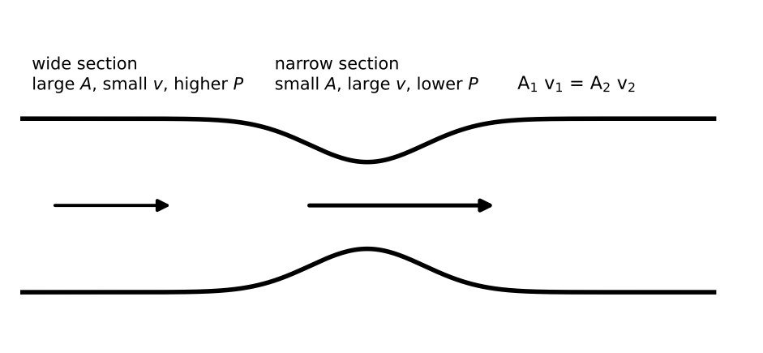

# Lesson 4: Fluids and Circulation

**What you will be able to do**

- Use density, specific gravity and pressure, and convert between pascals, atmospheres and mmHg.
- Calculate pressure at depth, and distinguish gauge pressure from absolute pressure.
- Apply Pascal's principle and Archimedes' principle to hydraulic lifts and floating objects.
- Use the continuity equation and Bernoulli's equation to relate speed, pressure and height in moving fluids.
- Explain how viscosity and vessel radius control flow, and why a small narrowing of an artery matters so much.

**Why it matters for the exam**

Category 4B is about the fluids that keep a body running: blood moving through vessels, air moving into the lungs, gas exchanging across membranes. The physics is the same as for water in a pipe, with a few biological twists. Questions often present a vessel with a narrowing, a pressure measurement, or a sinking and floating comparison, and ask what happens if one quantity changes. The answers come from four relationships and a handful of ratios. This lesson covers fluids as liquids; [Lesson 12](chapter:20) covers gases, which belong to the same category.

Praxis Tip: Most fluid questions are ratio questions in disguise. If you know how each quantity scales (with depth, with radius, with area), you can answer without arithmetic.

**Concept Review**

**Density and specific gravity.** Density is mass per volume: ρ = m / V. Water is about 1,000 kg/m³ (1.0 g/cm³). **Specific gravity** is the ratio of a substance's density to the density of water, so it has no units. A specific gravity below 1 means the substance floats in water; above 1, it sinks.

Praxis Tip: Remember 1.0 g/cm³ = 1,000 kg/m³ and 1 L = 1,000 cm³ = 10⁻³ m³. Many density questions turn on one unit conversion.

**Pressure.** Pressure is force per unit area, P = F / A. The SI unit is the pascal (Pa): 1 Pa = 1 N/m². Common units and conversions:

- 1 atm = 101,325 Pa ≈ 1.01 × 10⁵ Pa
- 1 atm = 760 mmHg = 760 torr
- 1 mmHg ≈ 133 Pa

Blood pressure is quoted in mmHg: a reading of "120 over 80" means 120 mmHg systolic and 80 mmHg diastolic, both measured relative to atmospheric pressure (that is, as gauge pressures).

**Hydrostatic pressure.** In a fluid at rest, the pressure increases with depth:

    P = P₀ + ρ g h

where P₀ is the pressure at the surface (for an open container, atmospheric pressure), ρ is the fluid density, and h is the depth below the surface. The term ρ g h is the **gauge pressure** at depth h; adding P₀ gives the **absolute pressure**. Only the vertical depth matters, not the container's shape or width.

Praxis Tip: In any hydrostatic problem, ask whether the question wants absolute or gauge pressure. The difference is exactly one atmosphere at the surface, and it is the favorite trap in this topic.

**Pascal's principle.** A pressure change applied to an enclosed fluid is transmitted undiminished throughout it. In a hydraulic lift, a small force on a small piston produces a large force on a large piston:

    F₁ / A₁ = F₂ / A₂

As with every machine, the gain in force costs distance: the large piston moves less than the small one. Work is conserved.

**Buoyancy.** Archimedes' principle: the buoyant force on an object immersed in a fluid equals the weight of the fluid it displaces:

    F_b = ρ_fluid V_displaced g

- A fully submerged object displaces its own volume.
- A floating object is in equilibrium: the buoyant force equals its weight. The fraction of its volume that is submerged equals ρ_object / ρ_fluid.
- The **apparent weight** of a submerged object is its true weight minus the buoyant force.

Praxis Tip: For a floating object, the buoyant force equals the object's weight, regardless of the fluid. The fluid's density then decides how much of the object has to sink to make that force.

*Figure: Continuity: where the tube narrows, speed rises and pressure falls.*

**Fluid flow and continuity.** For a steady flow of an incompressible fluid, the volume flow rate Q = A v (cross-sectional area times speed, in m³/s) is the same everywhere along a tube:

    A₁ v₁ = A₂ v₂

Where the tube narrows, the fluid speeds up. The area of a circular tube goes as the square of its radius, so halving the radius quadruples the speed.

**Bernoulli's equation.** For an ideal fluid (steady, nonviscous, incompressible) along a streamline:

    P + ½ ρ v² + ρ g h = constant

This is an energy statement for a fluid. For a horizontal pipe (h constant), a region of higher speed has lower pressure. This is the idea behind the Venturi effect (a constriction lowers the pressure and can draw fluid in from a side tube) and the pitot tube (which measures speed from a pressure difference).

Praxis Tip: Continuity tells you how the speed changes; Bernoulli tells you what the pressure does in response. Use them in that order.

**Viscosity and Poiseuille flow.** Real fluids resist flow. **Viscosity** (η) is a measure of this internal friction. For steady, smooth (laminar) flow of a viscous fluid through a long, narrow, circular tube, **Poiseuille's law** gives the flow rate:

    Q = π ΔP r⁴ / (8 η L)

where ΔP is the pressure difference along the tube, r its radius, and L its length. The flow rate depends on the *fourth power* of the radius. Halve the radius and the flow falls by a factor of 16; to restore the original flow, the pressure difference must rise 16-fold. This is why a modest plaque in an artery strains the heart so much.

At high speed, flow can become **turbulent**, with eddies and noise. Turbulent flow needs more pressure for the same flow, and in a blood vessel it can be heard as a murmur or a bruit.

**Surface tension.** The surface of a liquid behaves as if stretched, because molecules at the surface are pulled inward by their neighbors. Surface tension lets small insects walk on water and forms droplets. In the lungs, a lining called surfactant lowers the surface tension in the tiny air sacs, which makes them easier to inflate.

**Circulation in a nutshell.** Blood is pumped by the heart through arteries, then capillaries, then veins. Total cross-sectional area is largest in the capillaries, so by continuity the blood moves slowest there, which allows time for exchange. Pressure falls along the circuit because of viscous resistance, most steeply across the small arteries and arterioles.

**Worked Example 1: Pressure at depth (skill: gauge and absolute)**

A diver is 10 m below the surface of fresh water. What are the gauge and absolute pressures? (g = 10 m/s²; atmospheric pressure ≈ 1.0 × 10⁵ Pa.)

Gauge: ρ g h = 1,000 × 10 × 10 = 1.0 × 10⁵ Pa ≈ 1 atm.

Absolute: P₀ + ρ g h ≈ 1.0 × 10⁵ + 1.0 × 10⁵ = 2.0 × 10⁵ Pa ≈ 2 atm.

*Reading it.* Every 10 m of water adds about one atmosphere. This is a handy benchmark.

**Worked Example 2: A hydraulic lift (skill: Pascal and work)**

A small piston has an area of 0.010 m² and a large piston has an area of 0.20 m². A force of 50 N is applied to the small piston. What force does the large piston exert, and how far does the small piston move when the large one rises 1.0 cm?

Area ratio = 0.20 / 0.010 = 20. F₂ = 50 × 20 = 1,000 N.

Volume is conserved, so A₁ d₁ = A₂ d₂ and d₁ = 20 × 1.0 cm = 20 cm.

*Check.* Work in = 50 N × 0.20 m = 10 J. Work out = 1,000 N × 0.010 m = 10 J ✓.

**Worked Example 3: Floating and sinking (skill: Archimedes)**

(a) A wooden block of density 600 kg/m³ floats in water. What fraction is submerged? Fraction = ρ_object / ρ_fluid = 600 / 1,000 = 0.60.

(b) A 2.0 kg metal object of density 4,000 kg/m³ is lowered into water. What is its apparent weight? (g = 10 m/s².)

Volume = m / ρ = 2.0 / 4,000 = 5.0 × 10⁻⁴ m³. Buoyant force = ρ_water V g = 1,000 × 5.0 × 10⁻⁴ × 10 = 5.0 N. True weight = 2.0 × 10 = 20 N. Apparent weight = 20 − 5.0 = 15 N.

**Worked Example 4: A narrowed vessel (skill: continuity and Bernoulli)**

Blood (treat as ideal, ρ ≈ 1,000 kg/m³) flows horizontally at 0.20 m/s through a vessel of radius 1.0 cm into a narrowed section of radius 0.50 cm. Find the speed and the pressure drop in the narrow section.

Area ratio = (1.0 / 0.50)² = 4, so v₂ = 4 × 0.20 = 0.80 m/s.

Bernoulli (horizontal): P₁ − P₂ = ½ ρ (v₂² − v₁²) = ½ × 1,000 × (0.64 − 0.040) = 500 × 0.60 = 300 Pa, or about 2.3 mmHg.

*Reading it.* The pressure is lower where the vessel is narrower and the blood faster. A thin section can be squeezed shut by the lower internal pressure if the wall is weak.

**Worked Example 5: Poiseuille's r⁴ (skill: ratios)**

Plaque reduces an artery's radius to half its original value. Assume the pressure difference, the length and the viscosity do not change. By what factor does the flow rate change? What pressure difference would restore the original flow?

Q ∝ r⁴, so Q falls to (1/2)⁴ = 1/16 of the original, about 6 percent. To restore the flow, ΔP would have to increase by a factor of 16.

*Skill used:* reading a scaling law from a formula without evaluating anything.

Praxis Tip: Powers drive biology. Halve a radius and a cross-sectional area drops by 4, but a Poiseuille flow drops by 16. Write the exponent next to the variable the moment you see it.

**More Praxis Tips**

Praxis Tip: For a fluid problem with a diagram, label each point with its area, speed, pressure and height. A table of four quantities at two points keeps Bernoulli from turning into soup.

Praxis Tip: Remember that depth means *vertical* depth. A long, shallow pipe and a short, deep one at the same vertical depth have the same hydrostatic pressure.

Praxis Tip: When a question says an object "floats," use equilibrium (buoyant force equals weight). When it says "sinks," compare densities.

Praxis Tip: For blood pressure questions, 1 mmHg ≈ 133 Pa. Keep this conversion on a card.

Praxis Tip: If you can take a cube root or fourth root on sight, you can invert a Poiseuille question quickly. If not, practice with 16 = 2⁴ and 81 = 3⁴.

**Common Mistakes**

- Using absolute pressure when gauge pressure is asked, or the reverse.
- Using diameter ratios as if they were area ratios, forgetting to square.
- Forgetting that Bernoulli requires an ideal fluid and a streamline, and fails with large viscous losses.
- Reading the flow-rate formula's r⁴ as r².
- Treating the buoyant force as equal to the object's weight when the object is not floating.
- Mixing units (g/cm³ versus kg/m³; mmHg versus Pa).

**Checkpoint Questions**

1. What is the gauge pressure at the bottom of a water tank 5.0 m deep, due to the water alone? (ρ = 1,000 kg/m³; g = 10 m/s².)
   A. 5 kPa
   B. 500 kPa
   C. 101 kPa
   D. 50 kPa

2. A wooden block with a density of 800 kg/m³ floats in water. What fraction of its volume is submerged?
   A. 20%
   B. 80%
   C. 100%
   D. 50%

3. Water flows steadily through a pipe, then into a section whose diameter is half as large. The water's speed in the narrow section is
   A. 2 times as great
   B. the same
   C. 4 times as great
   D. one fourth as great

4. Blood flows through a long vessel under a fixed pressure difference. If the vessel's radius doubles while its length and the blood's viscosity stay the same, the flow rate becomes
   A. 16 times as large
   B. 2 times as large
   C. 4 times as large
   D. 8 times as large

5. An ideal fluid flows steadily and horizontally through a pipe that narrows. Compared with the wide section, the pressure in the narrow section is
   A. higher, because the fluid is compressed
   B. lower
   C. the same, because the pipe is horizontal
   D. zero

6. A hydraulic lift has a large piston with 25 times the area of the small piston. A 40 N force is applied to the small piston. The force exerted by the large piston is
   A. 40 N
   B. 1.6 N
   C. 25 N
   D. 1,000 N

7. An object weighs 8.0 N in air and 6.0 N when fully submerged in water. What is its density? (ρ_water = 1,000 kg/m³.)
   A. 4,000 kg/m³
   B. 1,000 kg/m³
   C. 1,300 kg/m³
   D. 2,000 kg/m³

---

**Stop here.** Answer every question on scratch paper before you read the reasons.

**Answers and reasons**

1. **D.** P = ρ g h = 1,000 × 10 × 5.0 = 5.0 × 10⁴ Pa = 50 kPa. (A drops a factor of ten from the product; B adds an extra factor of ten; C confuses the answer with atmospheric pressure.)
2. **B.** For a floating object, the fraction submerged is ρ_object / ρ_fluid = 800 / 1,000 = 0.80. (A uses 1 minus the density ratio; C assumes the block is fully submerged; D assumes half without calculation.)
3. **C.** Area goes as diameter squared, so the area is 1/4 as large. Continuity (A v = constant) makes the speed 4 times as great. (A uses the diameter ratio instead of the area ratio; B ignores the continuity equation; D inverts the relationship.)
4. **A.** By Poiseuille's law, Q is proportional to r⁴, and 2⁴ = 16. (B treats flow as proportional to radius; C uses the area, r²; D uses r³.)
5. **B.** By continuity the speed increases in the narrow section, and by Bernoulli's equation higher speed at the same height means lower pressure. (A confuses a narrower pipe with a compressed fluid; C ignores the change in speed; D overstates the effect.)
6. **D.** Pressure is transmitted undiminished, so F₂ = F₁ × (A₂ / A₁) = 40 × 25 = 1,000 N. (A assumes the force is unchanged; B divides by the area ratio instead of multiplying; C uses the area ratio as a force.)
7. **A.** The buoyant force is 8.0 − 6.0 = 2.0 N. Since the buoyant force equals the weight of the displaced water, ρ_object / ρ_water = W_air / F_b = 8.0 / 2.0 = 4, so ρ_object = 4,000 kg/m³. (B assumes the object has the same density as water; C divides the weight in air by the apparent weight; D uses the buoyant force as the density ratio.)

Praxis Tip: After the checkpoint questions, look at each wrong choice and name the slip (squared the wrong thing, wrong exponent, absolute versus gauge, unit conversion). Log it in your error log ([Strategy: The Question Method](chapter:4)).

**Teach-Back and Spaced Review**

*Say this aloud in one breath:* "Pressure rises by ρ g h with depth; a floating object sinks just far enough that the buoyant force equals its weight; where a pipe narrows, continuity makes the fluid faster and Bernoulli makes the pressure lower; and flow through a narrow tube goes as the fourth power of its radius."

*Review schedule:* revisit this lesson after 1 day (redo Worked Examples 1 and 5 without looking), after 3 days (checkpoint questions from a blank page), after 7 days (a mixed set that includes [Lesson 3](chapter:9) energy and [Lesson 2](chapter:8) forces), and after 21 days (explain the lesson aloud).

*Interleave:* alternate a fluids problem with an energy problem and a circuits problem from [Lesson 5](chapter:12), where voltage and current play the roles of pressure and flow.

Praxis Tip: End each study session by writing, from memory, P = P₀ + ρ g h, F_b = ρ V g, A₁v₁ = A₂v₂, Bernoulli's equation and Poiseuille's law. Check them against this chapter tomorrow.

---

**Author verification note (remove before publishing)**

- All examples and questions are original. Verified: 1,000 × 10 × 10 = 1.0 × 10⁵ Pa; area ratio 20 and 1,000 N; work 10 J both sides; fraction 0.60; apparent weight 15 N; speed 0.80 m/s and ΔP = 300 Pa (≈ 2.3 mmHg); (1/2)⁴ = 1/16; 1,000 × 10 × 5 = 5.0 × 10⁴ Pa.
- Answer key positions: D, B, C, A, B, D, A.
- Fluid statements to verify with a physics reviewer: Poiseuille's law form and r⁴ dependence; the statement that turbulence needs more pressure for the same flow; surface tension and surfactant description; "pressure falls most steeply across small arteries and arterioles."
- Category 4B topics covered here: density, specific gravity, buoyancy, hydrostatic pressure, Pascal's law, viscosity and Poiseuille flow, continuity, turbulence, surface tension, Bernoulli's equation, circulation. The gas-phase topics of 4B are in Lesson 12.
