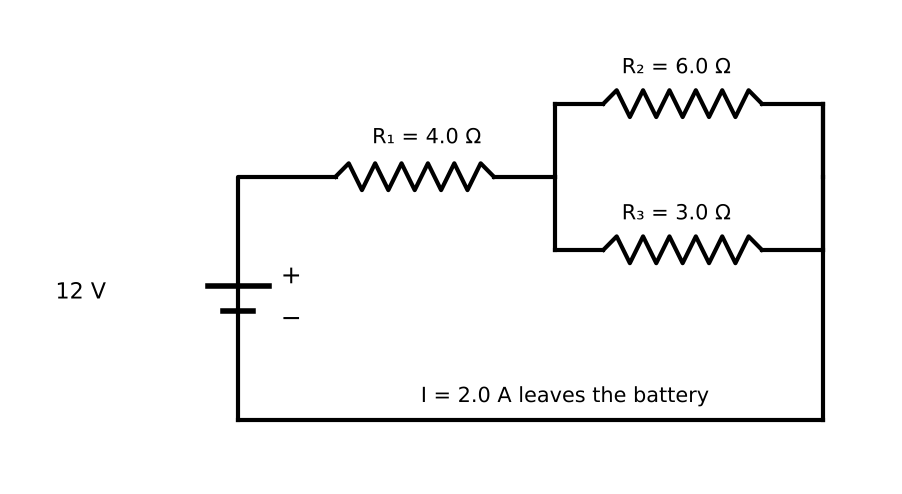

# Lesson 5: Electrostatics, Circuits and Magnetism

**What you will be able to do**

- Use Coulomb's law, electric field and electric potential, and recognize the inverse-square pattern you met in gravity.
- Analyze circuits with resistors in series and parallel using Ohm's law, and compute power.
- Handle capacitors, including energy storage and the series and parallel rules (which are the reverse of the resistor rules).
- Describe how a magnetic field acts on a moving charge, and use the right-hand rule.
- Connect these ideas to a nerve cell's membrane.

**Why it matters for the exam**

Category 4C is about moving charge: electrical circuits and their elements, and electrochemistry (which is in [Lesson 17](chapter:26)). A cell membrane is a leaky capacitor, a nerve impulse is a change in voltage across it, and a defibrillator, an ECG and a pacemaker are circuits. The exam rarely asks you to build a complicated circuit. It asks you to apply a handful of rules to a small one, usually with some bookkeeping, and sometimes to reason by analogy with the fluid flow of [Lesson 4](chapter:11): pressure is like voltage, flow is like current, and a narrow tube is like a resistor.

Praxis Tip: Keep the fluid analogy in your head. A pump (battery) pushes a flow (current) through narrow tubes (resistors) under a pressure difference (voltage). It will not answer every question, and it answers a surprising number.

**Concept Review**

**Charge and Coulomb's law.** Electric charge comes in two kinds, positive and negative. It is conserved, and in a conductor it is free to move, while in an insulator it is not. Like charges repel; opposite charges attract. The force between two point charges is

    F = k q₁ q₂ / r²,  with k ≈ 9.0 × 10⁹ N·m²/C²

The unit of charge is the coulomb (C). The elementary charge is e ≈ 1.6 × 10⁻¹⁹ C. This is an **inverse-square law**, exactly like gravity: double the distance and the force falls to one quarter.

**Electric field.** The electric field E at a point is the force per unit positive test charge, E = F / q. For a point charge Q, the field at distance r is E = k Q / r², pointing away from a positive charge and toward a negative one. Field lines leave positive charges and enter negative ones, and they are closer together where the field is stronger. Between two large parallel plates, the field is uniform, with E = V / d.

**Electric potential and energy.** The electric potential at a point is the potential energy per unit charge. The potential difference ΔV (the voltage) between two points is the work per unit charge needed to move a charge between them:

    W = q ΔV

For a point charge, V = k Q / r and the potential energy of two charges is U = k q₁ q₂ / r. The unit of potential is the volt: 1 V = 1 J/C. A convenient energy unit for atomic-scale problems is the **electron volt**: 1 eV = 1.6 × 10⁻¹⁹ J, the energy gained by one elementary charge moving through 1 V.

Praxis Tip: Charge moves "downhill" in potential energy. A positive charge speeds up moving from high to low potential; a negative charge does the opposite. Say "which way does this charge want to go?" before you do any arithmetic.

**Current and Ohm's law.** Current is the rate of flow of charge: I = ΔQ / Δt, measured in amperes (A = C/s). By convention, current points in the direction positive charge would move, from the higher-potential terminal toward the lower, even though the charge carriers in a metal are electrons moving the other way.

For many materials (called **ohmic**), the current is proportional to the voltage:

    V = I R

where R is the resistance in ohms (Ω). The resistance of a wire depends on its geometry and material:

    R = ρ L / A

where ρ is the resistivity, L the length, and A the cross-sectional area. A longer wire has more resistance; a thicker wire has less.

**Power in circuits.** The power dissipated by a resistor is

    P = I V = I² R = V² / R

All three forms are the same quantity; choose whichever matches the numbers you have.

*Figure: Series resistors share one current; parallel resistors share one voltage.*

**Resistors in series and parallel.**

| Arrangement | Same quantity | Equivalent resistance |
|---|---|---|
| Series | Current | R = R₁ + R₂ + ... (increases) |
| Parallel | Voltage | 1/R = 1/R₁ + 1/R₂ + ... (decreases) |

Adding a resistor in series raises the total resistance. Adding one in parallel *lowers* it, because it gives the current another path. For two resistors in parallel, R = R₁R₂ / (R₁ + R₂), and the result is always smaller than the smaller resistor.

Praxis Tip: For parallel resistors, remember the "product over sum" shortcut for two resistors, and the fact that the answer must be smaller than the smallest one. If it is not, you flipped something.

**Kirchhoff's rules.** At a junction, the current in equals the current out (conservation of charge). Around any closed loop, the sum of the voltage changes is zero (conservation of energy). Most circuits at this level can be reduced to series and parallel pieces without them.

**Capacitors.** A capacitor stores charge on two conducting plates separated by a gap. Its capacitance is C = Q / V (in farads, F). For two parallel plates of area A separated by a distance d, C is proportional to A / d; a **dielectric** material between the plates multiplies the capacitance by the dielectric constant κ. The energy stored is

    U = ½ C V² = ½ Q V = Q² / (2C)

The combination rules are the opposite of the resistor rules: capacitors in **parallel** add (C = C₁ + C₂ + ...), and capacitors in **series** combine like parallel resistors (1/C = 1/C₁ + 1/C₂ + ...).

**Meters.** An **ammeter** measures current and is placed in *series* with the circuit; it should have very low resistance. A **voltmeter** measures voltage and is placed in *parallel* with the component; it should have very high resistance.

**Conductivity.** Metals conduct by the motion of electrons; electrolyte solutions conduct by the motion of ions. Both are described by conductivity (the reciprocal of resistivity).

**Magnetism.** A magnetic field B (unit: tesla, T) exerts a force on a moving charge:

    F = q v B sin θ

where θ is the angle between the velocity and the field. The force is perpendicular to both v and B, as given by the right-hand rule (for a positive charge: fingers along v, curl toward B, thumb along F; reverse for a negative charge). Because the force is always perpendicular to the velocity, **a magnetic force does no work** and cannot change the particle's speed. It can only change its direction. A charge moving perpendicular to a uniform field travels in a circle of radius

    r = m v / (q B)

A current-carrying wire in a magnetic field feels a force F = I L B sin θ, which is the basis of electric motors.

**The nerve cell as a circuit.** A nerve cell membrane separates charge, with ion concentration differences maintained at an energy cost, and so behaves like a capacitor with leak paths (resistors) across it. The **myelin sheath**, a fatty insulating layer wrapped around many axons, increases the effective thickness of the insulator, which lowers the capacitance and raises the resistance of the membrane. The impulse then effectively jumps between the gaps in the myelin called **nodes of Ranvier**, which speeds conduction.

**Worked Example 1: Coulomb's law (skill: the inverse square)**

Two point charges, +2.0 μC and −3.0 μC, are 0.30 m apart. What is the force between them, and what happens if the distance doubles?

F = k |q₁ q₂| / r² = (9.0 × 10⁹)(2.0 × 10⁻⁶)(3.0 × 10⁻⁶) / (0.30)² = (9.0 × 10⁹)(6.0 × 10⁻¹²) / 0.090 = 0.054 / 0.090 = 0.60 N, attractive (opposite signs).

At 0.60 m the force is one quarter as large: 0.15 N.

*Skill used:* handling powers of ten, and recognizing the inverse-square scaling so that the second question needs no arithmetic.

**Worked Example 2: A charge in a uniform field (skill: potential and energy)**

Two parallel plates are 2.0 cm apart with a potential difference of 100 V. (a) What is the field between them? (b) An electron starts from rest at the negative plate. How much kinetic energy does it gain crossing to the positive plate, and what is its speed? (e = 1.6 × 10⁻¹⁹ C; electron mass 9.1 × 10⁻³¹ kg.)

(a) E = V / d = 100 / 0.020 = 5,000 V/m.

(b) The kinetic energy gained is q ΔV = 100 eV = 100 × 1.6 × 10⁻¹⁹ = 1.6 × 10⁻¹⁷ J. Then ½ m v² = 1.6 × 10⁻¹⁷, so v = √(2 × 1.6 × 10⁻¹⁷ / 9.1 × 10⁻³¹) = √(3.5 × 10¹³) ≈ 5.9 × 10⁶ m/s.

*Check.* This is about 2 percent of the speed of light, which is large but still safely non-relativistic.

**Worked Example 3: A circuit (skill: series, parallel and power)**

A 12 V battery drives a 4.0 Ω resistor in series with a parallel pair of 6.0 Ω and 3.0 Ω resistors. Find the total current, the voltage across each part, the current in each branch, and the total power.

*Parallel pair:* R = (6.0 × 3.0) / (6.0 + 3.0) = 18 / 9 = 2.0 Ω.

*Total resistance:* 4.0 + 2.0 = 6.0 Ω. *Total current:* I = 12 / 6.0 = 2.0 A.

*Voltages:* across the 4.0 Ω resistor: 2.0 × 4.0 = 8.0 V. Across the parallel pair: 12 − 8.0 = 4.0 V (or 2.0 A × 2.0 Ω = 4.0 V).

*Branch currents:* 4.0 / 6.0 = 0.67 A and 4.0 / 3.0 = 1.33 A. They sum to 2.0 A ✓.

*Power:* P = I V = 2.0 × 12 = 24 W. Check by parts: 4.0 Ω resistor: I² R = 4 × 4.0 = 16 W; 6.0 Ω: 4.0² / 6.0 = 2.67 W; 3.0 Ω: 4.0² / 3.0 = 5.33 W; total = 16 + 2.67 + 5.33 = 24 W ✓.

*Skill used:* reducing a circuit step by step, then working outward again, and checking with conservation of power.

**Worked Example 4: Capacitors (skill: charge, energy and the combination rules)**

A 2.0 μF capacitor is charged by a 12 V battery. (a) How much charge and energy does it store? (b) What is the equivalent capacitance of the 2.0 μF capacitor in series with a 6.0 μF capacitor, and in parallel with it?

(a) Q = C V = 2.0 × 10⁻⁶ × 12 = 24 μC. U = ½ C V² = ½ × 2.0 × 10⁻⁶ × 144 = 1.44 × 10⁻⁴ J = 144 μJ.

(b) Series: 1/C = 1/2.0 + 1/6.0 = 3/6.0 + 1/6.0 = 4/6.0, so C = 1.5 μF. Parallel: 2.0 + 6.0 = 8.0 μF.

*Reading it.* Series capacitors give a *smaller* total capacitance than either; parallel capacitors give a larger one. Resistors do the opposite.

**Worked Example 5: A proton in a magnetic field (skill: circular motion)**

A proton (mass 1.67 × 10⁻²⁷ kg, charge 1.6 × 10⁻¹⁹ C) moves at 2.0 × 10⁶ m/s perpendicular to a 0.50 T field. Find the force and the radius of its path.

F = q v B = (1.6 × 10⁻¹⁹)(2.0 × 10⁶)(0.50) = 1.6 × 10⁻¹³ N.

r = m v / (q B) = (1.67 × 10⁻²⁷)(2.0 × 10⁶) / [(1.6 × 10⁻¹⁹)(0.50)] = 3.34 × 10⁻²¹ / 8.0 × 10⁻²⁰ = 0.042 m, about 4.2 cm.

*Check.* The magnetic force supplies the centripetal force: q v B = m v² / r gives r = m v / (q B) ✓.

**More Praxis Tips**

Praxis Tip: Redraw a circuit as you simplify it, one equivalent resistor at a time. Do not simplify in your head and then discover that you simplified the wrong half.

Praxis Tip: When a battery is connected across a parallel set of resistors, every resistor sees the full battery voltage. That single idea resolves many questions at once.

Praxis Tip: To compare the power in two resistors with the same current, use P = I² R. With the same voltage, use P = V² / R. Choose the form that keeps the common quantity.

Praxis Tip: In a magnetic field question, first ask whether the charge is moving. A stationary charge feels no magnetic force, and a charge moving parallel to the field feels none either.

Praxis Tip: For electron-volt problems, never convert to joules until the end. A 100 V acceleration gives 100 eV, and everything is simpler in those units.

Praxis Tip: Keep a one-line memory for the two capacitor rules: "capacitors add in parallel, resistors add in series," and the other rule in each case is the reciprocal one.

**Common Mistakes**

- Putting an ammeter in parallel, which would be an expensive way to short-circuit a battery.
- Using the resistor combination rules for capacitors, or the reverse.
- Forgetting that a magnetic force does no work.
- Using the wrong sign for the force on a negative charge in the right-hand rule.
- Letting parallel resistance exceed the smallest resistor.
- Using the full potential difference where only part of it applies to a given component.

**Checkpoint Questions**

1. The distance between two point charges is doubled. The magnitude of the electric force between them becomes
   A. one fourth as large
   B. one half as large
   C. twice as large
   D. four times as large

2. Two 10 Ω resistors are connected in parallel across a 10 V battery. What total current does the battery supply?
   A. 0.50 A
   B. 1.0 A
   C. 2.0 A
   D. 5.0 A

3. A 3.0 μF capacitor and a 6.0 μF capacitor are connected in series. Their equivalent capacitance is
   A. 9.0 μF
   B. 2.0 μF
   C. 4.5 μF
   D. 18 μF

4. A current of 0.50 A flows through a 20 Ω resistor. The power dissipated is
   A. 10 W
   B. 200 W
   C. 0.025 W
   D. 5.0 W

5. A positively charged particle moves perpendicular to a uniform magnetic field. Which statement is correct?
   A. The particle moves in a circle at constant speed
   B. The particle speeds up along a straight line
   C. The magnetic force does positive work on the particle
   D. The particle is unaffected by the field

6. To measure the voltage across a resistor in a circuit, a voltmeter should be connected
   A. in series with the resistor, and should have a very low internal resistance
   B. in series with the resistor, and should have a very high internal resistance
   C. in parallel with the resistor, and should have a very high internal resistance
   D. in parallel with the resistor, and should have a very low internal resistance

7. An electron is accelerated from rest through a potential difference of 50 V. Its kinetic energy is closest to (e = 1.6 × 10⁻¹⁹ C)
   A. 3.2 × 10⁻²¹ J
   B. 1.6 × 10⁻¹⁹ J
   C. 5.0 × 10¹ J
   D. 8.0 × 10⁻¹⁸ J

---

**Stop here.** Answer every question on scratch paper before you read the reasons.

**Answers and reasons**

1. **A.** Coulomb's law is an inverse-square law, so doubling r divides F by 2² = 4. (B treats the force as inversely proportional to distance; C gets the direction of the dependence wrong; D squares the relationship in the wrong direction.)
2. **C.** Two equal resistors in parallel give R = 10 / 2 = 5.0 Ω. Then I = V / R = 10 / 5.0 = 2.0 A. (A uses the series resistance of 20 Ω; B uses only one resistor; D divides the voltage by 2, the number of resistors, as if that were the total resistance.)
3. **B.** For capacitors in series, 1/C = 1/3.0 + 1/6.0 = 3/6.0 = 1/2.0, so C = 2.0 μF. (A adds them, which is the parallel rule; C averages the two values; D multiplies them.)
4. **D.** P = I² R = (0.50)² × 20 = 0.25 × 20 = 5.0 W. (A uses P = I R and forgets to square the current; B uses I R² instead of I² R; C divides when it should multiply.)
5. **A.** The magnetic force is always perpendicular to the velocity, so it changes direction but not speed, and it does no work. The result is circular motion. (B assumes the magnetic force accelerates it along its path; C forgets that the force is perpendicular to the motion; D forgets the Lorentz force on a moving charge.)
6. **C.** A voltmeter is placed in parallel to measure the potential difference without drawing significant current, which requires a very high internal resistance. (A describes an ammeter; B blocks the current in the circuit; D would short-circuit the resistor.)
7. **D.** K = q ΔV = (1.6 × 10⁻¹⁹ C)(50 V) = 8.0 × 10⁻¹⁸ J, which is 50 eV. (A divides the charge by the voltage; B uses a potential difference of 1 V; C uses the voltage as if it were energy in joules.)

Praxis Tip: After the checkpoint questions, look at each wrong choice and name the slip (series versus parallel, squared versus not, wrong rule for capacitors, work by a magnetic force). Log it in your error log ([Strategy: The Question Method](chapter:4)).

**Teach-Back and Spaced Review**

*Say this aloud in one breath:* "Charges attract or repel with an inverse-square force; voltage drives current through resistance by Ohm's law; resistors add in series and combine reciprocally in parallel, and capacitors do the opposite; and a magnetic field bends a moving charge into a circle without ever changing its speed."

*Review schedule:* revisit this lesson after 1 day (redo Worked Examples 3 and 4 without looking), after 3 days (checkpoint questions from a blank page), after 7 days (a mixed set that includes [Lesson 4](chapter:11) fluids and [Lesson 3](chapter:9) energy), and after 21 days (explain the lesson aloud).

*Interleave:* alternate a circuit problem with a fluid flow problem and a work-energy problem. Then take the [physics mixed set](chapter:16).

Praxis Tip: End each study session by writing, from memory, Coulomb's law, V = I R, P = I V, the two capacitor combination rules, U = ½ C V², and r = m v / (q B). Check them against this chapter tomorrow.

---

**Author verification note (remove before publishing)**

- All examples and questions are original. Verified: Coulomb force 0.60 N and 0.15 N; E = 5,000 V/m; electron speed 5.9 × 10⁶ m/s; circuit: 6.0 Ω total, 2.0 A, 8.0 V, 4.0 V, 0.67 and 1.33 A, 24 W; capacitor: 24 μC, 144 μJ, 1.5 μF, 8.0 μF; proton radius 4.2 cm and force 1.6 × 10⁻¹³ N.
- Answer key positions: A, C, B, D, A, C, D.
- [VERIFY] on the myelin description resolved (standard physiology).
- Category 4C topics covered: electrostatics, Coulomb's law, field, potential, circuit elements (current, EMF, resistance, Ohm's law, series and parallel, resistivity), capacitance (series, parallel, energy, dielectrics), conductivity, meters, magnetism (Lorentz force), and the nerve-cell tie-in. Electrochemistry is in Lesson 17.
