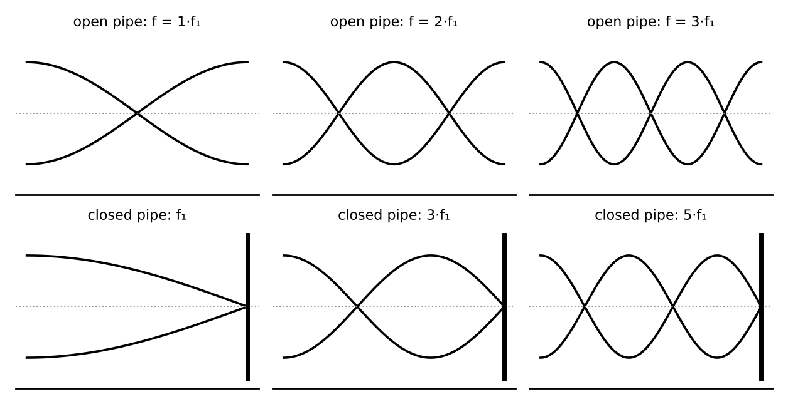

# Lesson 6: Periodic Motion, Waves and Sound

**What you will be able to do**

- Describe oscillations by amplitude, period, frequency and phase, and find the period of a mass on a spring and of a pendulum.
- Use v = f λ and know what changes (and what does not) when a wave enters a new medium.
- Apply superposition, interference and standing waves.
- Work with sound: speed, pitch, intensity, decibels, and the Doppler effect.
- Find the resonant frequencies of strings and pipes, and explain how ultrasound is used in medicine.

**Why it matters for the exam**

Periodic motion sits in category 4A, and sound sits in category 4D (how light and sound interact with matter). Together they cover the heartbeat, the pendulum, the eardrum, the stethoscope and the ultrasound probe. The exam asks about them in two ways: ratio questions ("what happens to the period if the mass is quadrupled?") and applied questions ("how does a Doppler ultrasound measure blood speed?"). Both need a short list of formulas and a clear idea of what each variable does.

Praxis Tip: For almost every formula in this lesson, the useful skill is to say what goes up when something else goes up. Write "T increases with m, decreases with k" beside the formula, and you can answer without a calculator.

**Concept Review**

**Describing oscillations.** A periodic motion repeats at regular intervals. Key terms:

- **Amplitude (A):** the maximum displacement from equilibrium.
- **Period (T):** the time for one complete cycle, in seconds.
- **Frequency (f):** cycles per second, in hertz (Hz). f = 1 / T.
- **Angular frequency (ω):** ω = 2π f = 2π / T, in rad/s.
- **Phase:** where in the cycle the oscillation is, relative to a reference.

**Simple harmonic motion (SHM).** When the restoring force is proportional to the displacement and points toward equilibrium (F = −k x), the motion is simple harmonic. Two systems to know:

- **Mass on a spring:** T = 2π √(m / k). A heavier mass or a softer spring gives a longer period.
- **Simple pendulum (small angles):** T = 2π √(L / g). A longer pendulum or weaker gravity gives a longer period. The period does *not* depend on the mass, and (for small angles) not on the amplitude.

In SHM, energy trades back and forth between kinetic and potential, as in [Lesson 3](chapter:9). The speed is greatest as the object passes through equilibrium, where the potential energy is least, and it is zero at the extremes of the motion. The maximum speed is v_max = A ω.

Praxis Tip: A period depends on the square root of the ratio, so quadrupling the mass on a spring or the length of a pendulum only doubles the period. Remember "square root" before you remember the formula.

**Waves.** A wave transfers energy without transferring matter. Waves in which the medium moves *perpendicular* to the direction of travel are **transverse** (a wave on a string; light, whose electric and magnetic fields oscillate perpendicular to the direction of travel). Waves in which the medium moves *parallel* to the direction of travel are **longitudinal** (sound). Every wave obeys

    v = f λ

where v is the wave speed, f the frequency and λ the wavelength.

The speed of a wave is set by the medium. The frequency is set by the source, and **does not change** when a wave passes into a new medium. So if the speed changes at a boundary, the wavelength changes in proportion.

Praxis Tip: Frequency belongs to the source; speed belongs to the medium; wavelength is whatever is left. When a wave enters a new medium, hold f fixed and let λ adjust.

**Superposition and interference.** When two waves overlap, their displacements add. If the waves are in phase, they combine to a larger amplitude (**constructive interference**). If they are out of phase by half a cycle, they cancel (**destructive interference**). Interference is the reason noise-cancelling headphones work: they produce a sound wave that is out of phase with the noise.

*Figure: Standing waves in pipes: open at both ends (left) and closed at one end (right).*

**Standing waves.** Two identical waves traveling in opposite directions form a standing wave, with fixed points of no motion (**nodes**) and points of maximum motion (**antinodes**). Standing waves occur on strings and in pipes at specific resonant frequencies.

**Sound.** Sound is a longitudinal pressure wave. Its speed depends on the medium:

- In air at room temperature: about 340 m/s.
- In liquids and solids it is much higher (water about 1,500 m/s; steel several thousand m/s), because these media are far stiffer.

The **pitch** of a sound is determined by its frequency. Audible frequencies run from roughly 20 Hz to 20,000 Hz. **Ultrasound** is sound above this range.

**Intensity and decibels.** Intensity is power per unit area, I = P / A, in W/m². For a point source radiating equally in all directions, the intensity falls as the inverse square of the distance. The human ear responds over an enormous range of intensities, so the **sound level** is given on a logarithmic scale:

    β = 10 log₁₀ (I / I₀),  with I₀ = 10⁻¹² W/m² (the threshold of hearing)

The unit is the decibel (dB). Because the scale is logarithmic:

- Every +10 dB multiplies the intensity by 10.
- Every +3 dB roughly doubles the intensity.
- Every −3 dB roughly halves it.
- Doubling the distance from a point source reduces the intensity by a factor of 4, which is a drop of about 6 dB.

**Attenuation** is the loss of intensity as a wave passes through a medium. High-frequency ultrasound is attenuated more strongly than low-frequency ultrasound, so it penetrates less deeply but gives sharper images.

**The Doppler effect.** When the source and observer move relative to each other, the observed frequency changes. For a source of frequency f_s and sound speed v:

    f_o = f_s (v ± v_o) / (v ∓ v_s)

Use the upper signs when the observer moves toward the source or the source moves toward the observer (frequency rises), and the lower signs when they move apart (frequency falls). Approaching: higher pitch. Receding: lower pitch.

In Doppler ultrasound, sound reflects from moving red blood cells, which act first as a moving observer and then as a moving source, so the frequency shift is roughly doubled and is proportional to the blood speed.

Praxis Tip: Do not memorize the sign rules; reason them out. If the source and observer approach each other, the frequency goes up, so make the numerator larger or the denominator smaller until that is true.

**Resonance in strings and pipes.** At resonance, a standing wave fits the length of the system exactly.

| System | Resonant frequencies | Pattern |
|---|---|---|
| String fixed at both ends | f_n = n v / (2L), n = 1, 2, 3, ... | All harmonics |
| Pipe open at both ends | f_n = n v / (2L), n = 1, 2, 3, ... | All harmonics |
| Pipe closed at one end | f_n = n v / (4L), n = 1, 3, 5, ... | Odd harmonics only |

The lowest frequency (n = 1) is the **fundamental**. For the same length, the fundamental wavelength is 4L in a closed pipe but 2L in an open pipe, so the closed pipe's fundamental is half the frequency.

**Shock waves.** A source moving faster than the wave speed in the medium leaves its own sound behind and forms a cone-shaped shock wave, heard as a sonic boom. Focused shock waves are used medically to break up kidney stones.

**Worked Example 1: A mass on a spring (skill: period and maximum speed)**

A 0.50 kg mass is attached to a spring with k = 200 N/m and oscillates with amplitude 0.10 m. Find the period, the frequency, and the maximum speed.

T = 2π √(m / k) = 2π √(0.50 / 200) = 2π √(0.0025) = 2π × 0.050 = 0.314 s. f = 1 / T = 3.18 Hz.

ω = 2π / T = 20 rad/s. v_max = A ω = 0.10 × 20 = 2.0 m/s.

*Check.* Energy: ½ k A² = ½ × 200 × 0.010 = 1.0 J = ½ m v_max² = ½ × 0.50 × 4.0 = 1.0 J ✓. (The same numbers appeared in [Lesson 3](chapter:9), where the block left the spring at 2.0 m/s.)

**Worked Example 2: Changing media (skill: f stays, λ changes)**

A 440 Hz sound wave in air (v = 340 m/s) enters water (v = 1,500 m/s). What are the wavelengths?

In air: λ = v / f = 340 / 440 = 0.77 m. In water: the frequency is still 440 Hz, so λ = 1,500 / 440 = 3.4 m.

The wavelength grew by the same factor as the speed (1,500 / 340 ≈ 4.4).

**Worked Example 3: Decibels and distance (skill: the log scale)**

(a) A sound goes from 60 dB to 80 dB. By what factor does the intensity increase?

ΔdB = 20 dB = two steps of 10 dB, each a factor of 10: 10 × 10 = 100.

(b) A small speaker radiates equally in all directions. Doubling your distance from it changes the sound level by how much?

The intensity falls by 2² = 4. The change is 10 log₁₀(1/4) = −10 × 0.602 = −6.0 dB.

*Skill used:* turning a logarithmic scale into repeated multiplication.

**Worked Example 4: A Doppler shift (skill: choosing signs)**

An ambulance siren emits 700 Hz and moves at 30 m/s. A stationary observer hears it as the ambulance approaches and then as it recedes. (v = 340 m/s.)

Approaching: f = 700 × 340 / (340 − 30) = 700 × 340 / 310 = 768 Hz. Receding: f = 700 × 340 / (340 + 30) = 700 × 340 / 370 = 643 Hz.

*Check.* The observed pitch is higher approaching (768 > 700) and lower receding (643 < 700), as it must be.

**Worked Example 5: Pipes (skill: open versus closed)**

A pipe 0.85 m long is used with v = 340 m/s. Find the lowest three resonant frequencies if it is (a) open at both ends and (b) closed at one end.

(a) Open: f_n = n × 340 / (2 × 0.85) = n × 200 Hz: 200 Hz, 400 Hz, 600 Hz.

(b) Closed: f_n = n × 340 / (4 × 0.85) = n × 100 Hz with n odd: 100 Hz, 300 Hz, 500 Hz.

*Reading it.* The closed pipe has a lower fundamental (100 Hz, an octave below the open pipe) and only odd harmonics.

**Worked Example 6: A pendulum (skill: the period)**

A pendulum has a length of 1.0 m. What is its period on Earth (g = 10 m/s²)? What would you do to double the period?

T = 2π √(L / g) = 2π √(0.10) = 2π × 0.316 = 1.99 s ≈ 2.0 s.

To double T, quadruple L (to 4.0 m). Changing the mass does nothing.

**More Praxis Tips**

Praxis Tip: For a wave question, write the three symbols v, f and λ on your scratch paper and cross out the one that is fixed. It sets up the whole problem.

Praxis Tip: In decibel questions, break the number of dB into tens and threes: 26 dB is two tens (×100) and two threes (about ×4), so about ×400. You do not need a calculator.

Praxis Tip: If a question asks about the sound heard by a *moving* observer, check whether the source is also moving, and that you are only changing one of the two terms in the Doppler formula.

Praxis Tip: For a string or pipe, draw the standing wave: nodes at fixed ends and closed ends, antinodes at open ends. The picture gives you the fraction of a wavelength that fits.

Praxis Tip: Treat 340 m/s and 1,500 m/s (air and water) as working values if a question does not give the speed.

Praxis Tip: Remember that ultrasound is high-frequency, so its wavelength in tissue is short, which is what makes the images fine-grained.

**Common Mistakes**

- Thinking the frequency of a wave changes when it enters a new medium.
- Believing a pendulum's period depends on its mass.
- Using the open-pipe formula for a closed pipe, or the reverse.
- Forgetting that dB is logarithmic, and adding intensities instead of decibels.
- Using the wrong signs in the Doppler formula, then not checking against common sense.
- Confusing amplitude, which carries energy, with frequency, which carries pitch.

**Checkpoint Questions**

1. The length of a simple pendulum is increased by a factor of 4. Its period
   A. quadruples
   B. is halved
   C. doubles
   D. is unchanged

2. A sound wave passes from air into water. Which statement is correct?
   A. Its frequency stays the same and its wavelength increases
   B. Its frequency increases and its wavelength stays the same
   C. Both its frequency and wavelength decrease
   D. Its speed decreases and its wavelength decreases

3. Sound A has a level of 70 dB and sound B has a level of 50 dB. The intensity of A is how many times that of B?
   A. 20
   B. 2
   C. 10
   D. 100

4. A source emitting a steady tone moves toward a stationary observer. Compared with the emitted tone, the observer hears
   A. a lower frequency
   B. a higher frequency
   C. the same frequency
   D. a lower speed of sound

5. A pipe closed at one end has a fundamental resonant frequency of 100 Hz. What is the next higher resonant frequency?
   A. 150 Hz
   B. 200 Hz
   C. 400 Hz
   D. 300 Hz

6. A block on a spring oscillates with period T. If the amplitude is doubled (within the spring's elastic range), the period becomes
   A. 2T
   B. T (unchanged)
   C. T/2
   D. 4T

7. A string 1.5 m long is fixed at both ends. Waves travel along it at 60 m/s. What is the fundamental frequency?
   A. 20 Hz
   B. 40 Hz
   C. 90 Hz
   D. 10 Hz

---

**Stop here.** Answer every question on scratch paper before you read the reasons.

**Answers and reasons**

1. **C.** T = 2π √(L / g), so quadrupling L multiplies T by √4 = 2. (A treats the period as proportional to length; B inverts the dependence; D confuses this with the effect of the mass.)
2. **A.** The source sets the frequency, which does not change. Sound travels faster in water, so v = f λ requires a longer wavelength. (B lets the frequency change with the medium; C reverses the effect of the faster speed; D gets the speed in water wrong.)
3. **D.** The difference is 20 dB, which is two factors of 10 in intensity, so 10 × 10 = 100. (A reads the decibel difference as the intensity ratio; B treats 3 dB as the factor; C counts only one 10 dB step.)
4. **B.** When source and observer approach, the observed frequency rises (the wave crests are bunched closer together). (A uses the receding case; C ignores the relative motion; D confuses the wave speed, which the medium sets, with the frequency.)
5. **D.** A pipe closed at one end supports only odd harmonics: 100, 300, 500 Hz, and so on. (A assumes all harmonics are present; B uses the open-pipe pattern; C skips to an even harmonic that a closed pipe does not support.)
6. **B.** For simple harmonic motion the period depends on m and k, not on the amplitude: T = 2π √(m / k). (A assumes a larger swing takes longer; C assumes a larger swing is faster per cycle; D squares the amplitude.)
7. **A.** For a string fixed at both ends, f₁ = v / (2L) = 60 / (2 × 1.5) = 20 Hz. (B uses v / L and forgets the factor of 2; C multiplies speed by length; D uses v / (4L), the closed-pipe formula.)

Praxis Tip: After the checkpoint questions, look at each wrong choice and name the slip (square root forgotten, frequency changed, wrong pipe rule, logarithmic scale). Log it in your error log ([Strategy: The Question Method](chapter:4)).

**Teach-Back and Spaced Review**

*Say this aloud in one breath:* "An oscillation has a period that depends on the square root of the mass or length; a wave's speed comes from its medium, its frequency from its source, and v equals f times lambda; sound intensity is logarithmic in decibels, a Doppler shift raises the pitch when source and observer approach, and strings and pipes resonate at whole-number multiples of a fundamental set by their length (odd multiples only for a pipe closed at one end)."

*Review schedule:* revisit this lesson after 1 day (redo Worked Examples 1 and 4 without looking), after 3 days (checkpoint questions from a blank page), after 7 days (a mixed set that includes [Lesson 3](chapter:9) energy and [Lesson 5](chapter:12) circuits), and after 21 days (explain the lesson aloud).

*Interleave:* alternate a waves problem with an energy problem and a fluids problem. [Lesson 7](chapter:14) continues with light, which is also a wave.

Praxis Tip: End each study session by writing, from memory, the period formulas for a spring and a pendulum, v = f λ, β = 10 log (I/I₀), the Doppler formula, and the resonance formulas for open and closed pipes. Check them against this chapter tomorrow.

---

**Author verification note (remove before publishing)**

- All examples and questions are original. Verified: T = 0.314 s, f = 3.18 Hz, v_max = 2.0 m/s, energy 1.0 J both ways; λ = 0.77 m and 3.4 m; 100× intensity; −6.0 dB; Doppler 768 Hz and 643 Hz; pipes 200/400/600 Hz and 100/300/500 Hz; pendulum 1.99 s.
- Answer key positions: C, A, D, B, D, B, A.
- Verify: speed of sound in air (about 340 m/s) and in water (about 1,500 m/s) against the fact sheet; statements about attenuation and frequency in ultrasound; the Doppler ultrasound explanation.
- Category 4A (periodic motion: amplitude, frequency, phase; transverse and longitudinal waves) and 4D (sound: production, relative speeds, intensity and decibels, attenuation, Doppler, pitch, resonance, ultrasound, shock waves) covered. Light is in Lesson 7.
