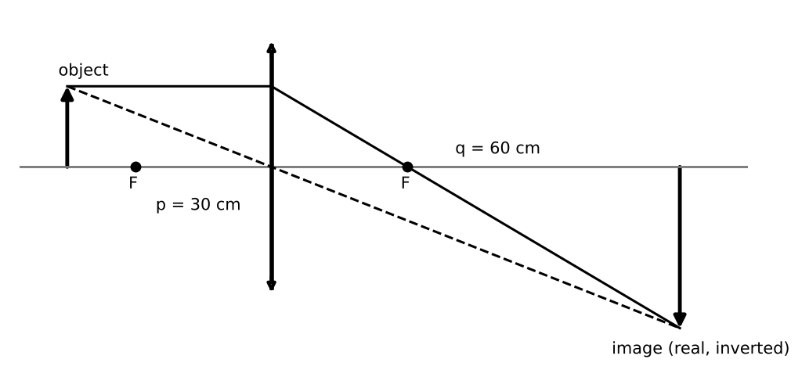

# Lesson 7: Light, Electromagnetic Radiation and Geometrical Optics

**What you will be able to do**

- Place radiation on the electromagnetic spectrum and use c = f λ and E = h f.
- Apply the law of reflection and Snell's law, and find the critical angle for total internal reflection.
- Locate images formed by mirrors and thin lenses using 1/p + 1/q = 1/f, and state whether they are real or virtual, upright or inverted.
- Explain interference, diffraction and polarization with the key formulas.
- Relate lens power (diopters) to the optics of the eye and its correction.

**Why it matters for the exam**

Category 4D covers how light and sound interact with matter. This lesson is the light half. The same physics describes the eye, the microscope, a fiber-optic endoscope, X-ray diffraction of crystals and a sunburn. The exam asks both calculation questions (where does the image form?) and reasoning questions (what changes when light enters a new medium?). The second kind rewards a small number of unshakeable facts, mostly about what stays the same at a boundary.

Praxis Tip: For light, ask the same three questions you asked for sound in [Lesson 6](chapter:13): what does the source fix, what does the medium fix, and what is left over? Frequency belongs to the source; speed belongs to the medium; wavelength follows.

**Concept Review**

**Electromagnetic radiation.** Light is an electromagnetic wave: oscillating electric and magnetic fields, perpendicular to each other and to the direction of travel. In a vacuum, all electromagnetic waves travel at the same speed, c = 3.0 × 10⁸ m/s, and obey c = f λ.

The spectrum, from low to high frequency (long to short wavelength): radio, microwave, infrared, visible, ultraviolet, X-ray, gamma ray. Visible light spans roughly 400 nm (violet) to 700 nm (red).

**Photons.** Light also behaves as particles called **photons**, each carrying energy

    E = h f = h c / λ,  with h = 6.63 × 10⁻³⁴ J·s

A convenient form: E (in eV) ≈ 1,240 / λ (in nm). Higher frequency means a more energetic photon: ultraviolet and X-ray photons can damage tissue, and radio photons cannot.

Praxis Tip: Keep "1,240 eV·nm" in your head. Divide it by a wavelength in nanometers and you have the photon energy in electron volts. A 500 nm photon is 2.5 eV.

**Reflection.** At a smooth surface, the angle of incidence equals the angle of reflection, both measured from the normal (the line perpendicular to the surface).

**Refraction and Snell's law.** When light passes from one medium to another, its speed changes and, unless it hits head-on, its direction bends. The **index of refraction** of a medium is

    n = c / v

so n ≥ 1, and a larger n means slower light. Snell's law relates the angles (measured from the normal):

    n₁ sin θ₁ = n₂ sin θ₂

Light bends *toward* the normal when entering a medium with a higher n, and *away from* the normal when entering a medium with a lower n. Across the boundary, the **frequency is unchanged**, while the speed and wavelength both become smaller by the factor n: λ = λ₀ / n.

**Dispersion.** The index of refraction depends slightly on wavelength, so a prism bends violet light more than red. This is dispersion, and it is why prisms and raindrops produce rainbows.

**Total internal reflection.** When light travels from a higher-index medium to a lower-index medium and strikes the boundary at an angle larger than the **critical angle**, it is entirely reflected:

    sin θ_c = n₂ / n₁  (with n₁ > n₂)

Total internal reflection is what keeps light inside an optical fiber.

*Figure: Three principal rays locate the image formed by a converging lens.*

**Mirrors and lenses: the sign conventions.** The mirror and thin-lens equation is

    1/p + 1/q = 1/f,  with magnification m = −q/p

- p is the object distance (positive for a real object in front of the mirror or lens).
- q is the image distance: positive for a **real** image (formed where light actually converges: in front of a mirror, behind a lens), negative for a **virtual** image.
- f is positive for a concave mirror and a converging lens, negative for a convex mirror and a diverging lens. For a spherical mirror, f = R / 2.
- A negative magnification means the image is **inverted**; a positive magnification means upright. The size is |m|.

Image rules for a converging lens or concave mirror (focal length f):

| Object position | Image |
|---|---|
| Beyond 2f | Real, inverted, smaller |
| At 2f | Real, inverted, same size |
| Between f and 2f | Real, inverted, larger |
| At f | No image (rays emerge parallel) |
| Inside f | Virtual, upright, larger (a magnifying glass) |

A diverging lens or convex mirror always produces a virtual, upright, smaller image.

Praxis Tip: Do the sign bookkeeping the same way every time: use 1/q = 1/f − 1/p, keep f's sign, and let the sign of q tell you real or virtual. Then m = −q/p tells you size and orientation.

**Lens power and the eye.** The **power** of a lens in **diopters** is P = 1/f with f in meters. Powers of thin lenses placed together add. The human eye focuses light on the retina using the cornea and a flexible lens (the combined power is roughly 60 diopters).

- **Nearsightedness (myopia):** the image of a distant object forms in front of the retina. It is corrected by a diverging lens (negative power).
- **Farsightedness (hyperopia):** the image forms behind the retina. It is corrected by a converging lens (positive power).

**Interference and diffraction.** Light is a wave and shows wave behavior.

- **Young's double-slit experiment:** coherent light through two slits separated by d produces bright fringes where d sin θ = m λ (m = 0, 1, 2, ...). On a distant screen at distance L, the fringe spacing is Δy = λ L / d.
- **Single-slit diffraction:** light spreads after passing through a slit of width a, with dark fringes where a sin θ = m λ (m = 1, 2, ...).
- **Diffraction grating:** many slits with spacing d give sharp bright maxima where d sin θ = m λ.
- **Thin films:** light reflected from the front and back of a thin layer interferes (soap bubbles, oil slicks).
- **X-ray diffraction:** X-ray wavelengths are comparable to the spacing between atoms, so crystals diffract them, revealing structure such as the shape of a protein.

**Polarization.** In **linearly polarized** light, the electric field oscillates in one plane. A polarizing filter transmits only the component along its axis. Unpolarized light passing through an ideal polarizer loses half its intensity. If polarized light of intensity I₀ then meets a second polarizer at angle θ, the transmitted intensity is I = I₀ cos² θ (**Malus's law**). **Circularly polarized** light has a field vector that rotates as the wave advances.

**Worked Example 1: A photon (skill: E, f and λ)**

What are the frequency and energy of a 500 nm photon?

f = c / λ = 3.0 × 10⁸ / 5.0 × 10⁻⁷ = 6.0 × 10¹⁴ Hz. E = h f = 6.63 × 10⁻³⁴ × 6.0 × 10¹⁴ = 4.0 × 10⁻¹⁹ J, and in electron volts, E = 1,240 / 500 = 2.5 eV (check: 4.0 × 10⁻¹⁹ / 1.6 × 10⁻¹⁹ = 2.5 ✓).

**Worked Example 2: Refraction (skill: Snell's law and what stays fixed)**

Light of wavelength 500 nm in air (n = 1.00) enters glass (n = 1.50) at an angle of incidence of 30° to the normal. Find the angle of refraction, the speed in the glass, and the wavelength in the glass.

sin θ₂ = (n₁ / n₂) sin θ₁ = (1.00 / 1.50)(0.50) = 0.333, so θ₂ = 19.5°. The ray bends toward the normal.

Speed: v = c / n = 3.0 × 10⁸ / 1.50 = 2.0 × 10⁸ m/s. Wavelength: λ = 500 / 1.50 = 333 nm. The frequency is unchanged: f = 2.0 × 10⁸ / 3.33 × 10⁻⁷ = 6.0 × 10¹⁴ Hz ✓.

**Worked Example 3: The critical angle (skill: total internal reflection)**

What is the critical angle for light going from glass (n = 1.50) into air?

sin θ_c = 1.00 / 1.50 = 0.667, so θ_c = 41.8°. Light striking the boundary at more than about 42° from the normal is totally reflected. For light going from air into glass there is no critical angle, because the light is always bending toward the normal.

**Worked Example 4: A converging lens (skill: real and virtual images)**

A converging lens has f = 20 cm. Find the image for an object at (a) 30 cm and (b) 10 cm from the lens.

(a) 1/q = 1/20 − 1/30 = 3/60 − 2/60 = 1/60, so q = +60 cm. Real image, behind the lens. m = −q/p = −60/30 = −2.0: inverted and twice the size.

(b) 1/q = 1/20 − 1/10 = −1/20, so q = −20 cm. Virtual image on the object's side. m = −(−20)/10 = +2.0: upright and twice the size, as in a magnifying glass.

*Check.* Case (a) is an object between f and 2f (20 to 40 cm), so a real, inverted, enlarged image is what the table predicts ✓. Case (b) is inside f, which predicts a virtual, upright, enlarged image ✓.

**Worked Example 5: Correcting nearsightedness (skill: diopters)**

A nearsighted person can see clearly only objects closer than 0.50 m. What lens power brings distant objects into focus? (Ignore the distance between the lens and the eye.)

The lens must make a distant object (p = ∞) appear to be at 0.50 m on the same side as the object, a virtual image with q = −0.50 m. Then f = q (for p = ∞), so f = −0.50 m and P = 1/f = −2.0 diopters, a diverging lens.

**Worked Example 6: Double-slit fringes (skill: interference)**

Light of wavelength 600 nm passes through two slits 0.20 mm apart onto a screen 1.0 m away. What is the spacing of the bright fringes?

Δy = λ L / d = (600 × 10⁻⁹)(1.0) / (0.20 × 10⁻³) = 6.0 × 10⁻⁷ / 2.0 × 10⁻⁴ = 3.0 × 10⁻³ m = 3.0 mm.

*Reading it.* Fringe spacing grows with wavelength and with screen distance, and shrinks as the slits move apart. Red light spreads more than blue.

**Worked Example 7: Two polarizers (skill: Malus's law)**

Unpolarized light of intensity I₀ passes through a polarizer, then through a second polarizer whose axis is rotated 60° from the first. What fraction of I₀ emerges?

After the first polarizer: I₀ / 2. After the second: (I₀ / 2) cos² 60° = (I₀ / 2)(0.25) = I₀ / 8.

*Check.* If the second polarizer were at 90° to the first, cos² 90° = 0 and no light would emerge, which is why crossed polarizers look black.

**More Praxis Tips**

Praxis Tip: Light entering a slower medium bends toward the normal. A memory aid is the car that drives from pavement onto sand with one wheel first: the slowed wheel pulls that side of the car around toward the sand.

Praxis Tip: When a diagram shows a lens, first mark the focal points on both sides. Then trace two rays: one parallel to the axis (it passes through the far focal point) and one through the center (it goes straight). Where they meet is the image.

Praxis Tip: In any "which stays constant" question for light entering a new medium, choose frequency. Speed and wavelength change; frequency belongs to the source.

Praxis Tip: For diopters, convert centimeters to meters first. A 20 cm lens is 1 / 0.20 = 5 diopters, not 1 / 20 = 0.05.

Praxis Tip: Photon energy rises with frequency and falls with wavelength. If a question asks which radiation is most energetic, pick the shortest wavelength.

Praxis Tip: For diffraction questions, the longer the wavelength or the smaller the opening, the more the light spreads.

**Common Mistakes**

- Measuring angles from the surface instead of from the normal.
- Saying frequency changes in a new medium.
- Mixing up the sign conventions for q and f.
- Forgetting to convert centimeters to meters when computing diopters.
- Assuming total internal reflection can occur going from low index to high index.
- Forgetting that the first polarizer halves the intensity of unpolarized light.

**Checkpoint Questions**

1. Which of the following photons has the greatest energy?
   A. Visible green
   B. Ultraviolet
   C. Infrared
   D. Microwave

2. Light passes from air into water. Which of its properties does not change?
   A. Its speed
   B. Its wavelength
   C. Its frequency
   D. Its direction, for any angle of incidence

3. Total internal reflection can occur only when light travels
   A. from a medium with a higher index of refraction to one with a lower index
   B. from a medium with a lower index of refraction to one with a higher index
   C. through a vacuum
   D. at normal incidence to a boundary

4. An object is placed at twice the focal length (2f) of a thin converging lens. The image is
   A. virtual, upright, and larger
   B. real, inverted, and smaller
   C. real, upright, and the same size
   D. real, inverted, and the same size as the object

5. A nearsighted person's glasses should use which kind of lens?
   A. A converging lens
   B. A flat piece of glass
   C. A diverging lens
   D. A lens of any type, as long as it is thick

6. In a double-slit experiment, the distance between the slits is halved while the wavelength and screen distance stay the same. The spacing between bright fringes
   A. doubles
   B. is halved
   C. stays the same
   D. quadruples

7. Unpolarized light of intensity I₀ passes through a polarizer, then through a second polarizer whose axis is at 60° to the first. The final intensity is
   A. I₀ / 2
   B. I₀ / 8
   C. I₀ / 4
   D. zero

---

**Stop here.** Answer every question on scratch paper before you read the reasons.

**Answers and reasons**

1. **B.** Photon energy E = h f increases with frequency. Ultraviolet has the highest frequency of the options. (A has a longer wavelength than ultraviolet; C has a longer wavelength than visible light; D has a much longer wavelength, so lower frequency and energy.)
2. **C.** The frequency is set by the source and stays the same across the boundary. Speed and wavelength decrease together by the factor n. (A decreases in water; B decreases in water; D stays the same only for incidence along the normal.)
3. **A.** Total internal reflection requires that the refracted ray would bend away from the normal and reach 90°, which happens only when n₁ > n₂ and the angle exceeds the critical angle. (B would bend the ray toward the normal, with no critical angle; C has no boundary to reflect from; D passes straight through without bending.)
4. **D.** 1/q = 1/f − 1/(2f) = 1/(2f), so q = 2f and m = −q/p = −1. (A describes an object inside the focal length; B describes an object beyond 2f; C real images from a single converging lens are inverted.)
5. **C.** In nearsightedness the image forms in front of the retina; a diverging lens spreads the light slightly so that the eye focuses it farther back. (A corrects farsightedness; B has no optical power; D confuses thickness with power.)
6. **A.** Δy = λ L / d, so halving d doubles the spacing. (B inverts the dependence on d; C ignores the dependence on d; D squares the dependence.)
7. **B.** After the first polarizer the intensity is I₀ / 2. Malus's law gives (I₀ / 2) cos² 60° = (I₀ / 2)(1/4) = I₀ / 8. (A stops after the first polarizer; C omits the factor of one half from the first polarizer; D describes crossed polarizers at 90°.)

Praxis Tip: After the checkpoint questions, look at each wrong choice and name the slip (angle from the wrong line, sign convention, frequency versus wavelength, diopters in centimeters). Log it in your error log ([Strategy: The Question Method](chapter:4)).

**Teach-Back and Spaced Review**

*Say this aloud in one breath:* "Light is a transverse electromagnetic wave with c equal to f lambda and photon energy h f; at a boundary the frequency stays fixed while speed and wavelength shrink by the index of refraction, bending the ray toward the normal when it enters a higher index; lenses and mirrors follow one over p plus one over q equals one over f with signs that tell me real or virtual; and interference, diffraction and polarization are all wave behavior."

*Review schedule:* revisit this lesson after 1 day (redo Worked Examples 2 and 4 without looking), after 3 days (checkpoint questions from a blank page), after 7 days (a mixed set that includes [Lesson 6](chapter:13) waves and [Lesson 5](chapter:12) circuits), and after 21 days (explain the lesson aloud).

*Interleave:* alternate an optics problem with a sound problem and an energy problem. [Lesson 8](chapter:15) turns to the nucleus, where photon energies become very large. Spectroscopy, which uses light to read molecules, comes in [Lesson 21](chapter:31).

Praxis Tip: End each study session by writing, from memory, c = f λ, E = h f, n = c / v, Snell's law, the critical angle, 1/p + 1/q = 1/f with m = −q/p, and Δy = λ L / d. Check them against this chapter tomorrow.

---

**Author verification note (remove before publishing)**

- All examples and questions are original. Verified: f = 6.0 × 10¹⁴ Hz; E = 2.5 eV; θ₂ = 19.5°; v = 2.0 × 10⁸ m/s; λ = 333 nm; θ_c = 41.8°; q = 60 cm and m = −2.0; q = −20 cm and m = +2.0; P = −2.0 D; Δy = 3.0 mm; I₀/8.
- Answer key positions: B, C, A, D, C, A, B.
- The optical power of the eye (about 60 diopters) was checked (standard physiology).
- Category 4D optics topics covered: electromagnetic radiation properties and spectrum, photon energy, visual spectrum and color, interference, double slit, diffraction, polarization, reflection, refraction and Snell's law, dispersion, total internal reflection, spherical mirrors, thin lenses, lens strength, optical instruments and the eye. Spectroscopy is in Lesson 21.
