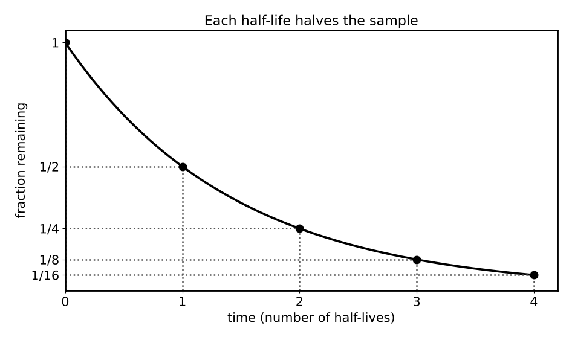

# Lesson 8: The Nucleus and Radioactive Decay

**What you will be able to do**

- Describe the nucleus with atomic number, mass number and isotope notation.
- Balance nuclear equations for alpha, beta and gamma decay.
- Use half-life to find how much of a sample remains, and relate half-life to the decay constant and activity.
- Explain binding energy and mass defect, and distinguish fission from fusion.
- Describe how a mass spectrometer separates ions, and why different radiations penetrate matter differently.

**Why it matters for the exam**

Category 4E opens with the atom. This lesson covers the nucleus; [Lesson 9](chapter:17) covers the electrons around it. Radioactivity reaches the clinic through imaging (PET scans, technetium tracers), treatment (radiation therapy, radioiodine) and dating (carbon-14). The exam asks for two kinds of skill: bookkeeping (what does this decay do to the numbers?) and exponential reasoning (how much is left after a given time?). Both are mechanical once you have the rules, and the half-life rule is one of the most reliable sources of easy points on the section.

Praxis Tip: Nuclear questions are among the most formula-light on the section. Learn the five decay rules and the half-life rule thoroughly, and a large share of the topic is yours.

**Concept Review**

**The nucleus.** The nucleus contains **protons** (positive charge) and **neutrons** (no charge), together called **nucleons**. Each element is defined by its **atomic number** Z, the number of protons. The **mass number** A is the total number of nucleons (protons plus neutrons). **Isotopes** of an element have the same Z but different A, so they differ in neutron count. The notation is ᴬ_Z X, for example ¹⁴₆C (carbon-14: 6 protons, 8 neutrons).

A **nuclear force** (the strong force) holds the nucleus together against the repulsion between protons. It is very strong but acts only over a very short range.

**Binding energy and mass defect.** The mass of a stable nucleus is *less* than the sum of the masses of its separate protons and neutrons. The difference is the **mass defect** Δm. It corresponds to the **binding energy**, the energy released when the nucleus formed (and the energy needed to pull it apart), by Einstein's relation

    E = Δm c²

A convenient conversion: 1 atomic mass unit (u) of mass corresponds to 931.5 MeV of energy. Binding energy per nucleon is largest around iron, which is why both heavy nuclei splitting (fission) and light nuclei combining (fusion) can release energy.

- **Fission:** a heavy nucleus splits into smaller ones, releasing energy (nuclear power, original atomic weapons).
- **Fusion:** light nuclei merge into a heavier one, releasing energy (the Sun).

**Radioactive decay.** An unstable nucleus changes spontaneously, emitting radiation. In every decay, **total charge (Z) and total nucleon number (A) are conserved**.

| Decay | Particle emitted | Change in the nucleus |
|---|---|---|
| Alpha (α) | Helium-4 nucleus, ⁴₂He | Z decreases by 2, A decreases by 4 |
| Beta-minus (β⁻) | Electron (plus an antineutrino) | A unchanged, Z increases by 1 (a neutron becomes a proton) |
| Beta-plus (β⁺) | Positron (plus a neutrino) | A unchanged, Z decreases by 1 (a proton becomes a neutron) |
| Electron capture | An inner electron is captured | A unchanged, Z decreases by 1 |
| Gamma (γ) | High-energy photon | No change in Z or A (the nucleus drops to a lower energy state) |

**Penetration.** Alpha particles are heavy and doubly charged, and are stopped by a sheet of paper or the outer layer of skin (but are dangerous if ingested). Beta particles penetrate farther (stopped by a thin sheet of metal). Gamma rays penetrate the most and need dense shielding such as lead.

Praxis Tip: To balance a nuclear equation, add up the top numbers (A) on each side, then the bottom numbers (Z). Both sums must match. A tiny table with two columns takes the guesswork out of it.

*Figure: Each half-life halves what remains: 100%, 50%, 25%, 12.5%.*

**Half-life and exponential decay.** Radioactive decay is random for any one nucleus but predictable for a large sample. The **half-life** (T½) is the time for half of a sample's nuclei to decay. It is constant for a given isotope, regardless of how much sample you have.

    N = N₀ (1/2)^(t / T½)

After one half-life, 1/2 remains; after two, 1/4; after three, 1/8; after four, 1/16. The decay is **exponential**, so on a semilog graph (log of the amount against time) it is a straight line ([Strategy: Reading Experiments, Data and Graphs](chapter:6)).

The **decay constant** λ is related to the half-life by

    λ = ln 2 / T½ ≈ 0.693 / T½

and the **activity** (decays per second) is activity = λ N, measured in becquerels (1 Bq = 1 decay per second). The activity decays with the same half-life as the number of nuclei.

Praxis Tip: For a whole number of half-lives, count halvings. For a fractional number, use the exponent form and estimate: 1.5 half-lives is between 1/2 and 1/4, about 0.35.

**Applications.**

- **Carbon-14 dating:** living things take in carbon-14 from the atmosphere. After death the uptake stops and the ¹⁴C decays with a half-life of about 5,730 years. The fraction remaining tells you the age.
- **Medical imaging:** positron emission tomography (PET) uses a β⁺ emitter; each positron annihilates with an electron and produces two 511 keV photons that travel in opposite directions and are detected. Technetium-99m, a gamma emitter with a half-life of about six hours, is widely used in nuclear imaging.
- **Therapy:** radioisotopes such as iodine-131 deliver radiation to specific tissue.

**The mass spectrometer.** A mass spectrometer measures the mass-to-charge ratio of ions. Ions are accelerated through a potential difference and then pass through a magnetic field, which bends their paths into circles of radius r = m v / (q B) ([Lesson 5](chapter:12)). Ions of the same charge and speed but greater mass follow wider circles, so the detector can tell them apart. In mass spectrometry of molecules (a tool in [Lesson 21](chapter:31)), the pattern of masses reveals the molecular formula and fragments.

**Worked Example 1: Balancing decays (skill: conservation of Z and A)**

(a) Uranium-238 (Z = 92) emits an alpha particle. What is the daughter nucleus?
A: 238 − 4 = 234. Z: 92 − 2 = 90. Z = 90 is thorium: ²³⁴₉₀Th. (Check: 234 + 4 = 238 ✓ and 90 + 2 = 92 ✓.)

(b) Carbon-14 undergoes β⁻ decay. What is the daughter?
A stays 14; Z goes from 6 to 7, which is nitrogen: ¹⁴₇N. The equation is ¹⁴₆C → ¹⁴₇N + e⁻ + antineutrino. (Check: charge: 6 = 7 + (−1) ✓.)

**Worked Example 2: Half-lives (skill: the exponent)**

A sample contains 80 mg of an isotope with a half-life of 12 days. How much remains after (a) 36 days and (b) 18 days?

(a) 36 / 12 = 3 half-lives: 80 × (1/2)³ = 80 / 8 = 10 mg.

(b) 18 / 12 = 1.5 half-lives: 80 × (1/2)^1.5 = 80 / 2.83 = 28 mg. A sanity check: after one half-life 40 mg, after two 20 mg; 28 mg lies between them ✓.

**Worked Example 3: Activity (skill: decay constant)**

A sample has 1.0 × 10¹² nuclei of an isotope with a half-life of 6.0 hours. What is its activity?

T½ = 6.0 × 3,600 = 21,600 s. λ = 0.693 / 21,600 = 3.2 × 10⁻⁵ s⁻¹. activity = λ N = 3.2 × 10⁻⁵ × 1.0 × 10¹² = 3.2 × 10⁷ Bq.

After 12 hours (two half-lives) the activity is a quarter of this, 8.0 × 10⁶ Bq.

**Worked Example 4: Carbon dating (skill: working backward)**

A wooden artifact has 25 percent of the carbon-14 of living wood. How old is it? What if it had 12.5 percent?

25 percent = (1/2)², so two half-lives: 2 × 5,730 = 11,460 years. 12.5 percent = (1/2)³: three half-lives = 17,190 years.

**Worked Example 5: Binding energy (skill: E = Δm c²)**

Helium-4 has an atomic mass of 4.002602 u. A hydrogen atom is 1.007825 u and a neutron is 1.008665 u. Find the binding energy and the binding energy per nucleon.

Mass of separate constituents (2 H atoms + 2 neutrons): 2(1.007825) + 2(1.008665) = 2.015650 + 2.017330 = 4.032980 u.

Mass defect: 4.032980 − 4.002602 = 0.030378 u. Binding energy: 0.030378 × 931.5 = 28.3 MeV. Per nucleon: 28.3 / 4 = 7.07 MeV.

*Reading it.* The nucleus is lighter than its parts by about 0.75 percent; that missing mass is the energy that holds it together. (Using hydrogen *atom* masses accounts for the electrons on both sides.)

**Worked Example 6: Telling isotopes apart (skill: mass spectrometer)**

Singly charged ions of ³⁵Cl and ³⁷Cl are accelerated through the same potential and enter the same magnetic field. Compare their radii.

After acceleration, q V = ½ m v², so v = √(2 q V / m). The radius r = m v / (q B) = (1 / B) √(2 m V / q). So r is proportional to √m. The ratio r(³⁷Cl) / r(³⁵Cl) = √(37 / 35) = 1.028: the heavier ion's circle is about 3 percent wider.

**More Praxis Tips**

Praxis Tip: Remember the particle subscripts: alpha ⁴₂He, beta-minus ⁰₋₁e, beta-plus ⁰₊₁e, gamma ⁰₀γ. Write them in the equation, then solve for the unknown nucleus.

Praxis Tip: For half-life questions with answer choices, check the powers of two: 1/2, 1/4, 1/8, 1/16, 1/32. Most questions land on one of them.

Praxis Tip: "How much is left?" and "how much has decayed?" are different answers. Read the stem for the verb.

Praxis Tip: Activity falls with the same half-life as the number of nuclei. A question that gives a counting rate is a half-life question in disguise.

Praxis Tip: The heavier of two ions with equal charge and speed makes the wider circle. If a question names the ion's mass, make a mental picture of two circles.

**Common Mistakes**

- Changing A in a beta decay, or forgetting that Z changes by 1.
- Using the number of half-lives as the fraction remaining (3 half-lives is 1/8, not 1/3).
- Thinking a half-life depends on the sample size.
- Confusing activity (decays per second) with the number of nuclei.
- Treating gamma emission as changing the element.
- Forgetting the electron masses when computing mass defects from atomic masses.

**Checkpoint Questions**

1. A nucleus undergoes alpha decay. Compared with the parent nucleus, the daughter nucleus has
   A. an atomic number lower by 4 and a mass number lower by 2
   B. an atomic number higher by 1 and the same mass number
   C. the same atomic number and mass number
   D. an atomic number lower by 2 and a mass number lower by 4

2. In beta-minus decay, a nucleus emits an electron. The daughter nucleus has
   A. the same mass number and an atomic number higher by 1
   B. the same mass number and an atomic number lower by 1
   C. a mass number lower by 4 and an atomic number lower by 2
   D. a mass number higher by 1 and the same atomic number

3. An isotope has a half-life of 5 days. What fraction of an initial sample remains after 20 days?
   A. 1/4
   B. 1/8
   C. 1/16
   D. 1/20

4. Which of the following forms of radiation is the most penetrating?
   A. Alpha particles
   B. Gamma rays
   C. Beta particles
   D. They are equally penetrating

5. A bone fragment contains 12.5 percent of the carbon-14 found in living bone. The half-life of carbon-14 is 5,730 years. The fragment's age is closest to
   A. 17,000 years
   B. 11,500 years
   C. 5,700 years
   D. 46,000 years

6. The mass of a stable nucleus is less than the sum of the masses of its separate protons and neutrons because
   A. neutrons lose mass when they enter a nucleus
   B. electrons carry away the missing mass
   C. mass is destroyed in violation of conservation laws
   D. some mass was converted into the binding energy that holds the nucleus together

7. Two singly charged ions with the same speed enter the same uniform magnetic field perpendicular to their motion. The heavier ion moves
   A. in a circle of smaller radius
   B. in a straight line
   C. in a circle of larger radius
   D. in a circle of the same radius

---

**Stop here.** Answer every question on scratch paper before you read the reasons.

**Answers and reasons**

1. **D.** An alpha particle is a helium-4 nucleus (2 protons, 2 neutrons), so Z drops by 2 and A drops by 4. (A swaps the two changes; B describes beta-minus decay; C describes gamma emission.)
2. **A.** A neutron changes into a proton plus an electron and an antineutrino, so A is unchanged and Z increases by 1. (B describes beta-plus decay; C describes alpha decay; D does not conserve nucleon number.)
3. **C.** 20 days is 4 half-lives, so the fraction remaining is (1/2)⁴ = 1/16. (A counts only two half-lives; B counts three half-lives; D divides 1 by the number of days.)
4. **B.** Gamma rays are uncharged, high-energy photons that interact weakly with matter and need dense shielding such as lead. (A are stopped by a sheet of paper; C are stopped by a thin sheet of metal; D ignores the differences in mass, charge and energy.)
5. **A.** 12.5 percent = (1/2)³, so three half-lives have passed: 3 × 5,730 ≈ 17,200 years. (B counts two half-lives; C counts one half-life; D multiplies by 8 instead of counting halvings.)
6. **D.** The mass defect Δm corresponds to the binding energy released when the nucleus formed, by E = Δm c². (A has no physical basis; B confuses nuclear and atomic mass; C misreads E = Δm c², which is a conversion, not a violation.)
7. **C.** r = m v / (q B), so at equal v, q and B the radius is proportional to the mass. (A reverses the dependence on mass; B ignores the magnetic force; D ignores the mass in r = m v / (q B).)

Praxis Tip: After the checkpoint questions, look at each wrong choice and name the slip (wrong change in Z, miscounted half-lives, confused remaining with decayed). Log it in your error log ([Strategy: The Question Method](chapter:4)).

**Teach-Back and Spaced Review**

*Say this aloud in one breath:* "In every nuclear change, charge and nucleon number are conserved: alpha drops Z by two and A by four, beta-minus raises Z by one, gamma changes nothing; half-life halves the sample each time, so n half-lives leave one over two to the n; and binding energy is the mass defect times c squared."

*Review schedule:* revisit this lesson after 1 day (redo Worked Examples 1 and 2 without looking), after 3 days (checkpoint questions from a blank page), after 7 days (a mixed set that includes [Lesson 7](chapter:14) light and [Lesson 5](chapter:12) magnetism), and after 21 days (explain the lesson aloud).

*Interleave:* alternate a nuclear problem with an optics problem and a circuits problem. Then take the [physics mixed set](chapter:16).

Praxis Tip: End each study session by writing, from memory, the five decay types with their changes in Z and A, N = N₀ (1/2)^(t/T½), λ = 0.693 / T½, and E = Δm c² with 1 u = 931.5 MeV.

---

**Author verification note (remove before publishing)**

- All examples and questions are original. Verified: ²³⁸U → ²³⁴Th + α; ¹⁴C → ¹⁴N; 80/8 = 10 mg and 80 × 2^(−1.5) = 28.3 mg; λ = 3.2 × 10⁻⁵ s⁻¹, A = 3.2 × 10⁷ Bq; 11,460 and 17,190 years; Δm = 0.030378 u, 28.3 MeV, 7.07 MeV per nucleon; √(37/35) = 1.028.
- Answer key positions: D, A, C, B, A, D, C.
- [VERIFY] tags resolved (standard facts): carbon-14 half-life about 5,730 years; technetium-99m half-life about 6 hours; PET 511 keV photons. Binding energy per nucleon peaks near iron.
- Category 4E atomic nucleus topics covered: atomic number and weight, neutrons, protons, isotopes, nuclear forces, binding energy, radioactive decay (α, β, γ), half-life, exponential decay and semilog plots, and the mass spectrometer. Mass spectroscopy of molecules is in Lesson 21.
