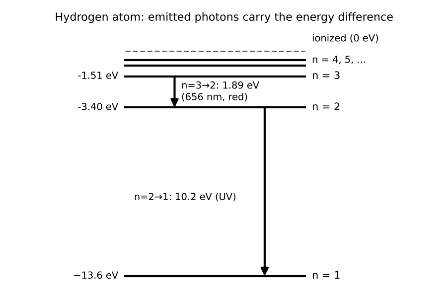
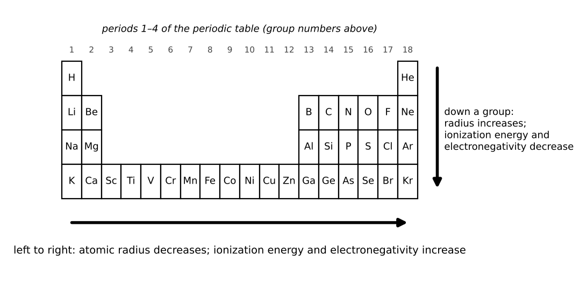

# Lesson 9: Electronic Structure and Periodic Trends

**What you will be able to do**

- Use the Bohr model of hydrogen to find energy levels and the photons emitted or absorbed in transitions.
- Apply the photoelectric effect and explain what it says about the nature of light.
- Write ground-state electron configurations for atoms and ions, and find the number of unpaired electrons.
- Predict trends in atomic radius, ionization energy, electron affinity and electronegativity.
- Recognize the main groups of the periodic table and their characteristic chemistry.

**Why it matters for the exam**

Category 4E asks you to predict an atom's physical and chemical behavior from its configuration. The periodic table is provided on screen during the section, so you do not need to memorize atomic numbers, but you do need to know what the arrangement *means*: which direction radius grows, which direction ionization energy grows, and why. Almost every general chemistry topic that follows (bonding, solubility, acids and bases, redox) is a consequence of these trends.

Praxis Tip: Do not memorize the trends as separate facts. Learn the one cause behind most of them: across a period, the nuclear charge increases while the electrons are added to the same shell, so the electrons are pulled in more strongly. Down a group, new shells are added farther out. Most of the trends follow from those two sentences.

**Concept Review**

**Atomic structure and quantum numbers.** Electrons in an atom occupy **orbitals**, regions of space where the electron is likely to be found. Each electron is described by four quantum numbers:

| Quantum number | Symbol | Meaning | Allowed values |
|---|---|---|---|
| Principal | n | Shell (size, energy) | 1, 2, 3, ... |
| Angular momentum | l | Subshell (shape): s, p, d, f | 0 to n − 1 |
| Magnetic | mₗ | Orbital orientation | −l to +l |
| Spin | mₛ | Electron spin | +½ or −½ |

Subshell l = 0 is **s** (one orbital, holds 2 electrons), l = 1 is **p** (three orbitals, 6 electrons), l = 2 is **d** (five orbitals, 10 electrons), l = 3 is **f** (seven orbitals, 14 electrons). A shell n holds at most 2n² electrons.

The **Pauli exclusion principle**: no two electrons in an atom can have the same four quantum numbers, so an orbital holds at most two electrons, with opposite spins. **Hund's rule**: within a subshell, electrons fill separate orbitals singly, with parallel spins, before pairing up. The **Heisenberg uncertainty principle**: it is impossible to know both the position and the momentum of a particle exactly at the same time.

*Figure: Hydrogen energy levels; each arrow is a photon emitted or absorbed.*

**The Bohr model of hydrogen.** In the Bohr model, the electron in hydrogen occupies discrete energy levels:

    E_n = −13.6 eV / n²

The energy is negative because the electron is bound; n = 1 is the **ground state** and higher n are **excited states**. The energy needed to remove an electron completely (ionization) from the ground state is 13.6 eV. When the electron moves between levels, it absorbs or emits a photon whose energy equals the difference:

    ΔE = E_f − E_i = 13.6 eV × (1/n_i² − 1/n_f²)

A negative ΔE (n_f < n_i) means a photon is emitted; a positive ΔE means one is absorbed. The photon's energy is the magnitude of ΔE.

Atoms therefore show **line spectra**: only certain wavelengths are absorbed or emitted, a fingerprint of each element. The Bohr model works exactly only for one-electron atoms, but the idea of discrete levels holds generally.

Praxis Tip: The sign of ΔE tells you the direction. Falling to a lower n emits a photon; jumping to a higher n requires absorbing one. Spacing between levels shrinks as n grows, so the transitions to n = 1 produce the highest-energy photons.

**The photoelectric effect.** When light shines on a metal, electrons are ejected only if the photon energy exceeds a minimum, the **work function** φ of the metal. The maximum kinetic energy of the ejected electrons is

    KE_max = h f − φ

Below the **threshold frequency** f₀ = φ / h, no electrons are emitted no matter how intense the light is. Above it, increasing the intensity increases the *number* of electrons, not their energy. This showed that light comes in quanta (photons), one photon interacting with one electron.

**Electron configurations.** Electrons fill orbitals from lowest energy upward (the **Aufbau principle**), in an order that follows: 1s, 2s, 2p, 3s, 3p, 4s, 3d, 4p, 5s, 4d, 5p, 6s, and so on. The configuration is written as the occupied subshells with superscripts for electron counts, often abbreviated with a noble gas core. For example, oxygen (Z = 8): 1s² 2s² 2p⁴; iron (Z = 26): [Ar] 4s² 3d⁶.

- **Cations** (positive ions) lose electrons from the *outermost shell first*. Transition metals lose 4s electrons before 3d: Fe²⁺ is [Ar] 3d⁶.
- **Anions** gain electrons into the next available orbital.
- Two common exceptions: chromium is [Ar] 4s¹ 3d⁵ and copper is [Ar] 4s¹ 3d¹⁰, because half-filled and fully filled d subshells are especially stable.

**Paramagnetism and diamagnetism.** An atom or ion with one or more **unpaired** electrons is **paramagnetic** (weakly attracted to a magnetic field). One with all electrons paired is **diamagnetic** (weakly repelled).

Praxis Tip: To count unpaired electrons, draw the orbital boxes for the outer subshell and fill them one arrow at a time with the same spin before pairing. A drawing prevents the most frequent configuration mistake.

**Effective nuclear charge and shielding.** An outer electron does not feel the full nuclear charge, because the inner electrons partly screen it. The net pull is the **effective nuclear charge**, Z_eff. Across a period, Z_eff rises (more protons, with similar shielding), so atoms get smaller and hold their electrons more tightly. Down a group, added shells increase the distance and shielding, so atoms get larger and hold their outer electrons more loosely.

*Figure: Periodic trends: across a period and down a group.*

**Periodic trends.**

| Property | Across a period (left to right) | Down a group |
|---|---|---|
| Atomic radius | Decreases | Increases |
| Ionization energy | Increases | Decreases |
| Electron affinity (generally, how much energy is released on gaining an electron) | Generally more negative (more favorable) | Generally less favorable (with exceptions, such as Cl above F) |
| Electronegativity | Increases | Decreases |
| Metallic character | Decreases | Increases |

- **First ionization energy** is the energy required to remove the outermost electron from a gaseous atom. Two small irregularities appear within the general rise: boron is lower than beryllium (the electron removed is in a higher-energy p orbital), and oxygen is lower than nitrogen (in oxygen's 2p⁴ one orbital holds a pair, and the pair repulsion makes that electron easier to remove).
- **Successive ionization energies** jump sharply when the next electron must come from a full inner shell. A large jump between the second and third ionization energies says the atom has two valence electrons.
- **Electronegativity** measures how strongly an atom attracts bonding electrons. Fluorine is the most electronegative element; the trend rises toward the upper right of the table, excluding the noble gases.
- **Ionic radius:** a cation is smaller than its atom (fewer electrons, same protons). An anion is larger than its atom (more electrons repelling each other). For **isoelectronic** species (the same number of electrons), the one with more protons is smaller.

**Groups of the periodic table.** The vertical columns share valence-electron patterns and chemistry:

- **Alkali metals (group 1):** one valence electron, form +1 ions, very reactive.
- **Alkaline earth metals (group 2):** two valence electrons, form +2 ions.
- **Transition metals:** partly filled d subshells; often multiple oxidation states and colored compounds.
- **Halogens (group 17):** seven valence electrons, form −1 ions, very electronegative.
- **Noble gases (group 18):** full valence shells, chemically inert (under ordinary conditions).
- **Metals** are on the left and center, are good conductors and tend to lose electrons; **nonmetals** are on the right and tend to gain electrons; **metalloids** lie between.

**Worked Example 1: A hydrogen transition (skill: Bohr levels and photons)**

An electron in hydrogen falls from n = 3 to n = 2. What are the photon's energy and wavelength?

|ΔE| = 13.6 × (1/2² − 1/3²) = 13.6 × (1/4 − 1/9) = 13.6 × (5/36) = 1.89 eV (ΔE itself is −1.89 eV, since the atom loses energy). λ = 1,240 / 1.89 = 656 nm: red light, the famous H-alpha line.

For comparison, n = 2 → 1 gives 13.6 × (1 − 1/4) = 10.2 eV, an ultraviolet photon. Ionizing from n = 2 requires 13.6 / 4 = 3.4 eV.

**Worked Example 2: The photoelectric effect (skill: threshold and kinetic energy)**

A metal has a work function of 2.0 eV. (a) What is the maximum kinetic energy of electrons ejected by 400 nm light? (b) What is the longest wavelength that works? (c) What happens with very intense 700 nm light?

(a) Photon energy = 1,240 / 400 = 3.1 eV. KE_max = 3.1 − 2.0 = 1.1 eV.

(b) The threshold photon energy is 2.0 eV, so λ_max = 1,240 / 2.0 = 620 nm.

(c) A 700 nm photon has energy 1,240 / 700 = 1.77 eV, which is below 2.0 eV, so no electrons are emitted, however intense the light is. Intensity adds more photons but does not give any single photon more energy.

**Worked Example 3: Configurations and unpaired electrons (skill: ions)**

Write the ground-state configurations of Fe, Fe²⁺ and Fe³⁺ and count their unpaired electrons.

Fe (Z = 26): [Ar] 4s² 3d⁶. The six d electrons occupy five orbitals: one pair and four singles, so 4 unpaired electrons.

Fe²⁺: remove the two 4s electrons first: [Ar] 3d⁶, 4 unpaired electrons.

Fe³⁺: remove one more, from 3d: [Ar] 3d⁵, with one electron in each d orbital, 5 unpaired electrons (the maximum). Fe³⁺ is strongly paramagnetic.

Compare Zn²⁺: [Ar] 3d¹⁰, with all electrons paired and zero unpaired, so it is diamagnetic.

**Worked Example 4: Ranking by trend (skill: reasoning, not recall)**

(a) Rank Na, Mg, Al by atomic radius. (b) Rank O²⁻, F⁻, Na⁺, Mg²⁺ by radius. (c) Compare nitrogen and oxygen first ionization energies.

(a) Same period, so radius decreases left to right: Na > Mg > Al.

(b) These are isoelectronic (each has 10 electrons). The more protons, the stronger the pull: Mg²⁺ (12 protons) is smallest, then Na⁺ (11), then F⁻ (9), and O²⁻ (8) is largest. Order: O²⁻ > F⁻ > Na⁺ > Mg²⁺.

(c) Nitrogen's first ionization energy is higher than oxygen's, despite oxygen having more protons, because in oxygen the 2p⁴ configuration has a doubly occupied p orbital, and the repulsion between the paired electrons makes one of them easier to remove.

*Skill used:* giving the cause (Z_eff, shielding, repulsion) rather than citing a memorized rule.

**More Praxis Tips**

Praxis Tip: For isoelectronic ions, the species with the most protons is the smallest. Write the proton counts next to the ions and the ranking is immediate.

Praxis Tip: When a photoelectric question gives a wavelength, convert to energy using E = 1,240 / λ (nm) in eV, and compare with the work function. It is one line.

Praxis Tip: To write a cation configuration, first write the neutral atom's configuration, then remove electrons from the outermost shell (4s before 3d). Fe³⁺ has 23 electrons: start from [Ar] 4s² 3d⁶, remove the two 4s electrons and one 3d electron, and you get [Ar] 3d⁵. Do not fill 23 electrons by the Aufbau order, which would wrongly give 4s² 3d³.

Praxis Tip: The periodic table on the screen shows the group numbers and metals versus nonmetals. Use it to read valence electron counts and typical ion charges instead of recalling them.

Praxis Tip: For ionization energies, look for the big jump in a list of successive values. It marks the shell boundary and tells you the number of valence electrons.

**Common Mistakes**

- Removing 3d electrons before 4s when making a transition metal cation.
- Counting paired electrons as unpaired (or the reverse) in the d subshell.
- Forgetting that cations are smaller than their atoms and anions larger.
- Assuming a more intense light below the threshold frequency can eject electrons.
- Applying the Bohr formula to atoms with more than one electron.
- Treating oxygen as having a higher first ionization energy than nitrogen.

**Checkpoint Questions**

1. Which of the following atoms has the largest atomic radius?
   A. K
   B. Ca
   C. Br
   D. Kr

2. The ground-state Fe²⁺ ion has how many unpaired electrons?
   A. 0
   B. 2
   C. 5
   D. 4

3. Which electron transition in a hydrogen atom emits the photon of greatest energy?
   A. n = 4 to n = 3
   B. n = 2 to n = 1
   C. n = 3 to n = 2
   D. n = 1 to n = 2

4. Light of a frequency below the threshold frequency of a metal is directed at its surface at very high intensity. What happens?
   A. Electrons are ejected with high kinetic energy
   B. Electrons are ejected with low kinetic energy
   C. No electrons are ejected
   D. Electrons are ejected after a delay

5. Which of the following has the largest radius?
   A. F⁻
   B. O²⁻
   C. Na⁺
   D. Mg²⁺

6. Nitrogen has a higher first ionization energy than oxygen. The best explanation is that
   A. nitrogen has more protons than oxygen
   B. oxygen is larger than nitrogen
   C. in oxygen, repulsion between the paired electrons in one 2p orbital makes that electron easier to remove
   D. nitrogen has a lower effective nuclear charge

7. Which of the following elements has the highest electronegativity?
   A. Si
   B. P
   C. S
   D. Cl

---

**Stop here.** Answer every question on scratch paper before you read the reasons.

**Answers and reasons**

1. **A.** Radius decreases across a period and increases down a group. K is the leftmost of the fourth-period elements listed. (B is in the same period but farther right, so it is smaller; C is in the same period but far to the right, so it is smaller; D is a noble gas at the far right of the period, so it is smaller.)
2. **D.** Fe²⁺ is [Ar] 3d⁶: six electrons in five d orbitals gives one pair and four unpaired electrons. (A assumes all the d electrons are paired; B pairs two of the d electrons that Hund's rule would keep separate; C describes Fe³⁺, not Fe²⁺.)
3. **B.** The energy gaps between levels shrink as n increases, so the transition to the ground state, n = 2 to n = 1 (10.2 eV), emits the highest-energy photon. (A has a small energy gap between closely spaced levels; C has a smaller gap than the transition to n = 1; D absorbs a photon instead of emitting one.)
4. **C.** Each photon must carry at least the work function. Higher intensity adds photons but does not increase the energy of any one of them. (A confuses intensity with photon energy; B assumes intensity alone can supply the work function; D describes a classical wave picture that the experiment contradicted.)
5. **B.** These ions are isoelectronic (10 electrons). The ion with the fewest protons holds the electrons least tightly and is the largest. (A has one more proton than O²⁻, so it is smaller; C has three more protons than O²⁻, so it is smaller; D has four more protons than O²⁻, so it is the smallest.)
6. **C.** Oxygen's 2p⁴ configuration has a doubly occupied orbital; the repulsion between those two electrons lowers the energy needed to remove one. (A reverses the proton counts; B oxygen is smaller; the radius difference is not the explanation; D reverses the trend in Z_eff.)
7. **D.** Electronegativity increases from left to right across a period. Of these third-period elements, chlorine is farthest right. (A is farther left in the same period; B is farther left in the same period; C is one place left of Cl in the same period.)

Praxis Tip: After the checkpoint questions, look at each wrong choice and name the slip (wrong direction of a trend, wrong electron removed, intensity versus frequency). Log it in your error log ([Strategy: The Question Method](chapter:4)).

**Teach-Back and Spaced Review**

*Say this aloud in one breath:* "Hydrogen's energy levels are minus 13.6 eV over n squared, and a transition emits or absorbs the difference as a photon; light must carry at least the work function to free an electron, regardless of intensity; across a period the effective nuclear charge grows so atoms shrink and hold electrons harder, and down a group the opposite is true; and cations lose their outermost electrons first."

*Review schedule:* revisit this lesson after 1 day (redo Worked Examples 1 and 3 without looking), after 3 days (checkpoint questions from a blank page), after 7 days (a mixed set that includes [Lesson 7](chapter:14) photons and [Lesson 8](chapter:15) the nucleus), and after 21 days (explain the lesson aloud).

*Interleave:* alternate an atomic-structure problem with an optics problem and a nuclear problem. [Lesson 10](chapter:18) uses the periodic table to count atoms and balance reactions.

Praxis Tip: End each study session by writing, from memory, E_n = −13.6 / n², KE_max = h f − φ, the four quantum numbers with their allowed values, and the two ionization-energy irregularities (Be/B and N/O).

---

**Author verification note (remove before publishing)**

- All examples and questions are original. Verified: 13.6 × 5/36 = 1.89 eV, 656 nm; 10.2 eV; 3.4 eV; 3.1 − 2.0 = 1.1 eV; 620 nm; 1.77 eV; Fe configurations; isoelectronic ordering.
- Answer key positions: A, D, B, C, B, C, D.
- Verify against a chemistry reviewer: Hund's rule and Pauli wording; the exceptions for Cr and Cu; the N/O and Be/B ionization-energy explanations; the electron affinity trend (has irregularities); statement that noble gases are inert "under ordinary conditions."
- Category 4E topics covered: electronic structure (hydrogen orbitals, quantum numbers, ground and excited states, line spectra, Pauli, paramagnetism and diamagnetism, notation, Bohr atom, Heisenberg uncertainty, effective nuclear charge, photoelectric effect) and the periodic table (groups and trends: valence electrons, ionization energy, electron affinity, electronegativity, atomic and ionic sizes).
