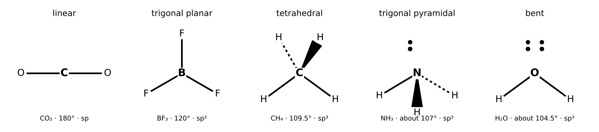

# Lesson 11: Covalent Bonding, Molecular Shape and Intermolecular Forces

**What you will be able to do**

- Draw Lewis structures, assign formal charges, and recognize resonance and Lewis acids and bases.
- Predict molecular shape with VSEPR, and the hybridization that goes with it.
- Decide whether a molecule is polar, and relate bond polarity to electronegativity.
- Count sigma and pi bonds, and relate bond order to bond length and strength.
- Rank substances by boiling point and solubility using intermolecular forces.

**Why it matters for the exam**

Category 5B, the nature of molecules and intermolecular interactions, supplies much of the explanatory power for chemistry and biology alike. Why does water boil at 100 °C when methane boils at −162 °C? Why do proteins fold? Why does a drug cross a membrane, and why does DNA hold its two strands together? The answer to each is a structure and an intermolecular force. Questions here are often qualitative: pick the correct shape, rank the boiling points, predict the solubility. They reward a systematic procedure more than memorization.

Praxis Tip: Run the same three steps for any molecule: Lewis structure, shape, polarity. In that order. Boiling point and solubility then follow from polarity and the kinds of intermolecular forces.

**Concept Review**

**Ionic and covalent bonding.** Atoms bond to reach more stable electron arrangements. In an **ionic bond**, electrons are transferred (typically from a metal to a nonmetal) and the resulting ions attract each other. In a **covalent bond**, atoms share electron pairs. Most real bonds are intermediate; a rough guide is that an electronegativity difference of about 0 gives a nonpolar covalent bond, a moderate difference gives a polar covalent bond, and a large difference gives an ionic bond. (This is a guide, not a hard line.)

**Lewis structures.** A Lewis structure shows valence electrons as bonds and lone pairs.

1. Count the total valence electrons (add for negative charge, subtract for positive).
2. Place the least electronegative atom in the center (hydrogen is always terminal).
3. Join the atoms with single bonds, then complete the octets of the outer atoms.
4. Put any remaining electrons on the central atom.
5. If the central atom lacks an octet, move lone pairs from outer atoms to make double or triple bonds.

Exceptions: hydrogen takes only two electrons. Boron and beryllium can have fewer than eight (BF₃). Elements in period 3 and below (such as S and P) can have an **expanded octet**, with more than eight electrons (PCl₅, SF₆).

**Formal charge.** Formal charge compares the electrons an atom "owns" in a structure with its valence electrons:

    formal charge = valence electrons − nonbonding electrons − ½ (bonding electrons)

The best Lewis structure usually has formal charges as close to zero as possible, with any negative charge on the most electronegative atom. The formal charges add up to the net charge of the species.

**Resonance.** When more than one valid Lewis structure can be drawn for the same arrangement of atoms, the real molecule is a **resonance hybrid**, an average of them. Electrons are **delocalized**, which lowers the energy and equalizes bond lengths. In the carbonate ion CO₃²⁻, all three C–O bonds are equal, with a bond order of about 1.33. Benzene's six carbon-carbon bonds are all equal for the same reason.

**Lewis acids and bases.** A **Lewis acid** accepts an electron pair; a **Lewis base** donates one. When BF₃ (an electron-deficient Lewis acid) reacts with NH₃ (which has a lone pair), a bond forms in which the nitrogen donates both electrons.

*Figure: Common VSEPR shapes, from linear to octahedral.*

**VSEPR: predicting shape.** Valence shell electron pair repulsion says that regions of electron density around a central atom (bonds count as one region regardless of order, and lone pairs count as regions too) arrange themselves to be as far apart as possible.

Each line gives: regions and lone pairs, then molecular shape, example, hybridization and approximate angle.

- 2 regions, 0 lone pairs: linear; CO₂; sp; 180°.
- 3 regions, 0 lone pairs: trigonal planar; BF₃; sp²; 120°.
- 3 regions, 1 lone pair: bent; SO₂; sp²; slightly under 120°.
- 4 regions, 0 lone pairs: tetrahedral; CH₄; sp³; 109.5°.
- 4 regions, 1 lone pair: trigonal pyramidal; NH₃; sp³; about 107°.
- 4 regions, 2 lone pairs: bent; H₂O; sp³; about 104.5°.
- 5 regions, 0 lone pairs: trigonal bipyramidal; PCl₅; sp³d; 90° and 120°.
- 6 regions, 0 lone pairs: octahedral; SF₆; sp³d²; 90°.

The electron geometry is the arrangement of all regions: linear (2), trigonal planar (3), tetrahedral (4), trigonal bipyramidal (5), octahedral (6).

Lone pairs take up more room than bonding pairs, which is why NH₃ and H₂O have bond angles below 109.5°.

**Sigma and pi bonds, and hybridization.** A **sigma (σ) bond** is formed by end-on overlap of orbitals, along the axis joining the nuclei. Every single bond is a σ bond. A **pi (π) bond** is formed by side-on overlap of p orbitals above and below the axis; it exists only in addition to a σ bond. A double bond is one σ plus one π; a triple bond is one σ plus two π.

Hybridization mixes atomic orbitals to form orbitals that point toward the neighbors: sp³ (four orbitals, tetrahedral), sp² (three in a plane, plus one unhybridized p orbital left to form a π bond), sp (two, linear, plus two p orbitals for two π bonds). The hybridization of a carbon can be read from its regions of electron density: 4 → sp³, 3 → sp², 2 → sp.

**Bond order, length and energy.** As bond order increases from single to double to triple, the bond gets **shorter and stronger**. A π bond is weaker than a σ bond, and π bonds also make the molecule rigid, because rotation around a double bond would break the p-orbital overlap. That rigidity is the reason cis-trans isomerism exists ([Lesson 18](chapter:28)).

| Carbon-carbon bond | Approx. length | Relative strength |
|---|---|---|
| C–C (single) | longest | weakest |
| C=C (double) | intermediate | intermediate |
| C≡C (triple) | shortest | strongest |

**Polarity and dipole moments.** A bond is **polar** if the atoms differ in electronegativity; the more electronegative atom bears a partial negative charge (δ⁻). The **dipole moment** is a vector measuring the separation of charge (units: debye). A molecule is polar only if its bond dipoles do not cancel. Shape matters: CO₂ has two polar bonds pointing in opposite directions, so the molecule is nonpolar; H₂O has two polar bonds at about 104.5°, which add, so it is polar. Similarly CCl₄ (tetrahedral, symmetric) is nonpolar, while CHCl₃ is polar.

Praxis Tip: To test polarity, ask whether the molecule is symmetric enough that the bond dipoles cancel. Symmetric shapes with identical outer atoms and no lone pairs on the central atom (linear, trigonal planar, tetrahedral, trigonal bipyramidal, octahedral) are nonpolar.

**Intermolecular forces.** These are attractions *between* molecules, much weaker than covalent bonds. In order of increasing strength for molecules of similar size:

1. **London dispersion forces** (van der Waals): temporary, induced dipoles. Present in all molecules; stronger for larger, more polarizable molecules (more electrons, longer chains).
2. **Dipole-dipole forces:** between permanent dipoles of polar molecules.
3. **Hydrogen bonding:** a particularly strong dipole-dipole attraction between a hydrogen bonded to N, O or F and a lone pair on another N, O or F.
4. **Ion-dipole forces:** between an ion and a polar molecule (how salts dissolve in water). These are strong, and are the major force in aqueous solutions of salts.

Stronger intermolecular forces mean a higher boiling point, a higher melting point, a higher viscosity and a lower vapor pressure.

**Solubility: like dissolves like.** Polar and ionic substances dissolve in polar solvents such as water; nonpolar substances dissolve in nonpolar solvents such as hexane. Ethanol mixes with water because it hydrogen-bonds with it. Oil and water do not mix because the water molecules prefer each other (hydrogen bonds) to the oil.

**Worked Example 1: Lewis structures and formal charge (skill: counting electrons)**

Draw the carbonate ion CO₃²⁻ and assign formal charges.

Valence electrons: C 4 + 3 × O 6 + 2 (for the charge) = 24. Carbon in the center, three oxygens around it. Single bonds use 6 electrons; completing the oxygen octets uses 18 more, for 24 total, but carbon has only 6 electrons. Convert one oxygen's lone pair into a C=O double bond.

Formal charges: carbon: 4 − 0 − ½(8) = 0. Double-bonded O: 6 − 4 − ½(4) = 0. Each single-bonded O: 6 − 6 − ½(2) = −1. Total: 0 + 0 − 1 − 1 = −2 ✓.

The double bond can be placed on any of the three oxygens, giving three resonance structures. The actual ion has three identical C–O bonds of bond order (1 + 1 + 2)/3 = 1.33 and each oxygen carries −2/3 of a charge.

**Worked Example 2: Shape, hybridization and polarity (skill: the three steps)**

Predict the shape, hybridization and polarity of (a) CO₂, (b) NH₃, (c) H₂O, (d) CH₄.

- CO₂: 2 regions (two double bonds); linear; sp; nonpolar, because the C=O dipoles cancel.
- NH₃: 4 regions (3 bonds + 1 lone pair); trigonal pyramidal; sp³; polar.
- H₂O: 4 regions (2 bonds + 2 lone pairs); bent; sp³; polar.
- CH₄: 4 regions (4 bonds); tetrahedral; sp³; nonpolar, because it is symmetric.

**Worked Example 3: Counting bonds (skill: sigma and pi)**

Count the σ and π bonds in ethane (C₂H₆), ethene (C₂H₄) and ethyne (C₂H₂), give the hybridization of the carbons, and order the C–C bond lengths.

Ethane: 7 σ (6 C–H + 1 C–C), 0 π. Carbons sp³. Ethene: 5 σ (4 C–H + 1 C–C) and 1 π. Carbons sp². Ethyne: 3 σ (2 C–H + 1 C–C) and 2 π. Carbons sp.

Bond length: ethane (single) > ethene (double) > ethyne (triple). Bond strength is the reverse.

**Worked Example 4: Ranking boiling points (skill: identify the dominant force)**

Rank ethane (C₂H₆), dimethyl ether (CH₃OCH₃) and ethanol (CH₃CH₂OH) by boiling point. All have similar molar mass (30, 46, 46).

Ethane: nonpolar, only dispersion forces. Dimethyl ether: polar (bent C–O–C), dipole-dipole forces, but no O–H bond so no hydrogen bonding between molecules. Ethanol: has an O–H bond, so it forms hydrogen bonds.

Order: ethane < dimethyl ether < ethanol. (Approximate real values: −89 °C, −24 °C, 78 °C.)

*Reading it.* Ethanol and dimethyl ether have the same formula, C₂H₆O, and differ by more than 100 °C, because hydrogen bonding is possible in only one of them.

**Worked Example 5: Predicting solubility (skill: like dissolves like)**

Predict whether each dissolves well in water: (a) NaCl, (b) hexane, (c) ethanol.

(a) NaCl: ionic; ion-dipole attractions with water compensate for breaking the crystal. Dissolves. (b) Hexane: nonpolar, only dispersion forces; water would have to give up hydrogen bonds. Does not dissolve. (c) Ethanol: polar with an O–H group that hydrogen-bonds with water. Dissolves in all proportions.

**More Praxis Tips**

Praxis Tip: To get a quick electron count for Lewis structures, use the periodic table's group numbers for valence electrons. You do not need to recall them.

Praxis Tip: For boiling-point rankings, ask in order: Is there hydrogen bonding? Is it polar? How big is it? Size breaks ties among otherwise similar molecules.

Praxis Tip: Count lone pairs *before* naming the shape. A common error is to call H₂O "linear" because it has three atoms.

Praxis Tip: A π bond requires an unhybridized p orbital. If you can say "this carbon has four σ bonds," it has no π bonds, and it is sp³.

Praxis Tip: Remember that hydrogen bonds are *intermolecular forces*, not covalent bonds. The H–O bond inside a water molecule is covalent and much stronger than the hydrogen bond between water molecules.

**Common Mistakes**

- Counting a double bond as two regions of electron density in VSEPR.
- Forgetting that lone pairs affect shape but not the name of the electron geometry.
- Calling a molecule polar because it contains polar bonds, without checking for symmetry.
- Confusing hydrogen bonding with covalent O–H bonds.
- Placing a double bond in the wrong resonance position and concluding the bond lengths differ.
- Assuming larger molecules always have higher boiling points even when hydrogen bonding is present in a smaller one.

**Checkpoint Questions**

1. What is the molecular shape of NH₃?
   A. Trigonal planar
   B. Trigonal pyramidal
   C. Tetrahedral
   D. Bent

2. Which of the following molecules is nonpolar?
   A. CO₂
   B. H₂O
   C. NH₃
   D. CHCl₃

3. Which of the following has the highest boiling point?
   A. CH₄
   B. CH₃Cl
   C. CH₃OH
   D. C₂H₆

4. What is the hybridization of the carbon atom in HCN?
   A. sp³
   B. sp²
   C. sp³d
   D. sp

5. How many sigma (σ) and pi (π) bonds are in ethyne (HC≡CH)?
   A. 5 σ and 0 π
   B. 2 σ and 3 π
   C. 3 σ and 2 π
   D. 3 σ and 1 π

6. Which of the following has the shortest carbon-carbon bond?
   A. Ethane (C₂H₆)
   B. Ethyne (C₂H₂)
   C. Ethene (C₂H₄)
   D. They all have the same bond length

7. What is the formal charge on nitrogen in the ammonium ion, NH₄⁺, in which nitrogen forms four single bonds and has no lone pairs?
   A. +1
   B. 0
   C. −1
   D. +4

---

**Stop here.** Answer every question on scratch paper before you read the reasons.

**Answers and reasons**

1. **B.** NH₃ has four regions of electron density (three bonds and one lone pair), so the electron geometry is tetrahedral and the molecular shape, with the lone pair not counted, is trigonal pyramidal. (A ignores the lone pair on nitrogen; C gives the electron geometry rather than the molecular shape; D describes a molecule with two bonds and two lone pairs, such as H₂O.)
2. **A.** CO₂ is linear and symmetric, so its two equal C=O bond dipoles point in opposite directions and cancel. (B is bent, so its bond dipoles add; C is pyramidal with a lone pair, so it is polar; D has three Cl atoms and one H, so it is asymmetric and polar.)
3. **C.** Methanol has an O–H group and forms hydrogen bonds, the strongest intermolecular force among the choices. (A has only weak dispersion forces; B has dipole-dipole forces but no hydrogen bonding; D has only weak dispersion forces.)
4. **D.** In H–C≡N, carbon has two regions of electron density (one single bond and one triple bond), so it is sp hybridized and the molecule is linear. (A would require four sigma bonds or lone pairs on carbon; B would require three regions of electron density; C requires an expanded octet, which carbon cannot have.)
5. **C.** The C≡C triple bond contains one σ and two π bonds. Each C–H bond is a σ bond. That gives 3 σ (two C–H plus one C–C) and 2 π. (A treats the molecule as having only single bonds; B reverses the counts of sigma and pi bonds; D counts the triple bond as having only one pi bond.)
6. **B.** The higher the bond order, the shorter and stronger the bond. Ethyne has a triple bond. (A has a C–C single bond, the longest of the series; C has a double bond, which is longer than a triple bond; D ignores the effect of bond order.)
7. **A.** Formal charge = valence electrons − nonbonding electrons − ½(bonding electrons) = 5 − 0 − 4 = +1. (B uses a lone pair that is not there; C has the sign reversed; D counts bonds instead of applying the formula.)

Praxis Tip: After the checkpoint questions, look at each wrong choice and name the slip (lone pair ignored, symmetry ignored, hydrogen bond versus covalent bond). Log it in your error log ([Strategy: The Question Method](chapter:4)).

**Teach-Back and Spaced Review**

*Say this aloud in one breath:* "I draw the Lewis structure, count regions of electron density to get the shape and hybridization, check symmetry for polarity, and then let the strongest intermolecular force, whether hydrogen bonding, dipole-dipole or dispersion, set the boiling point and solubility; and the more bonds between two atoms, the shorter and stronger the bond."

*Review schedule:* revisit this lesson after 1 day (redo Worked Examples 1 and 4 without looking), after 3 days (checkpoint questions from a blank page), after 7 days (a mixed set that includes [Lesson 9](chapter:17) periodic trends and [Lesson 10](chapter:18) stoichiometry), and after 21 days (explain the lesson aloud).

*Interleave:* alternate a bonding problem with a periodic-trends problem and a fluids problem. [Lesson 18](chapter:28) builds on these ideas in organic molecules.

Praxis Tip: End each study session by writing, from memory, the VSEPR table (regions, shape, hybridization, angle), the formal-charge formula, and the order of intermolecular force strength.

---

**Author verification note (remove before publishing)**

- All examples and questions are original. Verified: carbonate electron count 24 and formal charges summing to −2; sigma/pi counts (7 σ; 5 σ + 1 π; 3 σ + 2 π); boiling points are approximate (ethane about −89 °C, dimethyl ether about −24 °C, ethanol about 78 °C).
- Answer key positions: B, A, C, D, C, B, A.
- Verify with a chemistry reviewer: the hybridization/VSEPR table, especially expanded-octet entries; the electronegativity-difference guide; the "lone pairs take up more room" wording.
- Category 5B topics covered: Lewis structures and resonance, formal charge, Lewis acids and bases, partial ionic character and dipole moment, sigma and pi bonds and hybridization, VSEPR, multiple bonding effects on length and energy, intermolecular forces (hydrogen bonding, dipole interactions, van der Waals/London). Stereochemistry is in Lesson 18.
