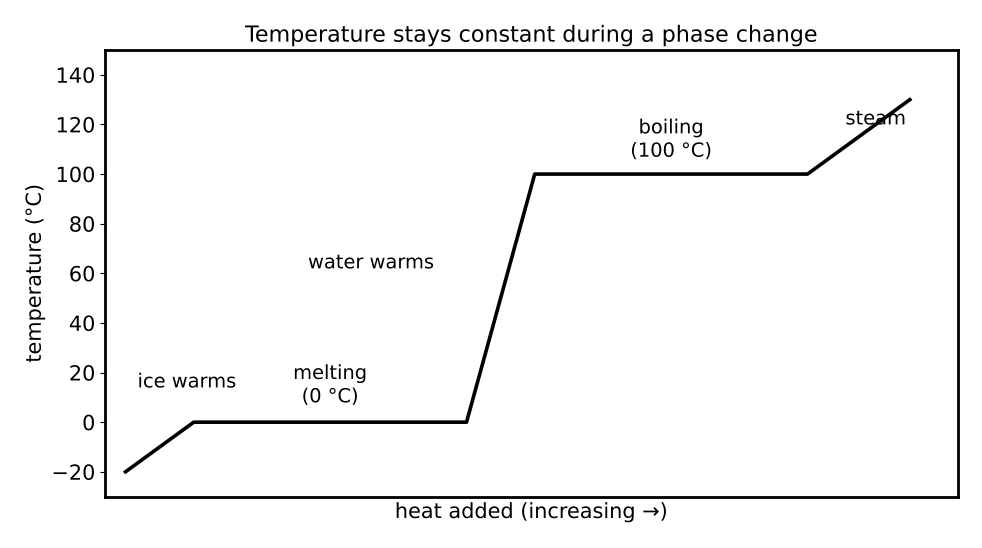

# Lesson 14: Thermochemistry and Thermodynamics

**What you will be able to do**

- Distinguish system, surroundings and state functions, and apply the zeroth, first and second laws.
- Calculate heat with q = m c ΔT and with latent heats, and interpret calorimetry data.
- Compute reaction enthalpy using standard enthalpies of formation, Hess's law and bond energies.
- Use ΔG = ΔH − TΔS to predict spontaneity, and relate ΔG° to the equilibrium constant.
- Read a PV diagram and a phase diagram.

**Why it matters for the exam**

Category 5E covers the principles of chemical thermodynamics and kinetics, and thermodynamics decides *whether* a reaction can go. The same logic describes the energetics of life: ATP hydrolysis drives other reactions, fats release more energy than sugars, and proteins fold because the overall free energy of the system falls. The exam asks for both calculation (how much heat? what sign is ΔG?) and reasoning (which way does the equilibrium lie? why does a temperature change matter?). A small set of relationships, applied with careful attention to signs, covers nearly all of it.

Praxis Tip: Thermodynamics is a sign game. Before you calculate, decide whether the system gains or loses energy, and attach the sign to every term. A calculation with a mistaken sign can look perfectly reasonable and still be completely wrong.

**Concept Review**

**System, surroundings and state functions.** The **system** is the part of the universe under study; everything else is the **surroundings**. A **state function** depends only on the current state of the system, not on how it got there: internal energy U, enthalpy H, entropy S, Gibbs free energy G, pressure, volume and temperature. **Heat** (q) and **work** (w) are *not* state functions; they describe processes.

**The laws of thermodynamics.**

- **Zeroth law:** if A is in thermal equilibrium with B, and B with C, then A is in thermal equilibrium with C. This is what makes temperature a meaningful property.
- **First law:** energy is conserved. The change in internal energy of a system equals the heat added to it minus the work it does on its surroundings: ΔU = Q − W. (Chemistry textbooks often write ΔU = q + w, with w the work done *on* the system. The two conventions agree physically; pay attention to which sign is meant.)
- **Second law:** the entropy of the universe increases in any spontaneous process: ΔS_universe > 0.

**Entropy.** **Entropy** (S) is a measure of the dispersal of energy, often described as disorder or the number of ways to arrange a system. Rules of thumb: entropy increases when a solid melts or a liquid vaporizes (S_solid < S_liquid < S_gas), when a gas expands, when a solid dissolves, when the number of gas molecules increases in a reaction, and when the temperature rises.

**Heat, temperature and heat capacity.** Heat is the transfer of thermal energy because of a temperature difference. For a substance that does not change phase:

    q = m c ΔT

where c is the **specific heat capacity** (for liquid water, 4.18 J/(g·K)). The heat capacity of an object is C = m c. Heat flows from hot to cold until the temperatures are equal. **Calorimetry** measures heat by observing a temperature change in a known mass of water: the heat gained by the water equals the heat released by the reaction (with opposite sign).

*Figure: Temperature plateaus while heat drives a phase change.*

**Phase changes.** During a phase change the temperature stays constant while heat is added or removed: q = m L, where L is the latent heat (the **heat of fusion** for melting, the **heat of vaporization** for boiling). For water, L_fusion ≈ 334 J/g and L_vaporization ≈ 2,260 J/g.

**Heat transfer.** Heat moves by **conduction** (direct contact, molecule to molecule), **convection** (movement of a fluid) and **radiation** (electromagnetic waves, needing no medium).

**Enthalpy.** At constant pressure, the heat exchanged by a reaction is the **enthalpy change** ΔH. A reaction with ΔH < 0 is **exothermic** (releases heat to the surroundings); one with ΔH > 0 is **endothermic** (absorbs heat). The **standard enthalpy of formation** ΔH_f° is the enthalpy change when one mole of a compound forms from its elements in their standard states (zero for elements in their standard states). Then

    ΔH°_rxn = Σ ΔH_f°(products) − Σ ΔH_f°(reactants)

**Hess's law.** The enthalpy change of a reaction is the same whether it occurs in one step or several, because H is a state function. You can add reactions (and their ΔH values), reverse them (changing the sign of ΔH), or multiply them (scaling ΔH).

**Bond energies.** The **bond dissociation energy** is the energy needed to break a bond. For a reaction in the gas phase,

    ΔH ≈ Σ (bond energies of bonds broken) − Σ (bond energies of bonds formed)

Breaking bonds costs energy; forming bonds releases it.

Praxis Tip: For bond-energy problems, keep the sign straight with the phrase "break is positive, make is negative." Then ΔH is simply the sum, and a negative total means exothermic.

**Gibbs free energy and spontaneity.** The **Gibbs free energy** combines enthalpy and entropy:

    ΔG = ΔH − T ΔS

A process at constant T and P is **spontaneous** (thermodynamically favorable) if ΔG < 0, at equilibrium if ΔG = 0, and non-spontaneous if ΔG > 0. The signs of ΔH and ΔS determine how temperature affects spontaneity:

| ΔH | ΔS | Spontaneous? |
|---|---|---|
| − | + | Always |
| + | − | Never |
| − | − | At low temperature |
| + | + | At high temperature |

The crossover temperature is T = ΔH / ΔS. Note that *spontaneous* means thermodynamically favorable; it says nothing about how fast the reaction goes ([Lesson 15](chapter:24)).

**Free energy and equilibrium.** Under standard conditions,

    ΔG° = −R T ln K_eq

A negative ΔG° means K_eq > 1 (products favored); a positive ΔG° means K_eq < 1; ΔG° = 0 means K_eq = 1. For electrochemical cells, ΔG° = −n F E° ([Lesson 17](chapter:26)). Away from standard conditions, ΔG = ΔG° + RT ln Q, which is why a reaction with positive ΔG° can still proceed if the cell keeps Q small by removing the product.

**PV diagrams and gas work.** For a gas, the work done by the system in an expansion at constant pressure is W = P ΔV. On a pressure-volume diagram, **the work equals the area under the curve**, and for a cyclic process the net work is the area enclosed by the loop. Four common processes: **isothermal** (constant T), **isobaric** (constant P), **isochoric** (constant V; no work) and **adiabatic** (no heat exchange, Q = 0). Conversion: 1 L·atm = 101.3 J.

**Phase diagrams.** A phase diagram plots pressure against temperature and shows which phase is stable. Lines separate the phases (solid-liquid, liquid-gas, solid-gas). The **triple point** is where all three coexist; the **critical point** marks the end of the liquid-gas line, beyond which the distinction between liquid and gas disappears. For most substances the solid-liquid line slopes up and to the right; for water, it slopes up and to the *left*, because ice is less dense than liquid water, so pressure favors melting.

**Thermal expansion.** Most materials expand when heated: ΔL = α L₀ ΔT, with α the coefficient of linear expansion.

**Energy in living systems.** The hydrolysis of ATP has a large negative ΔG (about −30 kJ/mol under standard biochemical conditions, pH 7), and cells use it to drive reactions that would otherwise be non-spontaneous by coupling them: the sum of the two ΔG values is negative. [Lesson 24](chapter:35) and Book 2 return to this.

**Worked Example 1: Calorimetry (skill: q = m c ΔT)**

(a) How much heat is needed to raise the temperature of 100 g of water from 20.0 °C to 30.0 °C? (b) When 0.0100 mol of a salt dissolves in 100 g of water in a coffee-cup calorimeter, the water temperature rises by 2.5 °C. What is ΔH per mole?

(a) q = m c ΔT = 100 × 4.18 × 10.0 = 4,180 J.

(b) Heat gained by the water: 100 × 4.18 × 2.5 = 1,045 J. The reaction released this heat, so q_rxn = −1,045 J, and ΔH = −1,045 J / 0.0100 mol = −104,500 J/mol ≈ −105 kJ/mol. The reaction is exothermic.

**Worked Example 2: Hess's law (skill: enthalpies of formation)**

Calculate ΔH° for CH₄ + 2 O₂ → CO₂ + 2 H₂O(l). The standard enthalpies of formation (kJ/mol) are: CH₄ −74.8; CO₂ −393.5; H₂O(l) −285.8; O₂ 0.

ΔH° = [−393.5 + 2(−285.8)] − [−74.8 + 2(0)] = [−965.1] − [−74.8] = −890.3 kJ per mole of CH₄. Strongly exothermic.

**Worked Example 3: Bond energies (skill: break minus make)**

Estimate ΔH for H₂ + Cl₂ → 2 HCl, given bond energies (kJ/mol): H–H 436, Cl–Cl 243, H–Cl 431.

Bonds broken: 436 + 243 = 679 kJ. Bonds formed: 2 × 431 = 862 kJ. ΔH ≈ 679 − 862 = −183 kJ. The reaction is exothermic because the bonds formed are stronger than those broken.

**Worked Example 4: Spontaneity and equilibrium (skill: ΔG and K)**

(a) A reaction has ΔH = +20 kJ/mol and ΔS = +100 J/(mol·K). Is it spontaneous at 300 K? Above what temperature? (b) A reaction has ΔG° = −11.4 kJ/mol at 298 K. What is K?

(a) ΔG = ΔH − TΔS = 20,000 − 300 × 100 = 20,000 − 30,000 = −10,000 J = −10 kJ, so it is spontaneous at 300 K. The crossover is T = ΔH / ΔS = 20,000 / 100 = 200 K; above 200 K it is spontaneous.

(b) ln K = −ΔG° / (RT) = 11,400 / (8.314 × 298) = 4.60, so K = e^4.60 ≈ 100. Products are strongly favored. (Rule of thumb: every −5.7 kJ/mol at 298 K is a factor of 10 in K.)

**Worked Example 5: Heating ice (skill: phase changes)**

How much heat is needed to turn 50 g of ice at 0 °C into liquid water at 20 °C? (L_fusion = 334 J/g; c = 4.18 J/(g·K).)

Melting: q₁ = m L = 50 × 334 = 16,700 J. Warming: q₂ = m c ΔT = 50 × 4.18 × 20 = 4,180 J. Total = 16,700 + 4,180 = 20,880 J ≈ 21 kJ.

*Reading it.* Melting the ice takes four times the heat of warming the resulting water by 20 °C, which is why ice is so effective at cooling a drink.

**Worked Example 6: Gas work (skill: P ΔV and the first law)**

A gas expands at a constant pressure of 2.0 atm from 1.0 L to 3.0 L. (a) How much work does it do? (b) If it absorbs 500 J of heat while doing 200 J of work, what is ΔU?

(a) W = P ΔV = 2.0 atm × 2.0 L = 4.0 L·atm = 4.0 × 101.3 J = 405 J.

(b) ΔU = Q − W = 500 − 200 = +300 J.

**More Praxis Tips**

Praxis Tip: Treat ΔH as "heat at constant pressure" and remember that exothermic means the number is negative. Say the word and the sign together until it is a habit.

Praxis Tip: For a quick sign check on ΔS, count the gas molecules. More gas molecules on the product side means ΔS > 0; fewer means ΔS < 0.

Praxis Tip: In calorimetry, the heat lost by the hot object equals the heat gained by the cold one. Set the two magnitudes equal and solve for the final temperature.

Praxis Tip: When a question asks about ΔG at a temperature other than 298 K, use ΔG = ΔH − TΔS with the temperature in kelvin, and keep the units consistent (kJ with kJ, or J with J).

Praxis Tip: In a phase diagram, move along a horizontal line to see the effect of temperature at constant pressure and along a vertical line to see the effect of pressure.

**Common Mistakes**

- Mixing J and kJ in ΔG = ΔH − TΔS.
- Using °C instead of kelvin in ΔG calculations.
- Calling a reaction with ΔG < 0 "fast."
- Forgetting to reverse the sign when reversing a reaction in Hess's law.
- Using the heat of fusion while the temperature is still changing, or the reverse.
- Treating heat and work as state functions.

**Checkpoint Questions**

1. How much heat is required to raise the temperature of 200 g of water by 5.0 °C? (c = 4.18 J/(g·K).)
   A. 0.17 kJ
   B. 1.0 kJ
   C. 4.2 kJ
   D. 21 kJ

2. Which of the following processes has a positive change in entropy?
   A. Water vapor condensing on a cold window
   B. A solid forming by precipitation from solution
   C. A gas being compressed into a smaller volume
   D. Ice melting into liquid water

3. A reaction has ΔH < 0 and ΔS > 0. It is
   A. spontaneous only at high temperatures
   B. spontaneous at all temperatures
   C. spontaneous only at low temperatures
   D. non-spontaneous at all temperatures

4. For an exothermic reaction at constant pressure, which statement is correct?
   A. ΔH is negative and heat flows from the system to the surroundings
   B. ΔH is positive and heat flows from the system to the surroundings
   C. ΔH is negative and heat flows from the surroundings to the system
   D. ΔH is zero because energy is conserved

5. The conversion of A to B has ΔH = −50 kJ, and the conversion of B to C has ΔH = −30 kJ. What is ΔH for the conversion of A directly to C?
   A. −20 kJ
   B. +80 kJ
   C. −1,500 kJ
   D. −80 kJ

6. A reaction has an equilibrium constant K greater than 1 at 298 K. Its standard free energy change ΔG° is
   A. negative
   B. positive
   C. zero
   D. equal to ΔH°

7. Heat is transferred through a metal spoon from a hot soup to your hand mainly by
   A. convection
   B. radiation
   C. conduction
   D. evaporation

---

**Stop here.** Answer every question on scratch paper before you read the reasons.

**Answers and reasons**

1. **C.** q = m c ΔT = 200 × 4.18 × 5.0 = 4,180 J ≈ 4.2 kJ. (A is far too small, the result of dividing instead of multiplying; B uses the temperature change as the heat; D multiplies by an extra factor of 5.)
2. **D.** Melting increases the freedom of motion of the molecules (S_liquid > S_solid), so ΔS > 0. (A decreases the dispersal of the molecules; B moves the particles into an ordered crystal; C gives the molecules fewer positions to occupy.)
3. **B.** ΔG = ΔH − TΔS: both terms push ΔG negative, so ΔG < 0 at every temperature. (A applies to ΔH > 0, ΔS > 0; C applies to ΔH < 0, ΔS < 0; D applies to ΔH > 0, ΔS < 0.)
4. **A.** An exothermic reaction releases heat to the surroundings, so the enthalpy of the system falls and ΔH < 0. (B gets the sign wrong; C gets the direction wrong; D confuses conservation of energy with no heat exchange.)
5. **D.** By Hess's law, enthalpy is a state function, so the steps add: −50 + (−30) = −80 kJ. (A subtracts the two values; B gets the overall sign wrong; C multiplies the two values.)
6. **A.** ΔG° = −RT ln K. When K > 1, ln K is positive, so ΔG° is negative. (B reverses the relationship; C would require K = 1; D ignores the entropy term.)
7. **C.** Heat moves through a solid by direct molecular contact, which is conduction. (A requires movement of a fluid; B does not need contact, and is not the main route through a solid; D is a phase change, not a mode of heat transfer through a solid.)

Praxis Tip: After the checkpoint questions, look at each wrong choice and name the slip (units, sign, spontaneous versus fast, kelvin). Log it in your error log ([Strategy: The Question Method](chapter:4)).

**Teach-Back and Spaced Review**

*Say this aloud in one breath:* "Energy is conserved, so the change in internal energy is heat in minus work out; heat is mass times specific heat times the temperature change, with phase changes handled separately by latent heat; reaction enthalpy is products minus reactants or bonds broken minus bonds made; and a reaction is spontaneous when delta G equals delta H minus T delta S is negative, which also means K is greater than one."

*Review schedule:* revisit this lesson after 1 day (redo Worked Examples 2 and 4 without looking), after 3 days (checkpoint questions from a blank page), after 7 days (a mixed set that includes [Lesson 3](chapter:9) energy and [Lesson 12](chapter:20) gases), and after 21 days (explain the lesson aloud).

*Interleave:* alternate a thermodynamics problem with a work-energy problem and a gas-law problem. [Lesson 15](chapter:24) adds the question of how fast, and where equilibrium lies.

Praxis Tip: End each study session by writing, from memory, ΔU = Q − W, q = m c ΔT, ΔH from formation enthalpies, ΔH from bond energies, ΔG = ΔH − TΔS and ΔG° = −RT ln K.

---

**Author verification note (remove before publishing)**

- All examples and questions are original. Verified: 4,180 J; −104.5 kJ/mol; −890.3 kJ; −183 kJ; ΔG = −10 kJ at 300 K and crossover 200 K; ln K = 4.60, K ≈ 100; 16,700 + 4,180 = 20,880 J; 405 J; ΔU = 300 J; 4.2 kJ for the checkpoint calorimetry question.
- Answer key positions: C, D, B, A, D, A, C.
- Resolved: latent heats of water (334 J/g, 2,260 J/g) and the ATP-hydrolysis ΔG°' value (about −30 kJ/mol). Open: sign convention for work in the first law (physics Q − W versus chemistry q + w) should be stated consistently with how the exam presents it.
- Category 5E topics covered: thermodynamic system and state functions, zeroth, first and second laws, PV diagrams, entropy, calorimetry and heat capacity, heat transfer (conduction, convection, radiation), endothermic and exothermic reactions, enthalpy and Hess's law, bond dissociation energies, free energy and spontaneity, coefficient of expansion, heats of fusion and vaporization, phase diagrams, and the bioenergetics link (ATP). Kinetics and equilibrium are in Lesson 15; enzymes in Lesson 24.
