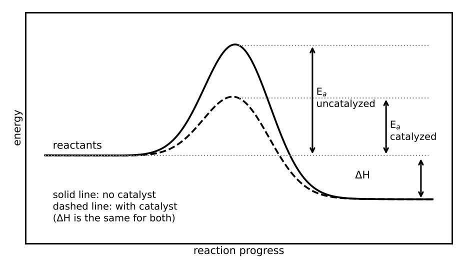

# Lesson 15: Kinetics and Equilibrium

**What you will be able to do**

- Determine a rate law and reaction order from concentration and rate data, and use integrated rate laws and half-lives.
- Explain how concentration, temperature and catalysts affect rate, using collision theory and the Arrhenius equation.
- Read reaction-energy diagrams and relate a mechanism to its rate law.
- Write equilibrium expressions, compare Q with K, and solve simple equilibrium problems with an ICE table.
- Predict shifts in equilibrium with Le Chatelier's principle.

**Why it matters for the exam**

Thermodynamics ([Lesson 14](chapter:23)) says whether a reaction can go; kinetics says how fast; equilibrium says where it ends up. The three questions are different and the exam enjoys testing whether you can keep them apart. Kinetics is also the language of enzymes ([Lesson 24](chapter:35)) and of drug clearance, and equilibrium is the language of buffers ([Lesson 16](chapter:25)), oxygen binding and metabolic regulation. Questions in this lesson mostly ask for direction and proportion: does the rate go up or down, does the equilibrium shift left or right, by what factor?

Praxis Tip: Always ask which of the three questions a problem is about: favorable (thermodynamics), fast (kinetics), or how far (equilibrium). Many wrong answers come from answering a neighbor of the actual question.

**Concept Review**

**Reaction rate.** The rate of a reaction is the change in concentration of a reactant or product per unit time, in M/s. For the reaction aA → products, rate = −(1/a) Δ[A]/Δt (a positive number, since the reactant is being consumed); dividing by the coefficient makes the rate the same whichever species you follow.

**Rate laws.** The **rate law** expresses the rate as a function of reactant concentrations:

    rate = k [A]^m [B]^n

where k is the **rate constant** (which depends on temperature), and m and n are the **orders** in A and B, determined by experiment (not from the balanced equation). The **overall order** is m + n. The units of k depend on the overall order.

- **Zeroth order:** the rate is independent of [A]. A plot of [A] versus time is a straight line.
- **First order:** rate = k [A]. A plot of ln [A] versus time is a straight line with slope −k. The half-life is constant: t½ = ln 2 / k = 0.693 / k.
- **Second order:** rate = k [A]². A plot of 1/[A] versus time is a straight line with slope k.

**Method of initial rates.** Compare experiments in which one concentration changes and the others stay fixed. If doubling [A] doubles the rate, the order in A is 1; if it quadruples the rate, the order is 2; if it has no effect, the order is 0.

Praxis Tip: Do the comparison by ratio: (factor change in rate) = (factor change in concentration)^order. Doubling and quadrupling are easy to read without logarithms.

**Collision theory and temperature.** For molecules to react they must collide with enough energy (at least the **activation energy**, E_a) and with the proper orientation. Raising the concentration increases the collision frequency. Raising the temperature increases both the collision frequency and, much more importantly, the fraction of collisions with energy above E_a. The **Arrhenius equation** describes the effect:

    k = A e^(−E_a / RT)

so k increases with temperature and decreases with larger E_a. A rule of thumb: many reactions near room temperature roughly double in rate for each 10 K rise.

**Catalysts.** A **catalyst** speeds a reaction by providing a pathway with a lower activation energy. It is not consumed. It speeds the forward and reverse reactions equally, so it **does not change the equilibrium constant, ΔG, or the position of equilibrium**; it only gets there faster. Enzymes are biological catalysts.

*Figure: A catalyst lowers the activation energy but not the overall ΔE.*

**Reaction-energy diagrams.** A diagram of energy against reaction progress shows reactants, products, an energy barrier (the **transition state**, a maximum) and sometimes valleys (**intermediates**, species that form and are consumed). The forward activation energy is the height from the reactants to the top of the barrier; ΔH is the difference in energy between products and reactants:

    ΔH = E_a(forward) − E_a(reverse)

**Mechanisms.** Most reactions occur in several elementary steps. The slowest step is the **rate-determining step**, and the rate law of the overall reaction is determined by it (together with any fast steps before it). For an elementary step, the orders equal the molecularity (the coefficients).

**Equilibrium.** A reaction at **chemical equilibrium** has equal forward and reverse rates, so the concentrations are constant (though not necessarily equal). For aA + bB ⇌ cC + dD:

    K_c = [C]^c [D]^d / ([A]^a [B]^b)

Pure solids and pure liquids are omitted from the expression. K_p uses partial pressures. A large K favors products; a small K favors reactants. K depends only on temperature.

**The reaction quotient.** Q has the same form as K but uses the *current* concentrations.

- Q < K: the reaction proceeds forward (toward products).
- Q = K: at equilibrium.
- Q > K: the reaction proceeds in reverse (toward reactants).

**Le Chatelier's principle.** If a stress is applied to a system at equilibrium, the system shifts to partly counteract it.

| Stress | Shift |
|---|---|
| Add reactant (or remove product) | Toward products |
| Add product (or remove reactant) | Toward reactants |
| Increase pressure (decrease volume) | Toward the side with fewer moles of gas |
| Increase temperature | Toward the endothermic direction (K changes) |
| Add a catalyst | No shift (equilibrium reached faster) |
| Add an inert gas at constant volume | No shift |

Only a change in temperature changes the value of K.

Praxis Tip: Treat heat as a reactant or a product. For an exothermic reaction, heat is a product, so adding heat is "adding product" and shifts the equilibrium left.

**ICE tables.** To solve for equilibrium concentrations, build a table with rows for Initial, Change and Equilibrium concentrations; express the changes in terms of an unknown x using the coefficients; substitute into the K expression; and solve for x.

**Worked Example 1: Initial rates (skill: reading orders from data)**

For the reaction A + B → products, three experiments give:

| Experiment | [A] (M) | [B] (M) | Initial rate (M/s) |
|---|---|---|---|
| 1 | 0.10 | 0.10 | 2.0 × 10⁻³ |
| 2 | 0.20 | 0.10 | 4.0 × 10⁻³ |
| 3 | 0.10 | 0.20 | 8.0 × 10⁻³ |

Experiments 1 and 2: [A] doubles, [B] fixed, the rate doubles. Order in A = 1. Experiments 1 and 3: [B] doubles, the rate quadruples. Order in B = 2.

Rate law: rate = k [A][B]². Using Experiment 1: k = 2.0 × 10⁻³ / [(0.10)(0.10)²] = 2.0 × 10⁻³ / 1.0 × 10⁻³ = 2.0 M⁻² s⁻¹. The overall order is 3.

**Worked Example 2: First-order decay (skill: half-life)**

A first-order reaction has k = 0.0231 min⁻¹. (a) Find the half-life. (b) If [A]₀ = 0.80 M, what is [A] after 90 min?

(a) t½ = 0.693 / 0.0231 = 30 min. (b) 90 min = 3 half-lives, so [A] = 0.80 × (1/2)³ = 0.10 M.

*Skill used:* treating a first-order process exactly like radioactive decay ([Lesson 8](chapter:15)).

**Worked Example 3: Temperature and rate (skill: Arrhenius)**

A reaction has E_a = 50 kJ/mol. By what factor does the rate constant change when the temperature rises from 300 K to 310 K?

ln (k₂/k₁) = (E_a / R)(1/T₁ − 1/T₂) = (50,000 / 8.314)(1/300 − 1/310) = 6,014 × 1.075 × 10⁻⁴ = 0.647. So k₂/k₁ = e^0.647 ≈ 1.9: close to a doubling for a 10 K rise, consistent with the rule of thumb.

**Worked Example 4: An ICE table (skill: solving for equilibrium concentrations)**

For H₂ + I₂ ⇌ 2 HI, K_c = 50 at a certain temperature. If 1.0 M H₂ and 1.0 M I₂ are placed in a container, find the equilibrium concentrations.

| | [H₂] | [I₂] | [HI] |
|---|---|---|---|
| Initial | 1.0 | 1.0 | 0 |
| Change | −x | −x | +2x |
| Equilibrium | 1.0 − x | 1.0 − x | 2x |

K = (2x)² / (1.0 − x)² = 50. Take the square root of both sides: 2x / (1.0 − x) = 7.07, so 2x = 7.07 − 7.07x, 9.07x = 7.07, and x = 0.78.

Equilibrium: [HI] = 2x = 1.56 M; [H₂] = [I₂] = 1.0 − 0.78 = 0.22 M.

*Check.* (1.56)² / (0.22)² = 2.43 / 0.0484 = 50 ✓. Because K is large, most of the reactants have been converted.

**Worked Example 5: Predicting a shift (skill: Q versus K and Le Chatelier)**

(a) For A ⇌ B with K_c = 4.0, the current concentrations are [A] = 0.50 M and [B] = 3.0 M. Which way does the reaction go? (b) For N₂ + 3 H₂ ⇌ 2 NH₃ (exothermic), predict the shift for adding N₂, increasing the pressure, raising the temperature, and adding a catalyst.

(a) Q = [B] / [A] = 3.0 / 0.50 = 6.0 > K = 4.0, so the system shifts toward the reactants (left).

(b) Adding N₂: shifts right (toward NH₃). Increasing the pressure: shifts right (4 moles of gas on the left, 2 on the right). Raising the temperature: shifts left (the forward reaction is exothermic), and K decreases. Adding a catalyst: no shift.

**Worked Example 6: A mechanism (skill: rate-determining step)**

A two-step mechanism for NO₂ + CO → NO + CO₂ is: Step 1 (slow): NO₂ + NO₂ → NO₃ + NO. Step 2 (fast): NO₃ + CO → NO₂ + CO₂. What is the rate law? What is the intermediate?

The slowest step controls the rate, and for an elementary step the rate law follows its molecularity: rate = k [NO₂]². CO does not appear, because it reacts only in the fast step. The intermediate is NO₃ (formed in step 1 and consumed in step 2). The overall reaction (adding the steps and cancelling NO₃ and one NO₂) is NO₂ + CO → NO + CO₂.

**More Praxis Tips**

Praxis Tip: The rate law is an experimental result. You cannot read it off the balanced equation unless the reaction is a single elementary step.

Praxis Tip: For half-life questions, check whether the process is first order. If the half-life stays the same as the concentration falls, it is. If it doubles each time, it is second order.

Praxis Tip: A catalyst changes the *path*, not the *destination*. Check any answer choice that says a catalyst changes K, ΔH or ΔG: it is wrong.

Praxis Tip: If a question shifts an equilibrium by adding a pure solid or pure liquid, nothing happens. They do not appear in K.

Praxis Tip: For the effect of temperature on equilibrium, look at the sign of ΔH. Endothermic reactions have K increase with T; exothermic reactions have K decrease with T.

**Common Mistakes**

- Writing the rate law from the stoichiometric coefficients of a multi-step reaction.
- Confusing the rate constant k (depends on T) with the rate (depends on concentrations).
- Saying a catalyst shifts the equilibrium.
- Including solids or liquids in K.
- Using the sign of ΔG to answer a question about rate.
- Using initial concentrations as if they were equilibrium concentrations.

**Checkpoint Questions**

1. Doubling the concentration of reactant A, with everything else unchanged, quadruples the initial rate of a reaction. The reaction is
   A. first order in A
   B. second order in A
   C. zeroth order in A
   D. fourth order in A

2. A first-order reaction has a half-life of 20 minutes. What fraction of the reactant remains after 60 minutes?
   A. 1/3
   B. 1/6
   C. 1/8
   D. 1/4

3. Adding a catalyst to a reaction at equilibrium will
   A. shift the equilibrium toward the products
   B. increase the value of K
   C. change the ΔH of the reaction
   D. speed up the approach to equilibrium without changing the value of K

4. The reaction A + B ⇌ C is endothermic. If the temperature of the system at equilibrium is increased, the equilibrium
   A. shifts toward the products and K increases
   B. shifts toward the reactants and K decreases
   C. shifts toward the products but K is unchanged
   D. does not shift

5. For a reaction at a given temperature, the reaction quotient Q is larger than the equilibrium constant K. The reaction will
   A. proceed toward the products until Q = K
   B. remain at its present composition
   C. proceed toward the reactants until Q = K
   D. stop, because K has changed

6. Which is the correct equilibrium expression for 2 SO₂(g) + O₂(g) ⇌ 2 SO₃(g)?
   A. K = [SO₂]² [O₂] / [SO₃]²
   B. K = [SO₃]² / ([SO₂]² [O₂])
   C. K = [SO₃] / ([SO₂] [O₂])
   D. K = 2[SO₃] / (2[SO₂] + [O₂])

7. In a multistep reaction mechanism, the rate-determining step is
   A. the slowest elementary step
   B. the fastest elementary step
   C. the step with the largest overall energy release
   D. the last step in the mechanism

---

**Stop here.** Answer every question on scratch paper before you read the reasons.

**Answers and reasons**

1. **B.** Rate ∝ [A]ⁿ, and 2ⁿ = 4 gives n = 2. (A would double the rate; C would leave the rate unchanged; D would multiply the rate by 16.)
2. **C.** 60 minutes is three half-lives, so the fraction remaining is (1/2)³ = 1/8. (A divides 1 by the number of half-lives; B divides 1 by twice the number of half-lives; D counts only two half-lives.)
3. **D.** A catalyst lowers the activation energy for the forward and reverse reactions equally, so equilibrium is reached faster but K, ΔG and ΔH are unchanged. (A gives a catalyst thermodynamic influence it does not have; B confuses rate with equilibrium; C confuses the pathway with the endpoints.)
4. **A.** Heat acts as a reactant in an endothermic reaction, so adding heat shifts the equilibrium toward products, and K, which depends on temperature, increases. (B applies the rule for an exothermic reaction; C forgets that K depends on temperature; D applies the catalyst rule.)
5. **C.** When Q > K there is too much product relative to equilibrium, so the net reaction runs in reverse. (A applies the rule for Q < K; B would require Q = K; D is wrong because K depends only on temperature, which did not change.)
6. **B.** K is products over reactants, with each concentration raised to the power of its coefficient. (A inverts the expression; C omits the coefficients as exponents; D multiplies instead of using exponents.)
7. **A.** The overall rate cannot exceed the rate of the slowest step, which acts as a bottleneck. (B reverses the idea; C confuses thermodynamics with kinetics; D confuses position with speed.)

Praxis Tip: After the checkpoint questions, look at each wrong choice and name the slip (catalyst shifts equilibrium, Q and K reversed, order from coefficients). Log it in your error log ([Strategy: The Question Method](chapter:4)).

**Teach-Back and Spaced Review**

*Say this aloud in one breath:* "A rate law gives the rate as a constant times concentrations raised to experimentally determined orders; raising the temperature or adding a catalyst makes a reaction faster by raising the fraction of collisions over the barrier or lowering the barrier; at equilibrium forward and reverse rates are equal and K is products over reactants; and the system shifts toward products if Q is below K and toward reactants if Q is above K, with Le Chatelier telling me which way a stress pushes."

*Review schedule:* revisit this lesson after 1 day (redo Worked Examples 1 and 4 without looking), after 3 days (checkpoint questions from a blank page), after 7 days (a mixed set that includes [Lesson 14](chapter:23) thermodynamics and [Lesson 13](chapter:21) solubility), and after 21 days (explain the lesson aloud).

*Interleave:* alternate a kinetics problem with an equilibrium problem and a thermodynamics problem. [Lesson 16](chapter:25) applies equilibrium to acids and bases.

Praxis Tip: End each study session by writing, from memory, the general rate law, the first-order half-life, the Arrhenius equation, the K expression, and the Le Chatelier table.

---

**Author verification note (remove before publishing)**

- All examples and questions are original. Verified: k = 2.0 M⁻² s⁻¹; t½ = 30 min; 0.10 M; k₂/k₁ = 1.9; x = 0.78, [HI] = 1.56 M, [H₂] = 0.22 M, K check = 50; Q = 6.0 > 4.0.
- Answer key positions: B, C, D, A, C, B, A.
- Verify with a chemistry reviewer: the statement "many reactions roughly double per 10 K" (a rule of thumb with exceptions); the Le Chatelier table, especially the inert-gas row; the ΔH = E_a(forward) − E_a(reverse) relation.
- Category 5E topics covered (Rate Processes in Chemical Reactions): reaction rate, rate laws and rate constants, reaction order, rate-determining step, collision theory, activation energy and the Arrhenius relation, catalysis, reaction-energy diagrams, equilibrium constants, Le Chatelier's principle, and the relation to free energy. Enzyme kinetics is in Lesson 24.
