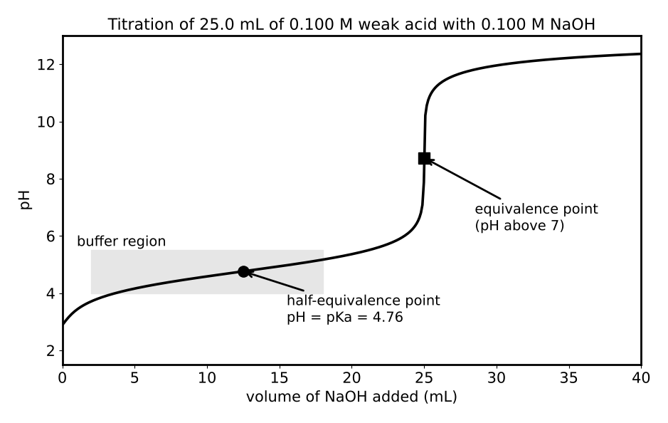

# Lesson 16: Acids, Bases, Buffers and Titration

**What you will be able to do**

- Use pH, pOH, Kw, Ka and Kb, and identify conjugate acid-base pairs.
- Calculate the pH of strong and weak acids and bases, and of salt solutions.
- Apply the Henderson-Hasselbalch equation to buffers and explain how buffers resist change.
- Interpret titration curves, find equivalence and half-equivalence points, and choose indicators.
- Connect these ideas to physiological buffers, especially the bicarbonate system in blood.

**Why it matters for the exam**

Acid-base chemistry is the second half of category 5A and one of the most heavily used ideas in the whole section. Enzymes work within narrow pH ranges, amino acids change charge with pH ([Lesson 23](chapter:34)), blood must stay near pH 7.4, and half the drugs you meet are weak acids or bases. The calculations are short, and nearly all of them reduce to a handful of equations plus the ability to estimate logarithms ([Strategy: The Quantitative Toolkit](chapter:5)). This lesson is a good place to practice reasoning in orders of magnitude.

Praxis Tip: Before calculating a pH, say whether the answer should be acidic, neutral or basic. A pH answer on the wrong side of 7 means a step went wrong.

**Concept Review**

**Acids and bases.** In the **Brønsted-Lowry** definition, an acid donates a proton (H⁺) and a base accepts one. When an acid donates a proton, what remains is its **conjugate base**; when a base accepts a proton, it becomes its **conjugate acid**. In HA + H₂O ⇌ A⁻ + H₃O⁺, HA/A⁻ and H₃O⁺/H₂O are the conjugate pairs. A species that can act as either an acid or a base is **amphiprotic** (water, HCO₃⁻). The more general **Lewis** definition (from [Lesson 11](chapter:19)) defines an acid as an electron-pair acceptor.

**Water and pH.** Water autoionizes: 2 H₂O ⇌ H₃O⁺ + OH⁻. The equilibrium constant is

    Kw = [H⁺][OH⁻] = 1.0 × 10⁻¹⁴ (at 25 °C)

In pure water at 25 °C, [H⁺] = [OH⁻] = 1.0 × 10⁻⁷ M. The scales are

    pH = −log [H⁺],  pOH = −log [OH⁻],  pH + pOH = 14 (at 25 °C)

A solution is acidic if pH < 7, neutral at 7, and basic if pH > 7 (at 25 °C). Each pH unit is a factor of 10 in [H⁺].

**Strong acids and bases.** Strong acids dissociate completely: HCl, HBr, HI, HNO₃, HClO₄, and (for the first proton) H₂SO₄. Strong bases: the hydroxides of group 1 (NaOH, KOH) and the heavier group 2 hydroxides (Ba(OH)₂, Ca(OH)₂, which are only moderately soluble). For a strong monoprotic acid, [H⁺] equals the acid concentration; for a strong base, [OH⁻] equals the base concentration (times the number of OH⁻ per formula unit).

**Weak acids and bases.** Weak acids ionize only partially: HA ⇌ H⁺ + A⁻ with

    Ka = [H⁺][A⁻] / [HA],  pKa = −log Ka

A smaller pKa (larger Ka) means a stronger acid. For a weak base, B + H₂O ⇌ BH⁺ + OH⁻, with Kb. For a conjugate pair,

    Ka × Kb = Kw,  pKa + pKb = 14

so the conjugate base of a weak acid is a weak base, and a *stronger* acid has a *weaker* conjugate base.

**pH of a weak acid.** If the acid is weak and not too dilute, x = [H⁺] is small compared with the starting concentration C, so Ka ≈ x² / C and

    [H⁺] ≈ √(Ka × C)

The approximation is acceptable if x is less than about 5 percent of C. The **percent ionization** is (x / C) × 100.

**Hydrolysis of salts.** The ions of a salt can react with water.

- Salt of a strong acid and strong base (NaCl): neutral.
- Salt of a weak acid and strong base (sodium acetate): the anion is a weak base, so the solution is **basic**.
- Salt of a strong acid and weak base (ammonium chloride): the cation is a weak acid, so the solution is **acidic**.

**Polyprotic acids.** Acids with more than one ionizable proton (H₂CO₃, H₃PO₄) lose protons stepwise, and each step has its own Ka, with Ka₁ > Ka₂ > Ka₃. The first ionization dominates the pH.

**Buffers.** A **buffer** resists changes in pH when small amounts of acid or base are added. It is a solution of a weak acid and its conjugate base (or a weak base and its conjugate acid) in comparable amounts. The weak acid neutralizes added base and the conjugate base neutralizes added acid. The pH is given by the **Henderson-Hasselbalch equation**:

    pH = pKa + log ([A⁻] / [HA])

- When [A⁻] = [HA], pH = pKa.
- A tenfold excess of A⁻ raises the pH by 1 unit above pKa; a tenfold excess of HA lowers it by 1.
- A buffer works best within about ±1 pH unit of its pKa, and its **capacity** increases with the total concentration of the buffer components.
- Adding strong acid converts some A⁻ into HA; adding strong base converts some HA into A⁻. Because the pH depends on a *ratio*, it changes little.

Praxis Tip: To find the pH of a buffer after adding acid or base, do the stoichiometry first (moles of A⁻ and HA after the reaction), then use Henderson-Hasselbalch with the new ratio. The volume cancels out of the ratio.

*Figure: Weak acid titrated with strong base: buffer region, half-equivalence (pH = pKa) and equivalence point.*

**Titration.** In a **titration**, a solution of known concentration (the titrant) is added to a sample until the reaction is complete. The **equivalence point** is where moles of titrant equal the moles of analyte (stoichiometrically). An **indicator** is a weak acid or base whose color change signals the **endpoint**; the indicator should change color near the pH at the equivalence point.

| Titration | pH at equivalence | Notes |
|---|---|---|
| Strong acid + strong base | 7 | Steep jump around pH 7 |
| Weak acid + strong base | Above 7 | The conjugate base is present; **half-equivalence point: pH = pKa** |
| Weak base + strong acid | Below 7 | The conjugate acid is present; half-equivalence: pOH = pKb |

The flat region before the equivalence point in a weak acid titration is the buffer region. A **redox titration** uses an oxidizing or reducing titrant with a color change or a potential to mark the endpoint (for example, permanganate, which is purple).

**The bicarbonate buffer in blood.** Blood is buffered mainly by the CO₂/bicarbonate system:

    CO₂ + H₂O ⇌ H₂CO₃ ⇌ H⁺ + HCO₃⁻

with an effective pKa of about 6.1. At a blood pH of 7.4, the ratio [HCO₃⁻]/[CO₂ + H₂CO₃] = 10^(7.4 − 6.1) = 10^1.3 ≈ 20. The lungs control the CO₂ (breathing faster removes CO₂ and raises the pH), and the kidneys control the bicarbonate. Disruptions are classified as acidosis (blood pH below about 7.35) and alkalosis (above about 7.45).

**Worked Example 1: Strong acids and bases (skill: logs without a calculator)**

(a) What is the pH of 0.020 M HCl? (b) What is the pH of 0.010 M NaOH?

(a) [H⁺] = 0.020 = 2.0 × 10⁻² M. pH = 2 − log 2 = 2 − 0.30 = 1.70.

(b) [OH⁻] = 0.010 M, so pOH = 2.0 and pH = 14 − 2.0 = 12.0.

**Worked Example 2: A weak acid (skill: the square-root shortcut)**

A 0.010 M solution of a weak acid HA has Ka = 1.0 × 10⁻⁶. Find the pH and the percent ionization.

[H⁺] ≈ √(Ka C) = √(1.0 × 10⁻⁶ × 1.0 × 10⁻²) = √(1.0 × 10⁻⁸) = 1.0 × 10⁻⁴ M. pH = 4.0.

Percent ionization = (1.0 × 10⁻⁴ / 1.0 × 10⁻²) × 100 = 1.0 percent, which is under 5 percent, so the approximation is valid.

**Worked Example 3: A buffer, before and after (skill: Henderson-Hasselbalch)**

A buffer contains 0.20 M acetic acid and 0.20 M acetate in 1.0 L (pKa = 4.76). (a) What is its pH? (b) What is the pH after adding 0.010 mol of HCl? (c) What would the pH of 1.0 L of pure water become after the same addition?

(a) [A⁻] = [HA], so pH = pKa = 4.76.

(b) The H⁺ converts acetate to acetic acid: acetate 0.20 − 0.010 = 0.19 mol; acetic acid 0.20 + 0.010 = 0.21 mol. pH = 4.76 + log (0.19 / 0.21) = 4.76 − 0.04 = 4.72.

(c) In water, [H⁺] = 0.010 M and pH = 2.0.

*Reading it.* The buffer's pH changed by 0.04, while the water's pH changed by 5 units. That is a buffer doing its job.

**Worked Example 4: The bicarbonate ratio (skill: reading a ratio from pH and pKa)**

At pH 7.4 with pKa 6.1, what is the ratio of bicarbonate to dissolved CO₂? What happens to the pH if CO₂ rises?

log ratio = 7.4 − 6.1 = 1.3, so ratio = 10^1.3 ≈ 20. If CO₂ rises (hypoventilation), the denominator increases, the ratio falls, and the pH falls: respiratory acidosis.

**Worked Example 5: A titration curve (skill: key points)**

25.0 mL of 0.100 M weak acid HA (pKa = 4.76) is titrated with 0.100 M NaOH. Find (a) the volume at the equivalence point, (b) the pH at the half-equivalence point, (c) the pH at the equivalence point.

(a) Moles HA = 0.0250 L × 0.100 M = 2.50 mmol. At equivalence, moles NaOH = 2.50 mmol, so V = 2.50 / 0.100 = 25.0 mL.

(b) The half-equivalence point is at 12.5 mL. There [HA] = [A⁻], so pH = pKa = 4.76.

(c) At equivalence all HA has become A⁻. The total volume is 50.0 mL, so [A⁻] = 2.50 mmol / 50.0 mL = 0.0500 M. Kb = Kw / Ka = 1.0 × 10⁻¹⁴ / 1.74 × 10⁻⁵ = 5.7 × 10⁻¹⁰. [OH⁻] ≈ √(Kb C) = √(5.7 × 10⁻¹⁰ × 0.0500) = √(2.9 × 10⁻¹¹) = 5.4 × 10⁻⁶ M. pOH = 5.27, pH = 8.73.

*Reading it.* The equivalence-point pH of 8.7 is basic, as expected for the conjugate base of a weak acid. An indicator that changes near pH 9, such as phenolphthalein, suits this titration better than one that changes near pH 4.

**Worked Example 6: Salt solutions (skill: which ion reacts)**

Predict whether each is acidic, basic or neutral: NH₄Cl, CH₃COONa, NaCl, NaHCO₃ (the bicarbonate ion is amphiprotic).

NH₄Cl: NH₄⁺ is the conjugate acid of a weak base, so the solution is acidic. CH₃COONa: acetate is the conjugate base of a weak acid, so basic. NaCl: neutral. NaHCO₃: mildly basic.

**More Praxis Tips**

Praxis Tip: The log table helps: log 2 ≈ 0.30, log 3 ≈ 0.48, log 5 ≈ 0.70. A concentration written as a × 10⁻ⁿ has pH = n − log a.

Praxis Tip: For a buffer problem that gives amounts, compute moles (not concentrations) of each component; the ratio of moles equals the ratio of concentrations in the same volume.

Praxis Tip: At the half-equivalence point of a weak acid titration, pH = pKa. This is the favorite one-line question in this topic.

Praxis Tip: Check whether the 5 percent rule holds for a weak acid approximation. If the acid is very weak or very dilute, the approximation can fail and the problem needs a more careful treatment, although the exam rarely goes there.

Praxis Tip: When comparing acids, compare pKa values. Lower pKa means stronger acid. If a question gives Ka, convert mentally: Ka = 10⁻⁵ means pKa = 5.

**Common Mistakes**

- Reporting a pH above 7 for an acid solution.
- Using concentrations instead of moles in a buffer after adding strong acid or base.
- Forgetting that the equivalence-point pH of a weak acid-strong base titration is above 7.
- Treating pKa as the pH of a solution of the acid (it is the pH at which the acid and its conjugate base are present in equal amounts).
- Confusing the equivalence point (stoichiometric) with the endpoint (indicator color change).
- Forgetting to adjust for dilution when mixing solutions.

**Checkpoint Questions**

1. What is the pH of a 1.0 × 10⁻³ M solution of the strong acid HNO₃?
   A. 3.0
   B. 11.0
   C. 1.0
   D. 7.0

2. Four weak acids have the following pKa values. Which is the strongest acid?
   A. pKa = 5
   B. pKa = 7
   C. pKa = 10
   D. pKa = 2

3. A buffer contains equal concentrations of a weak acid HA and its conjugate base A⁻. The pH of the buffer is
   A. 7.0
   B. equal to pKa + 1
   C. equal to the pKa of HA
   D. equal to 14 − pKa

4. Which of the following mixtures would make an effective buffer?
   A. Hydrochloric acid and sodium chloride
   B. Acetic acid and sodium acetate
   C. Sodium hydroxide and sodium chloride
   D. Sodium chloride and sodium nitrate

5. A weak acid is titrated with a strong base. At the equivalence point, the pH is
   A. equal to 7, because the acid and base have neutralized each other
   B. less than 7, because the acid is weak
   C. equal to the pKa of the acid
   D. greater than 7, because of the conjugate base

6. Blood has a pH of 7.4, and the effective pKa of the bicarbonate buffer is about 6.1. The ratio [HCO₃⁻] / [CO₂ + H₂CO₃] is approximately
   A. 1.3
   B. 0.05
   C. 20
   D. 2.0

7. A solution has a pH of 9.0 at 25 °C. The hydroxide ion concentration is
   A. 1 × 10⁻⁹ M
   B. 1 × 10⁻⁵ M
   C. 1 × 10⁻⁷ M
   D. 1 × 10⁻⁴ M

---

**Stop here.** Answer every question on scratch paper before you read the reasons.

**Answers and reasons**

1. **A.** HNO₃ is a strong acid, so [H⁺] = 1.0 × 10⁻³ M and pH = −log (10⁻³) = 3.0. (B is the pH of a strong base of the same concentration; C uses the wrong exponent; D assumes the solution is neutral.)
2. **D.** A lower pKa means a larger Ka, which means a stronger acid. (A has a smaller Ka than the acid with pKa 2; B is a weaker acid than the first two; C is the weakest acid of the group.)
3. **C.** With [A⁻] = [HA], log ([A⁻]/[HA]) = log 1 = 0, so pH = pKa. (A assumes all buffers are neutral; B would need a tenfold excess of A⁻; D uses the wrong relationship.)
4. **B.** A buffer needs a weak acid and its conjugate base (or a weak base and its conjugate acid) in comparable amounts. (A pairs a strong acid with a neutral salt; C pairs a strong base with a neutral salt; D contains no acid-base pair at all.)
5. **D.** At equivalence, the weak acid has been converted entirely to its conjugate base, which reacts with water to produce OH⁻. (A applies to strong acid-strong base titrations; B ignores the conjugate base that is now present; C applies to the half-equivalence point.)
6. **C.** pH = pKa + log (ratio), so log (ratio) = 7.4 − 6.1 = 1.3 and the ratio is 10^1.3 ≈ 20. (A reports the pH difference instead of the ratio; B inverts the ratio; D has no basis in the equation.)
7. **B.** pOH = 14 − 9.0 = 5.0, so [OH⁻] = 10⁻⁵ M. (A is the hydrogen ion concentration; C is the value in pure water; D miscalculates pOH as 4.0.)

Praxis Tip: After the checkpoint questions, look at each wrong choice and name the slip (strong versus weak, pKa direction, ratio inverted, dilution ignored). Log it in your error log ([Strategy: The Question Method](chapter:4)).

**Teach-Back and Spaced Review**

*Say this aloud in one breath:* "pH is minus log of the hydrogen ion concentration and pH plus pOH is fourteen; a weak acid's pH comes from the square root of Ka times C, and a lower pKa means a stronger acid; a buffer holds pH near its pKa through Henderson-Hasselbalch because it depends on a ratio; and in a weak acid titration the half-equivalence point is pH equals pKa and the equivalence point is basic."

*Review schedule:* revisit this lesson after 1 day (redo Worked Examples 3 and 5 without looking), after 3 days (checkpoint questions from a blank page), after 7 days (a mixed set that includes [Lesson 15](chapter:24) equilibrium and [Lesson 13](chapter:21) solutions), and after 21 days (explain the lesson aloud).

*Interleave:* alternate an acid-base problem with a solubility problem and a kinetics problem. [Lesson 17](chapter:26) turns to electrochemistry.

Praxis Tip: End each study session by writing, from memory, Kw, pH + pOH, Ka × Kb = Kw, [H⁺] ≈ √(Ka C), and Henderson-Hasselbalch.

---

**Author verification note (remove before publishing)**

- All examples and questions are original. Verified: pH 1.70 and 12.0; [H⁺] = 1.0 × 10⁻⁴ and 1.0 percent; pH 4.76 and 4.72; ratio 10^1.3 = 19.95 ≈ 20; V_eq = 25.0 mL; Kb = 5.7 × 10⁻¹⁰, [OH⁻] = 5.4 × 10⁻⁶, pH 8.73.
- Answer key positions: A, D, C, B, D, C, B.
- Resolved: effective pKa of the bicarbonate system (about 6.1) and the normal blood pH range (about 7.35 to 7.45); strong acid and base lists; claim that Ba(OH)₂ and Ca(OH)₂ are only moderately soluble.
- Category 5A topics covered: Brønsted-Lowry acids and bases, ionization of water and Kw, pH, conjugate pairs, strong and weak acids and bases, Ka/Kb/pKa/pKb, hydrolysis of salts, buffers, titration curves and indicators, redox titration; plus ions in solution and solubility in Lesson 13.
