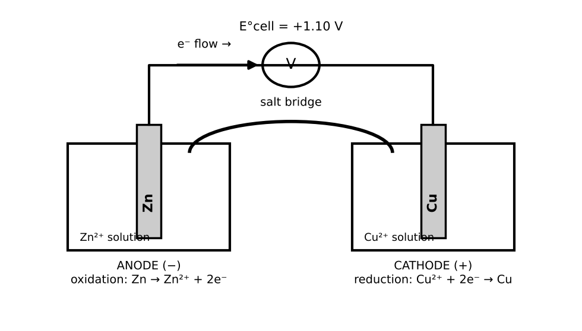

# Lesson 17: Electrochemistry

**What you will be able to do**

- Distinguish galvanic (voltaic) cells from electrolytic cells, and identify the anode, cathode and direction of electron flow in each.
- Calculate cell potentials from standard reduction potentials, and relate E° to ΔG° and the equilibrium constant.
- Use the Nernst equation, including for concentration cells and for membrane potentials.
- Apply Faraday's law to relate current, time and the amount of substance deposited.
- Connect electrochemistry to batteries and to biological electron carriers.

**Why it matters for the exam**

Category 4C joins circuits ([Lesson 5](chapter:12)) with chemistry: when a chemical reaction moves electrons through a wire, you have a battery; when a current drives a reaction, you have electrolysis. The same logic describes the voltage across a nerve membrane and the electron-transport chain that powers your cells. Exam questions use a small toolkit: spot the anode and cathode, add up potentials, apply Nernst to a concentration change, and count electrons with Faraday's constant.

Praxis Tip: Two mnemonics will carry you through half of this lesson: **LEO the lion says GER** (Loss of Electrons is Oxidation; Gain of Electrons is Reduction) and **An Ox, Red Cat** (Anode: Oxidation; Reduction: Cathode). These identify the electrodes by what happens at them, in every type of cell.

**Concept Review**

**Redox, half-reactions and electrodes.** In a redox reaction, electrons are transferred ([Lesson 10](chapter:18)). An electrochemical cell separates the two half-reactions so that the electrons must travel through an external wire. At every electrode in every type of cell:

- The **anode** is where **oxidation** occurs.
- The **cathode** is where **reduction** occurs.

An electrolyte (ions in solution or a molten salt) completes the circuit inside the cell, and in many cells a **salt bridge** or porous barrier allows ions to move between the two half-cells, preserving charge neutrality without letting the solutions mix. Electrons travel through the wire; ions carry the current through the solution. **Anions migrate toward the anode, and cations toward the cathode.**

*Figure: Galvanic cell: oxidation at the anode, reduction at the cathode, electrons through the wire.*

**Galvanic (voltaic) cells.** A galvanic cell uses a **spontaneous** redox reaction to produce electrical energy. The cell potential is positive.

- Electrons flow through the external wire from the anode to the cathode.
- The anode is the **negative** electrode and the cathode is the **positive** electrode.
- Example: a zinc electrode in Zn²⁺ and a copper electrode in Cu²⁺. Zn is oxidized at the anode, Cu²⁺ is reduced at the cathode.

**Electrolytic cells.** An electrolytic cell uses an external source of electrical energy to drive a **non-spontaneous** reaction (electrolysis). The cell potential for the reaction as written is negative, so the applied voltage must exceed it.

- Oxidation still occurs at the anode and reduction at the cathode, but now the signs of the electrodes are reversed: the anode is the **positive** electrode (connected to the positive terminal of the power source) and the cathode is the **negative** electrode.
- Example: electrolysis of molten NaCl produces sodium metal at the cathode (Na⁺ + e⁻ → Na) and chlorine gas at the anode (2 Cl⁻ → Cl₂ + 2 e⁻).

Praxis Tip: The names "anode" and "cathode" always follow oxidation and reduction. The plus and minus signs depend on the type of cell. Learn the processes first and derive the signs from the type of cell.

**Standard reduction potentials.** Each half-reaction has a **standard reduction potential**, E°, measured in volts against a reference (the standard hydrogen electrode, defined as 0.00 V) at 1 M concentrations and 1 atm. The more positive E°, the greater the tendency to be reduced. Selected values (V): Li⁺/Li −3.04; Mg²⁺/Mg −2.37; Zn²⁺/Zn −0.76; H⁺/H₂ 0.00; Cu²⁺/Cu +0.34; Ag⁺/Ag +0.80; F₂/F⁻ +2.87. (Treat these as typical textbook values; any value a question needs will normally be given to you.)

The cell potential is

    E°_cell = E°_cathode − E°_anode

(both taken as *reduction* potentials; do not change them when you multiply a half-reaction by a coefficient). A positive E°_cell means the reaction is spontaneous as written. A species with a more negative E° is a stronger reducing agent; one with a more positive E° is a stronger oxidizing agent.

**Free energy and equilibrium.** The cell potential is related to the free energy and to the equilibrium constant:

    ΔG° = −n F E°_cell,  with F = 96,485 C/mol (Faraday's constant)
    E°_cell = (0.0592 / n) log K (at 25 °C)

Positive E° means negative ΔG° and K > 1.

**The Nernst equation.** Away from standard conditions,

    E = E° − (RT / nF) ln Q = E° − (0.0592 / n) log Q (at 25 °C)

where Q is the reaction quotient ([Lesson 15](chapter:24)). As a galvanic cell runs, Q increases and E falls; at equilibrium E = 0 and the battery is "dead".

**Concentration cells.** A concentration cell has the same electrode material and the same ions in both half-cells, differing only in concentration. E° = 0, but E is not: the cell drives itself toward equal concentrations. The more concentrated side is where reduction occurs (the cathode).

**Faraday's law of electrolysis.** The amount of substance produced at an electrode is proportional to the charge passed:

    charge Q = I t (coulombs = amperes × seconds)
    moles of electrons = I t / F
    moles of product = (moles of electrons) / (electrons per ion)

**Batteries.** A battery is one or more galvanic cells in series. Its **electromotive force (EMF)** is the voltage when no current flows. Examples: the lead-storage battery (lead and lead dioxide in sulfuric acid; rechargeable by electrolysis), and the nickel-cadmium battery (rechargeable). Rechargeable batteries are galvanic when discharging and electrolytic when charging.

**Electrochemistry in the body.** Cells use **soluble electron carriers**, mainly NAD⁺/NADH and FAD/FADH₂ (a flavin carried by flavoproteins), to move electrons from fuel molecules to the electron-transport chain. Nerve and muscle cells maintain a **membrane potential** because ions are more concentrated on one side of the membrane than the other. The equilibrium (Nernst) potential for an ion of charge z, at body temperature (37 °C), is approximately

    E_ion ≈ (61.5 mV / z) × log ([ion]_out / [ion]_in)

The constant 61.5 mV is 2.303 RT/F at 37 °C (310 K); at 25 °C it is the familiar 59.2 mV. The nerve impulse is a rapid change in these potentials ([Lesson 5](chapter:12) described the membrane as a capacitor).

**Worked Example 1: A galvanic cell (skill: potentials, ΔG and K)**

For the cell Zn(s) | Zn²⁺ ‖ Cu²⁺ | Cu(s), find E°_cell, ΔG° and K. (E°: Cu²⁺/Cu = +0.34 V; Zn²⁺/Zn = −0.76 V.)

The copper half-reaction has the more positive E°, so Cu²⁺ is reduced (cathode) and Zn is oxidized (anode). E°_cell = 0.34 − (−0.76) = +1.10 V.

ΔG° = −n F E° = −(2)(96,485)(1.10) = −2.12 × 10⁵ J = −212 kJ/mol.

log K = n E° / 0.0592 = (2)(1.10) / 0.0592 = 37.2, so K ≈ 10³⁷. An enormous K, as expected from a large positive E°.

Electron flow: from the Zn electrode (anode, negative) through the wire to the Cu electrode (cathode, positive). Through the salt bridge, anions move toward the Zn half-cell and cations toward the Cu half-cell.

**Worked Example 2: The Nernst equation (skill: Q)**

The same cell has [Zn²⁺] = 1.0 M and [Cu²⁺] = 0.010 M. Find E.

Reaction: Zn + Cu²⁺ → Zn²⁺ + Cu, so Q = [Zn²⁺] / [Cu²⁺] = 1.0 / 0.010 = 100.

E = 1.10 − (0.0592 / 2) log 100 = 1.10 − 0.0296 × 2 = 1.10 − 0.059 = 1.04 V.

*Reading it.* Lowering the concentration of a reactant (Cu²⁺) reduced the voltage, which is what Le Chatelier's principle would suggest.

**Worked Example 3: Faraday's law (skill: electrons to mass)**

A current of 2.00 A passes through a solution of Cu²⁺ for 965 s. What mass of copper is deposited? (M(Cu) = 63.5 g/mol.)

Charge = 2.00 × 965 = 1,930 C. Moles of electrons = 1,930 / 96,485 = 0.0200 mol. Cu²⁺ + 2 e⁻ → Cu, so moles of Cu = 0.0200 / 2 = 0.0100 mol. Mass = 0.0100 × 63.5 = 0.635 g.

**Worked Example 4: A concentration cell (skill: E° = 0 but E > 0)**

Two silver electrodes dip into Ag⁺ solutions of 0.010 M and 1.0 M, connected by a salt bridge and a wire. Find the cell voltage and identify the cathode.

E° = 0. The reaction runs to equalize concentrations: Ag⁺ is reduced in the concentrated half-cell (cathode) and Ag is oxidized in the dilute half-cell (anode). Q = [Ag⁺]_dilute / [Ag⁺]_concentrated = 0.010 / 1.0 = 0.010.

E = 0 − 0.0592 log (0.010) = −0.0592 × (−2) = +0.118 V. n = 1.

**Worked Example 5: Which metal reduces which ion? (skill: comparing E°)**

Will zinc metal reduce Cu²⁺? Will it reduce Mg²⁺?

Zn (E° of Zn²⁺/Zn = −0.76 V) is oxidized by any species with a higher E°. Cu²⁺/Cu is +0.34 V, so Zn reduces Cu²⁺: E°_cell = 0.34 + 0.76 = +1.10 V, spontaneous. Mg²⁺/Mg is −2.37 V, lower than Zn's, so Zn does not reduce Mg²⁺: E°_cell = −2.37 + 0.76 = −1.61 V, non-spontaneous. (Magnesium would reduce Zn²⁺ instead.)

**Worked Example 6: A membrane potential (skill: Nernst for an ion)**

A neuron has [K⁺]_in = 140 mM and [K⁺]_out = 5 mM. Estimate the equilibrium potential for K⁺ at 37 °C.

E_K = (61.5 mV / 1) × log (5 / 140) = 61.5 × log (0.0357) = 61.5 × (−1.447) = −89 mV.

*Reading it.* The inside of the cell is negative relative to the outside, as in a resting neuron, because K⁺ tends to leave. If [K⁺]_out rises, log ([K⁺]_out/[K⁺]_in) increases and the potential becomes less negative: the cell moves toward firing.

**More Praxis Tips**

Praxis Tip: Do not multiply E° by the coefficients when you scale a half-reaction. Potential is an intensive property (like temperature); only ΔG° scales with n.

Praxis Tip: To decide which half-cell is the cathode, pick the one with the larger (more positive) reduction potential. Then E°_cell = E°_cathode − E°_anode is always positive for a spontaneous galvanic cell.

Praxis Tip: In Faraday problems, count electrons per ion first (+1, +2, +3). The mole ratio from the half-reaction is the step that people forget.

Praxis Tip: For the Nernst equation, write Q with products over reactants, as in an equilibrium expression. Q > 1 lowers E; Q < 1 raises it.

Praxis Tip: A "dead" battery is one at equilibrium: E = 0 and Q = K. A battery is a reaction that has not yet reached equilibrium.

**Common Mistakes**

- Assigning anode and cathode by sign instead of by oxidation and reduction.
- Reversing the sign of E° for the half-reaction that is reversed but then subtracting again.
- Doubling E° when doubling a half-reaction.
- Forgetting the number of electrons n in ΔG° = −nFE° or in Faraday's law.
- Putting the more concentrated side as the anode in a concentration cell.
- Assuming a positive E° means a fast reaction.

**Checkpoint Questions**

1. In both galvanic and electrolytic cells, which process occurs at the cathode?
   A. Oxidation
   B. Dissolution of the electrolyte
   C. The salt bridge releases electrons
   D. Reduction

2. A galvanic cell has a cathode half-reaction with E° = +0.80 V and an anode half-reaction with E° = +0.34 V. What is the standard cell potential?
   A. +0.46 V
   B. +1.14 V
   C. −0.46 V
   D. +0.34 V

3. A galvanic cell has a positive standard cell potential. This means that, for the cell reaction,
   A. ΔG° is positive and K is greater than 1
   B. ΔG° is negative and K is greater than 1
   C. ΔG° is negative and K is less than 1
   D. the reaction is fast

4. How much charge must pass to reduce 1.0 mol of Al³⁺ ions to aluminum metal? (F = 96,485 C/mol.)
   A. 9.6 × 10⁴ C
   B. 1.9 × 10⁵ C
   C. 2.9 × 10⁵ C
   D. 8.6 × 10⁵ C

5. In a galvanic cell, electrons flow through the external wire
   A. from the anode to the cathode
   B. from the cathode to the anode
   C. from the salt bridge to the anode
   D. from the positive electrode to the negative electrode

6. Two half-cells contain the same metal electrode in solutions of the same ion at concentrations of 0.01 M and 1.0 M, connected by a salt bridge. Which statement is correct?
   A. The cell generates no voltage, because the electrodes are identical
   B. The more dilute half-cell is the cathode
   C. The voltage is independent of the concentrations
   D. The standard cell potential is zero, but the cell generates a nonzero voltage

7. The extracellular potassium concentration around a neuron increases while the intracellular concentration is unchanged. The equilibrium potential for K⁺ becomes
   A. more negative
   B. unchanged
   C. less negative
   D. zero

---

**Stop here.** Answer every question on scratch paper before you read the reasons.

**Answers and reasons**

1. **D.** By definition, reduction occurs at the cathode and oxidation at the anode, in every type of electrochemical cell. (A occurs at the anode in both types of cell; B is not a defining process; C confuses the salt bridge with the wire.)
2. **A.** E°_cell = E°_cathode − E°_anode = 0.80 − 0.34 = +0.46 V. (B adds the two potentials; C subtracts in the wrong order; D uses the anode potential alone.)
3. **B.** ΔG° = −n F E°, so a positive E° gives a negative ΔG°, and ΔG° = −RT ln K gives K > 1. (A gets the sign of ΔG° wrong; C gets the size of K wrong; D confuses thermodynamics with kinetics.)
4. **C.** Al³⁺ + 3 e⁻ → Al, so 3 mol of electrons are needed: 3 × 96,485 ≈ 2.9 × 10⁵ C. (A counts only one mole of electrons; B counts only two moles of electrons; D counts 9 moles of electrons.)
5. **A.** Oxidation at the anode releases electrons, which travel through the wire to the cathode, where they are consumed by reduction. (B reverses the direction; C forgets that the salt bridge carries ions, not electrons; D reverses the direction of electron flow.)
6. **D.** E° = 0 for a concentration cell, but the Nernst equation gives a nonzero E because Q differs from 1; the cell runs until the concentrations equalize. (A ignores the effect of concentration; B reverses the electrode roles; C contradicts the Nernst equation.)
7. **C.** E_K ∝ log ([K⁺]_out / [K⁺]_in). A larger outside concentration makes the ratio larger and the potential less negative. (A reverses the effect of a higher outside concentration; B ignores the concentration dependence in the Nernst equation; D would require equal concentrations on both sides.)

Praxis Tip: After the checkpoint questions, look at each wrong choice and name the slip (electrode mix-up, E° scaled, wrong electrons per ion, Nernst sign). Log it in your error log ([Strategy: The Question Method](chapter:4)).

**Teach-Back and Spaced Review**

*Say this aloud in one breath:* "Oxidation is at the anode and reduction at the cathode in every cell; in a galvanic cell the reaction is spontaneous, electrons flow from anode to cathode, and E cell equals E cathode minus E anode, while an electrolytic cell is driven by an outside source; delta G equals minus n F E and Nernst corrects E for concentration through Q; and Faraday counts electrons as current times time over F."

*Review schedule:* revisit this lesson after 1 day (redo Worked Examples 1 and 3 without looking), after 3 days (checkpoint questions from a blank page), after 7 days (a mixed set that includes [Lesson 14](chapter:23) free energy and [Lesson 5](chapter:12) circuits), and after 21 days (explain the lesson aloud).

*Interleave:* alternate an electrochemistry problem with a thermodynamics problem and a circuit problem. Then take [Chemistry Set 2](chapter:27).

Praxis Tip: End each study session by writing, from memory, E°_cell = E°_cathode − E°_anode, ΔG° = −nFE°, the Nernst equation, and moles of electrons = It/F.

---

**Author verification note (remove before publishing)**

- All examples and questions are original. Verified: E°_cell = 1.10 V; ΔG° = −212 kJ/mol; log K = 37.2; E = 1.04 V; 0.635 g Cu; concentration-cell E = 0.118 V; E_K ≈ −89 mV; 3F ≈ 2.9 × 10⁵ C.
- Answer key positions: D, A, B, C, A, D, C.
- Resolved: standard reduction potentials; the 61.5 mV constant at 37 °C (2.303 RT/F at 310 K). Typical neuron K⁺ concentrations (about 140 mM inside, 5 mM outside) are standard textbook values.
- Category 4C electrochemistry topics covered: electrolytic cells (electrolysis, anode, cathode, electrolyte, Faraday's law, electron flow, oxidation and reduction at the electrodes), galvanic or voltaic cells (half-reactions, reduction potentials, cell potential, direction of electron flow), concentration cells, batteries (EMF, lead-storage, nickel-cadmium), and the nerve-cell tie-in.
