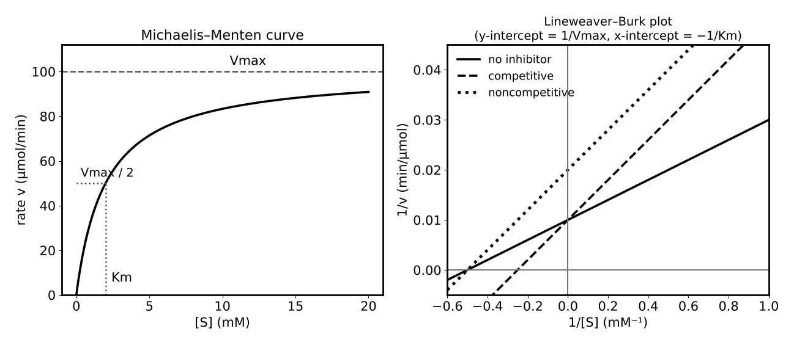

# Lesson 24: Enzymes and Kinetics

**What you will be able to do**

- Describe how enzymes catalyze reactions, the active-site and induced-fit models, and the roles of cofactors and coenzymes.
- Use the Michaelis-Menten equation, Km, Vmax and kcat, and read a Lineweaver-Burk plot.
- Distinguish competitive, noncompetitive and uncompetitive inhibition by their effects on Km and Vmax.
- Explain how temperature and pH affect enzyme activity, and how allosteric and covalent modification regulate enzymes.
- Connect enzymes to bioenergetics: free energy, ATP hydrolysis and coupled reactions.

**Why it matters for the exam**

Enzymes are where the kinetics of [Lesson 15](chapter:24), the acid-base chemistry of [Lesson 16](chapter:25) and the protein structure of [Lesson 23](chapter:34) meet. Category 5E treats enzymes as the biological expression of chemical kinetics and thermodynamics. They are also one of the most reliably tested topics in the whole section: a passage will describe an enzyme assay, give a table of rates versus substrate concentration, add an inhibitor, and ask what changed. The key skill is reading Km and Vmax from data, and knowing what each type of inhibitor does to them.

Praxis Tip: Anchor every enzyme question to two numbers, Km and Vmax. Ask which one the change affected. Nearly all inhibitor and mutation questions reduce to that.

**Concept Review**

**What enzymes do.** An **enzyme** is a biological catalyst, almost always a protein (some RNAs, called ribozymes, also catalyze reactions). Like any catalyst ([Lesson 15](chapter:24)), an enzyme:

- **lowers the activation energy** by stabilizing the transition state;
- **speeds the forward and reverse reactions equally**;
- **does not change ΔG, ΔH or the equilibrium constant**; it only speeds the approach to equilibrium;
- is **not consumed**.

Enzymes are also highly **specific**: each acts on particular substrates and catalyzes a particular reaction.

**The active site and models of binding.** The substrate binds in a pocket on the enzyme called the **active site**. In the older **lock-and-key** model the site is a rigid, complementary shape. In the **induced-fit** model the site changes shape when the substrate binds, tightening around the transition state. Induced fit is the accepted picture. Residues in the active site act as acids, bases and nucleophiles, and the surroundings (water excluded, charges placed) lower the energy of the transition state.

**Cofactors, coenzymes and vitamins.** Many enzymes need a non-protein helper. **Cofactors** are metal ions (Zn²⁺, Mg²⁺, Fe²⁺). **Coenzymes** are organic molecules (NAD⁺, FAD, coenzyme A), many derived from **vitamins**. A tightly bound coenzyme is a **prosthetic group**. A protein without its cofactor is an **apoenzyme**; with it, a **holoenzyme**.

**Classification by reaction type.** The main enzyme classes are: **oxidoreductases** (redox), **transferases** (move a functional group), **hydrolases** (cleave bonds with water), **lyases** (cleave bonds without water or redox, often forming double bonds), **isomerases** (rearrange atoms within a molecule), and **ligases** (join molecules, usually using ATP).

**Enzyme kinetics: Michaelis-Menten.** For a simple enzyme and one substrate, E + S ⇌ ES → E + P. At steady state the rate v depends on substrate concentration:

    v = Vmax [S] / (Km + [S])

- **Vmax** is the maximum rate, reached when the enzyme is saturated with substrate. Vmax = k_cat [E]_total.
- **Km** (the Michaelis constant) is the substrate concentration at which v = ½ Vmax. A *lower* Km indicates that the enzyme reaches half its maximum rate at a lower substrate concentration (often read as a higher affinity for the substrate).
- **k_cat** (the turnover number) is the number of substrate molecules converted per enzyme per second when saturated. The ratio **k_cat / Km** measures catalytic efficiency.
- At **[S] ≪ Km** the rate is roughly proportional to [S] (first order in substrate). At **[S] ≫ Km** the rate approaches Vmax and is independent of [S] (zero order).

The v versus [S] plot is a **hyperbola** that levels off at Vmax.

*Figure: Michaelis-Menten curve (left) and its Lineweaver-Burk reciprocal plot (right).*

**Lineweaver-Burk plot.** Taking reciprocals makes the equation linear:

    1/v = (Km / Vmax)(1/[S]) + 1/Vmax

A plot of 1/v against 1/[S] is a straight line with **y-intercept = 1/Vmax**, **x-intercept = −1/Km**, and **slope = Km/Vmax**.

Praxis Tip: To read a Lineweaver-Burk plot, find the two intercepts first. The y-intercept is 1/Vmax, so a *higher* intercept means a *lower* Vmax. The x-intercept is −1/Km, so an intercept closer to zero means a larger Km.

**Enzyme inhibition.**

| Type | Binds to | Effect on Vmax | Effect on Km | Lineweaver-Burk | Overcome by more substrate? |
|---|---|---|---|---|---|
| **Competitive** | Active site (competes with substrate) | Unchanged | Increases | Lines meet at the same y-intercept; steeper slope | Yes |
| **Noncompetitive** | A different site, on E and ES equally | Decreases | Unchanged | Lines meet at the same x-intercept; higher y-intercept | No |
| **Uncompetitive** | ES complex only | Decreases | Decreases | Parallel lines | No |
| **Mixed** | A different site, with different affinity for E and ES | Decreases | Increases or decreases | Lines intersect off the axes | No |

**Irreversible inhibitors** bind covalently (aspirin acetylates a serine of cyclooxygenase; penicillin acylates a bacterial transpeptidase) and permanently inactivate the enzyme.

**Local conditions.** Enzyme activity depends on its environment.

- **Temperature:** rate rises with temperature (as in [Lesson 15](chapter:24)) until the protein begins to denature, so activity peaks at an **optimum temperature** and then falls sharply.
- **pH:** ionization of active-site residues changes with pH, so each enzyme has an **optimum pH** (pepsin in the stomach about 2; trypsin in the small intestine about 8). Extreme pH denatures the protein.
- Salt concentration and the presence of other molecules also matter.

**Cooperativity and allosteric enzymes.** Some enzymes have multiple subunits and show **cooperativity**: binding of substrate at one active site changes the affinity of the others. The rate curve is **sigmoidal** (S-shaped) instead of hyperbolic. **Allosteric** enzymes are regulated by molecules that bind at sites other than the active site, shifting the enzyme between a low-affinity (tense, T) and a high-affinity (relaxed, R) state. **Allosteric activators** stabilize R; **allosteric inhibitors** stabilize T. In **feedback inhibition**, the end product of a pathway inhibits an early enzyme in it.

**Covalent regulation.** Enzymes can also be regulated by covalent modification, most commonly **phosphorylation** (kinases add phosphate groups; phosphatases remove them). **Zymogens** are inactive precursors activated by irreversible cleavage (trypsinogen → trypsin).

**Bioenergetics.** A reaction in a cell is spontaneous if its actual free-energy change is negative. The relation is ΔG = ΔG° + RT ln Q ([Lesson 14](chapter:23)), so concentrations matter: cells can drive a reaction with a positive ΔG° by keeping Q small. The biochemical standard state (pH 7) is written ΔG°′. The hydrolysis of **ATP** to ADP and phosphate has a large negative ΔG°′ (about −30 kJ/mol; −30.5 kJ/mol is the usual textbook value) and releases energy that is used for work. Cells use **coupling**: an unfavorable reaction is linked, through a common intermediate or a phosphorylated enzyme, to ATP hydrolysis, and the sum of the free energies is negative. ATP transfers phosphoryl groups; it is not "stored energy" in a simple sense. An enzyme cannot change the ΔG of a reaction; it only controls the rate.

**Biological oxidation-reduction.** Cells carry electrons with soluble carriers: **NAD⁺/NADH** (a two-electron carrier, in catabolism) and **NADP⁺/NADPH** (in biosynthesis), and flavin coenzymes (**FAD/FADH₂**) bound in **flavoproteins**. Oxidases and dehydrogenases transfer electrons to these carriers, which deliver them to the electron-transport chain.

**Worked Example 1: Michaelis-Menten calculations (skill: using the equation)**

An enzyme has Vmax = 100 μmol/min and Km = 2.0 mM. Find the rate at (a) [S] = 2.0 mM, (b) [S] = 18 mM, and (c) [S] = 0.20 mM.

(a) v = 100 × 2.0 / (2.0 + 2.0) = 50 μmol/min (half of Vmax, since [S] = Km).

(b) v = 100 × 18 / (2.0 + 18) = 1,800 / 20 = 90 μmol/min (about 90 percent of Vmax: nearly saturated).

(c) v = 100 × 0.20 / (2.0 + 0.20) = 20 / 2.2 = 9.1 μmol/min. This is roughly 100 × [S]/Km = 10: the rate is almost proportional to [S] when [S] ≪ Km.

**Worked Example 2: A Lineweaver-Burk plot (skill: reading intercepts)**

A Lineweaver-Burk plot of an enzyme has a y-intercept of 0.010 (μmol/min)⁻¹ and an x-intercept of −0.50 mM⁻¹. Find Vmax, Km, and the slope.

Vmax = 1 / 0.010 = 100 μmol/min. Km = 1 / 0.50 = 2.0 mM. Slope = Km / Vmax = 2.0 / 100 = 0.020 (min·mM/μmol).

**Worked Example 3: Inhibitors (skill: predicting rates)**

Using the enzyme above (Vmax = 100, Km = 2.0 mM), an inhibitor is added with [I] = Ki (so the inhibition factor 1 + [I]/Ki = 2). Find the rate at [S] = 2.0 mM if the inhibitor is (a) competitive and (b) noncompetitive.

(a) Competitive: Vmax is unchanged (100) and the apparent Km doubles to 4.0 mM. v = 100 × 2.0 / (4.0 + 2.0) = 33 μmol/min. Adding a large amount of substrate would restore the rate toward 100.

(b) Noncompetitive: Km is unchanged (2.0 mM) and Vmax is halved to 50. v = 50 × 2.0 / (2.0 + 2.0) = 25 μmol/min. More substrate cannot restore the original Vmax.

**Worked Example 4: Turnover and efficiency (skill: kcat)**

A reaction mixture contains 0.010 μmol of enzyme and gives Vmax = 100 μmol/min. Find k_cat in s⁻¹ and k_cat/Km (Km = 2.0 mM = 2.0 × 10⁻³ M).

k_cat = Vmax / [E] = 100 / 0.010 = 10,000 min⁻¹ = 167 s⁻¹. k_cat / Km = 167 / (2.0 × 10⁻³) = 8.3 × 10⁴ M⁻¹ s⁻¹.

*Reading it.* Each enzyme molecule converts about 167 substrate molecules every second when saturated.

**Worked Example 5: Coupled reactions (skill: adding free energies)**

Phosphorylation of glucose, glucose + Pᵢ → glucose-6-phosphate + H₂O, has ΔG°′ ≈ +13.8 kJ/mol. ATP hydrolysis has ΔG°′ ≈ −30.5 kJ/mol. What is ΔG°′ for the coupled reaction, glucose + ATP → glucose-6-phosphate + ADP?

ΔG°′ = +13.8 + (−30.5) = −16.7 kJ/mol. The coupled reaction is spontaneous even though the first step alone is not. A kinase (hexokinase) catalyzes it.

**Worked Example 6: Regulation (skill: allosteric versus covalent)**

An enzyme at the start of a pathway is inhibited by the pathway's end product, which does not resemble the substrate. Is this competitive inhibition? What is it called?

No. A molecule unlike the substrate that binds at a different site is not competing for the active site. It is **allosteric feedback inhibition**: the end product binds a regulatory site, stabilizes the less active conformation, and shuts the pathway down when the product is plentiful.

**More Praxis Tips**

Praxis Tip: For a competitive inhibitor, ask whether more substrate would "wash out" the effect. If yes, it is competitive and Vmax is unchanged. If no, Vmax has fallen.

Praxis Tip: On a Lineweaver-Burk plot, all lines for a given enzyme meet at a point or are parallel. Check whether they meet on the y-axis (competitive), on the x-axis (noncompetitive) or are parallel (uncompetitive).

Praxis Tip: A low Km means the enzyme saturates at low substrate concentration. If two enzymes act on the same substrate, the one with the lower Km handles low concentrations better.

Praxis Tip: Do not confuse Km with Kd. Km is a kinetic parameter that includes the catalytic step; it equals the dissociation constant only in the special case where catalysis is slow compared with dissociation.

Praxis Tip: When a passage describes a rate curve that is S-shaped instead of hyperbolic, the word to reach for is cooperativity (allosteric behavior).

**Common Mistakes**

- Saying an enzyme changes the equilibrium constant or ΔG of a reaction.
- Reading the y-intercept of a Lineweaver-Burk plot as Vmax instead of 1/Vmax.
- Mixing up competitive and noncompetitive inhibition effects on Km and Vmax.
- Treating Vmax as independent of the enzyme concentration (it is proportional to total enzyme).
- Assuming that ATP "contains" a large amount of energy in the P–O bond rather than releasing free energy on hydrolysis in a cellular context.
- Using one optimum pH or temperature for all enzymes.

**Checkpoint Questions**

1. In the Michaelis-Menten model, Km is defined as
   A. the maximum rate of the reaction
   B. the concentration of enzyme at half-saturation
   C. the equilibrium constant for the reaction
   D. the substrate concentration at which the reaction rate is half of Vmax

2. A competitive inhibitor changes the kinetic parameters of an enzyme in which way?
   A. Km is unchanged and Vmax decreases
   B. Km decreases and Vmax decreases
   C. Km increases and Vmax is unchanged
   D. Km decreases and Vmax is unchanged

3. Which of the following is unchanged when an enzyme catalyzes a reaction?
   A. The activation energy
   B. The standard free-energy change (ΔG°) of the reaction
   C. The rate of the reaction
   D. The pathway between reactants and products

4. On a Lineweaver-Burk plot (1/v versus 1/[S]), the y-intercept equals
   A. 1/Vmax
   B. Vmax
   C. −1/Km
   D. Km/Vmax

5. A noncompetitive inhibitor binds to an enzyme at a site other than the active site. Compared with the uninhibited enzyme, the inhibited enzyme has
   A. a lower Vmax and an unchanged Km
   B. an unchanged Vmax and a higher Km
   C. a higher Vmax and a lower Km
   D. a lower Vmax and a lower Km

6. An allosteric regulator of an enzyme
   A. binds at the active site and competes with the substrate
   B. is always a covalently bound cofactor
   C. binds at a site other than the active site and changes the enzyme's activity
   D. changes the equilibrium constant of the reaction

7. A zymogen is
   A. an enzyme that has been phosphorylated
   B. an inactive enzyme precursor activated by cleavage
   C. a competitive inhibitor
   D. the product of an enzyme-catalyzed reaction

---

**Stop here.** Answer every question on scratch paper before you read the reasons.

**Answers and reasons**

1. **D.** Km is the substrate concentration at which v = Vmax/2. (A this is Vmax; B Km is a substrate concentration; C Km is not an equilibrium constant for the overall reaction.)
2. **C.** A competitive inhibitor competes for the active site, so more substrate is needed to reach half-maximal rate (Km up), but a large excess of substrate still reaches the same Vmax. (A describes noncompetitive inhibition; B describes uncompetitive inhibition; D reverses the effect on Km.)
3. **B.** A catalyst changes the pathway and activation energy, not the thermodynamics: ΔG° and K stay the same. (A enzymes lower it; C enzymes increase it; D enzymes provide a new pathway.)
4. **A.** Setting 1/[S] = 0 in the Lineweaver-Burk equation gives 1/v = 1/Vmax. (B is the reciprocal of the intercept; C is the x-intercept; D is the slope.)
5. **A.** The inhibitor reduces the amount of active enzyme (lowering Vmax) without affecting substrate binding (Km unchanged), and extra substrate cannot overcome it. (B describes competitive inhibition; C does not describe an inhibitor; D describes uncompetitive inhibition.)
6. **C.** Allosteric regulators bind at separate regulatory sites and shift the enzyme between more and less active conformations. (A describes a competitive inhibitor; B confuses allosteric binding with prosthetic groups; D enzymes and regulators do not change K.)
7. **B.** Zymogens (such as trypsinogen and pepsinogen) are inactive precursors that become active enzymes after a specific proteolytic cleavage. (A describes covalent regulation, not a zymogen; C is a different category; D confuses an enzyme precursor with a product.)

Praxis Tip: After the checkpoint questions, look at each wrong choice and name the slip (intercept confusion, wrong inhibition type, catalysts and equilibrium). Log it in your error log ([Strategy: The Question Method](chapter:4)).

**Teach-Back and Spaced Review**

*Say this aloud in one breath:* "An enzyme lowers the activation energy without changing delta G or K; the rate follows Michaelis-Menten, with Km the substrate concentration at half of Vmax; competitive inhibitors raise Km and leave Vmax alone while noncompetitive inhibitors lower Vmax and leave Km alone; and cells regulate enzymes allosterically, by covalent modification such as phosphorylation, and by activating inactive precursors."

*Review schedule:* revisit this lesson after 1 day (redo Worked Examples 1 and 3 without looking), after 3 days (checkpoint questions from a blank page), after 7 days (a mixed set that includes [Lesson 15](chapter:24) kinetics and [Lesson 23](chapter:34) protein structure), and after 21 days (explain the lesson aloud).

*Interleave:* alternate an enzyme problem with a kinetics problem and a protein-structure problem. [Lesson 25](chapter:36) completes the biomolecules with sugars, fats and nucleic acids.

Praxis Tip: End each study session by writing, from memory, the Michaelis-Menten equation, the Lineweaver-Burk intercepts, and the inhibitor table (type, binding site, effect on Vmax and Km).

---

**Author verification note (remove before publishing)**

- All examples and questions are original. Verified: 50, 90 and 9.1 μmol/min; Vmax 100, Km 2.0, slope 0.020; competitive 33 μmol/min and noncompetitive 25 μmol/min; k_cat 167 s⁻¹ and k_cat/Km 8.3 × 10⁴ M⁻¹ s⁻¹; −16.7 kJ/mol.
- Answer key positions: D, C, B, A, A, C, B.
- ΔG°′ values confirmed against standard textbook values: for ATP hydrolysis (about −30.5 kJ/mol) and glucose phosphorylation (+13.8 kJ/mol); aspirin and penicillin mechanisms; optimum pH values for pepsin and trypsin; the Km versus Kd statement.
- Category 5E enzyme topics covered: classification, mechanism (substrates, specificity, active site, induced fit, cofactors, coenzymes, vitamins), kinetics (catalysis, Michaelis-Menten, cooperativity, local conditions), inhibition, regulatory enzymes (allosteric, covalent), bioenergetics (free energy, Keq, ATP hydrolysis and group transfers), and biological oxidation-reduction (half-reactions, soluble electron carriers, flavoproteins).
