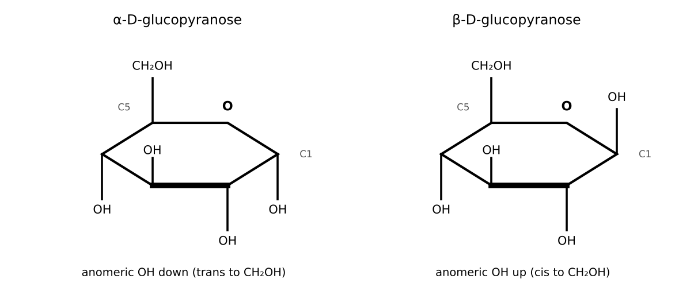
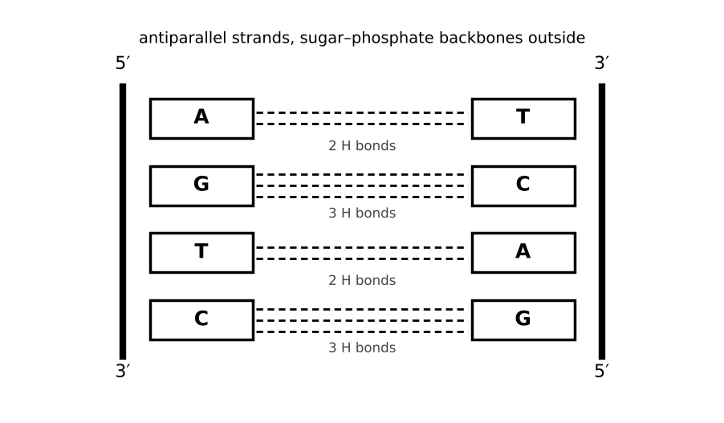

# Lesson 25: Carbohydrates, Lipids and Nucleic Acids

**What you will be able to do**

- Describe monosaccharide structure, including aldoses and ketoses, D/L, epimers and anomers, and the cyclization of sugars into hemiacetals.
- Identify glycosidic linkages in disaccharides and polysaccharides, and decide whether a sugar is reducing.
- Classify lipids (fatty acids, triacylglycerols, phospholipids, sphingolipids, steroids, signaling lipids) and relate structure to properties.
- Describe the structure of nucleotides and nucleic acids, base pairing, and the properties of the double helix.
- Connect structure to function, such as why membranes form bilayers and why fats store more energy than starch.

**Why it matters for the exam**

This lesson completes category 5D, the structure, function and reactivity of biologically relevant molecules. The chemistry in the earlier organic lessons is not an abstraction here: carbonyl addition makes the ring of glucose ([Lesson 19](chapter:29)), esters hold fats together ([Lesson 20](chapter:30)), hydrogen bonding holds the DNA double helix ([Lesson 11](chapter:19)), and amphipathic structure forms a membrane ([Lesson 13](chapter:21)). This book covers the *chemistry of structure*. How these molecules are made, broken down and used (metabolism, replication, gene expression) is taught in Book 2.

Praxis Tip: For each class of biomolecule, learn the building block, the bond that links the blocks, and the two or three properties that follow. The pattern is the same for sugars, lipids and nucleic acids.

**Concept Review**

**Monosaccharides.** Carbohydrates have the general formula (CH₂O)ₙ. A **monosaccharide** is a single sugar unit: an **aldose** if it has an aldehyde group (glucose, galactose, ribose) or a **ketose** if it has a ketone (fructose). By carbon count: triose (3), tetrose (4), pentose (5), hexose (6). Names: glucose, galactose and fructose are hexoses; ribose and deoxyribose are pentoses.

Sugars are chiral. A sugar belongs to the **D** or **L** family according to the configuration of its stereocenter farthest from the carbonyl group (in the Fischer projection, the –OH on the right is D). Natural sugars are mostly **D**. An open-chain aldohexose has four stereocenters, so there are 2⁴ = 16 aldohexoses (8 D and 8 L).

**Epimers and anomers.**

- **Epimers** are diastereomers that differ in configuration at exactly **one** stereocenter. Glucose and galactose differ only at C4; glucose and mannose differ only at C2.
- **Anomers** are the two forms (α and β) of a cyclic sugar that differ at the new stereocenter created by ring closure, the **anomeric carbon**.

*Figure: Alpha and beta anomers of glucose differ only at the anomeric carbon.*

**Cyclization.** In solution, most sugars with five or six carbons close into rings. The hydroxyl on one carbon attacks the carbonyl carbon, forming an internal **hemiacetal** (hemiketal for a ketose; [Lesson 19](chapter:29)). Glucose usually forms a six-membered ring (**pyranose**, from C5–OH attacking C1). Ribose forms a five-membered ring (**furanose**), as does fructose when it is bound in sucrose (free fructose in solution is mostly pyranose, with some furanose). The old carbonyl carbon becomes the **anomeric carbon**, a new stereocenter, and the ring can form in two ways:

- **α-anomer:** the –OH on the anomeric carbon is on the opposite face to the CH₂OH group (in D-glucose: trans to C6, pointing down in the Haworth projection).
- **β-anomer:** the –OH on the anomeric carbon is on the same face as the CH₂OH group (cis to C6, pointing up).

In water, the α and β forms interconvert through the open-chain form (**mutarotation**). In the chair form of **β-D-glucose** every substituent is equatorial, which makes it the most stable and the most abundant glucose isomer.

**Reducing sugars.** A sugar is **reducing** if its anomeric carbon is a free hemiacetal that can open to the aldehyde (or, for ketoses, tautomerize to one), because the aldehyde can then reduce oxidizing agents such as Benedict's or Tollens' reagent. Ketoses such as fructose also test as reducing, because under the conditions of the test they tautomerize through an enediol to an aldose.

**Glycosidic bonds.** When the anomeric –OH of one sugar reacts with an –OH of another, an **acetal** forms (a **glycosidic bond**, with loss of water). Common examples:

| Compound | Composition and linkage | Reducing? |
|---|---|---|
| Maltose | glucose α(1→4) glucose | Yes (one free anomeric carbon) |
| Lactose | galactose β(1→4) glucose | Yes |
| Sucrose | glucose α(1→2) fructose β | **No** (both anomeric carbons are tied up in the bond) |

Polysaccharides are long chains of glucose with different linkages and shapes:

- **Starch** (plant storage): amylose (unbranched, α(1→4)) and amylopectin (branched, with α(1→6) at branch points).
- **Glycogen** (animal storage): like amylopectin but more highly branched.
- **Cellulose** (plant structure): β(1→4) linkages produce long straight chains that hydrogen-bond in sheets; humans lack the enzyme to digest β(1→4) linkages. The α versus β difference in one bond changes the shape and the function completely.

Glycosidic bonds are hydrolyzed by acid or by enzymes (amylase cleaves α(1→4); lactase cleaves the β linkage of lactose).

Praxis Tip: To decide whether a disaccharide is reducing, check whether either sugar still has a free hemiacetal –OH at its anomeric carbon. If both anomeric carbons are in the glycosidic bond (as in sucrose), it is non-reducing.

**Lipids.** Lipids are biological molecules defined by solubility: largely nonpolar, soluble in organic solvents and not in water.

- **Fatty acids:** long hydrocarbon chains (typically 12 to 24 carbons, an even number) with a carboxylic acid at one end. **Saturated** fatty acids have no C=C bonds and pack tightly (higher melting point). **Unsaturated** fatty acids have one or more C=C bonds, usually **cis**, which put a kink in the chain, prevent tight packing and **lower the melting point**. (Stearic acid, 18:0, is solid at room temperature; oleic acid, 18:1 *cis*, is liquid.) The notation 18:1 means 18 carbons and 1 double bond.
- **Triacylglycerols (triglycerides):** glycerol esterified with three fatty acids. These are **storage fats**. They are very reduced, nonpolar and stored without water, so they hold about twice as much energy per gram as carbohydrates (roughly 9 versus 4 kcal/g). **Saponification** with a base gives glycerol and soap (fatty acid salts; [Lesson 20](chapter:30)).
- **Phospholipids:** glycerol with two fatty acids and a phosphate group bearing a polar head group. They are **amphipathic** (a polar head and nonpolar tails) and in water form **bilayers** with the tails hidden inside: the basis of cell membranes ([Lesson 13](chapter:21), the hydrophobic effect).
- **Sphingolipids:** built on the amino alcohol sphingosine instead of glycerol; abundant in nerve cell membranes (sphingomyelin). **Glycolipids** carry sugars.
- **Waxes:** esters of long-chain fatty acids with long-chain alcohols; protective coatings.
- **Steroids:** four fused rings. **Cholesterol** is a component of animal cell membranes (it modulates fluidity) and the precursor of steroid hormones (estrogen, testosterone, cortisol) and bile salts.
- **Fat-soluble vitamins (A, D, E, K)** and **signaling lipids** such as the **prostaglandins** (derived from the fatty acid arachidonic acid) act as cofactors, hormones and local signals.

*Figure: A pairs with T (two hydrogen bonds); G pairs with C (three).*

**Nucleotides and nucleic acids.**

- A **nucleoside** is a nitrogenous base joined to a five-carbon sugar. A **nucleotide** is a nucleoside plus one or more phosphate groups.
- The sugar is **ribose** in RNA and **2′-deoxyribose** in DNA (lacking the 2′-OH).
- The bases are **purines** (adenine A and guanine G; two fused rings) and **pyrimidines** (cytosine C, thymine T, and uracil U; one ring). DNA contains A, G, C, T; RNA contains A, G, C, U.
- Nucleotides link by **phosphodiester bonds**: the 3′-OH of one nucleotide is joined, through a phosphate, to the 5′-carbon of the next. The chain has a **5′ end** and a **3′ end**, and sequences are written 5′ → 3′. The backbone is sugar-phosphate-sugar-phosphate, with the bases pointing inward.
- **DNA double helix:** two strands wound around each other, **antiparallel** (one 5′ → 3′, the other 3′ → 5′). The bases pair by hydrogen bonds: **A with T (two hydrogen bonds)** and **G with C (three hydrogen bonds)**. Therefore in double-stranded DNA, A = T and G = C (Chargaff's rules), and purines equal pyrimidines in amount. The paired bases stack, and the stacking (hydrophobic and van der Waals interactions) contributes at least as much to stability as the hydrogen bonds. The helix has a **major groove** and a **minor groove**.
- **Melting:** heating separates the strands. DNA with a higher **G–C content** has more hydrogen bonds and melts at a higher temperature (higher Tm).
- **RNA** is usually single-stranded, can fold into structures (tRNA, rRNA, ribozymes), and has a 2′-OH that makes it more reactive to hydrolysis than DNA.
- Nucleic acids absorb UV light near 260 nm, used to measure their concentration.
- Nucleotides have **other functions**: ATP (energy), GTP, cAMP (a second messenger), NAD⁺ and FAD (electron carriers; [Lesson 24](chapter:35)).

**Worked Example 1: Relationships among sugars (skill: epimers, anomers, enantiomers)**

How are the following related? (a) D-glucose and D-galactose. (b) α-D-glucose and β-D-glucose. (c) D-glucose and L-glucose.

(a) They differ only at C4: **epimers** (diastereomers). (b) They differ only at the anomeric carbon (C1): **anomers**. (c) They are mirror images, with opposite configuration at every stereocenter: **enantiomers**.

**Worked Example 2: Counting stereocenters (skill: open-chain versus cyclic)**

How many stereocenters does open-chain glucose have? How many stereoisomers of an aldohexose are possible? How many stereocenters does the cyclic form have?

Open-chain glucose (CHO–CHOH–CHOH–CHOH–CHOH–CH₂OH): four stereocenters (C2 to C5). Stereoisomers: 2⁴ = 16, including 8 D and 8 L sugars. In the ring form, C1 becomes a fifth stereocenter, which is why cyclic glucose has two anomers (α and β) for each open-chain form.

**Worked Example 3: Reducing or non-reducing? (skill: the anomeric carbon)**

Which of maltose, lactose and sucrose is non-reducing? Explain.

Maltose and lactose each have one glucose unit whose anomeric carbon is not part of the glycosidic bond, so a free hemiacetal remains that can open to an aldehyde: both are reducing. In sucrose the glycosidic bond joins the anomeric carbon of glucose to the anomeric carbon of fructose, so neither ring can open: **sucrose is non-reducing**.

**Worked Example 4: Fatty acids and fats (skill: structure to property)**

(a) Rank stearic acid (18:0), oleic acid (18:1, *cis*) and linoleic acid (18:2, *cis*) by melting point. (b) Write the saponification of tristearin with NaOH.

(a) Melting point falls with the number of cis double bonds, because each kink prevents tight packing: stearic acid (about 70 °C) > oleic acid (about 13 °C) > linoleic acid (about −5 °C).

(b) Tristearin (the triglyceride of three stearic acid residues) + 3 NaOH → glycerol + 3 sodium stearate (soap).

**Worked Example 5: DNA base composition and melting (skill: Chargaff's rules)**

(a) In a double-stranded DNA sample, 30 percent of the bases are adenine. What percentages of T, G and C are present? (b) Which melts at a higher temperature: DNA that is 60 percent G+C or 40 percent G+C? (c) What is the complement of the strand 5′-ATGC-3′?

(a) A = T = 30 percent, so A + T = 60 percent. The remaining 40 percent is G + C, split equally: G = 20 percent, C = 20 percent.

(b) The 60 percent G+C DNA has a higher proportion of G–C pairs (three hydrogen bonds each) and a higher melting temperature.

(c) The strands are antiparallel: the complement of 5′-ATGC-3′ is 3′-TACG-5′, which is written 5′-GCAT-3′ in the conventional direction.

**Worked Example 6: Membranes (skill: amphipathic molecules)**

Why do phospholipids form a bilayer in water rather than a pile of individual molecules?

Each phospholipid has a polar head that interacts favorably with water and two nonpolar tails that do not. Burying the tails together in an interior region, with heads facing the water on both sides, minimizes the exposure of nonpolar groups to water and increases the entropy of the water (the hydrophobic effect). A bilayer is therefore the stable arrangement; a membrane forms spontaneously.

**More Praxis Tips**

Praxis Tip: When a question asks about the anomeric carbon, think "former carbonyl carbon." In an aldose it is C1; in a ketose such as fructose it is C2.

Praxis Tip: For melting points of fats, count cis double bonds. More cis double bonds means a lower melting point.

Praxis Tip: To pair DNA strands, write the complement and then reverse it to read 5′ → 3′. Most mistakes come from forgetting the antiparallel direction.

Praxis Tip: Remember that hydrogen bonds hold the two strands of DNA together, and phosphodiester bonds (covalent) hold each strand's backbone together. A question about "breaking DNA strands apart" without cutting them is about hydrogen bonds.

Praxis Tip: For polysaccharides, the lesson of α versus β: same monomer, different linkage, completely different shape and digestibility.

**Common Mistakes**

- Confusing epimers with anomers.
- Calling sucrose a reducing sugar.
- Saying unsaturated fatty acids have higher melting points because they have more double bonds.
- Forgetting that A–T pairs have two hydrogen bonds and G–C pairs have three.
- Writing a complementary strand in the same direction as the original.
- Mixing up nucleosides and nucleotides.

**Checkpoint Questions**

1. D-glucose and D-galactose differ only in the configuration at carbon 4. They are
   A. anomers
   B. epimers
   C. enantiomers
   D. structural isomers

2. In the cyclic form of D-glucose, the anomeric carbon is
   A. carbon 1, the carbon that was the aldehyde carbon
   B. carbon 6, the CH₂OH carbon
   C. carbon 4, the carbon that differs in galactose
   D. the ring oxygen

3. Which of the following disaccharides is not a reducing sugar?
   A. Maltose
   B. Lactose
   C. Cellobiose (glucose β(1→4) glucose)
   D. Sucrose

4. Compared with a saturated fatty acid of the same chain length, a fatty acid with one cis double bond has
   A. a higher melting point, because double bonds are stronger
   B. the same melting point
   C. a lower melting point, because the kink prevents tight packing
   D. a lower molecular mass and therefore a higher boiling point

5. Phospholipids in water spontaneously form bilayers because
   A. they are entirely nonpolar and avoid water
   B. they are amphipathic, with polar heads in contact with water and nonpolar tails sequestered inside
   C. they are entirely polar and dissolve completely in water
   D. they are covalently cross-linked by disulfide bonds

6. A double-stranded DNA sample contains 22 percent adenine. What percentage of the bases is guanine?
   A. 22 percent
   B. 44 percent
   C. 56 percent
   D. 28 percent

7. In a DNA strand, adjacent nucleotides are linked by
   A. hydrogen bonds between the sugar and the next base
   B. glycosidic bonds between the two bases
   C. phosphodiester bonds between the 3′-OH of one nucleotide and the 5′ phosphate of the next
   D. peptide bonds between the phosphates

---

**Stop here.** Answer every question on scratch paper before you read the reasons.

**Answers and reasons**

1. **B.** Diastereomers that differ at exactly one stereocenter are epimers. (A differ at the anomeric carbon; C are mirror images with opposite configuration at every stereocenter; D differ in connectivity, not configuration.)
2. **A.** The anomeric carbon is the former carbonyl carbon, which becomes the hemiacetal carbon on ring closure. (B is not the carbonyl carbon; C is an epimeric center, not the anomeric carbon; D is an oxygen atom, not a carbon.)
3. **D.** In sucrose the glycosidic bond uses the anomeric carbons of both glucose and fructose, so neither ring can open to a free carbonyl. (A has a free anomeric carbon on one glucose unit; B has a free anomeric carbon on its glucose unit; C has a free anomeric carbon on one glucose unit.)
4. **C.** A cis double bond puts a bend in the chain, so the molecules cannot pack as tightly, and less energy is needed to melt them. (A confuses bond strength with packing; B ignores the effect of the kink; D does not follow.)
5. **B.** The hydrophobic effect drives the nonpolar tails to the interior while the polar heads face the water on both sides. (A phospholipids have polar heads; C they have nonpolar tails; D bilayers are held by noncovalent forces.)
6. **D.** A = T = 22 percent, so A + T = 44 percent. G + C = 56 percent and G = C = 28 percent. (A assumes G equals A; B adds A and T and calls the result G; C is the combined G + C percentage.)
7. **C.** The backbone of a nucleic acid strand is a chain of covalent phosphodiester linkages. (A hydrogen bonds hold base pairs, not the backbone; B glycosidic bonds join a base to its sugar; D peptide bonds link amino acids.)

Praxis Tip: After the checkpoint questions, look at each wrong choice and name the slip (epimer or anomer, reducing or not, direction of the strand). Log it in your error log ([Strategy: The Question Method](chapter:4)).

**Teach-Back and Spaced Review**

*Say this aloud in one breath:* "Sugars cyclize by forming internal hemiacetals, creating an anomeric carbon with alpha and beta forms, and glycosidic bonds link them into disaccharides and polysaccharides whose shape depends on the linkage; fats are triesters of glycerol and cis double bonds lower melting points while phospholipids are amphipathic and form bilayers; and nucleotides link by phosphodiester bonds into antiparallel strands paired A to T by two hydrogen bonds and G to C by three."

*Review schedule:* revisit this lesson after 1 day (redo Worked Examples 1 and 5 without looking), after 3 days (checkpoint questions from a blank page), after 7 days (a mixed set that includes [Lesson 19](chapter:29) carbonyl chemistry and [Lesson 23](chapter:34) proteins), and after 21 days (explain the lesson aloud).

*Interleave:* alternate a biomolecule problem with a carbonyl problem and a protein problem. Then take the [Biochemistry Set](chapter:37), the last practice set before the full-length sections.

Praxis Tip: End each study session by writing, from memory, the relationship between epimers and anomers, the glycosidic-bond table, the lipid classes with one property each, and the base-pairing rules.

---

**Author verification note (remove before publishing)**

- All examples and questions are original. Verified: 2⁴ = 16; Chargaff arithmetic (A = T = 30, G = C = 20); complement 5′-GCAT-3′.
- Answer key positions: B, A, D, C, B, D, C.
- Verify with a biochemistry reviewer: α/β anomer definition wording; the statement about fructose being reducing; fatty acid melting points; the energy-density claim for fat versus carbohydrate; lipid examples (prostaglandins, fat-soluble vitamins); DNA stacking contribution.
- Category 5D topics covered: carbohydrates (nomenclature, absolute configuration, cyclic structure, epimers and anomers, glycoside hydrolysis, keto-enol tautomerism of monosaccharides, disaccharides, polysaccharides), lipids (storage, structural, signals/cofactors, steroids, vitamins, prostaglandins), and nucleotides and nucleic acids (composition, DNA double helix, RNA structures, chemistry and other functions).
