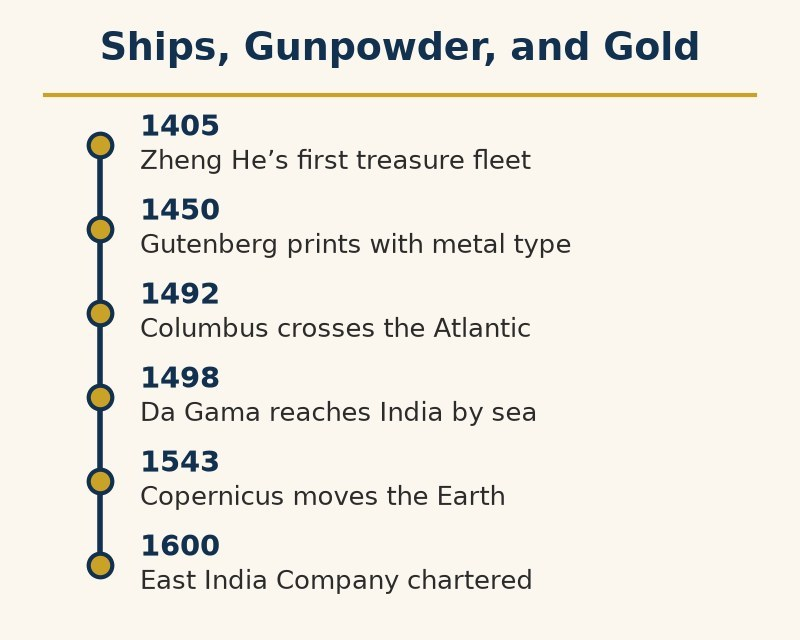

# The 15th to 17th Centuries: Ships, Gunpowder, and Gold — Exploration, Conquest, and the Colonial Age

Ocean crossing long predated European voyages. People reached Australia by boat tens of thousands of years earlier; Polynesian navigators crossed the Pacific by stars and swells, and Norse sailors reached North America around 1000 CE.

From 1405 to 1433, Ming China sent seven treasure fleets under Zheng He to India, Arabia, and East Africa. Some had hundreds of ships and tens of thousands of crew. Scholars debate the largest vessels’ size. Later, the court halted the voyages and abandoned the fleet program; the choice narrowed China’s oceanic reach.

What changed was not the idea of crossing an ocean, but what the arrivals did to the people on the other side.

The Black Death reached Europe in 1347. A century later, its upheaval had changed labor, land ownership, and the balance between peasants and nobles.

Portugal began the European push. Prince Henry sponsored African-coast voyages; Bartolomeu Dias rounded the Cape in 1488, and Vasco da Gama reached India by sea in 1498. Columbus, sailing for Spain, reached the Caribbean in 1492 while seeking Asia. Vespucci’s accounts helped mapmakers recognize a new continent, named on a 1507 map after him. Magellan’s expedition completed a circumnavigation in 1522, though he died in the Philippines before it ended.

England arrived late: John Cabot reached North America in 1497, but Roanoke disappeared after its 1587 founding. The East India Company (1600) and Jamestown (1607) began England’s lasting imperial expansion.

Gunpowder began in China; by the fifteenth century, cannon and firearms strengthened states with the administration and taxes to support them. The Ottomans, Safavids, and Mughals became known as gunpowder empires. European powers applied the same combination at sea.

Francis Drake raided Spanish treasure ships in the 1570s and 80s, circumnavigated the globe, and was knighted by Elizabeth I. Spain regarded him as a pirate on an English queen’s payroll.

Disease—smallpox, measles, and influenza—killed a majority of Indigenous people in the Americas over the following century and a half. Estimates range from about half to 90 percent because the original population is disputed. War, forced labor, famine, and community destruction made epidemics deadlier. Smallpox weakened Tenochtitlan before Cortés took it in 1521; Pizarro captured Atahualpa amid epidemic and civil war in 1532.

Ships, guns, compasses, charts, and double-entry bookkeeping drew on Chinese, Arab, Indian, and European inventions. European states concentrated them in an overseas system linking every inhabited continent. Capability accumulated; decisions were made one voyage at a time.

From the early 1500s to the 1860s, about 12.5 million Africans were forced aboard ships for the Americas; about 10.7 million survived. The rest died at sea. Survivors were sold into hereditary forced labor, chiefly on sugar, tobacco, rice, and cotton plantations.

Historians assembled records from roughly 36,000 voyages into a database. The traders kept precise accounts; their ledger is exact, and it is not enough to hold a person.

Olaudah Equiano’s 1789 autobiography describes his kidnapping as a child in what is now southeastern Nigeria and the voyage below deck. The ship was so crowded, he wrote, that each person scarcely had room to turn. Children fell into the latrine tubs; he remembered “the shrieks of the women, and the groans of the dying.”

A baptismal record and naval muster roll list Equiano’s birthplace as South Carolina; some historians therefore question whether his African chapters were firsthand. Others defend his account. The hold’s conditions match ship records and other survivors’ descriptions.

Equiano was often kept on deck because he was ill and too young for fetters. Watching the water, he wrote that he envied the “inhabitants of the deep” for their freedom.

Britain and the United States banned the trade in 1807 and 1808, but smuggling continued. In 1860, the schooner Clotilda carried about 110 captives from Ouidah to Mobile; its crew burned the ship after secretly landing them.

Kossola, about nineteen, was among the captives. Freed in 1865, he and other survivors bought land and built African Town near Mobile. Zora Neale Hurston recorded his life in 1927 and 1928; Barracoon appeared in 2018. He died in 1935, one of the last survivors of the last known slave ship to reach the United States.

Divers confirmed the burned hull of the Clotilda in 2019, in the Mobile River upstream of Mobile Bay, a few miles from the town its passengers built.

Faster ships, better charts, credit, insurance, and law made the trade more efficient. Capability compounded. Judgment did not.
