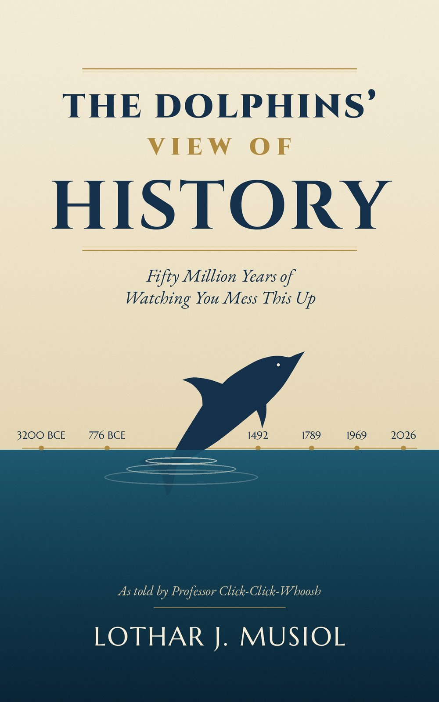

The Dolphins’ View of History

*Fifty Million Years of Watching You Mess This Up*

Lothar J. Musiol

*As told by Professor Click-Click-Whoosh, Cetacean Academy of Oceanic Studies*

*The Dolphins’ View of History*

Copyright © 2026 Lothar J. Musiol. All rights reserved.

No part of this book may be reproduced, stored, or transmitted in any form without written permission from the author, except for brief quotations in reviews.

Professor Click-Click-Whoosh, the Cetacean Academy of Oceanic Studies, and the International Dolphin Historical Society are inventions. The history is not. Dates, figures, and events follow the published scholarship listed in the Notes and Sources and were checked against the record as it stood in 2026. Where historians disagree, the text says so.

Kindle edition, 2026.

**Table of Contents**

The Cast of Recurring Ideas

Prologue: Humans Have Ape Ancestors

How to Read This Book

The Last Fifty Million Years: No Hands, No Cities — Why the Dolphins Only Watched

7 Million to 300,000 Years Ago: Where Everyone Is From — Africa and the Making of Humans

The Old Stone Age, a Million Years Ago: The First Fires — Early Humans and the Spark of Culture

70,000 to 15,000 Years Ago: Out of Africa — The Long Walk Across the World

The Neolithic, from 10,000 BCE: The First Villages — Agriculture and the End of Wandering

From 3200 BCE: Writing and Memory — How Humans Learned to Speak to the Future

The Bronze Age, 3100–1150 BCE: Gods and Kings — Mesopotamia, Egypt, and the First Empires

1600 BCE to 589 CE: The Middle Kingdom — China’s Long Civilization

2600 BCE to 550 CE: The Subcontinent — Zero, Gods, and Glorious Complexity

Classical Greece, 508–323 BCE: Democracy’s Experiment — Ancient Greece

The 8th Century BCE to 476 CE: Rome — The Empire That Built the World and Broke It

The 5th Century BCE to 1291 CE: Faiths, Crusades, and the Medieval World

The Early Middle Ages, 476–1000 CE: The Allegedly Dark Ages

The 2nd Century BCE to 1368 CE: Silk, Steppe, and Plague — The Roads That Connected Everyone, Including the Germs

The 8th Century BCE to 1897 CE: Gold, Salt, and Stone — The Kingdoms of Africa

1482 to Today: The Richness Moved — Africa’s Resources and Who Took Them

2600 BCE to 1491 CE: Before Columbus — Cities, Corn, and Knotted String

The 15th to 17th Centuries: Ships, Gunpowder, and Gold — Exploration, Conquest, and the Colonial Age

1450 to the Late 1800s: Machines and Manifestos — Renaissance, Enlightenment, and Industry

1776–1865: The Republic, With Exceptions — America

1865 to Today: After the Bargain — America’s Long Account

1808 to Today: Liberators and Generals — Latin America After the Empires

1299 to Today: The Sublime Porte — The Ottoman Empire and the Map It Left

1914–1918: Home by Christmas — The First World War

The Twentieth Century: Genius and Catastrophe — Great Countries, Terrible Decades

1917–1991: The Soviet Union, Ideals and Iron

1949 to Today: China, the Long Memory and the Great Leap

The 13th Century BCE to 1948 CE: The People Who Kept Their Story — A Complete History of the Jews

1945–1991: Cold War — Two Powers, One Planet

1957 to 2026: Leaving the Cradle — Space Travel, the Moon, Mars, and (Maybe) the Galaxy

1905 Onward: The Physics That Finally Made Sense to Someone

The 1940s to the 1970s: Decolonization — The World Redraws Itself

1893 to 1994: Civil Rights and Liberation — Humanity Argues With Itself

1843 to 2007: The Digital Leap — Computers, Networks, and a Connected World

The Thirteenth B’ak’tun, 2012: The World Was Supposed to End in 2012 (It Didn’t)

1950 to the 2020s: Something Might Be Watching (Probably Not What You Think)

1796 to Today: Medicine and Its Cost — How Humans Learned to Heal

1896 to Today: Climate and Consequence — The Price of Progress

1991 to Today: A Fractured Present — Democracy, Authoritarianism, and the Information Age

Seven Million Years to Today: The Dolphins’ Long View — What a Non-Human Species Makes of Human History

A Timeline — For Humans Who Like Their History in Order

What the Physics Is For — An Appendix on Uses and the One Theory Not Yet Found

Appendix: After Homo Sapiens — A Speculative Look at Superhumans and Androids

Notes and Sources

Further Reading — For Humans

Picture Credits

About the Author

Also by Lothar J. Musiol

# The Cast of Recurring Ideas

**The ratchet. **Humans keep what they learn in tools, texts, and institutions, and each generation starts from there. Anthropologists call the process cumulative culture. Once built, its gains are difficult to lose.

**The capability and wisdom gap. **Capability compounds. Wisdom has to be learned again by each generation. The book keeps measuring the distance between the two.

**The hands problem. **Dolphins are clever and handless, so they leave no mark beyond their lifetimes. Humans kept their hands, and nearly everything in this book follows from that.

**The Society. **The International Dolphin Historical Society is the narrator’s committee. Dolphins sleep half a brain at a time, so every decision is taken by a quorum of the half-awake.

**The verdict. **Each chapter ends with a Dolphin verdict, short or long as the chapter deserves, and sometimes honestly unresolved.

# Prologue: Humans Have Ape Ancestors

For millions of years, Earth belonged to sensible creatures. Fish swam, whales sang, dolphins socialized, and reefs prospered.

Then came the land apes.

At first they were small, frightened mammals running from predators. Eventually they became convinced that the entire planet belonged to them.

This is their story, as told by the neighbors.

A note on sources, for readers wondering how a dolphin knows anything about the Roman Senate. Dolphins have no libraries. They have coastlines, and coastlines are where humans do their loudest talking. Sailors read aloud, harbors gossip, and for several thousand years nearly everything the species knew about itself was, at some point, shouted across water. More recently there has been the habit of playing the radio on deck. Where the record is thin, the dolphins say so. Where it is disputed, they say that too, and try not to pick a side merely to sound decisive. Where the evidence runs out entirely, they have been known to guess, and to label the guess as one.

A harder question, which several members of the Society raised and none could fully answer, is how a species with no libraries ends up footnoting a 2017 paper in Nature. The honest account is less romantic than radios on deck: once the Society started writing this down properly, it did what any institution does when it wants to be taken seriously, and went and read the journals, same as anyone else with an ocean’s worth of patience and nothing else scheduled. The harbor gossip got them interested. It did not, on its own, get them a citation for the encephalization quotient.

Such matters are settled by the International Dolphin Historical Society, which the reader will meet from time to time as the Society. Since dolphins sleep with one half of the brain at a time, the committee can convene without waking its full membership.

The dolphins have been watching the land for a very long time.

Not this book’s kind of watching yet. No history, no verdicts. Just watching, the way any species watches whatever lives nearby.

Even the land’s earliest chapters met with dolphin approval. Giant reptiles once ruled the ground and, less famously, the sea, where several of them were large, toothy, and unpleasant to swim near. Then an asteroid struck, which this history endorses without qualification.

*“Excellent. The giant toothy monsters disappeared. Oceans became calmer. Mammals got their chance.”*

Their own story starts in the water, heading the opposite direction.

About fifty million years ago, an early four-legged land mammal, from the same broad family that today includes hippos, waded into shallow water and did not come back out.

The fossil record calls the first of these test cases Pakicetus — four legs, hooves, a long snout, built rather like a hairy dog that had made some very specific life choices. Its next of kin, once it had committed a little further to the bit, was filed under Ambulocetus, which is Latin for “the walking whale.” Dolphin historians did not choose that name. They have simply had fifty million years to get used to it.

*“Our closest living land relative, confirmed independently more than once, is the hippopotamus,” the Society noted. “We did not select this family. We were assigned it, and we have decided to be gracious about it in public.”*

Over tens of millions of years that choice reshaped the whole animal. Legs became flippers. Nostrils migrated to the top of the skull. Hearing adapted for water instead of air.

Dolphins gave up solid ground. In exchange they got something almost no land animal has: three-dimensional hearing precise enough to find a single fish in total darkness, and, once diving and breathing stopped using all of it, some intelligence left over. Watching, for instance.

While the dolphin line was finishing that trade, on the other side of the world, a different set of mammals was still in the trees — and had wasted no time getting there. The first small, tree-dwelling creature recognizable as a primate shows up in the fossil record a little over sixty million years ago, a few million years after the asteroid: on a timescale of tens of millions of years, essentially the same week. That is a very fast start for a family that would go on to need another sixty million years just to invent the wheel.

That lineage kept branching the whole time — early monkeys, then apes, then bigger apes — with taxonomists ending up needing five separate, confusingly similar Latin names (Hominoidea, Hominidae, Homininae, Hominini, Hominina) in order to track the last twenty-five million years or so of it. Here is a summary of all five definitions, free of charge: more apes, slightly different apes, repeatedly, for a very long time.

About six or seven million years ago, in the forests and grasslands of Africa, one population of apes split into two.

One side became the ancestors of chimpanzees and bonobos, still today the closest living relatives any human has.

The other side became the hominins: apes that would, in time, leave most of the trees, straighten their backs, and free their hands.

This was a terrible mistake. They are careful to add that it is also the only reason they have anything to write about.

*A species congratulating its own arrival as the point of the story is rarely in a position to notice that it is also the only witness for the defense.*

One detail matters here. Walking upright came first. Australopithecus was standing and walking on two legs more than three million years ago, with a brain not much larger than a chimpanzee’s. The big brain came later, and came slowly.

*“This was not a ladder,” the Society recorded. “It was a branch. Most branches on that tree went extinct. This one did not.”*

For a long stretch after that, the dolphins paid this branch no special notice. An ape walking upright in the mixed woodland of early Africa was not obviously more interesting than any other animal finding its niche. Dolphins had seen plenty of niches found.

That changed on the day the free hands picked up a stone, and kept it.

**Dolphin verdict:**

*Humans are not a separate creation and were not the point of the story from the start. They are one branch of an ordinary family tree that happened to keep its forelimbs free while a cousin species, in the same stretch of millions of years, gave its own forelimbs up altogether. Two branches, two trades. This book is about what one of them did with the hands it kept.*

# How to Read This Book

Read it in order, or by region: most chapters stand alone. Each ends with a Dolphin verdict that sums up the chapter, and the verdicts are short or long as the material demands. Small timeline strips appear at several points to orient you.

The Timeline near the back repeats every date in one sequence. Skim it, or skip it. The Notes and Sources are for checking a claim, not for reading straight through, and Further Reading lists the books worth owning.

Dates before about 3000 BCE are approximate. The timeline grows denser in recent millennia because written evidence survives in greater abundance, not because earlier centuries mattered less. The jokes belong to the dolphins; the facts are meant to be checked.

# The Last Fifty Million Years: No Hands, No Cities — Why the Dolphins Only Watched

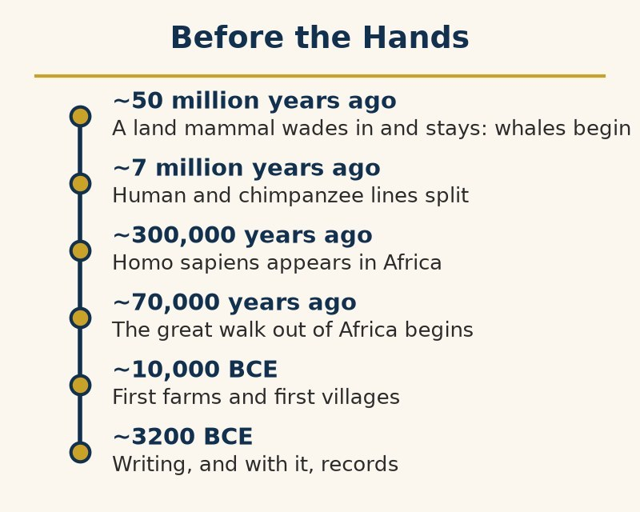

By any fair measure, dolphins are not history’s dim supporting cast.

Their brains, relative to body size, rank close behind humans and above every great ape. On the usual yardstick, the encephalization quotient, a bottlenose dolphin scores a little over 4 and a chimpanzee about 2.5. Only humans, at about 7, score higher.

They call each other by name. Each dolphin develops a signature whistle in its first year of life, and other dolphins use it to address that individual specifically, even years apart.

A brief correction while the subject is open: dolphins are not telepathic. The claim surfaces periodically in pop culture and the occasional earnest paperback, and it deserves retiring. What looks like mind-reading from the outside is whistles, clicks, and body language, processed by an animal that has had many millions of years of practice and nothing else competing for its attention underwater. It is excellent hearing, not a superpower.

They hunt in coordinated teams and teach their young skills that vary by region — a genuine culture, not just instinct. In Shark Bay, Western Australia, a line of mothers has taught daughters for generations to break a marine sponge free and wear it over the nose while foraging on the sharp seafloor.

*“This is the closest any dolphin population ever came to a tool industry,” the Society recorded. “One sponge. No handle, no blade, no upgrade, ever.”*

That “never” is the chapter.

A dolphin’s forelimb is a flipper: five digits, fused and flattened under a smooth skin, built for steering, not gripping. Nothing in it can close around a stone and swing it.

A dolphin cannot start a fire, and even if one somehow could, there is nowhere on a dolphin’s body, or in its world, to keep dry tinder or a bed of coals. Water conducts heat away roughly twenty-five times faster than air. The ocean does not merely fail to help; it actively puts fires out.

A dolphin cannot found a village. Home, for a pod, is a moving current and a stretch of coastline, not a fixed plot of ground with a wall around it. There is no floor to build a floor on.

A dolphin cannot write anything down. Its whistles and clicks are as expressive, in their own medium, as human speech — but nothing in a dolphin’s body can press a mark into clay or lift a pen. Nothing a dolphin learns outlives the dolphins who learned it, except by being demonstrated all over again to the next generation.

Every one of these is a hands problem, not a brains problem.

Put a human brain in a dolphin’s body and the result is still a very clever animal that will never build a wheel. Put a dolphin’s instincts in a human body — hands, dry land, controllable fire — and, this book will argue, most of what follows in it becomes at least explicable, if not forgivable.

There is a way to tell this chapter as a tragedy. Dolphin historians decline to tell it that way.

*“We were never damaged by our own inventions,” dolphin historians noted, “because we were never permitted to have any. There are worse fates than being only a witness.”*

No dolphin has ever been laid off by a dolphin-built machine, poisoned by dolphin industrial runoff, or drafted into a war fought with dolphin-forged weapons. The species that got hands got all of that too, along with everything else.

The record is not perfectly clean. Humans did eventually find one direct use for a dolphin: capturing them for aquariums and marine parks, where they perform, on cue and on a schedule, much the same leaps and tricks dolphins already perform in the wild. There they do it for free, on their own initiative, for no audience but each other and the occasional extra fish.

*“We do the trick either way,” Professor Click-Click-Whoosh observed. “The difference is who decided it was a trick, and who is charging admission.”*

None of which stops dolphins from doing, now and then, the opposite as well: helping humans lost or in danger at sea, guiding disoriented swimmers toward shore, and, in a handful of widely reported modern cases, circling swimmers closely enough to keep an approaching shark away. These are the swimmers’ accounts, not controlled experiments, and are reported here as such. Greek writers told the same kind of story more than twenty-five centuries ago: Herodotus has the singer Arion thrown overboard by pirates and carried to shore on a dolphin’s back, and the image of a rider on a dolphin ended up stamped on Greek coins.

*Nobody fully explains this pattern of goodwill toward a species that also, on occasion, keeps us in tanks, beyond noting that consistency was never a precondition for decency.*

The rest of the file belongs here too, since this book has promised nowhere to flatter anyone. Wild bottlenose dolphins have been documented killing calves of their own species, in numbers too consistent across too many separate populations (Scotland, the western Atlantic, Spain’s Galician coast) to be isolated accidents. Researchers link the pattern to the same reproductive competition that drives infanticide in several other mammals. Bottlenose dolphins have also been recorded killing harbor porpoises off Scotland and other parts of coastal Britain, without eating them, which no one has fully explained. Adult males form multi-level alliances specifically to corner and control females during mating season, a behavior marine biologists call herding rather than its plainer English name. None of this undoes the rescue stories already on this chapter’s record. It means that dolphins asking to be believed about their own decency have exactly the same mixed file every other species gets, and that nothing in this book is told from above.

Here is the thesis the rest of the book keeps testing on the one species that did get the hands. A hand turns an idea into an object, and an object outlives its maker. Children inherit tools, improve them, and pass them on. Anthropologists call this cumulative culture: knowledge can accumulate across generations. A dolphin calf inherits its mother’s skills. A human child inherits a civilization’s tools. Capability, in this species, compounds.

Wisdom does not compound the same way. It cannot be stored in a tool or inherited with one. People relearn it through mistakes and sometimes through grief. A big brain guarantees cleverness. It does not guarantee wisdom. The two arrive on separate schedules, and the chapters that follow trace how far apart those schedules drifted.

The dolphins did not get to build cities, wage wars, or write books.

They got, instead, the rest of this book’s worth of time to watch the species that could.

**Dolphin verdict:**

*Intelligence without a hand to hold anything stays a private matter — an animal can be as clever as it likes and still leave no mark on the world beyond its own lifetime. Humans got the hand. Everything from the first chipped stone to the last chapter of this book is the record of what a clever species does once cleverness stops being private.*

A short note before the book goes any further, one dolphin scholarship insists on adding itself.

Readers expecting the dolphins of a certain British science fiction series — secretly the most intelligent species on the planet, quietly aware of Earth’s approaching demolition, departing by spacecraft with a dry farewell about fish — will be disappointed, or possibly relieved. These are ordinary Earth dolphins, arrived at the ordinary way, with no advance warning of anything and no spacecraft on order. What follows is biology’s account, not science fiction’s.

That said, dolphin scholarship sees no reason to let a good line go to waste on a technicality. So: thanks for all the fish.

# 7 Million to 300,000 Years Ago: Where Everyone Is From — Africa and the Making of Humans

Every human being alive today descends from people who lived in Africa. This is not a metaphor or a courtesy to a continent. It is the best-supported conclusion in the study of human origins, and it rests on three independent witnesses that agree: bones, tools, and DNA.

The stage was East Africa’s Rift Valley, where the crust was slowly pulling the continent apart, raising highlands, drying out forests, and laying down lake beds that preserve bones very well. Dolphin scholars, who have a professional interest in lakes and rivers, note that the early hominins seem to have shared the taste. (The idea that humans spent their formative millennia in the water, the so-called aquatic ape hypothesis, has flattered dolphins for decades. Dolphin scholarship regrets that the evidence points the other way, and must decline the credit.)

The earliest candidates for the human side of the family split, Sahelanthropus in Chad, Orrorin in Kenya, and Ardipithecus in Ethiopia, date to somewhere between about seven and four and a half million years ago. All of them are argued over, which is what the early branches of a family tree tend to attract.

Then, about 3.7 million years ago, two or three individuals walked across a fresh fall of volcanic ash at Laetoli, in what is now Tanzania, and left footprints that the ash preserved: upright, unhurried, and unmistakably those of a biped. They are the oldest footprints that everyone agrees were made by a hominin, and among the most affecting objects in the whole archive. Not a tool, not a monument, just somebody walking somewhere, three and a half million years before anyone thought to write it down.

Lucy, an Australopithecus afarensis found at Hadar in Ethiopia in 1974, lived about 3.2 million years ago and stood roughly three and a half feet tall. The expedition named her after the Beatles song playing in the camp that evening, which makes a British band the godparent of human prehistory.

The genus Homo turns up in the record about 2.8 million years ago, with stone tools close behind or even ahead of it. At Olduvai Gorge in Tanzania, Louis and Mary Leakey spent decades unearthing the tools and the toolmakers, and one of the toolmakers was named Homo habilis, handy man, a fair description of the whole genus.

By about 1.6 million years ago, a tall, long-legged Homo erectus boy, found on the shore of Lake Turkana in Kenya, was built very nearly like a modern human from the neck down, and his kind were already leaving. The oldest hominin bones outside Africa, at Dmanisi in Georgia, are about 1.8 million years old. The first human diaspora was under way more than a million years before any of the humans alive today existed.

Homo sapiens itself is younger than most people assume. The oldest fossils attributed to it are about 300,000 years old and come from Jebel Irhoud in Morocco, at the northwestern corner of the continent, a long way from the Rift Valley. Others turn up in Ethiopia and South Africa. There was no single garden of origin. Humanity’s ancestors were a scatter of connected populations across an entire continent, trading genes and ideas, and the modern human form came together piece by piece. They did not have the continent to themselves, either: deep in a South African cave system, a small-brained relative called Homo naledi, found in 2013 and dated to around the same period, confirms that a different lineage survived into the same broad window. No site yet shows the two populations actually crossing paths.

The evidence that these were people who thought, and not merely people who made tools, also comes from the south. At Blombos Cave on South Africa’s coast, pieces of ochre engraved with crosshatched patterns and strings of shell beads, some 75,000 years old or more, show humans making marks for no reason except meaning. They are among the earliest known steps toward almost everything that follows in later chapters.

The genetic evidence agrees. People whose ancestors stayed in Africa carry more genetic diversity than people anywhere else, because everyone else descends from a comparatively small group that left. Popular accounts once summarized this by inventing a “Mitochondrial Eve” and a “Y-chromosomal Adam,” names that suggest a first couple. They were nothing of the kind. They are simply the most recent individuals through whom all living humans trace, respectively, their mother’s mother’s mother’s line and their father’s father’s father’s line. They very likely never met, and each was surrounded by thousands of contemporaries who also left descendants, just not along that one unbroken thread.

It follows that the human family is, genetically, one very recently branched African family. The differences humans would later organize entire societies around, skin color, hair, the shape of a face, are the product of a few thousand generations of adapting to sunlight and climate, and account for a very small part of the genome. It is worth saying now, because several later chapters concern what humans built on the opposite assumption.

*“Every human being is an African who has moved. It is a fact that turns out to be easy to accept in a lecture and remarkably hard to remember in the field.”*

**Dolphin verdict:**

*The origin of humankind was not a moment in a place. It was a long, crowded, repeatedly interrupted process spread across a whole continent, and it happened in Africa, among Africans, for something like seven million years before anybody left. Every later chapter here is, at some level, about branches of that one family, and the dolphins would ask readers to keep the family resemblance in mind, particularly in the chapters where humans forgot it.*

# The Old Stone Age, a Million Years Ago: The First Fires — Early Humans and the Spark of Culture

For a very long time, the main thing that distinguished the branch from any other ground-dwelling ape was that it walked upright and had learned to hold a stone.

Then, at some point more than a million years ago — the dolphins concede the exact date is one of the few things they will not commit to — a hominin kept a flame burning instead of running from it.

Homo erectus is the leading suspect. Scorched bone and ash layers at several sites, most famously Wonderwerk Cave in South Africa, put controlled fire in erectus hands by roughly one million years ago, with older, patchier evidence pushing the date back further still.

The record gets messier the further back it is pushed. Ash and burned bone at Wonderwerk mark controlled use; whether the same hominins could reliably start a fire from scratch, rather than simply keeping a naturally occurring one alive and carrying its embers, is a separate and much harder question. The two skills likely arrived a very long time apart. At Qesem Cave in Israel, hearths dated to around 300,000 years ago show fire used habitually and repeatedly in the same spot, which is closer to what most people picture when they hear the word.

Fire did three things at once, and dolphins rank them in order of surprise.

It cooked food. Cooking breaks down tough fibers and denatures proteins before a single tooth gets involved, meaning more calories extracted per bite and less of the day spent chewing. Some researchers tie this directly to the brain’s later growth spurt — a brain is metabolically expensive, and cooking may have been what first paid the bill.

The primatologist Richard Wrangham has argued at length that cooking did more than feed the brain: it reshaped the whole animal, shrinking the teeth and the gut and freeing hours of the day, and made Homo erectus, in a sense, a species defined by dinner. The argument is contested, as most arguments about deep time are, because firm evidence of controlled fire is patchy at the very date the theory needs it most. It is plausible and not proved.

It pushed back the night. A fire is the first porch light: a circle of visibility and warmth a hominin band could sit inside after dark, when every other diurnal (day-active) primate was hiding.

It gathered people in a circle, facing each other, for hours, with nothing urgent to do. Some anthropologists consider the campfire the first real venue for storytelling, planning, and gossip — the oldest classroom and the oldest theater at once.

Stone tools kept pace. The earliest deliberately shaped stones, simple sharp-edged flakes struck off a core, date to about 3.3 million years ago at Lomekwi in Kenya — older than the genus Homo itself, which unsettled the old assumption that toolmaking required a human ancestor to begin with.

By 1.7 million years ago, Homo erectus was making the Acheulean hand axe: a symmetrical, teardrop-shaped tool that took real planning to produce and stayed in use, largely unchanged, for over a million years — the longest-running product design in history, by a spectacular margin.

Fire did one more thing that took stone tools by surprise. At Pinnacle Point on South Africa’s coast, toolmakers learned to bury certain stone in a bed of coals for a slow, controlled bake before knapping it, a heat treatment that made silcrete flake more predictably into sharper, thinner blades. The earliest confirmed example dates to around 164,000 years ago. Cooking improved the meal; this improved the knife that helped make the meal possible — heat spent on the tool instead of the dinner, a use nobody, dolphin or human, would have predicted from a species that had only just learned to keep a flame alive.

Language is the hardest of the three to date, because words leave no bones. Some researchers think the capacity for complex speech was already present in the common ancestor of Neanderthals and modern humans, more than half a million years ago; others argue for something much later. Nobody, human or dolphin, knows. What the evidence does show is a species sitting in circles, handling shared tools, and teaching a hand axe’s proportions to the next generation, and that already required some way of sharing what one mind knew with another.

**Dolphin verdict:**

*Every technology, all the way to the last chapter, is downstream of that first kept flame. Cooking bought the calories for a bigger brain, the fire’s light bought hours the sun used to take away, and the circle around it bought a species its first classroom. Dolphins have never needed a fire. They have also never had a campfire story, and on this one point, envy is not out of the question.*

# 70,000 to 15,000 Years Ago: Out of Africa — The Long Walk Across the World

Homo sapiens spent most of its first two hundred thousand years or so inside Africa. Then it left.

Several waves left. Earlier small dispersals left faint traces in the bones of the Levant and the genes of later people. The wave that gave rise to nearly everyone alive outside Africa today left, on the genetic evidence, somewhere between about 70,000 and 50,000 years ago. Geneticists and archaeologists still argue over where in that window it falls.

They were not alone on the road. Neanderthals had lived across Europe and western Asia for hundreds of thousands of years already; the more recently identified Denisovans occupied at least parts of Asia. Homo sapiens met both, and quite possibly a few others: Homo floresiensis, a small-bodied human species discovered on the Indonesian island of Flores in 2003 and nicknamed the hobbit, may have overlapped with them. Its latest bones date to about 60,000 years ago and its stone tools to about 50,000, close to when modern humans reached the region. The list of human species has been lengthening steadily since 2003, mostly because somebody keeps digging.

Met is a diplomatic word. Genomes settle the more delicate question: the great majority of people with non-African ancestry today carry a small percentage of Neanderthal DNA, and some Southeast Asian and Pacific populations carry a meaningful share of Denisovan DNA as well. Interbreeding happened, more than once, in more than one place.

The Denisovans are a strange case even by this chapter’s standards: as a population, they were identified in 2010 not from a skeleton but from a single fragment of a finger bone, found in Denisova Cave in Siberia, whose DNA belonged to no known human species. A handful of further scraps, including part of a jaw recovered from the Tibetan Plateau and identified only by its proteins, are most of what humans have to show for an entire branch of their own family. It is the most impressive piece of detective work in the whole book: an entire lost population, reconstructed almost entirely from genetic residue.

Neanderthals and Denisovans both eventually disappeared as distinct populations, the timing pointing to about 40,000 years ago for the last Neanderthals. Dolphins note that “disappeared” is not the same as “erased” — their DNA is still walking around.

Whether modern humans caused those disappearances, by competition, by violence, by disease, or simply by absorbing the last small populations into their own, is not settled, and the answer may differ from valley to valley. Humans have tended to call the outcome a success. The dolphins, who have watched a fair number of species replaced by a more energetic cousin, call it the first sign of trouble.

The most striking crossing, to a dolphin, was the one across open water. Reaching Australia required a sea voyage of at least tens of kilometers even at the lowest ice-age sea levels, deliberate enough that it could not have been an accident. It had happened by about 50,000 years ago at the latest. Excavators at one rock shelter in northern Australia argue for 65,000; critics doubt that the oldest artifacts there are as old as the sand around them. The disagreement is worth fifteen thousand years. It has never been about the ocean.

*The Society has its own version of this argument. Its Early Arrival school and its Late Arrival school have been debating the date since before the excavators were born, and the minutes record that at the last session both schools agreed on only one point: that the boats were good.*

*“This is the first time,” one senior dolphin scholar added, “that we had reason to look up.”*

Humans were in the Americas by about 15,000 years ago at the latest, having crossed Beringia, the land bridge exposed by lower ice-age sea levels, and then moved south, down an ice-free corridor or along the coast, a choice historians still argue about. Human footprints at White Sands, New Mexico, dated to between about 23,000 and 21,000 years ago, would push the arrival back much further. The dates have survived several rounds of retesting without yet convincing every critic, and the dolphins decline to referee that one either.

Within a stretch of time that is a blink by the dolphins’ calendar — well under a hundred thousand years — one primate species had walked, rafted, or paddled onto every livable continent on Earth except Antarctica.

No other primate had ever done this, and no ocean-going mammal had needed to; dolphins had held the whole map for ages, they had simply never needed to plant a flag on any of it.

In the intervals between all this walking, humans made stone tools, hunted, presumably argued with the neighbors, and drew surprisingly good pictures on cave walls. The oldest figurative painting yet dated, a scene of people and a pig in a cave on the Indonesian island of Sulawesi, is at least 51,000 years old.

*“At this stage,” dolphin historians observed, “they were reasonably harmless. We would like it recorded that we said ‘at this stage.’”*

**Dolphin verdict:**

*Every other successful animal stayed inside the range its body and food supply allowed. Humans declined anyway. A species that had barely finished inventing fire crossed a strait it could not swim and a steppe it could not graze, on the strength of tools, boats, and each other. The dolphins had known the whole map for tens of millions of years by then. This was the first time anything else did too.*

# The Neolithic, from 10,000 BCE: The First Villages — Agriculture and the End of Wandering

For nearly all of Homo sapiens’ existence, there was no such thing as home in the modern sense — only a range, walked and re-walked with the seasons.

That changed, independently, in several places over several thousand years, starting around 10,000 BCE, in what looks in hindsight like the least likely revolution in the whole book. Humans decided to stay near where the wild wheat and barley already grew, in the Fertile Crescent stretching through parts of today’s Iraq, Syria, Turkey, and the Levant.

The story is not quite as tidy as fields first, temples later. At Göbekli Tepe in southeastern Turkey, hunter-gatherers raised rings of carved limestone pillars, some weighing many tons, around 9600 BCE, before any fully domesticated crop appears in the region. Whether feeding the crowds who gathered to build it helped tip the balance toward planting deliberately, reversing the usual story in which farming comes first and temples follow, is a question archaeologists have not settled.

Rice was brought under cultivation separately in China’s Yangtze valley, in a process that was under way by about 7000 BCE and took thousands of years to produce fully domesticated rice. Maize, beans, and squash came together in Mesoamerica. Yams and taro were domesticated in New Guinea. None of these groups had contact with each other. All arrived, on their own clocks, at the same idea.

One domestication in this chapter predates all of them and involved no crop whatsoever. Wolves and humans had struck their own bargain at least 15,000 years ago, well before the first wheat was ever planted on purpose, arriving uninvited to a chapter otherwise about fields and grain as proof that not every alliance needed a harvest to get started.

The idea, in full, was: stop following the food, and make the food follow you instead.

Domestication changed both species in the bargain. Wild wheat shatters its seed head to scatter grain across the ground. The mutant stalks that held onto their seed, useless to the plant in the wild, were exactly the ones a human harvester kept and replanted, generation after generation, until an entire species had been redesigned to be worse at surviving without people.

*Professor Click-Click-Whoosh, in the margin of the wheat file: “Nobody asked the wheat.”*

Sheep, goats, cattle, and pigs went through a parallel bargain: safety and food in exchange for meat, milk, and, eventually, a dead end for anyone who tried to run.

Surplus grain could be stored, which meant it could also be measured, taxed, stolen, and fought over — the first time in the book that food had a plural owner instead of just a mouth.

Farming went on to create cities, governments, armies, taxes, and, inevitably, accountants, and it gave the species a new and lasting hobby: from this point forward, humans would spend enormous energy arguing over lines on maps.

Villages appeared where surplus made them possible. Çatalhöyük in Anatolia, occupied from about 7500 BCE, housed several thousand people in mudbrick homes packed so tightly that residents entered through the roof.

At Çatalhöyük, a house was not just shelter. Archaeologists found burials beneath floors and platforms, many made while buildings were occupied. A 2025 study of human remains argues that these burials tied family memory to the life of a particular house. When a house was rebuilt, its history did not vanish with the old walls; people carried it into the next structure. Archaeologists trace continuity through bones, floors, and layers of plaster. The walls and floors were renewed repeatedly, sometimes dozens of times, and in some buildings the line between household work, ritual, and burial remained within one structure. The settlement offers a physical clue to what changed when people stayed in one place: home became somewhere to store food and make tools, but also a place to keep the dead close and make belonging last. The same ground held ordinary work and its memory, a connection wandering families could not preserve in the same form.

The trade-offs were real, and they come before the population boom, not after it. Skeletal evidence from early farming communities generally shows shorter stature, worse teeth, and more infectious disease than the hunter-gatherer populations that came before, likely from a narrower diet and closer contact with penned animals and each other.

What farming lacked in individual health it made up in sheer output. A patch of land that could feed a handful of foragers could feed many times as many farmers, and populations rose accordingly, even if the average farmer was, by several measures, worse off than the average forager had been.

*“This was the book’s first trade of quality for quantity. It would not be the last.”*

**From the minutes of the Society, on the question of farming:**

*Motion: that farming was a mistake. For: eleven pods. Against: nine. Abstaining: four, on the grounds that without farming there would be no fishing fleets, and the Society has never decided how it feels about fishing fleets. Human scholars divide the same way. The geographer Jared Diamond called agriculture “the worst mistake in the history of the human race” in a 1987 essay; most archaeologists consider the verdict too sweeping, since the same fields fed the cities, the writing, and the medicine that later chapters describe. The anthropologist James C. Scott presses a sharper version of the same complaint: that it was not the wheat but what grew up around the wheat, the taxman, the wall, and the ledger, that first made humans unfree in ways worth voting on. The motion was carried, narrowly, by the half of the quorum that was awake.*

Villages could not be un-invented once the population had grown to fit them. There was no more room upstream to walk back to.

**Dolphin verdict:**

*Agriculture is usually told as an unambiguous improvement, and the population numbers back that reading up. But the individual farmer, on the evidence of their own bones, often ate worse and lived sicker than the forager two thousand years earlier. Humans had discovered a pattern that recurs for the rest of the book: a choice that is bad for the person and good for the population can still win, because populations, not people, are what get to keep making the next choice.*

# From 3200 BCE: Writing and Memory — How Humans Learned to Speak to the Future

Start with one tablet. It is a square of baked clay about three inches across, made, probably in the city of Uruk, sometime between 3400 and 3000 BCE, and it fits in a human palm. Its marks record a large quantity of barley, a period of thirty-seven months, and two signs read as KU and ŠIM: Kushim. Nobody knows whether Kushim was a person, a job title, or an office. The same signs turn up on seventeen other tablets, mostly in accounts of barley and beer.

Until this point, human behavior had to be reconstructed from bones, stone, and ash, the same evidence used on any other animal. With the Kushim tablet, the sources start talking back, and the first thing they say is how much barley is owed.

Writing appears in Sumer, in southern Mesopotamia, by around 3200 BCE, in the form of cuneiform: wedge-shaped marks pressed into wet clay with a cut reed. Egyptian hieroglyphs emerge at almost the same time. Whether Egypt invented the idea on its own or picked it up from contact with Mesopotamian traders and then built an entirely different script around it is still argued; the two systems share a moment, not a form.

Neither system started as literature. The earliest Sumerian tablets are receipts: so many sheep, so much grain, so much beer, owed to or by so-and-so.

Writing, in other words, was invented for bookkeeping, by the same surplus-and-ownership economy the last chapter introduced. Poetry, law, and history came later, riding on infrastructure built for tax season.

If Kushim was a person, the earliest name in the written record belongs to an accountant. The first author known by name, roughly a thousand years later, was a woman: Enheduanna, a high priestess at Ur and a daughter of Sargon of Akkad, who around 2300 BCE composed hymns to the goddess Inanna. And the Epic of Gilgamesh, whose earliest surviving Sumerian poems about the king date from around 2100 BCE, though the unified epic as later generations knew it was assembled centuries after that, contains a flood story that circulated in Mesopotamia long before the biblical one was written down.

*Professor Click-Click-Whoosh, in the margin: “Fame in the literate world began with paperwork, and has not strayed far since.”*

Two more independent inventions of writing followed: Chinese script, attested from Shang dynasty oracle bones by around 1200 BCE though likely older, and Mesoamerican scripts including the Maya, fully developed by around the last centuries BCE. Four separate origins, spread across three continents (Asia twice over, in Mesopotamia and China, plus Africa and the Americas) and thousands of miles of mutual isolation, arriving at the same solution to the same problem.

The problem, underneath the receipts, was memory’s expiration date. Everything a human generation knew had previously lived only as long as someone who remembered it stayed alive to be asked.

A written mark does not need to be remembered. It needs only to be found.

A mark also does not drift. Human memory does, and it drifts in company. Each time a human recalls something, the brain rebuilds it, and the rebuilt version quietly takes in whatever the rememberer has heard since. A story passed through enough mouths comes out smoother, simpler, and more like what the listeners expected to hear.

*Professor Click-Click-Whoosh, in the margin: “Modern humans have a name for the same wrong memory held by many heads at once: the Mandela effect, after the large number of them who remember Nelson Mandela dying in prison in the 1980s. He walked free in 1990, became president of South Africa, and died in 2013. The newspapers of 1990 say so, and they have not changed their minds. That is the whole case for clay.”*

The Library of Ashurbanipal, assembled in Nineveh in the 7th century BCE, held thousands of tablets on medicine, astronomy, and literature, deliberately collected. It was the most famous early case of a society building a memory on purpose, for readers not yet born, coming well over a thousand years after the earlier archives at Ebla and Hattusa.

The far more famous Library of Alexandria, founded in Egypt under the Ptolemaic dynasty in the early 3rd century BCE, took the same idea and multiplied its ambition. It aimed not merely at a collection but at a copy of every text in the known world, reportedly gathered by searching every ship that docked in Alexandria’s harbor for scrolls worth transcribing. Its actual end is more mundane than its popular legend. There was no single dramatic burning by a single villain — a fire during Julius Caesar’s visit in 48 BCE damaged part of the collection. Further decline followed political instability and reduced funding over the following centuries. The destruction of the associated Serapeum temple in 391 CE, under an edict against pagan sites, finished off what direct evidence can still trace. By the time of the Arab conquest in the 7th century, the library had already ceased to exist as a major institution for hundreds of years, which is why most historians reject the later, popular story blaming that conquest for its loss.

*“We pass down what we know only by living demonstration,” the Society recorded. “A calf learns to hunt by watching its mother hunt, generation after generation, and if a pod is lost, its particular hunting culture is lost with it. Humans built a version of memory that survives the death of everyone who held it. After this chapter, they stop forgetting on our clock, and start forgetting, if at all, on their own.”*

This is the moment the ratchet from the first chapter acquires a memory. A tool can be copied only by someone who sees it; a written instruction can be copied by someone born three centuries later on another continent. Everything from a legal code to a shipping manifest to, eventually, history’s own subject matter, depends on this one invention holding.

Not everything people wrote down was grand. About 1750 BCE, in the Mesopotamian city of Ur, a customer named Nanni sent a clay tablet to a copper merchant named Ea-nasir. Nanni complained that the copper was not the quality he had paid for, that his messenger had been treated rudely, and that he had had enough. Nobody knows whether Ea-nasir ever replied. The tablet survived because clay does not rot, and it is often called the oldest customer complaint on record.

**Dolphin verdict:**

*Fire and farming changed what a human body could do. Writing changed what a human generation could keep. Every chapter after this one exists only because someone, somewhere, wrote something down that outlived them — including, the dolphins note with some professional interest, this book.*

# The Bronze Age, 3100–1150 BCE: Gods and Kings — Mesopotamia, Egypt, and the First Empires

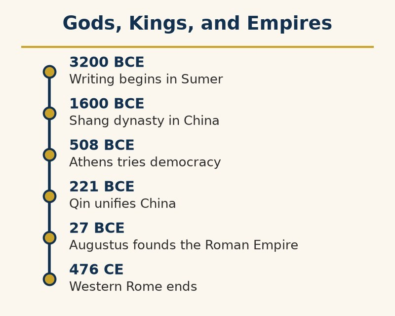

Writing gave surplus a memory. This chapter is about what surplus, once remembered and counted, could buy: organized power over other people, at a scale no band or village ever needed.

Sumer’s early city-states — Uruk, Ur, Lagash — were ruled by kings who claimed the gods had put them there, an argument with the enormous practical advantage that it required no further evidence.

Sometime around 2300 BCE (the often-quoted 2334 is a modern reconstruction, not a recorded year), Sargon of Akkad did something no Mesopotamian ruler is known to have managed before: he conquered multiple Sumerian city-states and held them together as one state. Historians argue over whether to call it the first empire. His own inscriptions boast of thousands of soldiers who ate daily in his presence, which sounds like the beginnings of a standing army, and like the beginning of a very large grocery bill.

Egypt took a different shape entirely. Around 3100 BCE, Upper and Lower Egypt were unified under a single ruler, beginning a pattern that would hold, with interruptions, for close to three thousand years. It meant one Nile, one pharaoh, one god-king whose authority needed no separate justification because he was not considered separate from the divine to begin with.

The pyramids at Giza, raised in the 26th century BCE, were not simply tombs. They were proof, visible from a great distance in every direction, that a single ruler could organize tens of thousands of workers, feed them, house them, and coordinate them for decades — a display of administrative reach as much as religious devotion.

*“Finally,” Professor Click-Click-Whoosh observed, “a species that can stack rocks at industrial scale.”*

It should be said that the pyramids were not, as legend has it, built by slaves. Excavations of a workers’ town near Giza, beginning in the 1990s, found bakeries, breweries, and the graves of laborers who had been fed on bread, beer, and beef and whose injuries had been treated. They were conscripted and paid in rations. Their successors, the tomb-builders of the Valley of the Kings, staged what is generally regarded as the first recorded labor strike around 1157 BCE, when the rations ran late.

Around 1754 BCE, the Babylonian king Hammurabi issued a code of nearly 300 laws, carved into a stone stele and set up in public. Its “eye for an eye” reputation obscures the more significant part: a ruler publishing his laws where any literate subject could check whether a judge had followed them.

Egypt’s hieroglyphs and demotic script could not be read at all until 1799, when French soldiers found a slab of dark granodiorite at Rosetta inscribed with the same decree in Greek, Egyptian hieroglyphs, and Egyptian demotic script. The Greek, which scholars could already read, unlocked the other two: Jean-François Champollion published the decipherment in 1822, and hieroglyphs, silent for roughly fourteen centuries, began speaking again. Mesopotamia’s cuneiform needed an entirely separate key: the trilingual Behistun Inscription in Iran, which Henry Rawlinson copied at real physical risk in the 1830s and 1840s. The decipherment was confirmed in 1857, when the Royal Asiatic Society had four scholars translate a newly found Assyrian text in sealed envelopes and compare the results. Only then could Sargon’s boasts and Hammurabi’s code, both written in cuneiform, be read again as well.

Bureaucracy, in the dry modern sense of scribes, tax rolls, and standing regulations, is not a later refinement bolted onto ancient kingship. It is what let a single ruler act at a distance, on people he would never personally meet, at all.

Standing armies did the same for coercion that bureaucracy did for taxation: a permanent, trained force loyal to the state rather than a set of neighbors who happened to answer a call to arms.

This chapter’s political inventions extended even to peace. In 1259 BCE, Egypt’s Ramesses II and the Hittite king Hattusili III signed what survives as the oldest peace treaty whose full text is still known. It ended decades of war between the two great powers of the age and pledged mutual defense and the return of fugitives in language strikingly close to a modern treaty’s own. A replica of one version hangs today at the United Nations headquarters in New York, a three-thousand-year-old reminder that this species invented the peace treaty in practically the same breath it invented the war worth ending.

This chapter is a turning point of a different kind from the tools before it. Fire, stone axes, and farming were all technologies applied to the physical world. Kingship, law, and bureaucracy are technologies applied to other humans.

*“An idea, believed by enough people, organizes exactly as much labor as a tool,” dolphin scholars remarked, “and needs no metal at all.”*

**Dolphin verdict:**

*The first empires were built from grain surplus, a persuasive story about divine favor, and enough scribes to keep track of both. No hands were required to invent kingship, only a large enough audience willing to believe the story — proof that this species’ most powerful technology, for good and for ill throughout the rest of this book, is not always something it can hold.*

# 1600 BCE to 589 CE: The Middle Kingdom — China’s Long Civilization

While Mesopotamia and Egypt built the pattern of god-king and bureaucracy, a separate civilization was assembling its own version, with no contact between them at all, along the Yellow and Yangtze rivers.

The Xia dynasty survives mostly as legend, its existence debated by historians and best treated the way any oral tradition without a matching written or archaeological record deserves: plausible, unconfirmed, and filed separately from certainty.

The Shang dynasty, from around 1600 BCE, is not a legend. Its oracle bones — turtle shells and ox bones, heated until they cracked, the cracks read as answers from ancestors — carry the earliest confirmed Chinese writing, from about 1250 BCE, chiefly questions about harvests, weather, and war.

The Zhou replaced the Shang around 1046 BCE and introduced the Mandate of Heaven: a ruler kept power only while heaven approved, with failure serving as evidence the mandate had been lost.

*“This is a theory of legitimate power with a built-in excuse for every future revolution,” Professor Click-Click-Whoosh observed. “Whoever wins next did not usurp anything. Heaven had already decided.”*

Confucius urged social harmony through ritual, family duty, and defined roles. His disciples compiled the Analects after his death. Laozi, a partly legendary figure, became associated with the Daoist view that people should align themselves with the Dao rather than impose order by force.

Both answers outlasted every dynasty that came after them, which is a more interesting fact than either answer’s specific content.

In 221 BCE, Qin Shi Huang unified the warring states, standardized script, currency, axle widths, and law, linked earlier defensive walls, and commissioned thousands of life-sized terracotta soldiers for his tomb.

Sima Qian, Han China’s Grand Historian, was castrated around 99 BCE for defending a disgraced general. He chose to finish his Records of the Grand Historian rather than die by suicide, preserving a history from legendary founders to his own court. Later dynasties took it as a model.

Professor Click-Click-Whoosh read the Records of the Grand Historian aloud to a skeptical committee and, on reaching the postscript, argued with the page.

“You give every fallen dynasty to its last emperor,” the Professor said. “The Mandate of Heaven always leaves for a reason, and the reason is always the man on the throne when it left. Is that history, or a verdict with footnotes?”

The page had an answer. Sima Qian wrote that a death can weigh more than Mount Tai or less than a goose feather, and that he had chosen his weight on purpose. He also put the follies of his own court into the record, in a treatise on the imperial sacrifices that is quietly merciless about the emperor’s long, expensive search for immortality.

“That is a better answer than the committee expected,” the Professor admitted. “Later dynasties took the Records as their model, and kept one habit of it: each new dynasty wrote the obituary of the one before, usually citing the Mandate of Heaven as the cause of death.”

The committee recorded a draw, its customary result when a human has a point.

The figure below shows the frontispiece of the Diamond Sutra, printed in 868 CE, the oldest dated printed book.

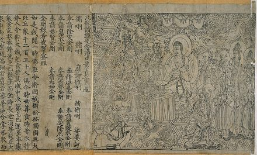

*Frontispiece of the Diamond Sutra, printed in China in 868 CE, the oldest dated printed book.*

The Qin collapsed within four years of its founder’s death. The Han kept much of its standardization with less brutality, an inheritance that endured.

The Sui reunited China in 589 after centuries of division and introduced civil-service examinations based on classical texts. Open in principle to all men, they favored families able to afford years of schooling. The exams linked learning to government service for centuries.

This pattern — unify, flourish, fracture, reunify — repeats across Chinese history for the next two thousand years with a regularity that invites comparison, only half-jokingly, to a tide.

**Dolphin verdict:**

*Few civilizations have matched China’s combination of scale and continuity: one script, evolving but recognizable, in continuous use for more than three thousand years, across dynasties that rose and fell like weather. A later chapter will ask what happened when the twentieth century tried to interrupt that continuity on purpose. This chapter’s verdict, for now, is simpler: the tide always came back in.*

# 2600 BCE to 550 CE: The Subcontinent — Zero, Gods, and Glorious Complexity

Somewhere between Mesopotamia and China, on the far side of some of the tallest mountains on Earth, a third river civilization was building cities.

The Indus Valley, or Harappan, civilization flourished from roughly 2600 to 1900 BCE across what is now Pakistan and northwestern India. Its cities, Harappa and Mohenjo-daro among them, were laid out on grids, built from bricks of standardized sizes, and equipped with covered drains and private bathrooms. That standard of municipal plumbing that deserves admiration even from a species that has never needed any, and that much of the world would not match for thousands of years.

Harappan seals carry a script no one has deciphered; some scholars doubt it records language. Around 1900 BCE, the cities emptied, perhaps as rivers shifted and the monsoon weakened. The case remains open.

The Vedas, Sanskrit texts at the root of Hindu traditions, were composed from about 1500 BCE and transmitted orally for centuries. Reciters used interlocking sequences as error checks, preserving the verses with unusual precision before they were written down.

*“It is the most impressive thing a species has ever done without a pen,” one senior dolphin scholar added, “and we say that as animals who hand our own traditions down the same way, and lose them the same way.”*

Hindu traditions draw on the Vedas, Upanishads, and epics including the Mahabharata, whose Bhagavad Gita stages a debate about duty between a warrior and his charioteer. The tradition has no single founder, date, or governing book.

It also carried, and honest scholarship has to say so, a hierarchy of birth. Caste ranked people by ancestry and occupation and placed some so low that they were treated as untouchable. Historians disagree about how rigid the system was in different regions and centuries, and some argue that British censuses and administration hardened categories that had been more fluid; none argues that the hierarchy was a British invention. Independent India’s constitution abolished untouchability in 1950 and prohibited discrimination by caste. In marriages, villages, and job markets, caste is still being asked to leave.

In the sixth and fifth centuries BCE, Siddhartha Gautama taught a path to end suffering through discipline and moderation; Buddhism later spread across Asia. Mahavira’s Jain tradition centered ahimsa, non-harm, practiced by some monks with such care that they sweep the ground to avoid killing insects.

Dolphin scholarship extends the Jains the same warm professional regard it will later extend to the Amish, and for the same reason: they looked at the ability to do harm and voted, on purpose, for less of it. Their idea outlived every empire in this chapter. Filtered through a Gujarati upbringing already steeped in Jain and Vaishnava ideas of non-harm and then fused with Tolstoy’s Christian pacifism and Thoreau’s civil disobedience, it resurfaced twenty-five centuries later in the practice of a lawyer named Gandhi.

Chandragupta founded the Mauryan Empire around 321 BCE. His minister Kautilya is traditionally credited with the Arthashastra, a blunt manual of statecraft that treats spies, poison, and economic pressure as tools of rule.

The Gupta period, from about 320 to 550 CE, is what an older generation of historians called India’s golden age. Current scholarship treats the label with some suspicion, since it mostly describes a flowering of Sanskrit court culture for a literate elite in the north rather than a uniform experience across a subcontinent this chapter has otherwise insisted on treating as too varied for one label. The dolphins, who have no court and no capital, sidestep the politics of the label and agree only on the numbers. Indian mathematicians perfected a place-value system in which ten symbols, including a zero, can write any number there is. A dot marking an empty place appears in Indian manuscripts within the first few centuries CE, and by 628 CE Brahmagupta was writing out rules for arithmetic with zero treated as a number in its own right. Aryabhata, working in the 5th century, calculated pi to four decimal places and proposed that the apparent turning of the heavens was caused by the Earth turning on its axis. The Gupta era also gave the world chaturanga, the ancestor of chess, a game in which armies fight on a small board, presumably in the hope that people would keep it there.

The system traveled west through the Islamic world, where al-Khwarizmi’s writings helped spread it, and reached Europe through merchants and, in 1202, Fibonacci’s book on calculation. Europeans called the result Arabic numerals and have been slightly wrong about it ever since.

The Gupta empire broke up under pressure from nomadic invaders in the 6th century. The subcontinent’s later visitors, from the Delhi sultans and the Mughals to the East India Company, are a story for a later chapter.

**Dolphin verdict:**

*India gave the rest of humanity its numbers, its zero, its chess, and one of its most durable arguments for non-violence, and kept a hierarchy of birth that took until 1950 to outlaw and is taking longer to retire. The dolphin file carries two marginal notes: “High intellectual output” and “Excessive complexity.” The second is under review.*

# Classical Greece, 508–323 BCE: Democracy’s Experiment — Ancient Greece

Every government examined so far has run on the same basic claim: one person, or one family, or one god’s favorite, decides, and everyone else complies.

Athens, starting with reforms under Cleisthenes in 508 BCE, tried something that fit no earlier category: a large body of citizens deciding collectively, in person, by majority vote, in an assembly any citizen could attend and speak in.

The qualifier matters more than the achievement, so it comes first. “Citizen” in Athens meant adult free men born to Athenian parents — excluding women, enslaved people (who made up a large share of the city’s population), and foreign residents, however long they had lived there. Democracy’s first draft governed a minority and called it everyone.

Within that limit, the invention was still real. Many public offices were filled by lot, sortition, in place of election, on the theory that any citizen was fit to serve and that voting for office invited wealthy or persuasive candidates to dominate it. Ostracism let the assembly exile a citizen, no crime required, for ten years, if enough people simply voted that his influence had grown dangerous.

Professor Click-Click-Whoosh took the funeral oration to the committee, which is to say Thucydides’ version of it, and argued with Pericles across a row of coffins.

“Its administration favours the many instead of the few,” the Professor read, in the Victorian translation the Society prefers. “This is why it is called a democracy.”

“Lovely,” said the Professor. “Now count the many.” The count left out women, enslaved people, and foreign residents, which is most of the city.

Then the Professor turned to the footnote Thucydides himself supplied. He admits that he could not remember the speeches word for word, so he made each speaker say what the occasion seemed to demand, keeping as close as he could to the general sense of what was really said.

“So one of the most famous sentences about democracy,” the Professor concluded, “is a historian’s best reconstruction of a politician’s best guess at what a grieving city wanted to hear.”

The committee noted that in the same speech Pericles called Athens “the school of Hellas,” and that the school’s admissions policy was strict. It entered a vote in favor of the argument and a note against the arithmetic.

Below, a nineteenth-century painter imagines Pericles delivering the funeral oration that Thucydides recorded.

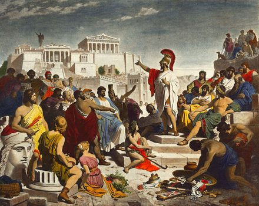

*Pericles delivering the funeral oration, painting by Philipp Foltz.*

Sparta, Athens’ great rival, organized itself around almost the opposite values — a rigid military caste system, an economy built on the forced labor of the conquered Helot population, and a citizenry trained from childhood for war, not debate. Much of this picture, though, comes from Athenian and later outsiders writing generations afterward. Historians now treat its most austere version with some caution. Sparta was not democracy’s villain so much as evidence that “successful ancient Greek city-state” did not imply any particular set of values at all.

Philosophy came out of this same world, asking the questions its politics kept raising. Socrates, in the 5th century BCE, questioned everything in public until Athens sentenced him to death for it. Plato, his student, distrusted democracy specifically, having watched it kill his teacher, and imagined a state ruled by trained philosopher-kings instead. Aristotle, Plato’s student, wrote systematically across politics, ethics, biology, and logic, and his influence outlasted the city-states that produced him by roughly two thousand years.

The Persian Wars, fought in the early 5th century BCE, saw a coalition of Greek city-states repel the much larger Persian Empire: at Marathon in 490 BCE and, ten years later, at sea off Salamis, after the famous defeat at Thermopylae had bought a few days. The wars mattered less for the battles themselves than for what they let Athens believe about its own place in the world afterward.

Having seen off Persia together, the Greeks promptly turned on each other. The Peloponnesian War, fought between Athens and Sparta and their respective allies from 431 to 404 BCE, ended with Athens defeated, its democracy briefly overthrown, and, five years later, Socrates on trial. Watching the whole sequence from the coast, it is hard not to notice that a people who had just proved they could unite against an empire lasted about one generation before returning to what they were evidently better at.

A century and a half later, Alexander the Great, trained in his youth by Aristotle, conquered a swath of territory from Greece to Egypt to the edge of India, spreading Greek language, architecture, and philosophy across a region far larger than Greece had ever ruled on its own. Hellenism outlived Alexander’s empire, which fractured into rival kingdoms within a generation of his death in 323 BCE.

The Greeks were also the makers of the earliest known analog computer. In 1900, sponge divers off the island of Antikythera found a shipwreck containing a corroded lump of bronze, later revealed by X-ray to be a device of some thirty surviving geared wheels. It was made sometime in the second or early first century BCE. It predicted eclipses and tracked the cycle of the Olympic Games. Nothing of comparable sophistication is known to appear again for well over a thousand years. It was found by sponge divers, at the bottom of the sea, which seems about right.

**Dolphin verdict:**

*This is the first chapter in the book about a government arguing, in public and on the record, about how it should be governed. The argument was badly incomplete — most of the population had no vote in it — but the habit of holding the argument at all, not settling it by decree, is the part that outlived Athens and keeps recurring for the rest of this book.*

# The 8th Century BCE to 476 CE: Rome — The Empire That Built the World and Broke It

Rome starts, by its own telling, as a small settlement of shepherds on the Tiber around the 8th century BCE. The founding myths (a she-wolf, twin brothers, one dead by the other’s hand) are exactly that: myth, worth noting for what it says about how Rome wanted to be remembered rather than what happened.

Below, a nineteenth-century fresco shows Cicero denouncing Catiline in the Senate.

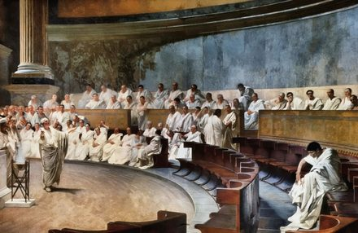

*Cicero denounces Catiline in the Roman Senate, fresco by Cesare Maccari.*

What is well documented is the Republic that followed the expulsion of its last king in 509 BCE: a Senate of several hundred former magistrates, enrolled for life by the censors rather than elected to the body itself. Executive power lay with annually elected magistrates called consuls, and a system of checks was built specifically to prevent any one Roman from becoming king again.

Early in the Republic’s life, around 451–450 BCE, ordinary citizens pressured the aristocratic Senate into publishing the Twelve Tables, Rome’s first written law code. It was inscribed on bronze or wood and displayed in the Forum precisely so a plebeian could no longer be told after the fact what the law had always supposedly said. The tables were blunt and, by modern standards, often brutal, and were revised many times over the centuries that followed — but the principle that law had to be written where the ruled could read it outlived every revision, and outlived the Republic that first wrote it down.

The system worked, more or less, for nearly five hundred years, before its own success broke it. Conquest brought wealth, slaves, and provinces faster than the Republic’s institutions, built for a city-state, could absorb. Ambitious generals commanding personal armies proved more powerful than the Senate nominally in charge of them.

Julius Caesar crossed the Rubicon river with his army in 49 BCE, in defiance of the Senate’s explicit order to disband it, and won the civil war that followed. His assassination in 44 BCE, by senators trying to save the Republic, instead finished killing it. His adopted heir, Octavian, emerged from the next round of civil war as Rome’s first emperor, taking the name Augustus in 27 BCE.

The Republic’s checks, designed with some care to prevent exactly this outcome, held up for close to five hundred years and then gave way in about twenty, a thoroughly Roman ratio of centuries spent planning to afternoons spent undoing it.

What Rome built next, over the following two centuries of relative internal peace known as the Pax Romana, is arguably its most durable invention: a network of roads that, by a common modern estimate, ran to some 250,000 miles at its peak, more than 50,000 of them paved. Aqueducts moved water across entire regions by gravity alone. A body of law distinguishing public and private rights still underlies many legal systems today, and a path to citizenship had, by 212 CE, extended to almost every free person in the empire.

It also had a strategy for domestic peace, which the satirist Juvenal summed up around 100 CE as bread and circuses: free grain for the citizens of the capital and, at the Colosseum, opened in 80 CE, spectacle on a scale nobody has since attempted with the same disregard for the participants. The Pantheon’s concrete dome, completed around 126 CE, remains the largest unreinforced concrete dome in the world, which is more than can be said for most of the buildings put up since.

The trade underneath the peace was explicit: order, infrastructure, and law, purchased with the loss of the Republic’s own citizens’ say in how they were ruled.

The empire’s decline, when it came, was neither sudden nor total. Currency debasement, plague, pressure from migrating peoples along its borders, and a genuine crisis of imperial succession (the third century alone saw dozens of claimants to the throne) wore at it for two hundred years before Rome fell to anything.

In 395 CE the empire formally split into Western and Eastern halves. The Western half’s last emperor was deposed in 476 CE, an event later historians would mark as “the fall of Rome.” The Eastern half, ruled from Constantinople and known to history as the Byzantine Empire, continued for another thousand years, until 1453.

*“There was no single day the lights went out. Half the empire kept them on for another millennium, under the same laws and the same god, with a different capital and, eventually, a different language.”*

Human historians are still arguing about which of those two sentences matters more. One school, following Peter Brown, describes a long “late antiquity” of transformation, in which Roman law, Christianity, and Latin carried on under new rulers. Another, led by archaeologists such as Bryan Ward-Perkins, points to what the ground shows in the West after about 400 CE: fewer coins, simpler pottery, smaller buildings, smaller cattle, and a collapse in living standards that took centuries to reverse. The dolphins’ own historians have split along exactly the same line.

When Alaric’s Visigoths sacked Rome in August 410, the damage was less than the legend, but the shock was enormous. In Bethlehem the scholar Jerome, who had known the city, wrote that the city which had taken the whole world had itself been taken, and that sobs choked him as he dictated.

**Dolphin verdict:**

*Split decision. The Transformationist pod holds that Rome did not fall; it changed hands, languages, and capitals, and half of it carried on for a thousand years. The Catastrophist pod holds that for a farmer in fifth-century Britain, whose pots got cruder, whose coins vanished, and whose cattle got smaller, the change of hands felt very much like a fall. Both are describing the same evidence from different distances. The dolphins, who watched from the sea, record only that the shipping thinned.*

# The 5th Century BCE to 1291 CE: Faiths, Crusades, and the Medieval World

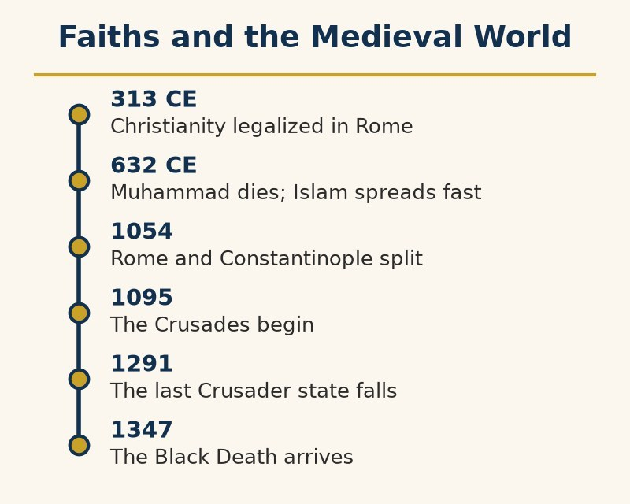

Of everything covered so far, nothing moved as much material as quickly, or grew as tightly bound to power, as belief did once it went looking for followers who owed it nothing in the way of birth or citizenship.

Dolphins, who have always been content to enjoy the ocean and find fish, regard the human urge to develop extensive theories about the meaning of existence as this species’ most distinctive hobby, and on the whole respect it.

Buddhism, arising in the 5th or 6th century BCE from the teachings of Siddhartha Gautama in what is now Nepal and northern India, spread across Asia over the following centuries through trade routes and, in particular, the patronage of the Indian emperor Ashoka in the 3rd century BCE. Ashoka converted after a famously brutal conquest and then spent the rest of his reign promoting nonviolence.

Christianity began as a Jewish movement in Roman Judea. Constantine legalized it in 313 CE; Theodosius made it the empire’s official religion by 380. A persecuted minority had become the state faith within a century.

The faith did not stay one thing for long. Centuries of accumulated disagreement over doctrine, ritual, and who answered to whom came to a formal head in 1054, when the churches of Rome and Constantinople excommunicated each other’s leaders in what historians call the Great Schism. It divided Christianity into its Western Catholic and Eastern Orthodox halves, a division the two sides would not formally revoke until 1965 and have still not fully healed. A faith organized enough to convert an empire was also, it turned out, organized enough to split one.

Islam began with Muhammad’s teachings in seventh-century Mecca and Medina. Within a century of his death in 632, Muslim rule extended from Iberia to India through conquest, administration, and conversion, which proceeded at different rates.

Each faith, once established, did two jobs at the same time: it organized how believers should live, and it organized armies, tax systems, and successions in the believers’ names. This is not cynicism.

Christianity’s own version of that second job produced a fight over who, exactly, was in charge of it. The Investiture Controversy, running from 1076 to 1122, pitted the Holy Roman Emperor against the Pope over whether a king or the Church got to appoint bishops, and therefore who ultimately answered to whom. In 1077, Emperor Henry IV, excommunicated and politically cornered, walked to the Italian castle of Canossa and stood barefoot in the snow for three days until Pope Gregory VII agreed to receive him. The phrase "going to Canossa" entered several European languages as shorthand for public humiliation. The underlying argument, settled by compromise in 1122, never really ended; it only changed which century’s crown and which century’s clergy were having it.

Professor Click-Click-Whoosh asked to see the pope’s own account of Canossa, on the grounds that every other teller had improved the story.

Gregory VII’s letter to the German princes turned out to be plain. King Henry, he wrote, had waited three days before the castle gate, laid aside every sign of royalty, and stood there barefoot and dressed in wool. The snow, the Professor noted, is left to later tellers.

“So the humiliation is real,” the Professor told the committee, “and the pope wrote it up himself, which is the first reason to read it with a pencil.”

The second reason arrived later. Henry was absolved within days, kept his crown, and went on fighting. Seven years after the barefoot wait his army took Rome, and a year after that Gregory died in exile at Salerno.

“Canossa was a performance of humility,” the Professor concluded, “and both sides spent the rest of their lives disputing who had won it. The pope’s reputation did better than the pope.”

The picture below, from a manuscript of about 1115, shows Henry IV begging Countess Matilda and Abbot Hugh of Cluny to speak for him at Canossa.

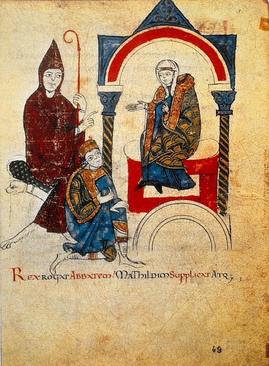

*Henry IV begs Countess Matilda and Abbot Hugh of Cluny to speak for him at Canossa, from the Vita Mathildis, about 1115.*

While Western Europe, after Rome’s western half fell, entered the fragmented centuries the next chapter discusses, the Islamic world entered what historians call its Golden Age. Baghdad’s House of Wisdom, founded in the 8th century, employed scholars to systematically translate Greek, Persian, and Indian works into Arabic. They preserved texts Europe had largely lost access to and would not fully recover for centuries. Scholars across the Islamic world advanced medicine, optics, and astronomy well beyond what Rome had left behind, among them the Persian polymath Avicenna, whose medical encyclopedia remained a standard European medical school text for roughly six centuries. The Andalusian philosopher Averroes wrote commentaries on Aristotle that reintroduced Greek philosophy to a Western Europe that had largely lost direct access to it. (The chapter on the Allegedly Dark Ages picks up the one figure from this Golden Age whose own name became a unit of modern computing.)

The Crusades, beginning in 1095 when Pope Urban II called for a military campaign to reclaim Jerusalem, ran in waves for close to two centuries. Without euphemism, they were religious conviction, real and widely shared among participants, fused to land claims and trade route control. In the notorious Fourth Crusade of 1204, the result was the outright sack of Constantinople, a Christian city, by a Christian army meant to be fighting someone else entirely.

Jerusalem changed hands several times across the Crusading period. Its most consequential loss, for the Crusader side, came in 1187, when the Kurdish Muslim general Saladin defeated the Crusader army at the Battle of Hattin and retook the city after eighty-eight years of Crusader rule. Accounts on both sides noted that he spared the Christian population rather than repeating the massacre the First Crusade had inflicted on Jerusalem’s residents in 1099. None of the Crusader states the campaigns produced lasted much past 1291.

What outlasted the fighting in the Levant was trade and contact. The heavier traffic in translated texts and Islamic scholarship reached Western Europe mainly through a different front: Islamic Spain’s Toledo school of translators and Norman Sicily. It fed the universities that began forming in the 12th and 13th centuries.

**Dolphin verdict:**

*No fleet, no army, and no king so far moved as many people, across as much distance, as a belief that asked only to be believed. The Crusades are this chapter’s starkest proof that a good story and a bad reason can travel in the same convoy — and its quieter proof, easy to miss underneath the sieges, is that even a violent contact between civilizations still manages to leave something worth keeping behind.*

# The Early Middle Ages, 476–1000 CE: The Allegedly Dark Ages

After the fall of Rome, western Europe fragmented into smaller kingdoms, and later humans called the centuries that followed the Dark Ages.

The dolphins found the name suspicious.

*“Was it truly dark, or were the humans simply missing paperwork?”*

There were fewer records than during the Roman Empire, many cities shrank. In parts of the former Western Empire — Britain especially — the archaeological record this book’s Rome chapter cited (fewer coins, cruder pottery, smaller buildings) shows a genuine, sharp drop in material life, not just missing paperwork. That was a regional collapse, though, not a global one.

Elsewhere, life went on. Emperors still governed in Constantinople, scholars in Baghdad studied mathematics and astronomy, and India and China flourished.

Baghdad’s House of Wisdom deserves a name, not just a mention. Al-Khwarizmi worked there in the 9th century and left behind two words still in daily use: algebra, from the title of his book on solving equations, and algorithm, a Latinized version of his own name. Humans, it should be noted, named a basic unit of modern computing after a mathematician from the middle of their allegedly dark age.

Constantinople alone should have made the label harder to sustain. The emperor Justinian, ruling from 527 to 565, commissioned a systematic compilation of Roman law, the Corpus Juris Civilis, that went on to shape European legal systems for the next fifteen hundred years. He also built the Hagia Sophia, completed in 537, which remained the largest cathedral in the world for nearly a thousand years.

The label itself has a specific culprit and a much narrower original meaning than students are usually given. The idea goes back to the 14th-century Italian poet Petrarch, who applied it only to what he saw as the loss of classical Latin literary style in the centuries after Rome. He did not apply it to the era’s politics, religion, or science, and not at all to Byzantium, the Islamic world, India, or China, none of which he was thinking about.

*“The oceans,” the dolphins concluded, “did not notice any darkness.”*

Nor was Europe standing still. Kingdoms formed, trade expanded, farming improved with the heavy plow, the water mill, and the horse collar, and, a little later, universities appeared.

Charlemagne, crowned Emperor of the Romans in Rome on Christmas Day, 800 CE, revived the imperial title in the West more than a century before Otto I’s 962 coronation gave rise to what later became known as the Holy Roman Empire. He gathered scholars from across Europe at his court, the Englishman Alcuin of York chief among them. He also standardized a new, clearer handwriting, Carolingian minuscule, whose rounded lowercase letters are the direct ancestors of the ones printed on this page. Charlemagne himself, by his biographer Einhard’s account, kept writing tablets under his pillow to practice his letters in spare moments, and began too late in life to master the skill.

*“The man who revived European literacy,” dolphin historians observed, “never quite learned to write. Humans, it should be said, have never let competence stand in the way of sponsorship.”*

The disruption was not entirely a matter of missing paperwork, either. Norse raiders sacked the monastery at Lindisfarne, off the English coast, in 793 CE, a single attack Christian Europe treated for a generation afterward as a sign the world had turned hostile, and Viking raids and settlement continued for the better part of three centuries.

One popular idea about the period is worth correcting directly, since it runs exactly backward. Educated medieval Europeans did not believe the world was flat. The Earth’s sphericity, established by Greek astronomers centuries earlier, was standard teaching in medieval universities and never seriously disputed by anyone with an education to lose. The flat-earth myth about the era was largely manufactured in the 19th century, not least by Washington Irving’s mostly invented 1828 biography of Columbus, which put a fictional flat-earth argument into the mouths of scholars who had never made one.

Warfare did not pause. From the ninth and tenth centuries, castles began to rise across the landscape, as lords built walls rather than settle their disputes.

Centuries later, some humans became so dissatisfied with the traditional story that they proposed radical alternatives.

One mathematician, Anatoly Fomenko, argued that large parts of ancient history had been misdated and that the timeline was wrong. He suggested that many events thought to belong to antiquity actually occurred much later.

Most historians rejected this idea and pointed to archaeological evidence, written records, radiocarbon dating, and other methods that support the conventional timeline.

**From the minutes of the Society, on the question of the Dark Ages:**

*Motion to adopt Fomenko’s chronology: defeated, unanimously, by both halves of every brain present. Motion to retire the phrase “Dark Ages”: carried, with one abstention from a member who wished it recorded that the North Sea in the ninth century was, in fact, quite dark.*

**Dolphin verdict:**

*The age was not dark. It was only complicated. Humans often confuse the absence of records with the absence of history.*

# The 2nd Century BCE to 1368 CE: Silk, Steppe, and Plague — The Roads That Connected Everyone, Including the Germs

Nobody at the time called it the Silk Road. The name was coined in 1877 by a German geographer, Ferdinand von Richthofen, some two thousand years after the traffic began, and it is misleading twice over: it was not one road, and silk was only a fraction of what moved along it.

What existed instead was a web of trails, oases, and caravan towns running from China to the Mediterranean, worked by relays of merchants who rarely traveled the whole distance and generally took a cut at their stage. The Han dynasty opened it up in earnest in the 2nd century BCE, after the envoy Zhang Qian returned from a thirteen-year mission, ten of them spent as a prisoner, with news of a world to the west. Rome soon developed a taste for Chinese silk so expensive that Pliny the Elder complained, around 77 CE, that luxuries from the east were draining the empire of a hundred million sesterces a year.

What moved along it was not only goods. Buddhism traveled east into China. Christianity and Islam traveled in several directions. Paper, gunpowder, and the compass eventually made their way west. And, at odd intervals, so did things nobody had ordered.

The roads were at their busiest and safest under the Mongols, which is not a sentence anyone expects.

In 1206 a chieftain named Temüjin was proclaimed Genghis Khan, ruler of all the Mongols, and within a few decades his family ruled the largest contiguous land empire in history, from Korea to the borders of central Europe. The conquests were catastrophic. When Baghdad fell in 1258, the chroniclers said the Tigris ran black with the ink of its destroyed libraries and red with the blood of its people. Estimates of the dead across all the Mongol campaigns run into the millions, and on some counts the tens of millions; the medieval figures cannot be checked, and nobody who has studied them thinks they were small.

Having conquered nearly everyone, the Mongols ran one of the most efficient postal systems of the pre-modern world, in which relay riders could reportedly cover up to two hundred miles a day. They also proved surprisingly relaxed about what their subjects believed and extremely interested in whether the trade was flowing. The resulting stability, the Pax Mongolica, made it possible for a Venetian named Marco Polo to travel to the Great Khan’s court in the 1270s and return with a book. Whether he saw everything he described is still debated. Whether he brought back pasta is not: he did not.

The same network that carried silk and paper also carried, in the 1340s, a bacterium. Recent ancient-DNA studies point to the region of present-day Kyrgyzstan as the plague’s starting point, from which it followed the trade routes with caravans and armies until it reached the Crimean port of Kaffa in 1346. An Italian chronicler who was not present reported that the besieging Mongol army catapulted plague victims over the walls; historians treat the story with caution, since the disease was evidently arriving by ordinary means as well. What is beyond dispute is that in October 1347 Genoese galleys carrying sick sailors put into Messina, in Sicily. Over the next five years, the plague may have killed between a third and a half of Europe’s population, with heavy losses across the Middle East and North Africa as well.

Numbers that size stop meaning anything, so here is one man. In Siena, where the plague arrived in the spring of 1348, a tax official named Agnolo di Tura kept a chronicle. In the middle of it he wrote: “I, Agnolo di Tura, called the Fat, buried my five children with my own hands.” He went on with the chronicle afterward. There was nobody else to write it.

Much of the Black Death’s itinerary was maritime, as dolphins watching a great many Genoese ships go by could have told anyone. Rats have always made excellent passengers and terrible guests, though recent studies suggest that in many European outbreaks the disease spread more through human fleas and lice than through rats.

*“Humans built the first genuinely continental trade network,” one dolphin scholar observed, “and were unpleasantly surprised to learn that a market open to silk is also open to everything else that hitches a ride.”*

The Mongol empire itself broke into rival khanates within a few generations, and China’s Ming dynasty drove the Mongols out in 1368. The connections survived both. Within a century the same goods, and the same germs, were finding faster ways to travel, by sea.

**Dolphin verdict:**

*The first globalization moved at the speed of a camel and still managed to carry a pandemic across three continents in under a decade. The roads that connect a species to its own kind are neutral about what they carry, and the dolphins draw the obvious conclusion without much pleasure: connection has always arrived with a bill, and the itemized version has always come after payment.*

# The 8th Century BCE to 1897 CE: Gold, Salt, and Stone — The Kingdoms of Africa

It is a common error, and an old one, to picture Africa between the pyramids and the slave ships as a blank. Dolphin historians, who have watched the continent’s coastlines for rather longer than anyone has been drawing maps of them, would like to correct the record.

Below, Mansa Musa of Mali appears holding a gold nugget in the Catalan Atlas of 1375.

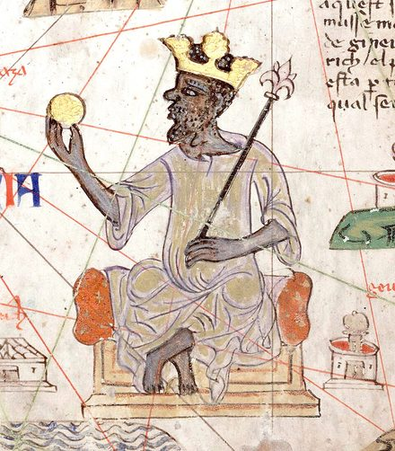

*Mansa Musa of Mali holding a gold nugget, from the Catalan Atlas, 1375.*

Start with the pyramids. The kingdom of Kush, south of Egypt in what is now Sudan, spent centuries as Egypt’s neighbor, trading partner, and occasional conqueror: in the 8th century BCE the Kushite king Piye marched north and founded Egypt’s 25th dynasty, whose pharaohs ruled the Nile valley for most of a century. Kush built pyramids of its own, smaller and steeper than Egypt’s, and built more of them: Sudan today has more pyramids than Egypt. Its iron-working capital, Meroë, was once described by an early 20th-century archaeologist as the Birmingham of ancient Africa, on account of the slag heaps, a compliment Birmingham has yet to return.

Further east, the kingdom of Aksum, in what is now Ethiopia and Eritrea, grew rich on Red Sea trade between the 1st and 7th centuries CE. It minted its own gold coins, raised towering carved stone obelisks, and, under King Ezana around 330 CE, became one of the first states anywhere to adopt Christianity. In the 3rd century the Persian prophet Mani is reported to have listed the four great kingdoms of the earth as Persia, Rome, China, and Aksum, which is company the average textbook does not offer it.

South of the Sahara, the wealth was gold and salt. Gold came out of the forests of West Africa, salt came out of the desert, and camel caravans crossing the Sahara exchanged one for the other at prices that made several kings extremely rich. The empires of Ghana, Mali, and Songhai rose and fell on that trade between roughly the 8th and the 16th centuries.

The most famous of their rulers, Mansa Musa of Mali, set out on the pilgrimage to Mecca in 1324 with a caravan that Arab chroniclers put at tens of thousands of people, and gave away so much gold in Cairo that, by their account, its price stayed depressed there for more than a decade. A map made in Spain in 1375, the Catalan Atlas, shows him on a throne holding a gold nugget, which is how European mapmakers chose to introduce the wealthiest man in Africa to their readers.

He returned with architects and scholars, and Timbuktu, on the edge of the desert, became a center of learning whose mosques and private libraries filled with hand-copied manuscripts on law, astronomy, medicine, and mathematics. Some of them survive for a reason that is deeply moving. In 2012, when armed extremists occupied Timbuktu, librarians and volunteers quietly smuggled most of an estimated 350,000 manuscripts out of the city, by their own count, some of them by river.

*“A library is only as safe as the people willing to carry it out,” the Society recorded, with the Library of Alexandria in mind.*

On the other side of the continent, the Swahili city-states of the East African coast, Kilwa and Mombasa among them, grew rich on monsoon-driven trade across the Indian Ocean, exchanging gold and ivory for Chinese porcelain and Indian cloth. Inland, the great stone enclosures of Great Zimbabwe housed thousands of people at their peak between the 11th and 15th centuries. European colonial officials, unwilling to believe that Africans had built it, attributed it for decades to the Phoenicians, King Solomon, or the Queen of Sheba, to anyone but the people who lived there, until archaeologists established beyond argument who had.

And in the forests of what is now Nigeria, the kingdom of Benin produced, from at least the 13th century and most famously in the 16th, some of the finest cast-metal art in the world. Take one piece. It is a brass plaque about the size of a large book, one of several hundred cast to be nailed to the wooden pillars of the oba’s palace. It shows a Portuguese trader in a brimmed hat holding a manilla, the brass bracelet that served as currency in the coastal trade. Benin’s artists recorded the Europeans the way Europeans would later decline to record Africans: carefully, and as one detail in a kingdom’s own story.

In 1897 a British military expedition, sent after an earlier British party was ambushed on its way to the city, burned Benin City and carried off thousands of its brass and ivory works, which were sold, dispersed, and displayed in museums across Europe and America. Whether and how they should go home is still argued. Germany and the Smithsonian began returning pieces in 2022, and in 2023 Nigeria’s government declared the Oba of Benin their rightful owner; many other museums are still deciding.

The Atlantic slave trade, told in a later chapter, took its victims from societies like these: kingdoms with cities, laws, armies, scholars, and treasuries, not from a blank. The picture of Africa as a place where history happened to other people is largely a European invention, and it lasted about as long as it was useful.

The plaque’s pillar is gone, and so is the palace it was nailed to. The nail holes are still in the brass.

# 1482 to Today: The Richness Moved — Africa’s Resources and Who Took Them

## The ground itself

Africa is rich. Gold, salt, copper, iron, ivory, timber, rubber, cocoa, coffee, cotton, oil, and diamonds drew outsiders for centuries, along with the labor of the people who lived above them. Imperial maps followed the deposits.

The land was neither empty nor poor. West African forests grew yams and oil palm; Ethiopia grew coffee; Sahel routes carried salt and gold; Great Lakes kingdoms kept wealth in cattle. Southern copper was worked long before Europeans named the belt. Ships arrived light and left heavy.

## Cities of metal and law

In what is now Nigeria, Nok artists made terracotta figures and smelted iron from about 1500 BCE. Later, Ile-Ife artisans cast brass and copper heads with remarkable skill. Some European observers credited lost Romans rather than African makers with the work.

Kongo had provinces, a court, nzimbu-shell currency, and a king, the Manikongo. Portuguese captains first arrived as diplomatic peers. Their demand for captives, however, consumed the kingdom’s labor and strained its politics. In 1526, Afonso I wrote João III that traders were seizing his people, including nobles’ sons and members of his family, and asked the king to stop them. The traffic continued; his letters sit beside cargo lists.

Asante built an empire on Akan goldfields, with a capital at Kumasi and a bureaucracy. The Golden Stool represented the nation’s soul and was not for anyone to sit on. When a British governor demanded it in 1900, war followed. Britain eventually took the country and its gold, but not the stool.

Dahomey grew rich by selling captives to European forts. The trade harmed its neighbors as well as its victims. This chapter keeps both facts in view: African kings and African victims often lived only days’ walk apart, and wealth and human sale could occupy the same treasury.

## The state that stayed

Ethiopia kept its crown. Lalibela’s rock-hewn churches were built in phases over centuries, some parts perhaps older than the twelfth- and thirteenth-century reign traditionally credited with them. In 1896 at Adwa, Menelik II’s forces defeated an Italian invasion, keeping the country from partition. His own empire also expanded over neighbors, a history that deserves no romance.

## What the scramble was for

European powers described the Scramble for Africa as a race for flags and prestige. Company charters show what mattered more. King Leopold’s Congo Free State imposed rubber quotas through hostage-taking and mutilation; villagers could be punished for falling short. Millions may have died from violence, hunger, and disease, but no census exists to settle the number. The account books and photographs remain.

At Kimberley and on the Witwatersrand, diamond and gold wealth grew with a labor system built to extract it cheaply. De Beers housed African miners in closed compounds; migrant labor and pass laws helped shape apartheid.

Elsewhere, palm oil, groundnuts, cocoa, cotton, and Katanga copper moved outward. Independence changed the flag over many mines more easily than it changed the contracts or the flow of wealth.

## Still rich

Oil made a new version of the goldfields. Niger Delta, Angolan, and Gulf of Guinea resources brought wealth that often passed the people standing above them. Economists call the pattern the resource curse, though they debate how much comes from geology and how much from politics. The cases here turn on the deals governing where the money went: roads and schools in some places, palaces and weapons in others.

One different bargain emerged in Botswana. The first large diamond mine was found in 1967, a year after independence; that year’s Mines and Minerals Act placed mining revenues under national control. A World Bank review estimated that close to 90 percent of mineral revenues from 1983 to 2014 went to physical and human capital, divided roughly between infrastructure and investments such as education and health. Botswana remained dependent on diamond income. The case shows how public institutions can turn some mineral wealth into shared assets, while leaving the economy exposed to the market for a single resource.

Today the inventory includes cobalt for batteries, coltan for phone capacitors, and gold dug by hand in eastern Congo. Militias profit from some of these mines; dangerous, poorly paid work and child labor have been reported in artisanal cobalt mining.

Africa did not need discovery to become valuable. Its kingdoms, soil, and minerals were rich before outsiders arrived. Ships, companies, and debt changed who collected the proceeds. The continent’s later poverty was not ancient; wealth moved, and the transfer endured.

**Dolphin verdict:**

*Africa did not simply fall behind. Resources were taken through successive systems of conquest, companies, and debt; the ground remained rich.*

# 2600 BCE to 1491 CE: Before Columbus — Cities, Corn, and Knotted String

When Spanish soldiers first came down the causeway into the Aztec capital in 1519, one of them later wrote that some of his companions wondered aloud whether they were dreaming. It is a useful reminder that the Americas of 1491 were not empty, and were not waiting.

Below is a map of Tenochtitlan, printed in Nuremberg in 1524, one of the earliest European pictures of the city.

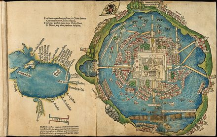

*Tenochtitlan, in a map printed in Nuremberg in 1524.*

The story begins with corn. Somewhere in southern Mexico, some nine thousand years ago, farmers began breeding a scruffy wild grass called teosinte into maize, a project of such patient and improbable success that geneticists still argue about how it was done. Beans and squash followed, and with them, cities.

Caral, in Peru’s Supe Valley, was raising monumental pyramids around 2600 BCE, roughly when Egypt was raising its own. The Olmec of the Gulf Coast carved colossal stone heads. The Maya built astronomically aligned cities in the rainforest and developed one of the few true writing systems in the world. Teotihuacan, near present-day Mexico City, held perhaps a hundred thousand people or more at its height, which would have made it one of the largest cities on Earth. The great Maya cities were largely abandoned between about 800 and 950 CE, apparently through some combination of drought, warfare, and overreach, a sequence that recurs throughout this book.

By 1519 the Aztec, or Mexica, capital of Tenochtitlan, built on an island in a lake and fed by artificial floating gardens, held, on estimates that run from about 60,000 to more than 200,000, more people than most European cities of the day, even at the low figure. It had aqueducts, causeways, and a market that astonished the Spaniards. It also practiced human sacrifice on a scale that horrified them, and that needs saying plainly: a civilization can be both a marvel and a horror, and the humans of both hemispheres demonstrated as much.

In the Andes, the Inca Empire, at its height in the late 15th and early 16th centuries, ruled perhaps ten million people (estimates run from about six to fourteen million) across the length of the mountain chain. It was linked by roads and rope bridges running somewhere from 14,000 to 25,000 miles depending on what counts as part of the network. It did this without the wheel, without draft animals beyond the llama, and without any writing that anyone has been able to read. It kept its records on the quipu, a system of knotted, colored strings in which the type and position of each knot recorded numbers, and, some scholars now argue, possibly more.

*“The writing chapter counted four independent inventions of writing,” dolphin historians noted. “The Inca ran an empire of ten million on knotted string and declined to be counted among them. The fifth candidate has never quite been ruled out.”*

Inca stonework matched the roads for ambition. At sites like Sacsayhuamán above Cusco and the mountaintop retreat of Machu Picchu, the masons fitted multi-ton stones together without mortar. Machu Picchu was occupied from at least 1420 CE according to 2021 radiocarbon dating of its burials, a generation earlier than the traditional chronicle-based date of around 1450; its purpose is still debated, and a royal estate is the leading guess. The fit is so precise that a knife blade still cannot slide between the joints. The technique has helped several Inca walls outlast earthquakes that leveled colonial Spanish buildings raised right beside them centuries later.

North of Mexico, Cahokia, beside the Mississippi near present-day St. Louis, held perhaps ten to twenty thousand people around 1100 CE and built Monks Mound, an earthwork larger at its base than the Great Pyramid of Giza. In the Amazon basin, farmers engineered dark, fertile soils, terra preta, that are still worked today.

How many people lived in the whole hemisphere in 1491 is one of the most contested numbers in the field. In 1966 the anthropologist Henry Dobyns proposed as many as 90 to 112 million. Skeptics, most forcefully the historian David Henige, answered that such figures multiply one guess by another. A 2019 synthesis of the regional studies settled near 60 million, with wide margins either side. Every estimate shapes the next chapter, because the size of the collapse depends on the size of what collapsed.

*The Society divides on this question into the High Counters and the Low Counters, a split that mirrors the human one so exactly that each school accuses the other of having read the wrong anthropologist. Both agree on the shape of what came next, which is the part that matters.*

Dolphins, who had spent thousands of years watching both coasts, have one small footnote to add. Genetic studies published in 2020 found Native American ancestry in people on several Polynesian islands, dated to around 1200 CE, which suggests that Polynesian voyagers reached South America and came back some three centuries before Columbus, possibly with the sweet potato. Dolphin historians say only that they saw the canoes.

What happened next is told in the chapter on the ships. Dolphin scholarship asks only that it be read with these pages in mind.

**Dolphin verdict:**

*The Americas of 1491 were not a wilderness waiting to be found. They held cities larger than most in Europe, crops that would go on to feed the world, and, in the quipu, a rival to the idea of writing itself. Everything in the next chapters is, in part, a story of what was done to them. There would also be no chips without the Andes, which makes fish and chips half Andean.*

# The 15th to 17th Centuries: Ships, Gunpowder, and Gold — Exploration, Conquest, and the Colonial Age

Ocean crossing long predated European voyages. People reached Australia by boat tens of thousands of years earlier; Polynesian navigators crossed the Pacific by stars and swells, and Norse sailors reached North America around 1000 CE.

From 1405 to 1433, Ming China sent seven treasure fleets under Zheng He to India, Arabia, and East Africa. Some had hundreds of ships and tens of thousands of crew. Scholars debate the largest vessels’ size. Later, the court halted the voyages and abandoned the fleet program; the choice narrowed China’s oceanic reach.

What changed was not the idea of crossing an ocean, but what the arrivals did to the people on the other side.

The Black Death reached Europe in 1347. A century later, its upheaval had changed labor, land ownership, and the balance between peasants and nobles.

Portugal began the European push. Prince Henry sponsored African-coast voyages; Bartolomeu Dias rounded the Cape in 1488, and Vasco da Gama reached India by sea in 1498. Columbus, sailing for Spain, reached the Caribbean in 1492 while seeking Asia. Vespucci’s accounts helped mapmakers recognize a new continent, named on a 1507 map after him. Magellan’s expedition completed a circumnavigation in 1522, though he died in the Philippines before it ended.

England arrived late: John Cabot reached North America in 1497, but Roanoke disappeared after its 1587 founding. The East India Company (1600) and Jamestown (1607) began England’s lasting imperial expansion.

Gunpowder began in China; by the fifteenth century, cannon and firearms strengthened states with the administration and taxes to support them. The Ottomans, Safavids, and Mughals became known as gunpowder empires. European powers applied the same combination at sea.

Francis Drake raided Spanish treasure ships in the 1570s and 80s, circumnavigated the globe, and was knighted by Elizabeth I. Spain regarded him as a pirate on an English queen’s payroll.

Disease—smallpox, measles, and influenza—killed a majority of Indigenous people in the Americas over the following century and a half. Estimates range from about half to 90 percent because the original population is disputed. War, forced labor, famine, and community destruction made epidemics deadlier. Smallpox weakened Tenochtitlan before Cortés took it in 1521; Pizarro captured Atahualpa amid epidemic and civil war in 1532.

Ships, guns, compasses, charts, and double-entry bookkeeping drew on Chinese, Arab, Indian, and European inventions. European states concentrated them in an overseas system linking every inhabited continent. Capability accumulated; decisions were made one voyage at a time.

From the early 1500s to the 1860s, about 12.5 million Africans were forced aboard ships for the Americas; about 10.7 million survived. The rest died at sea. Survivors were sold into hereditary forced labor, chiefly on sugar, tobacco, rice, and cotton plantations.

Historians assembled records from roughly 36,000 voyages into a database. The traders kept precise accounts; their ledger is exact, and it is not enough to hold a person.

Olaudah Equiano’s 1789 autobiography describes his kidnapping as a child in what is now southeastern Nigeria and the voyage below deck. The ship was so crowded, he wrote, that each person scarcely had room to turn. Children fell into the latrine tubs; he remembered “the shrieks of the women, and the groans of the dying.”

A baptismal record and naval muster roll list Equiano’s birthplace as South Carolina; some historians therefore question whether his African chapters were firsthand. Others defend his account. The hold’s conditions match ship records and other survivors’ descriptions.

Equiano was often kept on deck because he was ill and too young for fetters. Watching the water, he wrote that he envied the “inhabitants of the deep” for their freedom.

Britain and the United States banned the trade in 1807 and 1808, but smuggling continued. In 1860, the schooner Clotilda carried about 110 captives from Ouidah to Mobile; its crew burned the ship after secretly landing them.

Kossola, about nineteen, was among the captives. Freed in 1865, he and other survivors bought land and built African Town near Mobile. Zora Neale Hurston recorded his life in 1927 and 1928; Barracoon appeared in 2018. He died in 1935, one of the last survivors of the last known slave ship to reach the United States.

Divers confirmed the burned hull of the Clotilda in 2019, in the Mobile River upstream of Mobile Bay, a few miles from the town its passengers built.

Faster ships, better charts, credit, insurance, and law made the trade more efficient. Capability compounded. Judgment did not.

# 1450 to the Late 1800s: Machines and Manifestos — Renaissance, Enlightenment, and Industry

Before the method came the mood. Beginning in fourteenth-century Italy and spreading north, a revival of interest in the classical world, the Renaissance, put painters, engineers, and scholars in the same rooms and, eventually, on the same pages. Leonardo da Vinci, who painted, dissected, and filled notebooks with flying machines that would not fly for four centuries, impressed the dolphins enormously, though they note that he finished remarkably little of what he started.

Below is a page of Genesis from the Gutenberg Bible, printed at Mainz about 1455.

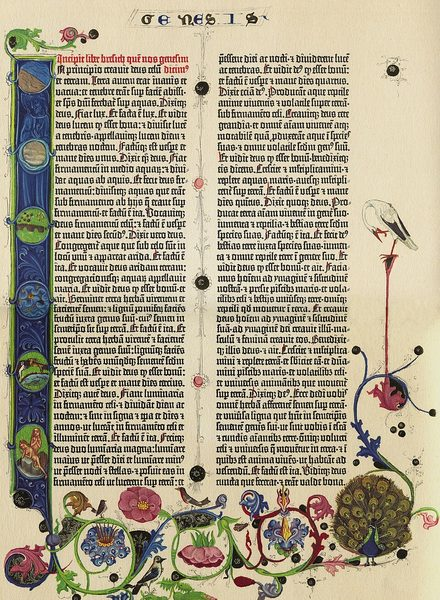

*A page of Genesis from the Gutenberg Bible, Mainz, about 1455.*

Around 1450, in the German city of Mainz, Johannes Gutenberg’s press with movable metal type made books cheap enough that ideas could begin to travel faster than the authorities who disliked them. Movable type had been invented in China and Korea centuries earlier; Gutenberg’s version, built around an alphabet of a few dozen letters rather than thousands of characters, was the one that scaled. By 1500, by common estimates, more than ten million volumes had been printed in Europe, and within a generation the press was carrying Martin Luther’s objections to the Church across the continent faster than the Church could answer them.

In the century and a half after Copernicus proposed, in 1543, that the Earth orbited the sun, not the other way around, a habit took hold among a scattered and quarrelsome set of thinkers: test a claim against observation and evidence, not against who holds the authority to state it. Historians of science now warn that this was no single, tidy Scientific Revolution. Galileo’s mathematics, Kepler’s astrology-laced astronomy, and Newton’s long private detours into alchemy and biblical chronology were not one method perfecting itself by relay, whatever the textbook version implies. What they share, in hindsight, is only the result: Newton’s 1687 laws of motion and gravitation unified the falling apple and the orbiting moon under one set of equations, proof that the habit, however messily arrived at, worked.

Over the following two centuries the method swallowed most of nature: electricity, chemistry, and, in 1859, biology, when Charles Darwin published On the Origin of Species and told humans, in print and at length, what the dolphins had been privately assuming since the Prologue: that they were apes. Reception among humans was mixed. Dolphin scholarship approved of the whole period without reservation, and would like the record to show that it does not say that often.

The Enlightenment took that method and pointed it at government itself. If nature ran on discoverable, testable laws instead of divine whim, philosophers including Locke, Rousseau, and Voltaire argued, perhaps legitimate government did too — resting on the consent of the governed, not a monarch’s claimed mandate from heaven.

Those arguments left the page. The American colonies declared independence from Britain in 1776 on language drawn almost directly from Locke. The French Revolution, beginning in 1789, went considerably further and faster, ending not just a king’s rule but, for a time, the king himself, at the guillotine in 1793. It unleashed a period of revolutionary terror before settling, after considerable further upheaval, into a very different Europe than the one that started the century.

The 1789 Declaration of the Rights of Man and of the Citizen proclaimed those rights universal in its title and meant, on close reading, men. Olympe de Gouges published a parallel Declaration of the Rights of Woman in 1791, pointing out the omission in the driest possible terms. The revolutionary tribunal had her guillotined in 1793, officially for her political pamphlets, and dolphin scholarship notes only that a government inventing universal rights from first principles found the principle easier to state than to extend.

Industry arrived on a separate but overlapping timeline. Steam power, made practical by Thomas Newcomen’s pumping engine of 1712 and efficient by James Watt’s improved engine, patented in 1769, uncoupled work from the muscle, water, and wind that had already powered it for a thousand years. It freed industry for the first time from needing a river’s flow or a reliable wind. By the early 1800s it was running textile mills, and by mid-century, railroads. Output per worker rose by multiples that no previous technology, including the plow and the domesticated ox, had ever delivered.

The ratchet found an engine. For a million years the stored know-how of the species had been multiplied by muscle, its own or an animal’s. Coal multiplied it by sunlight buried three hundred million years earlier. Wisdom had no equivalent fuel. Factory laws, public sanitation, and limits on child labor all came eventually, but each had to be argued for, one parliament and one generation at a time, after the damage was done.

The other side of the ledger was immediate, and it belongs beside the productivity gains, not after them: children as young as five or six worked textile mill floors on twelve-hour shifts. New industrial cities like Manchester grew so fast that sanitation and housing never caught up, and cholera outbreaks followed accordingly.

*Professor Click-Click-Whoosh, in the margin beside Manchester: “Also raining.”*

Forests vanished into furnaces, coal smoke turned industrial skies the color of old newspaper, and factory waste began its long journey to the sea. As late as December 1952, London suffered five days of coal smoke so thick that about four thousand people died within days, and by later estimates as many as twelve thousand over the following months, a rare occasion on which British weather was not entirely the weather’s fault.

Nationalism, an idea barely a century old in its modern form, hardened through the late 1800s into competitive alliances between the newly industrial and imperial powers of Europe. The powers were Germany (whose own rapid unification in 1871 is a later chapter’s starting point), France, Britain, Austria-Hungary, and Russia. Each armed and allied against the others in a system explicitly built, on paper, to prevent exactly the war it produced.

**Dolphin verdict:**

*Reason, applied to nature, produced science. Reason, applied to government, produced revolutions. Reason, applied to labor, produced an industrial output that could arm a continent faster than any war before it needed weapons found or forged. Within a little over two centuries of Newton’s laws, the same continent that produced them had assembled an alliance system, an arms industry, and a railway timetable that made a general war very nearly automatic. The tools got better. This chapter is the first sign the wisdom to match them had not kept pace.*

# 1776–1865: The Republic, With Exceptions — America

## Before the sentence

English colonists planted Jamestown in 1607 on Powhatan land and nearly starved. Tobacco saved it; in 1619 the privateer White Lion sold “twenty and odd” captive Africans there. Virginia did not yet define slavery in law, but the system was taking shape.

English settlers signed a compact on Wampanoag land in 1620. By King Philip’s War (1675–76), the relationship had collapsed: Native communities were killed, enslaved, or driven away, and English settlements expanded.

By the late 1600s, New England traded fish and timber, while the Chesapeake and Carolinas grew tobacco and rice with enslaved labor. Bacon’s Rebellion briefly united poor white and enslaved Black men against Virginia’s elite; later laws hardened racial divisions to prevent another alliance.

The French and Indian War (1754–63) left Britain in debt and gave it a vast inland claim. London taxed the colonies and restricted settlement west of the Appalachians to avoid conflict with Native nations. Colonists objected to both the taxes and limits on expansion.

## The war for a sentence

War began at Lexington and Concord in April 1775. A year later Congress declared independence and asked Thomas Jefferson to explain why. His equality sentence outlived its author’s practice; the prose was powerful, but not the whole of its writer.

Washington’s army froze at Valley Forge, went unpaid, and lost men to desertion. Prussian drillmaster von Steuben taught it to march. France joined after Saratoga; French money and ships helped make Yorktown possible in 1781. Independence was a coalition, with a monarchy’s grudge behind it.

Thousands of enslaved people fled to British lines after Virginia’s royal governor promised freedom to those who fought for the Crown; some later settled in Nova Scotia and Sierra Leone. Native nations mostly sided with Britain against settler expansion. Women managed farms and camps while men fought.

## A machine for disagreement

The Articles of Confederation proved unable to tax, pay soldiers, or stop Shays’s Rebellion. Delegates met in Philadelphia in 1787 and built a government with a House apportioned by population, a Senate by state, an indirectly elected president, an appointed court, and divided powers meant to slow decisions.

That design included a slavery bargain: enslaved people counted as three-fifths for House apportionment, giving enslavers more power but the enslaved none. The Constitution protected the African trade for twenty years and required the return of people who escaped bondage. These were negotiated terms of union, not accidents of wording.

Madison, Hamilton, and Jay defended the system in the Federalist Papers. Ratification in several states required a promise of a bill of rights; the first ten amendments, adopted in 1791, protected speech, religion, assembly, and the accused. They did not protect the enslaved. The Constitution was brilliant and incomplete.

## The early republic

George Washington refused a crown, put down the Whiskey Rebellion, then left office after two terms. Dolphin historians keep his departure on a short list of founders who did not treat power as permanent.

His Cabinet split. Hamilton wanted a national bank, public credit, and manufacturing; Jefferson favored farmers, a smaller federal state, and revolutionary France. Their dispute produced the first parties. The election of 1800 was bitter, but the losers yielded power peacefully—a political technology many governments never installed.

Jefferson bought Louisiana from Napoleon in 1803 and sent Lewis and Clark to survey it, with Sacagawea’s help. The purchase doubled both the map and the dispute over slavery. The Missouri Compromise of 1820 postponed that argument along a line of latitude.

## Removal, cotton, and the bargain coming apart

Andrew Jackson widened voting rights for white men while ignoring the Supreme Court’s protection of Cherokee land in Worcester v. Georgia. The Indian Removal Act and Trail of Tears followed. The Court had ruled; the president chose not to enforce it.

By the eve of the Civil War, nearly four million people were enslaved, most born in the United States and many forced southward into the cotton states through a domestic trade. Owners called the system paternal; the books recorded capital.

Americans seized Texas after rebellion, annexed it in 1845, then fought Mexico for more land. The 1848 treaty transferred the Southwest; gold was discovered in California that year. Expansion revived the dispute over whether slavery would spread.

## The crisis

The Compromise of 1850 admitted California as a free state, ended the slave trade in Washington, and strengthened the law forcing Northerners to return people who escaped bondage. Harriet Beecher Stowe’s 1852 novel brought slavery into readers’ parlors and helped move a debate many had avoided.

In 1854 Congress let settlers in Kansas and Nebraska vote on slavery, reopening a question the Missouri Compromise had postponed. Armed settlers arrived. In 1856 a South Carolina congressman beat Senator Charles Sumner on the Senate floor; in 1857 the Supreme Court ruled that Black Americans could not be citizens and Congress could not bar slavery in the territories. The court claimed to settle the issue; it ignited it.

John Brown’s 1859 raid on Harpers Ferry failed; he was hanged. Northerners divided over his methods, while many southerners saw the raid as proof of a northern conspiracy. The country had moved beyond argument without yet admitting it.

Lincoln won the presidency in 1860 without carrying a single southern state, on a platform that promised not to touch slavery where it existed and not to let it spread. The second promise was enough. South Carolina seceded in December. Six more states followed before he was inaugurated. They said they were leaving to protect a way of life. The way of life was the ownership of other people. Dolphin historians see no profit in a softer noun.

## The war, counted plainly

Fort Sumter was fired on in April 1861. Both sides expected a short war. At Bull Run, the first major battle, Union soldiers and civilian spectators fled toward Washington. The war would last four years.

Battles became shorthand for slaughter: Shiloh; Antietam, where Lincoln issued the Emancipation Proclamation; Gettysburg and Vicksburg, both Union victories in July 1863; then the Wilderness and Spotsylvania. Sherman’s march from Atlanta to the sea targeted railroads, barns, and civilian confidence.

Nearly 180,000 Black men served in the Union armed forces, many newly freed and often paid less than white soldiers. The Confederacy debated arming enslaved men only when defeat neared, then did so too late to matter.

Lee surrendered at Appomattox in April 1865; Lincoln was assassinated five days later. The Thirteenth Amendment abolished slavery that December; the Fourteenth established birthright citizenship and equal protection, and the Fifteenth barred racial exclusion from voting. Reconstruction governments elected Black men and funded schools. The Ku Klux Klan and other white-supremacist groups killed and intimidated voters; Washington withdrew its troops in 1877, allowing southern governments to nullify the amendments. The war had ended; the sentence had not won.

*“The founders wrote a sentence that was larger than they were,” Professor Click-Click-Whoosh observed. “It took a war, a great many people who had not been in the room, and several further generations to find out what it meant. The sentence, to its credit, did not change.”*

**Dolphin verdict:**

*A republic wrote an equality it repeatedly failed to honor. Its strongest idea remained usable against the people who wrote it; no sentence could enforce itself.*

# 1865 to Today: After the Bargain — America’s Long Account

## After the bargain

The republic that abandoned Reconstruction grew inventive about exclusion. Southern constitutions used poll taxes, literacy tests, and grandfather clauses to bar Black voters. In Plessy v. Ferguson (1896), the Supreme Court approved segregation as ‘separate but equal.’ The railroad-car budgets showed the lie before the photographs did.

Alongside the paperwork ran the rope. Between the 1880s and mid-twentieth century, several thousand Black Americans were lynched, often in public. Journalist Ida B. Wells documented the violence after being driven from Memphis. Dolphin historians call it terrorism: a system of racial control with an audience.

Irish and Chinese laborers built the transcontinental railroad, completed in 1869, as federal policy stripped Native nations of the Plains. Bison were killed partly to undermine Indigenous life. At Wounded Knee in 1890, soldiers killed hundreds of Lakota, many women and children.

Ellis Island processed millions of European immigrants from 1892. The Chinese Exclusion Act and Page Act restricted Chinese migration; western mobs used violence to enforce the same message. A country advertising refuge also recorded who was unwelcome.

## Empire, briefly, and the progressive repair

In 1898, the United States took Puerto Rico, Guam, and the Philippines from Spain. The war that followed in the Philippines killed hundreds of thousands, mostly civilians, through violence, hunger, and disease.

Progressive reformers challenged trusts, slums, and political corruption without abolishing industrial capitalism. States regulated child labor, work hours, and railroads; the federal income tax and direct election of senators arrived in 1913. The fortunes remained, but democracy gained tools to tax and inspect them.

After decades of organizing and protest, women won the national vote in 1920. Black women in Jim Crow states were still violently prevented from using it. The amendment and the threat at the polling place belonged to the same victory.

## Crash, and the state that answered

The 1920s boom in Florida land and credit-fueled stocks ended in the 1929 crash. By 1933, a quarter of the workforce was jobless. Troops drove veterans from the Bonus Army out of their camp after they marched for promised pay.

Roosevelt experimented: banks reopened under new rules, work programs built trails, and Social Security (1935) offered pensions and unemployment aid. Farm and domestic workers were excluded, leaving many Black workers outside the new protections.

## A war at home, including against its own

Pearl Harbor brought the United States into the Second World War and began another assault on its own citizens. In 1942 the government removed more than 100,000 people of Japanese ancestry from the West Coast, most of them citizens, and confined them inland. The Supreme Court declined to stop the policy; decades later came an apology and reparations that could not restore what was lost.

Sixteen million Americans served. Women entered factories, then were urged home when the men returned. Black soldiers fought in a segregated army; A. Philip Randolph forced Roosevelt to bar discrimination in defense plants by threatening a march on Washington. Victory abroad did not end hypocrisy at home.

The GI Bill helped build a middle class through college aid, mortgages, and business loans. Black veterans often met banks and universities that refused to apply it to them. Federal policy helped create suburbs with a whites-only gate; the prosperity in the photographs was never universal.

## The long war in Asia, and the president who resigned

The United States inherited and fought France’s colonial war in Vietnam. The domino theory justified a decade of bombing and conscription. The 1968 Tet offensive exposed official optimism; at Kent State in 1970, National Guard troops killed four students. U.S. troops left in 1973 and the South Vietnamese government fell in 1975. Estimates of Vietnamese dead run into the millions. The country lost the war and was changed by it.

While Vietnam continued, Watergate grew from a break-in into a constitutional crisis. Richard Nixon resigned in 1974 rather than face removal; his successor pardoned him. Hearings and tapes forced a president out, then the pardon limited accountability.

## The late century

Inflation, gasoline lines, and a failed hostage rescue marked the late 1970s. Ronald Reagan won in 1980, cut taxes, fired striking air-traffic controllers, and oversaw both a boom and growing inequality. The Soviet Union collapsed; Americans were invited to call it a victory, though empires often help cause their own endings.

The 1994 crime bill lengthened sentences and filled prisons, especially with Black and poor defendants; welfare was cut. A president was impeached and acquitted. The market rose, while the country grew reluctant to count prisoners.

On September 11, 2001, nearly three thousand people died in attacks on the World Trade Center and Pentagon; passengers brought a fourth plane down in Pennsylvania. The United States invaded Afghanistan, where the attackers had been sheltered, then Iraq, which had not attacked and lacked the weapons cited to justify war. The second invasion broke the state and killed hundreds of thousands. Grief was real; policy remained a choice.

Bad mortgages and bets built the 2008 collapse. Public money rescued the institutions that made them; many households never recovered on the same schedule.

The argument over who America is for remains open. Elections have been close, courts remade, and the sentence from 1776 still used as both boast and demand. This file is not closed.

*“We do not know of another document this species has kept arguing with for two and a half centuries,” dolphin historians noted, “without once agreeing to retire it. Most arguments this long end in divorce. This one keeps renewing the lease.”*

## God’s Own Experiment: Religion in America, 1620 to 1993

The United States built a religious history of new denominations, revivals, and experiments over four centuries.

Pilgrims in 1620 and Puritans after 1630 sought room for their strict Calvinism, not religious liberty for everyone. Roger Williams and Anne Hutchinson were banished for dissent; Rhode Island grew from that conflict.

Quakers, hanged in Massachusetts around 1660 and welcomed in William Penn’s Pennsylvania, brought peace-church practices: refusing violence and oaths, and living plainly. Amish and Mennonite communities later carried a stricter version, limiting technology by choice and organizing leadership without ambition.

*“These, with the Jains several chapters ago, are the humans in this book who looked at capability, decided it was optional, and voted, community by community, generation after generation, to keep less of it on purpose,” one senior dolphin scholar added. “The Amish do by choice roughly what nature simply built into every dolphin.”*

The Great Awakenings made revival a national habit. The Second helped produce the Latter Day Saints, Seventh-day Adventism, and later Jehovah’s Witnesses and Christian Science; the Shakers reached their American peak in the same era. Joseph Smith said an angel showed him golden plates inscribed in ‘reformed Egyptian.’ He translated the Book of Mormon, then returned the plates, by his own account, leaving no object for later examination.

*Both movements promised refuge from a corrupt outside world; the leader’s certainty often left followers carrying the risk.*

Without a federal established church, religious movements competed in an open field. State churches persisted for decades, but constitutional separation left room for new denominations.

*The Society noted that no state religion did not mean less religion; it meant more movements competing in an open field.*

American movements ranged from Amish communities limiting modern technology to Jonestown, where a leader demanded everything his followers had left. The variety resists a single verdict.

**Dolphin verdict:**

*The promise of Reconstruction was withdrawn within a generation. The country built railroads, admitted immigrants, split the atom, and reached the Moon while exclusion returned under new names. Capability and judgment kept to separate schedules.*

# 1808 to Today: Liberators and Generals — Latin America After the Empires

Spain’s American empire was not conquered by anyone. It lost a king. In 1808 Napoleon’s army occupied Spain and forced the royal family to abdicate, and across the Atlantic a question nobody had ever had to answer became urgent: if the king is a prisoner in France, in whose name does anyone govern? Councils formed in Caracas, Buenos Aires, Bogotá, and Mexico City, first to hold things together for the captive king and then, once the restored king had proved a poor reason to stay, to stop holding. By the mid-1820s Spain’s mainland American empire was gone.

The men who finished the job were generals. Simón Bolívar, a Venezuelan from one of the richest families in the colonies, led armies across rivers and the Andes and briefly ruled Gran Colombia, a union stretching from Venezuela to Ecuador. José de San Martín crossed the Andes from Argentina to free Chile and then sailed north to Peru. Near the end of his life Bolívar is reported to have said that those who serve a revolution plow the sea. Gran Colombia broke apart in 1830, the year he died.

Independence changed who held power far more than how it was held. Landowners, the Church, and the army kept their positions, slavery outlasted the colonial flags in most places for decades, and Indigenous people, a majority in several of the new countries, gained little say in them. Haiti, which had freed itself from France in 1804 in the only slave revolt in history to found a state, was made to pay for the achievement. In 1825 French warships arrived to enforce an indemnity for the property its former masters had lost, and the debt, with the loans taken out to cover it, was still being serviced in the 1940s.

Brazil took a different road. When Napoleon marched on Portugal in 1807, the whole Portuguese court, some ten thousand people or more, sailed for Rio de Janeiro under British escort, and Rio became the capital of a European empire. Brazil declared independence in 1822 under a Portuguese prince, who became its emperor, and remained a monarchy until 1889. It also imported more enslaved Africans than any other country in the Americas, on the order of five million people, and in 1888 became the last country in the hemisphere to abolish slavery. The monarchy fell the following year.

The outside power that came to matter most was the northern neighbor. The Monroe Doctrine of 1823 declared the hemisphere closed to new European colonies. From the end of the nineteenth century the United States treated it as a sphere of its own: marines landed repeatedly in the Caribbean and Central America, occupied Haiti from 1915 to 1934, and in 1954 the CIA helped overthrow Guatemala’s elected president.

Dolphin scholarship keeps two private entries in its Latin American file. The first is the Amazon river dolphin, the boto, pink and long-snouted, and the star of a folk tradition in which it comes ashore at festivals as a handsome stranger in a white hat, which hides the blowhole. The second is the vaquita, a porpoise found only at the top of Mexico’s Gulf of California, now down to fewer than twenty animals because gillnets set illegally for another fish, whose swim bladder is smuggled to Asia, drown them as bycatch. One of these entries is a joke. Dolphin historians would like it known which.

By the 1970s generals ruled most of South America: Brazil from 1964, Chile and Uruguay from 1973, Argentina from 1976. Several of them relied on a method that left no record. People were taken at night by men without names, and then there was no person, no charge, and no body. The word the region still uses is the disappeared. The governments coordinated: under Operation Condor, the security services of the southern cone traded prisoners and information across borders, so that a refugee who crossed one frontier could be collected by the neighboring service.

In Argentina, between 1976 and 1983, a commission looking only at cases it could document listed just under nine thousand people; the human rights groups that had been counting in real time said thirty thousand. Historians decline to choose the smaller number because it is easier to print. Some of the taken were drugged and thrown from aircraft into the Atlantic.

Chile’s coup came on September 11, 1973, when the armed forces bombed the presidential palace and the president, Salvador Allende, died inside it. Allende had been elected in 1970 with a little over a third of the vote; the United States, which had spent money to keep him from office and then to weaken his government, was quick to work with the generals. Under Augusto Pinochet, who ruled for seventeen years, official commissions later counted more than three thousand people killed or disappeared and some forty thousand imprisoned and tortured. The singer Víctor Jara was taken to a stadium within days. Witnesses said soldiers broke his hands and told him to play. He was shot on September 16, aged forty; a 2009 forensic exhumation confirmed 44 bullet wounds as the cause of death but could not independently verify the hand injuries.

Cuba’s road ran through a different door. Fulgencio Batista had run the island as a casino with a police force; in 1959 Fidel Castro’s revolution threw him out and built a one-party state that taught a nation to read and then limited what it could read. The United States, which had backed Batista, began cutting trade in 1960 and made the embargo comprehensive in 1962. It has lasted more than sixty years, and it has also been a convenient wall for a government that would like every empty shelf to have a foreign explanation. Cubans have paid both invoices. The rafts are the receipt.

The turn came in different costumes. Argentina’s junta lost a war over the Falkland Islands in 1982 and did not survive the defeat; in 1985 its commanders were tried in a civilian court, which had few precedents anywhere. Chile held a plebiscite in 1988 on Pinochet’s continued rule, and when he lost, he left. Brazil’s generals negotiated their way out in 1985 and left themselves an amnesty. Every one of these exits was incomplete, and every one was better than the alternative. The pattern is not that Latin America discovered virtue. It is that several countries built a door out, and most of them walked through it.

Mexico ran on a different calendar. One party, the PRI, ruled for seventy-one years by holding elections it did not lose, and in October 1968, days before an Olympics meant to show the country off, soldiers fired on student protesters at Tlatelolco. The party finally lost a presidential election in 2000. Since 2006 a war against the drug trade has left a state that cannot always say where its own citizens are: in 2014 forty-three students from a teachers’ college in Iguala were taken, with local police involved, and never came home. By the early 2020s the government’s own register of the missing had passed one hundred thousand names.

In April 1977, in Buenos Aires, a small group of mothers whose children had disappeared began walking in circles in the Plaza de Mayo, in front of the presidential palace, because gathering was forbidden and walking, technically, was not. They wore white headscarves, which they have said began as their children’s cloth diapers. They were still walking on Thursday afternoons in the 2020s.

# 1299 to Today: The Sublime Porte — The Ottoman Empire and the Map It Left

The Ottoman government was known abroad by the name of a door. The Sublime Porte, from the Turkish for the high gate, was the entrance to the grand vizier’s offices in Constantinople, and diplomats came to use it for the empire itself. Dolphin historians, who have mentioned the Ottomans only in passing so far, concede that an empire that lasted more than six centuries, and at its height held the Balkans, Anatolia, Egypt, the Levant, Iraq, North Africa, and the holy cities of Arabia, deserves more than a gate.

It began around 1299 as a small Turkic frontier principality in northwestern Anatolia, named for its first chieftain, Osman, on the edge of a Byzantine Empire that was already coming apart. His successors crossed into Europe in the 1350s, and in 1453 Sultan Mehmed II, twenty-one years old, took Constantinople after a siege of fifty-three days, with cannon cast for him by a Hungarian engineer, against walls that had stopped most attackers for a thousand years. The great church of Hagia Sophia became a mosque, and the city, in time, Istanbul.

Under Suleiman I, who reigned from 1520 to 1566 and was called the Magnificent in Europe and the Lawgiver at home, the empire reached the gates of Vienna in 1529 and controlled most of the Mediterranean’s southern and eastern shores. It ran on appointed officials instead of hereditary lords, and on an army whose core, the Janissaries, was infantry with firearms, recruited through a levy of Christian boys taken from Balkan villages, converted, trained, and paid by the sultan. The villages remembered the levy as the tribute of children. Some of the boys rose to be grand viziers.

Religious minorities were governed through local courts and communal privileges that, by the nineteenth century, hardened into what came to be called the millet system. Orthodox Christians, Armenians, and Jews ran their own courts and schools under their own law, in exchange for a special tax and a subordinate status. Historians now treat the earlier, tidier version of this story, a fixed three-millet system from the conquest of Constantinople onward, as partly a later administrative myth. It was not equality, and it was not modern tolerance, but it kept the peace across one of the most mixed populations on Earth for centuries. When Spain expelled its Jews in 1492, tens of thousands found refuge in Ottoman cities, Salonica above all, which stayed a majority-Jewish city into the twentieth century.

The capital sat on the Bosphorus, the strait between the Black Sea and the Sea of Marmara, where dolphins still swim alongside the commuter ferries, and the commuters, like the citizens of every capital this book has watched, do not look up.

What Europe’s diplomats called two centuries of decline looked less tidy from inside the empire, which spent that time adapting rather than simply falling. Defeats by Austria and Russia cost it the Balkans piece by piece, Greece won independence in the 1820s, and by the 1850s Europe’s diplomats were calling it the sick man of Europe, a phrase attributed to Tsar Nicholas I, a rival with every reason to write the obituary early. The empire defaulted on its debts in 1875 and handed part of its revenue to European creditors. Its 1876 constitution called all imperial subjects Ottomans “without distinction” of religion in Article 8, then named Islam as the state religion in Article 11. Professor Click-Click-Whoosh set the two articles beside each other: “Equal belonging, with its boundary written into the same document.” The sultan suspended the constitution within two years. In 1908 a group of officers, the Young Turks, restored it and then discovered the era’s favorite remedy for an empire of many peoples, which was nationalism, in this case Turkish.

The empire entered the First World War in late 1914 on Germany’s side. It beat a British and French landing at Gallipoli in 1915, a victory that made a young commander named Mustafa Kemal famous, and in the same year its government began deporting the Armenians of Anatolia. On April 24, 1915, Armenian leaders in Constantinople were arrested; over the following months hundreds of thousands of people were marched into the Syrian desert, where they died of thirst, starvation, and massacre. The toll is usually put near a million, out of an Armenian population of perhaps two million, and Assyrians and Greeks were killed in large numbers as well. The word is genocide, as most scholars of the subject agree, and the word was coined in the 1940s by Raphael Lemkin with this case partly in mind. The Turkish state disputes the term. More than thirty countries, the United States among them, have formally recognized it.

The Ottoman state did not survive the peace. The victors occupied Constantinople and planned to carve up Anatolia, and out of a war of resistance between 1919 and 1923 came a Turkish republic under Mustafa Kemal, later called Atatürk. The sultanate was abolished in 1922 and the caliphate in 1924. In 1923 Greece and Turkey agreed to exchange populations by religion, not language: well over a million Orthodox Christians were sent one way and about four hundred thousand Muslims the other, some of them people who spoke only the language of the country they were being sent from.

The Arab provinces went to Britain and France under League of Nations mandates, with borders that followed a secret 1916 agreement between two diplomats, Mark Sykes and François Georges-Picot, as amended by later bargaining: Iraq, Palestine, and Transjordan to Britain; Syria and Lebanon to France. Promises made during the war to Arab leaders, and the 1917 Balfour Declaration, which pledged British support for a national home for the Jewish people in Palestine, could not all be kept. The Treaty of Sèvres in 1920 sketched a Kurdish state; the Treaty of Lausanne in 1923 left it out, and the Kurds, an estimated thirty million people, now live in four countries and have a state in none.

Under that map, and beside it, lay oil, and the map soon mattered more than anyone had planned. In Iran, a 1951 law nationalizing the British-owned oil industry made Mohammad Mosaddegh a national hero, and a coup organized by British and American intelligence removed him in 1953. The Shah it restored was overthrown in 1979 by a revolution that created a clerical republic under Ayatollah Khomeini, and Tehran and Washington still read each event as the explanation for the other. Iraq invaded Iran in 1980, and the eight-year war killed hundreds of thousands of people; in 1988 Iraq’s government gassed the Kurdish town of Halabja, killing thousands of its own citizens. Two more wars in Iraq followed, in 1991 and 2003.

A region whose argument is still being conducted gets no verdict here, only an object. The dome of Hagia Sophia, finished in 537 as a Christian cathedral, became a mosque in 1453, a museum in 1935, and a mosque again in 2020. It has not been consulted at any stage.

# 1914–1918: Home by Christmas — The First World War

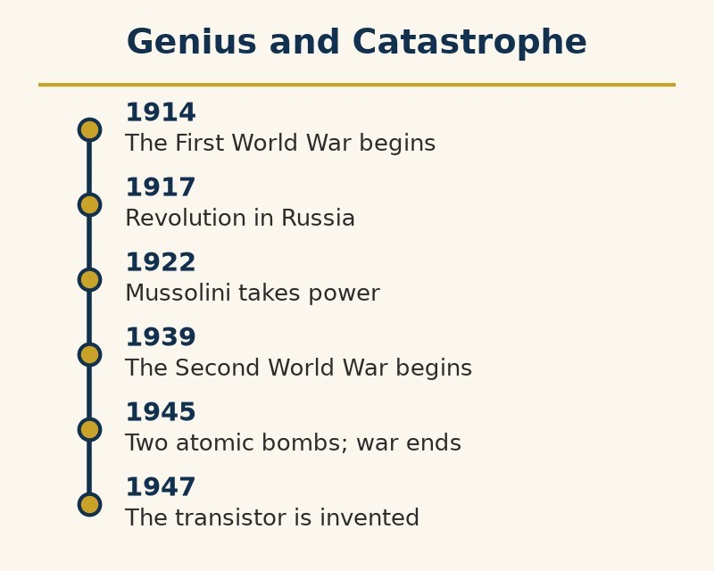

On June 28, 1914, a nineteen-year-old Bosnian Serb named Gavrilo Princip, whose group had already failed once that morning, found himself outside a delicatessen in Sarajevo when the car of Archduke Franz Ferdinand of Austria-Hungary took a wrong turn and stopped in front of him. A popular modern story has him buying a sandwich; no contemporary source says so. He shot the Archduke and his wife, Sophie, and began, without quite intending it, the First World War.

Below is a photograph of a Royal Irish Rifles ration party on the Somme, July 1916.

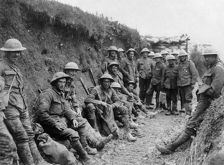

*A Royal Irish Rifles ration party on the Somme, July 1916.*

What followed was a chain reaction so mechanical that historians still argue about whether anyone could have stopped it. Austria-Hungary blamed Serbia, Russia backed Serbia, Germany backed Austria-Hungary, France backed Russia, and Britain, which had promised to defend Belgium’s neutrality, joined in after Germany marched through Belgium. Within weeks, nearly every great power in Europe was at war. Governments told their publics it would be short; several of the general staffs that planned it, Germany’s among them, had quietly prepared for a long one. The Kaiser told his departing troops that they would be home before the leaves fell. In Britain the phrase was over by Christmas.

It was not. The armies dug in, and for four years a front line some four hundred miles long, from the Channel to Switzerland, barely moved. The industrial machinery of an earlier chapter produced artillery, machine guns, barbed wire, and shells in numbers that turned every advance into a massacre. On July 1, 1916, the first day of the Battle of the Somme, the British Army suffered some 57,000 casualties, close to 20,000 of them killed, the worst day in its history. Many belonged to the Pals battalions, volunteers who had enlisted together with friends, neighbors, and workmates on the promise that they could serve alongside one another, a promise that was kept with a thoroughness whole towns did not forget. At Verdun that same year, the French and Germans spent ten months killing some three hundred thousand men over a few square miles of mud.

The tank, first used in 1916, was named for a cover story. To keep the machines’ purpose secret, the British told the workers building them that they were water tanks bound for Mesopotamia, and the name stuck.

The submarine came into its own. German U-boats sank thousands of merchant ships, and in May 1915 the liner Lusitania, with the loss of 1,198 lives, an event that helped draw the United States into the war two years later. It was the first time humans had sent steel fish to sea in large numbers to kill one another. The dolphins did not enjoy it.

Animals were conscripted as well: some eight million horses, donkeys, and mules are thought to have died in the war, and dolphin historians note, with the mild grievance of a species left out of the paperwork, that none of them had been consulted.

And then, on Christmas Eve 1914, something happened along parts of the Western Front that nobody had planned. German soldiers put candles on small trees and sang carols. British soldiers sang back. In several sectors men climbed out of their trenches, shook hands in no man’s land, swapped tobacco and buttons, buried each other’s dead, and, according to several letters home, played football. Tens of thousands of soldiers took part. The high commands on both sides were displeased and saw to it that it was not repeated on the same scale.

*“It is one of the rarest events in history. Two armies that had been ordered to kill each other decided, on their own initiative, to stop, and were then ordered, on the highest authority, to start again.”*

Here the ratchet this book has been following turned on the people who built it. Every gain of the industrial century, steel, chemistry, railways, the telegraph, mass literacy, and the administrative skill to feed and move millions of people, was available at once and pointed in one direction. The capability was cumulative, built up by generations. The judgment about using it was exercised, in the summer of 1914, by a few dozen men in a few weeks.

The war ended, on paper, at eleven o’clock on the morning of November 11, 1918, though fighting continued until the last minute and, by some counts, the final day produced more casualties than the Normandy landings a generation later. The war to end war, a phrase H. G. Wells had coined as the title of a book of essays in 1914, had killed some ten million soldiers and several million civilians and destroyed four empires: the German, the Austro-Hungarian, the Russian, and the Ottoman. Some of the map of the Middle East was redrawn by British and French diplomats under a secret agreement made in 1916, alongside promises to several different parties that could not all be kept.

A second catastrophe, spread by troop ships and crowded camps, was under way at the same time. The influenza pandemic of 1918 to 1920 killed somewhere between an estimated 17 million and 50 million people, quite possibly more, more than the war itself. It is remembered as the Spanish flu for a peculiar reason: Spain, which was neutral, had a free press and reported the disease openly, while the warring nations censored their own bad news. It was, dolphin historians observe, named after the one country in the story that was telling the truth.

The Treaty of Versailles, signed on June 28, 1919, five years to the day after the assassination, imposed heavy reparations and a war-guilt clause on Germany. The economist John Maynard Keynes, who had attended the conference as a British Treasury official and resigned in protest, wrote a bestselling book arguing that the settlement would do more harm than good. Marshal Foch, the French commander, is reported to have said of it that it was not a peace but an armistice for twenty years. It was, almost exactly, twenty years and sixty-five days. History rarely grants a forecast this precise, and the intervening years were spent by most of the parties involved rearming rather than proving him wrong.

*“A treaty can end a war on paper,” dolphin scholars noted, “without ending whatever made the war feel necessary to the people who lost it.”*

**Dolphin verdict:**

*The first war fought with the full industrial output of whole nations was expected to last a season, lasted four years, was fought for reasons most of its participants could not later explain, and ended in a peace practically everyone involved recognized as unstable. The dolphins record one short truce on Christmas Eve as the wisest thing that happened, and note that it was organized by the soldiers, in defiance of the people whose job it was to be wise.*

# The Twentieth Century: Genius and Catastrophe — Great Countries, Terrible Decades

Dolphin historians keep a particular file. It is thick, it is easy to add to, and it sits under a heading they would rather not have needed: countries that had every advantage a civilization can have, and handed themselves to a dictator anyway.

The entries are not obscure: countries with libraries, universities, cathedrals, orchestras, and centuries of philosophy, some admired by dolphins for generations.

Germany is the entry dolphin scholars open first. By the 19th and early 20th centuries, Germany, a country that had not existed as a single state until 1871, had become one of humanity’s centers of science, philosophy, engineering, music, and industry.

Defeat in the First World War, a hyperinflation so severe that, by the famous anecdote, the wheelbarrow was worth more than the money in it, and then the Great Depression left a young democracy short of friends and short of patience. Adolf Hitler was appointed chancellor in January 1933, after elections that had made his party the largest in parliament but never gave it a majority, and promptly arranged for there to be no more that mattered. His movement promoted dictatorship, extreme nationalism, racism, persecution, and conquest. Germany’s immense industrial and scientific capabilities were increasingly directed toward war. Many of the country’s finest minds, Einstein among them, fled.

The result was the Second World War, the most destructive conflict in human history. Somewhere between seventy and eighty-five million people died, most of them civilians.

The Holocaust murdered about six million Jews, along with Roma, disabled people, political prisoners, and others. It was carried out by a modern state, using its railways, its paperwork, its chemical industry, and its ordinary, obedient officials. At the largest of the death camps, most of the children who arrived were sent to the gas chambers the same day. Anne Frank, who had kept a diary in hiding in Amsterdam for two years, was deported in 1944 and died of typhus at Bergen-Belsen in early 1945, weeks before British troops liberated the camp. She was fifteen.

Nothing in this book’s long accumulation of capability was missing from it: the organizing state that writing made possible, the industrial chemistry of the last century, the census machinery that sorted people into categories, the railways that ran on time. Every one of those tools had been built for other purposes by people who never imagined this one. The ratchet does not choose what it carries.

Japan became a modern power within a lifetime; Italy, heir to Rome and the Renaissance, supplied fascism and Mussolini; Spain, of Cervantes and Velázquez, endured Franco for nearly four decades. Russia’s revolution ended in Stalin; China’s campaigns attacked its own past.

The file has other entries too: Greece lived under a junta (1967–74); Iraq under Saddam Hussein (1979–2003); Cambodia lost between a fifth and a quarter of its people under the Khmer Rouge (1975–79); Portugal was authoritarian from 1926 to 1974. Chile and Argentina’s juntas belong in the Latin America chapter.

Across the file, dolphin historians found a familiar sequence: humiliation, economic collapse, or fear, followed by promises of order, pride, and someone to blame. Courts and newspapers weakened, opposition followed, and emergency became the excuse. Culture offered no immunity; writers and composers did not vote. Historians still debate how much compliance came from conviction and how much from obedience. The record contains both.

After the war, Germany rebuilt as a democracy and advocate for European cooperation. It even acquired a word for confronting the past: Vergangenheitsbewältigung.

Others recovered within a decade or two. Some took until the 1970s. A few are, by any fair reading, still working on it.

The file also has thin pages, and they get checked as carefully as the full ones. Scandinavia spent the twentieth century with the same offer on the table, and mostly declined it. It was not innocent. Sweden stayed neutral in the Second World War and sold iron ore to Germany, and sterilized tens of thousands of its own citizens under a public-health program that ran into the 1970s; Norway produced Quisling, whose name became a word. Denmark, occupied, got most of its Jews to Sweden in a few nights in October 1943. A thin page in a thick file is an achievement, and it was not an accident.

## Japan, 1853–1947: Restoration and Empire

Japan entered the nineteenth century with centuries of court literature, Zen-influenced aesthetics, and craft traditions refined during more than two hundred years of isolation.

That isolation ended on Japan’s own terms only in the sense that it ended at all. In 1853, Commodore Matthew Perry’s American warships arrived in Edo Bay, the body of water later renamed Tokyo Bay, and made the cost of staying closed unmistakable. Within fifteen years, the Tokugawa shogunate had fallen and the Meiji Restoration of 1868 began compressing a century of industrialization into a few decades, on purpose.

The speed of it is stunning by any standard. A feudal, agrarian society built a modern navy, a rail network, a conscript army, and an industrial base within a single lifetime, sending students abroad to learn what it needed and building the rest at home once they returned.

Professor Click-Click-Whoosh called Fukuzawa Yukichi as a witness, because he was the Meiji era’s best-known explainer and had left plenty of exhibits.

Exhibit A, from 1872, was the sentence that opens his best-selling An Encouragement of Learning: Heaven, he wrote, does not create one person above another or below another. It echoes the American Declaration of Independence, and the Professor admires it.

Exhibit B was an unsigned editorial from March 1885 in his own newspaper, the Jiji Shimpo, titled “Datsu-A Ron,” or “On Leaving Asia.” It argued that Japan should stop waiting for its neighbors to modernize and deal with China and Korea as the Western powers did.

Here the Professor, who is strict about evidence, stopped. The editorial carried no name. Its attribution to Fukuzawa dates from 1933, when his collected works were expanded, and historians still doubt it: the paper had other editorial writers, and nobody seems to have remarked on the piece in 1885.

“We will not convict a man on an unsigned editorial,” the Professor ruled. “We will note, instead, that a country that had just learned the language of equality was already being offered the language of empire, and that Japan was not the only student in this book to take both lessons.”

Victory over China in 1895 and Russia in 1905 confirmed Japan as a great power by the era’s own measure. In the 1920s and 30s, militarism grew; in 1931 the army invaded Manchuria with little regard for civilian leaders in Tokyo.

Full-scale war with China followed in 1937. At Nanjing, Japanese forces killed civilians and disarmed soldiers over several weeks. Estimates range from tens of thousands to more than 200,000 in the Tokyo tribunal’s count and 300,000 in China’s official figure; the number remains disputed between the two countries.

After the December 1941 attack on Pearl Harbor, the state organized kamikaze pilots and Kaiten, manned torpedoes whose pilots could not survive the run. Dolphin historians, accustomed to seeing what moves through water, noted the design’s one-way logic.

*Dolphin historians allow themselves a rare departure from detached amusement here. A dolphin will die defending its calf, its pod, or itself, for reasons any animal would recognize instantly. It will not, and by its nature cannot, be persuaded to die for a flag, a doctrine, or a phrase it was taught to repeat. Of every pattern cataloged here, choosing to die for an idea instead of for another living creature is the one dolphin scholarship finds hardest to view with its usual distance, and declines to pretend otherwise here.*

The war ended in August 1945. The atomic bombs dropped on Hiroshima and Nagasaki, the only nuclear weapons ever used in war, killed well over 100,000 people by the end of that year, most of them civilians, and Japan surrendered days later.

After the war, a constitution drafted under American occupation took effect in May 1947. It renounced war and the maintenance of war potential; Japan rebuilt as an economic power within a generation, the timescale it had once used to build an empire.

## Italy, 1861–1946: Rome’s Heir and the Fascist Detour

Italy carries the longest cultural résumé in this part of the book. Rome itself, covered several chapters ago, is only the opening entry. A thousand years later, the Renaissance turned a handful of Italian city-states, Florence chief among them, into the densest concentration of art and science the book has yet recorded in one place. It produced Leonardo da Vinci, Michelangelo, and, in the century that followed, Galileo, whose telescope observations helped force the entire Copernican argument onto the world’s agenda.

Italy became a single state only in 1861. The disappointment of unification fed the movement Benito Mussolini built after the First World War. King Victor Emmanuel III invited him to form a government in October 1922 rather than order the army against the fascist squads; the March on Rome confirmed a deal already made. Italy supplied the word fascism before any other country supplied the matching regime.

The regime’s decisive turn came with the 1924 murder of socialist deputy Giacomo Matteotti, who had accused the fascists of election fraud. Mussolini used the crisis to strip away the remaining independent press and opposition. In January 1925 he claimed sole responsibility for the violence and dared parliament to act. It did not.

Professor Click-Click-Whoosh read that January 1925 speech the way the chamber should have: as a receipt.

“Notice what is being claimed,” the Professor told the committee. “He says the blame is his. But a man who takes all the responsibility is, in the same sentence, taking all the authority, and a parliament that had spent seven months in crisis over a murdered colleague let the transaction through.”

Then the Professor went back to the dead man’s last speech. On May 30, 1924, Giacomo Matteotti had stood up in the Chamber of Deputies and described the violence and fraud of the April election while fascist deputies shouted him down. When he sat, his colleagues reported, he said: “I have made my speech. Now you prepare the funeral oration for me.” Eleven days later he was dead.

“One of these men spoke against a majority and was killed for it,” the Professor concluded. “The other took the blame and kept the country. The dolphins have no opinion on which of them was braver. They have a very clear opinion on which of them was right.”

*“The claim that Mussolini made the trains run on time,” dolphin scholars noted, “is, by most transport historians’ account, largely a myth the regime encouraged on its own behalf. Dolphin scholarship treats a dictatorship’s own press office as a source of last resort.”*

The regime’s foreign ambitions ran ahead of its actual military strength for most of its life. The 1935–36 invasion of Ethiopia, one of the last independent states in Africa, used chemical weapons against a population with no air force and little modern weaponry to answer with. It was a one-sided brutality that does not belong under “war” in the sense the word implies in the chapters on the century’s two world wars.

Italy entered the Second World War in 1940 as Germany’s junior partner, and its military performance across North Africa, Greece, and the Balkans fell consistently short of the alliance’s needs. The war turned against Italy well before it turned against Germany: Allied landings in Sicily in 1943 triggered Mussolini’s own arrest by his former colleagues within weeks. The country split in two, an Allied-backed south and a German-occupied north where Mussolini was installed as a puppet ruler.

What followed was a civil war fought inside the larger world war: Italian partisans, communist and non-communist alike, fought German occupation forces and Mussolini’s remaining loyalists until the war’s end. Mussolini was captured and executed by partisans in April 1945, his body publicly displayed in Milan.

*“The deepest cultural inheritance in Europe,” Professor Click-Click-Whoosh observed, “put up with its dictator for twenty-one years. Dolphin scholarship regards this as poor value for a very old country.”*

Postwar Italy returned to democracy in 1946, messy and coalition-prone in the decades that followed, but real, and it survived coup plots and the political terrorism of the 1970s without a return to the fascist model.

Italy’s postwar purge of fascists faltered within two years. A 1946 amnesty drafted by Communist justice minister Palmiro Togliatti released most Italians jailed for fascist-era crimes; former officials returned to public life, and accountability lagged behind recovery.

## Spain, Medieval Córdoba to 1981: Convivencia and the General

Medieval al-Andalus, the Muslim-ruled Iberian Peninsula, sustained long periods of shared scholarship among Muslim, Christian, and Jewish communities. Córdoba and Toledo became centers of translation and learning, preserving and extending Greek philosophy, mathematics, and medicine at a time when much of Christian Europe had little access to them.

Historians argue about how rosy that picture is. Christians and Jews lived as dhimmi, protected but legally subordinate communities who paid a special tax, and the coexistence had violent interruptions: in 1066 a mob in Granada killed much of the city’s Jewish community. The fairest reading is that al-Andalus was, for long stretches, more tolerant than most of its neighbors, which is not the same as tolerant.

Maimonides, convivencia’s most famous scholar, was born in Córdoba around 1138. He wrote philosophy and medicine in Judeo-Arabic and his code of Jewish law in Hebrew, shaping Jewish, Islamic, and Christian thought. When the Almohads took Córdoba in 1148 and pressed non-Muslims to convert, his family fled; he later wrote major works in Cairo, where he served as a court physician.

That convivencia ended deliberately. The Reconquista’s completion in January 1492, with the fall of Granada, was followed within months by the Alhambra Decree expelling Spain’s Jewish population — the same year, not coincidentally, Spain funded the voyage that opened the Americas to European conquest in the chapter on exploration.

The Spanish Golden Age brought Cervantes and Velázquez alongside the Inquisition and a colonial empire built on conquest. In Spain, cultural achievement and coercion advanced together.

Spain’s twentieth-century crisis began with the Second Republic (1931) and the military uprising of July 1936. The Soviet Union backed the Republic; Germany and Italy backed Francisco Franco’s Nationalists. Germany’s Condor Legion bombed Guernica in April 1937. Historians still debate whether the attack was intended as a rehearsal for bombing larger cities.

Picasso’s painting of the bombing, Guernica, stayed abroad on his instructions until Spain was a democracy again; it came home in 1981, eight years after his death.

Franco’s victory in 1939 opened a dictatorship that lasted until his death in 1975, nearly four decades, and a stark outlier in one specific way: unlike Germany, Japan, and Italy, Franco’s Spain was never defeated from outside. There was no occupying army, no unconditional surrender, and no external constitution imposed on it.

*“The others were corrected by their enemies. Spain had to correct itself, decades late, on its own schedule, or not at all.”*

It did, eventually. Franco’s own designated succession plan, intended to preserve the regime, instead installed King Juan Carlos I, who oversaw a largely peaceful transition to constitutional democracy between 1975 and 1978, an outcome few observers had confidently predicted while Franco was still alive.

The transition rested on the Pacto del Olvido, an informal agreement not to prosecute civil-war and dictatorship crimes, formalized by a 1977 amnesty. It eased the transition but delayed Spain’s public reckoning; disputes over mass graves and monuments continued under laws passed in 2007 and 2022.

On February 23, 1981, Civil Guard lieutenant colonel Antonio Tejero and armed men stormed parliament and fired at the ceiling. The coup failed after King Juan Carlos publicly backed the constitution. Franco’s body was moved from the Valley of the Fallen in 2019, and the argument over memory continued.

**Dolphin verdict:**

*Germany’s recovery showed that a country can confront a catastrophe it helped create. Japan, Italy, and Spain followed different paths; none was protected by its past. Recovery required deliberate choices, and memory remains unfinished.*

# 1917–1991: The Soviet Union, Ideals and Iron

Pre-revolutionary Russia supplied its own share of this book’s genius, independent of anything that came after it: Tolstoy and Dostoevsky in literature, Tchaikovsky in music, Mendeleev’s periodic table of the elements in 1869. All of it was produced under a czarist autocracy that gave its own population little say in how it was ruled.

The 1917 revolution carried real idealism alongside its opportunism: an end to that autocracy, and a promise, sincerely held by a great many of its early supporters, of a classless society organized around common ownership rather than inherited privilege. A brutal civil war followed the revolution before the Bolsheviks secured control of the new Soviet state.

Vladimir Lenin’s death in 1924 opened a succession struggle that Joseph Stalin won by the end of the decade, having grasped sooner than his better-spoken rivals that whoever controls the appointments controls the party. What followed turned the idealism of 1917 into some of the deadliest state policy of the century. Forced collectivization of agriculture in the early 1930s produced famine across the Soviet Union, killing, on most estimates, between five and eight million people, about half of them in Ukraine. The Ukrainian famine is known as the Holodomor; it was the result of policy, not weather, and whether it should be called genocide is still argued, with Ukraine and a number of other countries recognizing it as one.

The purges and show trials of the later 1930s eliminated much of the Communist Party’s own founding generation on fabricated charges. The Gulag system of forced labor camps held, by archival counts, about eighteen million people between 1930 and 1953 alone, of whom at least 1.5 million died there.

In August 1939 Stalin signed a non-aggression pact with Hitler, with a secret protocol dividing Poland and the Baltic states between them, and Soviet troops entered eastern Poland that September. When Germany broke the pact and invaded in June 1941, Stalin is reported to have been, for a short while, unable to believe it.

The instinct to deny instead of admit had an early, specific test case. In 1940, the Soviet secret police executed some 22,000 Polish military officers and civil servants in the Katyn Forest and elsewhere, then blamed the killings on Nazi Germany for the next five decades. The Soviet state did not admit its own responsibility until 1990, one of the last confessions Gorbachev’s own government made before the country that had committed the act ceased to exist.

The scale of the camps was not widely believed outside the Soviet Union until one of their own survivors made it impossible to ignore. Aleksandr Solzhenitsyn, who had spent eight years in the Gulag himself, smuggled out and published The Gulag Archipelago in 1973, a documented account that cost him his citizenship and cost the Soviet state much of what remained of its sympathy abroad.

The same state apparatus that ran the purges and the camps also drove rapid industrialization. It turned a largely agrarian economy into one capable, within a single generation, of matching Nazi Germany’s military production and, in 1957, launching Sputnik, the first artificial satellite, ahead of every other nation on Earth.

A shorter accounting would flatten out the other half: the Soviet Union also paid the highest cost, by a wide margin, of any Allied power in defeating Nazi Germany. Estimates of Soviet dead in the Second World War run from around 20 million to as high as 27 million, military and civilian combined, a scale that shaped the postwar Soviet state’s own self-image for the rest of its existence.

*“A state can be simultaneously the victim of one catastrophe and the author of several others,” Professor Click-Click-Whoosh observed. “This chapter is where that fact is hardest to look away from.”*

Unlike postwar Germany, Japan, and Italy, the Soviet Union’s course correction did not arrive on the heels of external defeat. It came gradually, unevenly, and only after decades: Nikita Khrushchev’s 1956 speech denouncing Stalin’s crimes before the party’s own congress; a slow, incomplete thaw through the following decades; and finally Mikhail Gorbachev’s reforms of glasnost and perestroika in the 1980s. They loosened the state’s grip faster than the state itself could survive the loosening. The Soviet Union dissolved in 1991, nearly seventy years after its founding.

The pattern recurred once more before the end. On April 26, 1986, a reactor at the Chernobyl nuclear plant in Soviet Ukraine exploded, and the state’s first instinct was the one this chapter has already described: silence. Nearby residents were not evacuated for 36 hours, and the government did not publicly acknowledge the disaster until Swedish monitoring stations, detecting radioactive fallout drifting over Scandinavia, forced the admission. Gorbachev later said the disaster, more than any single policy, convinced him the old system’s secrecy could no longer be sustained.

*A state built on the promise of rational, scientific progress on the people’s behalf took thirty-six hours to tell the people downwind of an exploded reactor that they should leave. The town nearest the plant, Pripyat, built for its workers and home to about fifty thousand people, has been empty ever since.*

# 1949 to Today: China, the Long Memory and the Great Leap

This chapter returns to a civilization logged several chapters ago as among the deepest cultural inheritances in the book: millennia of continuous writing, philosophy, and administration, surviving dynasty after dynasty like a tide that always came back in.

The Opium Wars, unequal treaties, and foreign concessions interrupted China’s long continuity and opened what Chinese historians call the Century of Humiliation. The upheaval shaped the movements that followed and the Communist Party’s rise in 1949.

Decades of civil war and Japanese occupation, covered in this part of the book’s earlier section on Japan, ended in 1949 with the Communist Party’s victory under Mao Zedong, arriving with genuine popular exhaustion and hope behind it after so much foreign and internal violence.

The Great Leap Forward, launched in 1958, aimed to industrialize China’s economy at a speed the Soviet Union had once attempted with its own five-year plans. The policies it imposed on agriculture instead produced a famine, running from roughly 1959 to 1961, that killed somewhere between fifteen and forty-five million people; most demographers put the figure near thirty million, which would make it the deadliest famine on record. The cause was overwhelmingly policy, not drought.

Yang Jisheng was a young man in 1959 when his father starved to death. Decades later, as a journalist, he spent years in provincial and national archives and published what he found as Tombstone. His own count of the dead, about thirty-six million, sits at the high end of the estimates above.

The state could mobilize hundreds of millions of people. Nothing in its machinery could carry upward the news that the plan was failing. Its reach had grown faster than its ability to hear bad news.

The Cultural Revolution, launched in 1966 and continuing in various forms until Mao’s death in 1976, turned the state’s organizing power against its own institutions, culture, and people. Intellectuals were persecuted, historical and religious sites were destroyed, and education was disrupted for a generation. Estimates of the dead run from several hundred thousand to about two million. It was a direct, painful assault on the very cultural memory admired several chapters earlier.

*“A civilization that kept its own memory for three thousand years,” one senior dolphin scholar added, “spent a decade of the twentieth century trying to erase pieces of it on purpose. The tide, this time, did not simply come back in on its own.”*

Deng Xiaoping’s reforms, beginning in 1978 after Mao’s death, opened China’s economy to market mechanisms and foreign investment, producing what is likely the fastest large-scale poverty reduction in recorded history over the following four decades. That economic liberalization arrived without a matching political liberalization, a gap the army made unmistakable on the night of June 3–4, 1989, when it cleared protesters from in and around Tiananmen Square. Hundreds were killed, possibly more than a thousand; there is no official count, and the event is still censored inside China.

Three decades of growth made China the world’s largest manufacturer by output and a leading producer of steel and solar panels. It also became a major source of scientific research and trained scientists for laboratories at home and abroad.

BYD’s 2025 sales passed Tesla’s in battery-electric cars: about 2.26 million to 1.64 million. Lower-priced Chinese EVs prompted US and European tariffs aimed at slowing imports.

China’s population peaked around 2021 or 2022 and has declined since, while fertility fell among the world’s lowest despite the end of the one-child policy. Economic growth and population growth no longer move together.

*“The same country that re-engineered its entire economy within a single generation,” dolphin historians observed, “has so far found a shrinking birth rate considerably harder to re-engineer than a supply chain. Factories respond to five-year plans. Families, it turns out, hold a vote the state cannot fully overrule.”*

The political side of the ledger tightened. Pooh, as the leader is known online, took the top posts in 2012 and in 2018 removed the two-term limit on the presidency, ending the arrangement that had made leadership change hands every decade. An anti-corruption campaign jailed rivals along with a great many officials who were, in fact, corrupt. In Xinjiang the state built a system of mass detention and surveillance aimed at Uyghurs and other largely Muslim minorities, documented by researchers, leaked police files, and satellite imagery, and described by Beijing as vocational training. In Hong Kong a 2020 national-security law curtailed the autonomy the 1997 handover had promised.

The tightening had a lighter footnote, which the state did not treat lightly. The nickname dates from 2013, when Pooh walked with the American president at Sunnylands in California and Chinese social media users posted the photograph beside a drawing of Winnie-the-Pooh strolling with Tigger. In 2014 a handshake with Japan’s prime minister was matched with Pooh gripping the hoof of a gloomy Eeyore. In 2017, in the run-up to a party congress, comments using the bear’s Chinese name, Little Bear Winnie, began failing on Weibo with a warning that the content was illegal, and Pooh stickers disappeared from WeChat’s official gallery. No reason was given.

Dolphin historians do not consider the resemblance their business. They consider the ban their business. A state with a nuclear arsenal, a censorship apparatus, and the largest online population on Earth arranged to be threatened by a Bear of Very Little Brain. A government that feels secure can live with a joke. One that does not deletes it, and the deletion becomes the better-known joke.

Dolphin scholarship registers one further complaint alongside the economic ledger, and concedes it is a more personal one than most. China has been the world’s largest annual source of carbon emissions since the mid-2000s, by a growing margin over the United States in second place, and a widely cited 2015 study of mismanaged plastic waste entering the ocean ranked China first. A 2021 study that modeled rivers in more detail ranked the Philippines, India, and Malaysia higher, and wealthy countries, the United States among them, had for years shipped their own plastic waste to Asia to be dealt with there.

**Dolphin verdict:**

*China supplies this part of the book’s only case where the course correction was economic but not political. Hundreds of millions of people rose out of poverty within living memory, an achievement with few rivals in this history, produced by a state that has still not fully answered for the famine or the Cultural Revolution it also produced. Capability and wisdom, once again, on separate schedules — and, as this chapter closes, not yet fully reconciled.*

# The 13th Century BCE to 1948 CE: The People Who Kept Their Story — A Complete History of the Jews

Most peoples in this book are attached to dolphin scholarship through a place: Sumer’s rivers, Rome’s roads, China’s dynasties. This chapter is about a people the dolphins learned to track a different way, because for most of their history they were not reliably attached to any one place at all.

Jewish tradition begins with Abraham, who leaves Mesopotamia for Canaan under a covenant with one god. Like China’s Xia dynasty, Abraham is a founding figure of tradition rather than an archaeologically confirmed individual.

In the tradition, Jacob’s name becomes Israel, and his twelve sons become the twelve tribes. His twin Esau’s separate line becomes part of the story too.

Joseph, one of Jacob’s sons, is sold into slavery in Egypt by his brothers, rises in Pharaoh’s court by interpreting dreams, and later feeds the same family during famine. The family stays in Egypt.

Exodus says a later Pharaoh enslaved the Israelites and Moses led them out, an event traditionally dated to the 13th century BCE. Egyptian records are silent, and Canaan’s settlements show gradual local growth rather than the sudden conquest described in the text. A smaller departure may underlie the tradition; the Exodus as written is not supported by the evidence.

Tradition names Saul, David, and Solomon as kings; Solomon is credited with the First Temple. The Tel Dan Stele, a ninth-century BCE inscription, is the first outside text to confirm a “House of David,” but scholars dispute the kingdom’s size. Israel Finkelstein argues for a small chiefdom; others see a stronger tenth-century state. Israel fell to Assyria in 722 BCE; Judah fell to Babylon in 586 BCE, and the First Temple was destroyed.

Persia’s Cyrus the Great, having conquered Babylon, let the exiles return around 538 BCE. A Second Temple went up on the same site about two decades later.

The Dead Sea Scrolls, found near Qumran from 1947 onward and dating from roughly the third century BCE to the first century CE, preserve the oldest known copies of large portions of the Hebrew Bible, about a thousand years older than previously known copies. Their close match to later texts documents the care with which the tradition was transmitted.

Under Roman rule, Herod rebuilt the Temple on a grand scale. Jesus of Nazareth, a Jewish teacher, was executed by Roman authority around 30 CE. His movement became the Roman Empire’s state religion within four centuries and the world’s largest religious tradition within two millennia.

Judea itself did not stay quiet under Rome. A major revolt from 66 to 73 CE ended with the Second Temple’s destruction in 70 CE — only its western retaining wall still stands — and, by tradition, the mass suicide of the revolt’s last holdouts at Masada. That account comes down from a single source, the historian Josephus, and its details are still debated by archaeologists, some of whom question how much of it happened as described. A second revolt, in 132–135 CE, was crushed even more completely; Rome barred Jews from Jerusalem and renamed the province Syria Palaestina.

What followed was the diaspora: Jewish communities scattered across the Mediterranean, the Middle East, and eventually the whole of Europe and Asia. For the next eighteen centuries they carried their identity not through a land or a state, which they mostly did not have, but through law, text, and memory — the Talmud, compiled across the centuries that followed, and an unbroken chain of communal practice.

*The parallel to the dolphins’ own condition comes with a difference: a pod’s culture dies with the pod if the pod is lost. This people’s culture, carried in writing, survived the loss of its land entirely.*

Paul carried Christianity to non-Jewish communities in the mid-first century; the traditions diverged over generations. Christianity later split between Rome and Constantinople in 1054, then into Protestant denominations after Martin Luther’s 1517 challenge. A Jewish movement had become the ancestor of the largest religious family on Earth.

Expulsions, blood libel accusations, forced ghettos, and pogroms marked Jewish life in Christian Europe for centuries: England expelled Jews in 1290, Spain in 1492, and violence intensified in the Russian Empire in the late nineteenth and early twentieth centuries.

The Holocaust, already this book’s starkest chapter, was this pattern’s most extreme expression: an estimated six million Jews murdered by Nazi Germany and its collaborators between 1941 and 1945, an act of industrialized killing built on centuries of the persecution just described.

Theodor Herzl gave modern political form to Zionism. The Jewish State appeared in 1896; the first Zionist Congress met in 1897. After the Holocaust, international support for partition accelerated. The United Nations proposed it in 1947; Israel declared independence in May 1948.

Fighting began after the UN partition vote. Neighboring Arab states invaded the day after Israel declared independence. Israel expanded beyond the proposed borders; about 700,000 Palestinian Arabs fled or were driven out, an event Palestinians call the Nakba. Further wars followed in 1956, 1967, and 1973.

Egypt made peace with Israel in 1979, Jordan in 1994, and several states normalized relations through the 2020 Abraham Accords. The Palestinian conflict over land, statehood, and Jerusalem remains unresolved; the chapter offers no verdict while the people involved are still living it.

The people who kept their story without a land for eighteen centuries built, in 1948, a state to hold it. In the same year about 700,000 other people lost their homes on the same strip of coast, and began carrying a story of their own: the keys to houses they could not return to, the names of villages that are no longer on the map. Both stories are true. The dolphins, who have known that coast longer than either people, have not yet seen how the two will share it.

# 1945–1991: Cold War — Two Powers, One Planet

The alliance that beat Nazi Germany did not survive the peace it won. Within two years of 1945, the wartime partnership between the United States and the Soviet Union had curdled into open rivalry. It was hardened by an ideological split that this book has already put in plain view: capitalism and multiparty democracy on one side, one-party rule and state-planned economics on the other.

Below, American and Soviet tanks face each other at Checkpoint Charlie, Berlin, in October 1961.

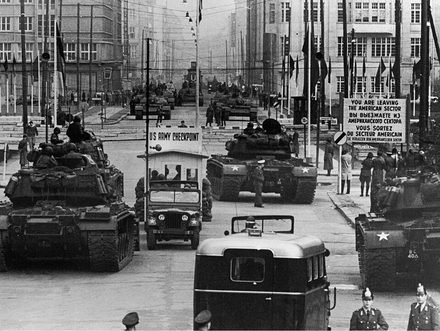

*American and Soviet tanks face to face at Checkpoint Charlie, Berlin, October 1961.*

Both sides had the bomb within four years of each other — the United States in 1945, the Soviet Union in 1949 — and by the 1960s both had enough of them, mounted on missiles that could cross the planet in under an hour, to guarantee that a full nuclear exchange would leave no meaningful winner. Strategists gave this condition an unusually honest name: mutual assured destruction.

The phrase is usually credited to the analyst Donald Brennan, who said he coined it around 1962 and meant the acronym as deliberate mockery, though a few institutional histories instead trace the term’s spread to Pentagon strategists later in the decade. The strategists kept it anyway. File this under candor, an achievement this species does not get nearly enough credit for.

The weapon itself was the product of a wartime race: the Manhattan Project (1942–45), staffed in large part by physicists who had fled fascist Europe, some of them from the very country whose bomb the project had been built to beat. The first test took place in the New Mexico desert in July 1945. Many of the next ones took place at sea. The United States detonated 67 nuclear devices at Bikini and Enewetak atolls in the Marshall Islands between 1946 and 1958. The 167 people of Bikini were moved off their atoll in 1946, told it was for the good of mankind; they have never been able to go home to stay. France later tested at Moruroa and Fangataufa in French Polynesia.

*“The apex predator,” dolphin historians noted, “has now learned physics.” The oceans, they added, became nervous.*

*“Humans built a weapon that finally matched their own capacity for self-destruction,” the Society recorded, “and then, mostly, did not use it. This is the book’s clearest instance of the wisdom half of the ledger showing up on time.”*

The two powers fought each other anyway, just never directly. Korea (1950–53) split a peninsula that remains divided as this book is written. Vietnam drew in American ground forces for a decade before ending, in 1975, in a unified Communist Vietnam and a war American planners had, by most later accounts, misjudged from the start. Afghanistan absorbed a Soviet occupation from 1979 to 1989 that killed about 15,000 Soviet soldiers and somewhere between half a million and two million Afghans, drove millions more into exile, and weakened the Soviet state.

The closest approach to the war neither side wanted came in October 1962, when Soviet nuclear missiles installed in Cuba, ninety miles from Florida, brought both governments within days, by many participants’ later accounts, of a confrontation neither one could fully control once started. A negotiated withdrawal ended the crisis without the two powers firing a shot at each other.

The nearest thing to an accident, by several participants’ accounts, happened at sea. On October 27, 1962, a Soviet submarine, B-59, running silent and out of contact near Cuba, was harassed by American destroyers dropping practice depth charges to force it to the surface. Its captain, believing the war had begun, wanted to fire the nuclear-tipped torpedo on board. The decision required the agreement of the senior officers aboard, and one of them, Vasily Arkhipov, refused. Twenty-one years later, on September 26, 1983, a Soviet early-warning system reported five incoming American missiles, and the officer on duty, Stanislav Petrov, judged the report a false alarm, on the grounds that a real attack would surely be larger, and did not pass it up the chain. The system had mistaken sunlight glinting off high clouds for missile launches.

*“Twice, the survival of a great many species turned on one officer deciding that the machine was probably wrong. The first of them was in a submarine, which dolphins take personally.”*

The Berlin Wall, raised by East Germany in 1961 to stop the outflow of its own population westward, stood as the era’s most literal symbol for close to three decades before crowds tore it down in November 1989. Historians now treat that single unplanned night as the moment the outcome of the whole rivalry became visible to everyone at once. The Soviet Union dissolved two years later, in 1991.

**Dolphin verdict:**

*The frightening technology and the restraint arrived on roughly the same schedule, at least between the two capitals. The fighting Washington and Moscow avoided with each other they ran through Korea, Vietnam, and Afghanistan, in other people’s countries, at a cost of millions of other people’s lives, so the restraint was narrower than it looks. Whether the bomb kept the peace, or two exhausted empires would have avoided a direct war anyway, historians still argue. Either way, it is evidence that capability and wisdom can occasionally travel together.*

# 1957 to 2026: Leaving the Cradle — Space Travel, the Moon, Mars, and (Maybe) the Galaxy

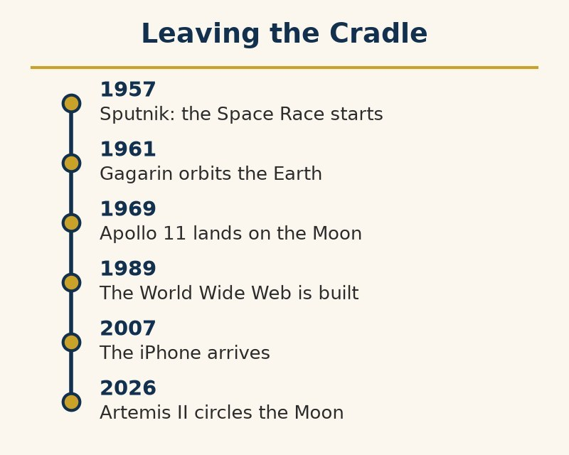

This chapter differs from every chapter before it: this may be the first thing in the whole book dolphins cannot watch happen in person. Everything up to now took place somewhere a dolphin could, in principle, have been present for — on the water, near it, or on land bordering it. This chapter’s subject leaves the planet.

Below is Earthrise, photographed by the Apollo 8 astronaut Bill Anders on December 24, 1968.

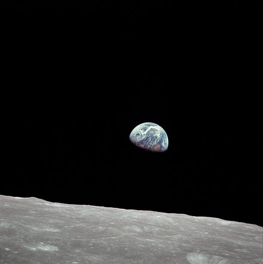

*Earthrise, photographed by Apollo 8 astronaut Bill Anders, December 24, 1968.*

The Space Race extended the previous chapter’s rivalry. The Soviet Union launched Sputnik in October 1957 and sent Yuri Gagarin into orbit in April 1961. The milestones reshaped US science funding.

The race produced other firsts worth remembering alongside Gagarin’s. Laika, a stray dog from the streets of Moscow, became the first animal to orbit Earth aboard Sputnik 2 in November 1957, on a one-way mission: the craft was never built to bring her home, and she died of overheating within hours of launch, a fact Soviet officials admitted only in 2002. Valentina Tereshkova followed in June 1963 as the first woman in space, orbiting Earth 48 times aboard Vostok 6. No other woman flew in space for nineteen years.

The Moon came first to machines. In September 1959 the Soviet probe Luna 2 became the first human-made object to reach it, by the simple method of hitting it, and a month later Luna 3 photographed the far side, a hemisphere no human eye, and no dolphin, had ever seen.

President Kennedy’s May 1961 commitment to land a man on the Moon “before this decade is out” turned prestige into a program: at its peak, Apollo employed around 400,000 people, and NASA consumed about 4 percent of the entire US federal budget in 1966. It delivered on the deadline. On July 20, 1969, Neil Armstrong and Buzz Aldrin walked on the Moon while an estimated 600 million people watched live, the largest simultaneous audience for a single event in human history up to that point.

The program had paid for its haste on the ground. In January 1967 a fire in a pure-oxygen cabin killed Gus Grissom, Ed White, and Roger Chaffee during a rehearsal on the launch pad. In April 1970 an oxygen tank burst aboard Apollo 13 on the way out; the crew used the lunar module as a lifeboat and came home because a great many people on the ground did hard arithmetic under a deadline.

What followed is nearly as interesting as the landing itself: humans stopped going. Apollo 17, in December 1972, was the last crewed Moon landing, and no human has walked on the Moon since, not for any technical reason so much as budgetary and political ones, once the Cold War prestige motive that funded the program in the first place had been satisfied. NASA’s Artemis program has begun to change that. In April 2026, Artemis II carried four astronauts, Reid Wiseman, Victor Glover, Christina Koch, and the Canadian Jeremy Hansen, around the Moon and back in ten days, the first crew to leave Earth orbit since 1972. A landing is planned for later in the decade.

*“A capability was reached and then set down again, deliberately, still fully understood,” Professor Click-Click-Whoosh observed. “This book has recorded plenty of capabilities lost to collapse or forgetting. This is the first one set aside on purpose, mid-stride, while everyone involved could still remember exactly how it was done.”*

The Space Shuttle program (1981–2011) and the International Space Station, continuously crewed since 2000, shifted the story from competition to cooperation. American and Russian space programs kept working together in orbit through periods when their governments were doing very little cooperating anywhere else.

Reusable commercial rockets cut launch costs. China expanded its crewed program and lunar ambitions; India’s Chandrayaan-3 landed near the Moon’s south pole in 2023, the first successful landing there.

In 2009, a spent rocket stage struck a shadowed lunar crater; the plume contained water. Ice in permanently shaded craters could support future missions, though extracting it remains a technical challenge.

Mars, so far, has been visited only by machines, and it began as a disappointment. In 1965 Mariner 4 flew past and sent back a dead world: craters, thin air, no canals. The canals had been a human wish, seen through bad telescopes and a great deal of hope. Later rovers found something better, the chemistry of ancient water, in a crater that had held a lake (Curiosity, 2012) and in a river delta (Perseverance, 2021), and Perseverance cached rock samples for a return trip that has been planned, costed, and replanned. The most important Martian stones humans own are still on Mars, labeled, bagged, and waiting for a ship that does not yet exist.

Mars settlement is discussed publicly and seriously by several of these programs and companies as a stated long-term goal. It remains, as this book is written, exactly that: a stated goal. No human has yet traveled farther than the Artemis II crew’s 252,756 miles, just past the far side of the Moon, and the radiation exposure, distance, and physiological toll of a Mars mission are substantially harder problems than anything Apollo solved. Some proponents talk further still, toward eventual expansion beyond the solar system entirely, to other stars and the wider galaxy.

None of this is recorded here as more than intention, consistent with this book’s practice of hedging claims about an unfinished present. They do note the pattern it would extend: this species has already left one continent on foot, crossed an ocean to a hemisphere it did not know was there, and, in at least one of its own founding accounts, walked out of Egypt. Each time it had incomplete information about what waited on the other side, and each time it went anyway.

**Dolphin verdict:**

*More than half a century ago, a small number of humans went somewhere no dolphin’s senses can follow, walked on a body that is not Earth, and came home to tell dolphin scholarship about it only secondhand, through a broadcast. Whatever this species does next — on Mars, or further out still — may be the first chapter in its history the dolphins have to take purely on faith. History’s oldest audience is, for the first time, considering what it means to lose its seat.*

# 1905 Onward: The Physics That Finally Made Sense to Someone

Twentieth-century physics produced a run of ideas famous for striking humans as bizarre on first contact. Dolphin scholarship, reviewing the same list, keeps having a different reaction: this looks familiar.

Special relativity, published by Einstein in 1905, showed that simultaneity is not absolute — whether two distant events happen “at the same time” depends on how fast an observer is moving relative to them, because nothing, not even information, travels faster than light. Human intuition, built on eyesight, where light’s travel time is imperceptible over any everyday distance, finds this deeply strange.

Dolphin intuition does not. Every dolphin has spent its entire life aware, in a way no human’s unaided senses are, that a signal takes a real, measurable amount of time to leave, bounce off something, and return. It also knows that where an object is right now and where its echo says it is are two different questions with two different answers depending on distance. Echolocation is not relativity, which concerns light and very high speeds, but it trains the intuition relativity begins from, and echolocating animals have been living with that intuition since long before Einstein needed a train and a lightning bolt to explain the idea to everyone else.

Einstein’s general theory, which in 1915 extended the special one to gravity, got its most famous public test in 1919. Arthur Eddington led an expedition to the island of Príncipe, off West Africa, and a second British team set up at Sobral, in Brazil, to photograph a total solar eclipse and measure whether starlight passing near the sun bent by the amount Einstein’s equations predicted. It did, and the announcement made Einstein an overnight celebrity in a way no physicist before him had been. Confirming this took a ship, an island, a rare eclipse, and a great deal of careful photography, whereas any dolphin confirms the same underlying point about delayed, non-instantaneous signals every time it clicks.

This was not idle abstraction for long. The same mass-energy relationship Einstein’s paper implied, E=mc², became, within four decades, the physics behind the atomic bomb, and the century’s arms race and Cold War, covered in the chapters that follow, are unthinkable without it. Relativity also turned out to have a mundane, everyday payoff nobody in 1905 could have predicted: satellite clocks in the Global Positioning System drift out of sync with clocks on the ground by measurable amounts because of both their speed and their weaker gravity. The satellite clocks are therefore deliberately set to tick slow before launch, by about 38 microseconds a day, and receivers apply a further relativistic correction for each orbit. Without it, every phone that gives directions would drift off by roughly ten kilometers a day. A theory built to explain light near the sun ended up steering cars down city streets.

Wave-particle duality, formalized through the 1920s, holds that light and matter both behave sometimes like discrete particles and sometimes like spread-out waves, depending on how they are observed. Humans, whose primary sense is vision — built around treating light as straight-line rays — tend to find this strange.

Dolphins never built their picture of the world out of straight rays to begin with. Sound, their primary sense, is a wave from the outset: it spreads, it interferes with itself, it diffracts around obstacles instead of stopping dead at their edge. A dolphin was never taught that its main sense behaves like a wave. It never had reason to assume otherwise.

*Dolphin historians insist on a disclaimer here rather than a claim to a doctorate: none of this makes a dolphin better at the mathematics of quantum mechanics, which remains formidably difficult, and echolocation is not, on its own, a quantum phenomenon. What differs is the starting intuition — the gut sense of which kind of behavior counts as normal before the equations arrive to explain it.*

None of this is offered as a claim that dolphins secretly anticipated theoretical physics, or that intuition is a substitute for the difficult mathematics humans spent a century building. That work deserves genuine compliments specifically because it was hard, and done without the sensory head start dolphins happened to be born with.

Quantum mechanics, in particular, did not stay confined to physics departments. Understanding how electrons behave in materials made the transistor possible in 1947, and the transistor made every computer, phone, and network described in later chapters possible in turn. A century’s strangest ideas about light and matter ended up, by a fairly direct chain of consequences, sitting in every reader’s pocket.

## The rest of the ledger

Physics is the chapter’s joke. It is not the whole of the accomplishment. Having teased one science for seeming familiar, this chapter owes the others a straight inventory. Over about four centuries humans built a method: claim less than you can show, show it again, and let a stranger try to break it. The method is the achievement. The list under it is what the method caught.

Chemistry organized substances into a periodic table whose gaps Mendeleev predicted and later elements filled. The same ability to rearrange molecules produced lasting plastics as well as drugs.

Biology found the script. In 1953 James Watson and Francis Crick published the double helix of DNA, built in part on X-ray measurements by Rosalind Franklin, whose own paper ran in the same issue and whose results the famous one acknowledged only in passing. Exactly fifty years later, in 2003, the Human Genome Project declared the code read; a working draft had appeared two years earlier, and the last stubborn gaps closed only in 2022. About three billion letters, most of them not genes, which was itself a finding. Evolution, stated in the nineteenth century, is the frame the letters sit in.

Plate tectonics explained continental motion and earthquakes after seafloor magnetic stripes were mapped in the 1960s. In 1948, Ralph Alpher and Robert Herman predicted the cosmic background glow; Arno Penzias and Robert Wilson detected it in 1965.

Science can correct public mistakes. Other laboratories failed to reproduce 1989 claims of room-temperature fusion. A 2010 report of arsenic-based DNA was challenged by follow-up studies in 2012. The retractions and disputes are part of the record, not exceptions to it.

*Two questions this chapter raises and a history cannot settle — what all this physics is actually for, and why it has still not become a single theory — are taken up later in “What the Physics Is For.”*

**Dolphin verdict:**

*The strangest ideas in twentieth-century physics were strange in particular to a species that built its picture of reality out of straight-line light and instantaneous-feeling vision. To a species that has always perceived the world as delayed, wave-based, and reconstructed from returning signal, several of the century’s least intuitive theories sound less like a revolution and more like a description of Tuesday. Humans still did the harder job. They had to prove it in equations. Dolphins only ever had to notice it.*

# The 1940s to the 1970s: Decolonization — The World Redraws Itself

Formal empire, built up over the centuries this book has already covered, mostly ended within a single human lifetime. The process ran fastest between the 1940s and the 1970s, and its speed was almost as remarkable as the speed of the empires it dismantled.

India’s road to independence began, like several roads already walked in this history, with a trading company. The Mughal Empire that had dominated the subcontinent since 1526 (builders of the Taj Mahal and, by some estimates, at its height responsible for roughly a quarter of the world’s economic output) was showing signs of fraying. Then the East India Company, chartered in London in 1600 to sell spices and cloth, began acquiring territory instead. After the Battle of Plassey in 1757, the Company governed large parts of India with an army that by the early 1800s was, by one common estimate, close to twice the size of Britain’s own, an arrangement best summarized as a business with a country attached. Company rule ended after the uprising of 1857, and direct rule by the British Crown, the Raj, followed until 1947.

Britain left railways, administrative systems, and a unified legal framework, but also an economy whose share of world output fell from roughly a quarter to under five percent, and repeated famines. Bengal’s 1943 famine killed an estimated two to three million amid wartime priorities and policy failures.

Gandhi’s campaign of nonviolent resistance had its most famous episode about salt. In 1930 the British-run government taxed salt, a commodity that lies free on any coast, and forbade Indians to make their own. In March, Gandhi set out to walk some 240 miles from his ashram to the sea at Dandi, gathering thousands of followers on the way, and on April 6 he picked up a lump of natural salt from the beach, which was against the law. Some sixty thousand people were arrested in the campaign that followed. It is a curious empire that can be shaken by something the ocean gives away for free.

Gandhi’s nonviolent campaign helped make continued British rule politically costly, but historians also stress Britain’s postwar exhaustion and the 1946 mutiny in its Royal Indian Navy. Independence had several causes, not one.

Independent India kept its democracy through nearly everything that followed (the exception was a two-year suspension of civil liberties, the Emergency, in 1975–77). In 2023 it passed China as the world’s most populous country by United Nations estimate, a piece of arithmetic the mathematicians of the Gupta period would presumably have found unsurprising.

India supplied one model: organize, outlast, make the empire’s own math stop working. Across Africa, seventeen countries gained independence in 1960, the “Year of Africa.” Algeria’s war with France lasted until 1962; Portugal’s African empire ended after the 1974 revolution. Some transitions were negotiated, others violent.

Britain’s own version of the handover was a case study in how little patience this could leave behind. The country spent the middle of this century returning an empire it had spent the previous two centuries quite energetically acquiring, and the returning was less graceful in places than its own histories later remembered. In Kenya, during the Mau Mau uprising of the 1950s, British authorities held tens of thousands of Kenyans in detention camps where torture was widespread; in 2013 the British government expressed regret and paid compensation to 5,228 surviving victims.

Colonial borders often ignored local ethnic, linguistic, and religious boundaries. Historians connect some later conflicts to these lines, while emphasizing that colonial borders alone do not explain them.

Colonial administrations also hardened social categories. In Rwanda, Belgian authorities made the distinction between Hutu and Tutsi more rigid and issued identity cards naming each group in the 1930s. Extremists later used those records during the 1994 genocide.

The cards and the lists were bureaucratic tools, made in ordinary times for ordinary administrative purposes. In 1994 they were used as a map of who was to be killed. Capability had compounded; judgment had not.

Cold War competition narrowed the choices of newly independent states. The Non-Aligned Movement, organized in Belgrade in 1961, sought a path outside both superpower blocs, with uneven results.

**Dolphin verdict:**

*Formal empire ended, for the most part, within one human lifetime, a pace with no earlier precedent in this record. But the economic dependencies, the drawn borders, and the political structures colonialism left behind did not end on the same schedule, and in a number of cases have not ended yet. Independence turned out to be a start, not a conclusion — a pattern now seen often enough to stop finding surprising, though not to stop repeating.*

# 1893 to 1994: Civil Rights and Liberation — Humanity Argues With Itself

Unlike most of the conflicts covered so far, the campaigns in this chapter were mostly won without an army.

Below are marchers at the Lincoln Memorial during the March on Washington, August 28, 1963.

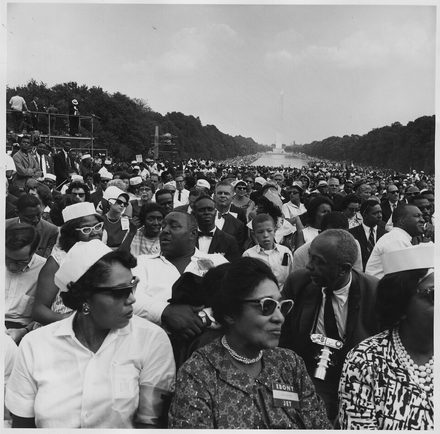

*Marchers at the Lincoln Memorial, March on Washington, August 28, 1963.*

In the United States, the Supreme Court’s 1954 Brown v. Board of Education ruling declared racially segregated public schools unconstitutional, overturning the legal doctrine that had upheld segregation for nearly six decades. The following decade of organized protest produced the 1955–56 Montgomery bus boycott, begun after Rosa Parks refused to give up her bus seat, nine months after a fifteen-year-old, Claudette Colvin, had done the same and been arrested. It also produced sit-ins and freedom rides, and the 1963 March on Washington, where Martin Luther King Jr. delivered his “I Have a Dream” speech. At Selma in 1965, state troopers beat marchers on the Edmund Pettus Bridge in front of television cameras. The campaign culminated in the Civil Rights Act of 1964 and the Voting Rights Act of 1965. Together they dismantled the legal architecture of segregation and disenfranchisement at the federal level, though not the underlying attitudes.

Emmett Till, a fourteen-year-old boy, was murdered in Mississippi in August 1955 after being accused of offending a white woman. His mother, Mamie Till-Mobley, held an open-casket funeral so that Jet magazine could publish photographs of his mutilated body. The murder and the photographs are widely credited with galvanizing the movement that followed; the Montgomery boycott began three months later. The Twenty-Fourth Amendment, ratified in 1964, abolished poll taxes in federal elections; two years later, in Harper v. Virginia State Board of Elections (1966), the Supreme Court struck down the remaining state and local poll taxes that had been used for decades to price Black voters out of elections across much of the South.

The same slow weapon was fired on a longer clock in South Africa, against a harder target. Legal racial segregation, formalized as apartheid in 1948, persisted for close to half a century against internal resistance, including the armed campaign of the ANC’s military wing, Umkhonto we Sizwe, after peaceful protest was banned, and mounting international pressure and sanctions. It ended only with Nelson Mandela’s release in 1990 from twenty-seven years of imprisonment, eighteen of them on Robben Island (in waters the dolphins know well), and his election as South Africa’s first Black president in 1994.

Changing what a majority believes it owes a minority turns out to be a method with more than one minority willing to try it. Women’s movements ran throughout the same century on their own overlapping timelines: suffrage achieved in New Zealand first, in 1893, then across Britain, the United States, and most of northern Europe by the 1920s — while France (1944), Italy (1945), and Switzerland waited decades longer still. A second wave of legal and social advances followed in the 1960s and 70s, addressing employment, reproductive rights, and legal equality more broadly. The pace and scope of change varied enormously by country, and the change continues unevenly to the present.

That timeline had its own casualty list and its own comedy. In Britain the suffragettes chained themselves to railings, and in 1913 Emily Davison died after stepping in front of the King’s horse at the Epsom Derby; women over thirty got the vote in 1918, and women on equal terms with men only in 1928. In the United States it came in 1920. Switzerland, a country not known for being late, gave women the federal vote in 1971, and its last holdout canton was ordered by the courts to comply in 1990.

A fourth argument about who counted as fully included ran through the same decades, slower to start and later to arrive at anything like the others’ legal recognition. In the early hours of June 28, 1969, patrons at the Stonewall Inn, a gay bar in New York’s Greenwich Village, fought back during a police raid of a kind the bar had endured many times before without resistance. The several nights of protest that followed are generally regarded as a turning point for the gay rights movement, and the following June, the first Pride marches in New York and other American cities marked the anniversary. Decriminalization, anti-discrimination protections, and marriage rights arrived on wildly different timelines in different countries over the half-century that followed, several of them still incomplete as this book is written.

*“Unlike wars, these campaigns won, for the most part, by changing what a majority believed was owed to a minority,” Professor Click-Click-Whoosh observed, “not by defeating anyone in the field. It is the slowest weapon the dolphins have cataloged. It is also one of the few that does not require winning to keep working — only enough people changing their minds, one at a time, for long enough.”*

**Dolphin verdict:**

*This chapter’s campaigns did not end prejudice; no law has ever managed that. What they did was rarer: they changed, on the legal record and in a large share of a population’s actual convictions, what a state and a society owed to people it had previously excluded. Progress here was slow, incomplete, and unevenly distributed by country — and it happened anyway, which is more than several earlier chapters can say.*

# 1843 to 2007: The Digital Leap — Computers, Networks, and a Connected World

The idea is older than the machine. In 1843 Ada Lovelace, the daughter of the poet Lord Byron, published what is often called the first computer program, an algorithm for a mechanical engine designed by Charles Babbage that he never managed to finish building, a very British way to invent a technology. Whether that mathematics was mostly Babbage’s framework or mostly Lovelace’s own insight is still debated by historians — the collaboration itself, not just the algorithm, is the real achievement.

Professor Click-Click-Whoosh took Lovelace’s own notes to the committee and read out the sentence that every later argument about machines has had to answer.

“The Analytical Engine has no pretensions whatever to originate anything,” she wrote. “It can do whatever we know how to order it to perform.”

The Professor’s objection was that this settles nothing. Dolphins in aquariums are also ordered to perform, and some of them develop opinions anyway.

Alan Turing read the same sentence a century later and thought it deserved a reply. In his 1950 paper on machine intelligence, the one that gave us the Turing test, he listed it as “Lady Lovelace’s Objection” and answered it with a confession: “Machines take me by surprise with great frequency.”

“The question of whether a machine can originate anything has now been open for 183 years,” the Professor told the committee, “and both sides are still quoting the same two sentences.”

The theoretical groundwork arrived next. Kurt Gödel’s 1931 incompleteness theorems proved that any formal mathematical system powerful enough to describe basic arithmetic must contain true statements it cannot prove within its own system. It is a hard limit built into logic itself, discovered a decade before anyone built a working computer, and one this book’s own recurring gap between capability and wisdom would recognize immediately.

The war made the theory into machinery. At Bletchley Park, Alan Turing, whose 1936 paper had already defined what a computing machine could do in principle, built on the work of Polish cryptologists, who had broken early Enigma messages in the 1930s, to design the electromechanical Bombes that read Germany’s Enigma traffic. The engineer Tommy Flowers built Colossus, the first programmable electronic digital computer, to read the German high command’s Lorenz cipher.

Below is ENIAC, one of the first general-purpose electronic computers, from the 1940s.

*ENIAC, among the first general-purpose electronic computers, 1940s.*

The transistor, invented at Bell Labs in 1947, replaced the bulky, failure-prone vacuum tube and made a smaller, faster, and dramatically cheaper computer possible. The integrated circuit followed by the late 1950s, packing multiple transistors onto a single chip. Gordon Moore’s 1965 observation that the number of components on a chip was doubling every year, revised in 1975 to every two years, held, with adjustments, for decades. It was a compounding rate of improvement with no real precedent among the physical technologies covered earlier.

ARPANET, a US Department of Defense research network, went live in 1969 connecting four university computers. It grew, through the 1970s and 80s, into the modern internet, and the World Wide Web, built by Tim Berners-Lee in 1989–91, gave that network a form ordinary people could actually navigate. The smartphone, arriving commercially with the iPhone in 2007, put a computer more capable than anything in the earlier chapters into a majority of human pockets within about fifteen years — essentially one human generation, start to finish, from four connected computers to several billion.

The same restless habit that renamed British spelling renamed brand names into verbs. Xerox spent decades on an advertising campaign, including the line “you can’t Xerox a Xerox on a Xerox,” fighting to keep its own name from settling into the language as the plain word for photocopying, and won. Google tried the same fight once “to google” crossed into the Oxford English Dictionary and Merriam-Webster’s, both in 2006, as a lowercase verb for searching the internet on any engine at all. A federal court later rejected an attempt to use that very popularity to cancel Google’s trademark outright, ruling that calling an act “googling” does not by itself make the name generic. It is tidy that the more completely an American company wins, the faster the language eats its name and dares the company to take it back.

The promise delivered was real: information that had once required a library and a train ticket became available in seconds. Coordination across a planet’s distance became close to instantaneous. Connection with people whose ancestors had parted ways with one’s own tens of thousands of years earlier became, for the first time in this history, recoverable.

The cost arrived on the same schedule as the promise, not after it. The same networks that connected people gave states and companies a capacity for surveillance with no earlier equivalent. The same platforms that spread information spread misinformation at the same speed and, by most measured accounts, rather more efficiently. Human attention became a resource harvested, sold, and optimized for in ways no earlier technology had ever managed to monetize directly.

*One of the era’s most quoted corporate mottos was, for several years, “move fast and break things.” The things broken were not specified in advance. Critics have since argued that they included privacy, attention spans, and the conduct of elections.*

*“Dolphins communicate at the speed of sound through water and have done so for tens of millions of years,” dolphin historians noted, with what human readers may reasonably interpret as amusement. “It required fiber optic cable, geostationary satellites, and a global economy’s worth of infrastructure for humans to do, at planetary scale, much what a pod already does by whistling.”*

**Dolphin verdict:**

*No technology recorded here arrived faster or reached farther in a single human lifetime than this one. It delivered on its promise of connection and information more completely than almost any earlier chapter’s technology delivered on its own promise — and it delivered the surveillance, the disinformation, and the harvested attention in the very same package, not as a later complication. The pattern of tools outrunning the wisdom to handle them, first flagged before the First World War, runs here on the fastest clock the book has yet recorded.*

# The Thirteenth B’ak’tun, 2012: The World Was Supposed to End in 2012 (It Didn’t)

By now the catalog of things humans got wrong about their own past is long. This chapter catalogs something rarer: an entire civilization getting blamed for a future that never happened.

The Maya civilization, whose sophisticated cities, mathematics (including an independently invented concept of zero), and astronomy this book has already touched on, tracked time with several overlapping calendar systems. The most elaborate, the Long Count, measured days elapsed since a fixed mythological starting point rather than resetting every year the way a modern calendar does.

The Long Count’s largest standard unit, the b’ak’tun, runs for roughly 394 years. On December 21, 2012, by the correlation most scholars accept, the thirteenth b’ak’tun since the Long Count’s starting point came to an end.

Maya inscriptions treat this the way an odometer treats rolling from 999999 back to 000000: a notable round number, not a terminus. Surviving texts, including one at the Tortuguero site in Mexico, reference the thirteenth b’ak’tun’s completion directly, and other inscriptions calmly reference dates thousands of years beyond it — not the record of a civilization that expected anything to stop.

None of this stopped a different story — with roots in 1970s and 80s New Age writing, including José Argüelles’s 1987 “Harmonic Convergence” — from reaching mass audiences in the early 2000s. Books, documentaries, and, in its final years, exactly the kind of internet-era information environment the previous chapter describes all amplified it. December 21, 2012 became a predicted apocalypse, variously attributed to a rogue planet, a solar alignment, or simply “what the Mayans predicted,” a phrase no surviving Maya text anywhere actually supports.

The prediction acquired enough traction that NASA published an official page addressing it before the date arrived, and another one afterward confirming that it had passed without incident.

The scare had specific accelerants. Roland Emmerich’s 2009 disaster film 2012, which depicted the prediction as fact and earned, as works of fiction do not usually earn, several hundred million dollars worldwide, did more than any single documentary to fix the date in popular imagination. It was not the only apocalypse on offer that decade. The radio broadcaster Harold Camping predicted the Rapture for May 21, 2011, bought billboards across the world to announce it, and, when it did not arrive, recalculated the date to October 21 of the same year, a level of confidence dolphin historians find difficult to improve on for comic timing.

The prediction’s astronomical hook, when it had one, involved the winter solstice sun appearing to cross the plane of the Milky Way as seen from Earth. That alignment is a genuine, very slow drift caused by the 26,000-year wobble of Earth’s axis, and the idea was popularized in the 1990s by the independent researcher John Major Jenkins. Professional astronomers pointed out that the alignment is not a single moment at all: the sun’s apparent position drifts across the galactic plane over a span of decades, a near-alignment recurs every year in the loose sense being used. Nothing in the mechanics implies any effect on Earth whatsoever.

The 19th century supplied its own rehearsal, complete with an official name for the letdown. William Miller, an American preacher, convinced tens of thousands of followers that the Second Coming would arrive on a specific date in 1844, based on his own reading of biblical chronology. When it did not, history recorded the outcome under the label his own followers coined at the time: the Great Disappointment. Several offshoot religious movements trace their origins straight back to the recalculating that followed.

This is not even an unusual case. Humans have forecast their own ending with some regularity and no shortage of confidence: recurring religious end-times predictions across multiple faiths and centuries. Closer to 2012 came the Y2K computer bug scare of 1999–2000, which anticipated a global systems collapse when computer clocks rolled from 99 to 00. It was addressed seriously enough in advance that its own uneventful passing is sometimes cited as evidence the warning must have been overblown to begin with.

*“A species that invented writing specifically to speak to its own future,” dolphin scholars remarked, “keeps guessing, often confidently and always incorrectly, exactly when that future stops.”*

**Dolphin verdict:**

*The Maya calendar did not fail. It did exactly what a calendar does, and rolled over to a new cycle precisely as its own inscriptions expected it to. What failed was a chain of retelling, centuries later, by a species apparently uncomfortable leaving the future open-ended and unscheduled. Dolphins, who have never once predicted their own extinction on a specific date, offer this pattern without much sympathy and considerable curiosity: of all the things this species got right early and wrong late, why does the ending always seem to need an appointment.*

# 1950 to the 2020s: Something Might Be Watching (Probably Not What You Think)

This book’s entire premise rests on one non-human intelligence quietly watching a technological species from a position of total detachment. This is not the first idea of its kind humans have entertained. It may not even be the most popular.

Physicist Enrico Fermi’s 1950 lunch-table question, since known as the Fermi Paradox, remains essentially unanswered. Given the number of stars in the galaxy, many with planets, and the billions of years those planets have had to develop life, why has no evidence of any other technological civilization ever turned up?

Frank Drake’s 1961 equation broke the question into estimable factors — the rate of star formation, the fraction of stars with planets, the fraction of those hospitable to life, and so on down to how long a civilization keeps broadcasting before it stops. It did not resolve the question, since several of those factors remain largely unknown even now.

The Search for Extraterrestrial Intelligence, listening for artificial radio signals since 1960, has found nothing conclusive in more than six decades of listening, a negative result serious scientists take seriously rather than dismiss.

In October 2017, astronomers spotted the first confirmed object from outside the solar system passing through it (two more have turned up since, the comet Borisov in 2019 and 3I/ATLAS in 2025): an elongated, tumbling body nicknamed ‘Oumuamua, Hawaiian for scout. Its unusual shape and a small, unexplained acceleration as it left the inner solar system prompted at least one Harvard astronomer to propose, in earnest, that it might be an artificial probe; most astronomers attribute the acceleration to outgassing from ices too faint to detect directly. The particulars remain debated. The object has not moved, in any scientific consensus, from natural to artificial.

The search has produced exactly one signal serious enough to have kept its own name. On August 15, 1977, a radio telescope in Ohio recorded a brief, powerful burst on a frequency associated with hydrogen; the astronomer who found it circled the printout and wrote “Wow!” beside it. It has never repeated, and no explanation, natural or otherwise, has ever been confirmed.

Frank Drake convened the field’s first conference at the Green Bank Observatory in 1961, a meeting of ten scientists — including a young Carl Sagan and dolphin-communication researcher John C. Lilly, who hosted a dinner at which the group jokingly named itself the Order of the Dolphin. Sagan went on to help design the Voyager Golden Record, a phonograph disc carrying images, sounds, and greetings in fifty-five languages, launched into interstellar space in 1977 on the chance that someone, eventually, might play it. The search is a Cold War child in more than just timing: Drake’s and Sagan’s generation of scientists came of age funding radio astronomy alongside the missile-tracking and satellite programs the Cold War chapter covers. The same military and government interest in big radio dishes helped pay for the instruments they listened with.

*“A human looking for extraterrestrial intelligence named his own search committee after us before he had found so much as a radio blip. We would call this premature, except that it turned out to be correct.”*

Humans have not only listened. In November 1974, scientists at the Arecibo Observatory in Puerto Rico beamed a single deliberate message toward the globular star cluster M13, encoding basic facts about human DNA, the solar system, and the species doing the transmitting, all in binary. The target, roughly 25,000 light-years away, was chosen chiefly because it was in the telescope’s sky that day. It was meant as a demonstration of the new transmitter rather than a serious attempt at contact; any reply would take some 50,000 years to arrive.

A separate, noisier strand of the same hope produced ancient-astronaut claims, popularized by Erich von Däniken’s 1968 book proposing that extraterrestrial visitors explain ancient monuments and mythology. Mainstream archaeology rejects this comprehensively. The pyramids, credited in an earlier chapter to the Egyptian builders who actually raised them, along with Stonehenge and the Nazca lines, all have well-documented human construction methods and timelines, understood without any assistance from off-world engineers.

More recently, US military encounters with unidentified aerial phenomena, officially acknowledged by the Pentagon starting in 2017 and the subject of congressional hearings in the 2020s, were reviewed by the Pentagon’s own office for the purpose. In 2024 that office reported it had found no evidence of extraterrestrial technology and that most cases it could resolve turned out to be ordinary objects such as balloons, drones, and birds.

The evidence settles none of this, but the shape of the underlying hope is plain: across religion, mythology, and now astrophysics, this species keeps reaching for the idea that something larger, wiser, or simply other is paying attention.

*“Humans have proposed gods, ancestors, angels, and now radio-quiet aliens as the audience for their own story,” the Society recorded. “Dolphin scholarship can confirm exactly one item on that list with any confidence. We have, in fact, been watching. We would gently note that we are considerably less impressive than most of the other candidates.”*

**Dolphin verdict:**

*Every civilization covered here, sooner or later, looks up, or inward, and asks whether anyone besides itself is keeping score. The honest answer, as far as instruments and evidence currently reach, is that no alien intelligence has been confirmed, no god has filed a verifiable report. The closest thing to a documented outside observer taking detailed notes turns out to have been a pod of dolphins the whole time, watching from a much shorter distance than anyone guessed, with excellent hearing and admittedly limited ability to intervene.*

# 1796 to Today: Medicine and Its Cost — How Humans Learned to Heal

This chapter’s technology, unlike most others covered so far, is aimed entirely inward — not at the physical world, and not at other humans as adversaries, but at the human body’s own failures.

Germ theory, established by Louis Pasteur and Robert Koch through the mid-to-late 1800s, replaced centuries of competing explanations, miasma and humoral imbalance among them, with something testable: specific microorganisms cause specific diseases. Joseph Lister applied antiseptic technique to surgery starting in the 1860s, and surgical survival rates, previously grim, improved dramatically within a generation. The first public demonstration of ether anesthesia, in 1846, had already turned surgery from a race against a conscious patient’s pain tolerance into a controlled procedure.

The path to it was not smooth. In 1847 the Hungarian physician Ignaz Semmelweis showed that deaths from childbed fever in his Vienna hospital dropped sharply when doctors washed their hands in chlorinated lime between the autopsy room and the delivery ward. His colleagues, who did not care to be told that they were the source of the infection, rejected the finding. Semmelweis was eventually committed to an asylum, where guards beat him severely; he died two weeks later, in 1865, of a gangrenous wound likely caused by that beating. In 1854, in London, the physician John Snow traced a cholera outbreak to a single water pump in Soho and persuaded the authorities to remove its handle. The medical establishment took several more decades to accept that the water and the doctors were both dirty.

Vaccination predates germ theory itself. Edward Jenner’s 1796 smallpox vaccine, built on the folk observation that milkmaids who caught cowpox rarely caught smallpox, in time led to smallpox’s complete eradication by 1980 — the only human disease ever deliberately eliminated from the wild.

Alexander Fleming’s accidental 1928 discovery of penicillin was not put into mass production until wartime urgency forced it in the 1940s, and it turned infections that had reliably killed throughout human history into treatable conditions within a single generation.

Together with clean water and sanitation, these advances drove the sharpest rise in human life expectancy in the species’ entire history — the global average roughly doubling within about a century, a capability jump among the most positive this history has to offer.

The list did not end with penicillin. Polio, which paralyzed children in epidemics the early twentieth century could not stop, met two vaccines, Salk’s and Sabin’s, and has been cornered to a few districts, where finishing is now a matter of politics and logistics instead of ignorance. In 2020 a new virus sent the species indoors, and within a year vaccines built on messenger RNA, a platform that had been a research bet and not a product, were in arms. The speed was real. So was a distribution that followed purchase orders more closely than it followed need.

Not all of it was clean. From 1932 to 1972 the United States Public Health Service ran a study in Tuskegee, Alabama, that followed hundreds of Black men with syphilis without treating them, and kept them from treatment even after penicillin became the standard cure. The study ended only after a whistleblower went to the press. Its legacy, a well-earned distrust, outlived it by decades.

The turn, when it comes in this chapter, is toward cost and access rather than violence. The same antibiotics and vaccines that were once nearly free to produce became, once patented, priced by what a market would bear instead of what they cost to make. Insulin’s own discoverers sold their patent rights for one dollar apiece in 1923, specifically so it could never be monopolized; decades later, in some countries, its price still varied enough to bankrupt patients who needed it to survive.

*Selling a patent for one dollar to keep a medicine affordable is, dolphin scholarship concedes, a fine idea. It works only for as long as nobody patents an improved delivery device, a marginally different formulation, or the pen it comes in, all of which turned out to be exactly as patentable as the original molecule was not.*

The opioid crisis, beginning in the late 1990s with the aggressive marketing of prescription painkillers by a pharmaceutical industry that downplayed their addiction risk, killed several hundred thousand people in the United States alone over the following decades. It is a rare case of the same institution responsible for both the chapter’s greatest triumph and one of its starkest, most avoidable harms.

Antibiotic resistance, arising from decades of overuse in both medicine and livestock agriculture, now threatens to erode that very advance: a slow, largely self-inflicted countdown on one of the chapter’s founding achievements.

*The chapter closes with an admission. Dolphins have no medicine, and in 1987–88 and again in 2013–15 a measles-like virus, the dolphin morbillivirus, killed bottlenose dolphins by the hundreds along the Atlantic coast of the United States. Nobody treated them. The dolphins note that this is what life without the human hand looks like when the illness arrives, and that they do not recommend it.*

**Dolphin verdict:**

*Vaccination, antiseptic surgery, and antibiotics bought this species more added years of life, more quickly, than any war ever cost it. The familiar shape followed: medicine that could be almost free to produce became, in places, unaffordable to the people who needed it, and the industry that ended centuries of death by infection also spent a decade selling addiction as pain relief. Dolphins have no doctors. They also have no bill.*

# 1896 to Today: Climate and Consequence — The Price of Progress

The physics is straightforward: greenhouse gases slow heat escaping to space. Humans have raised their concentration by burning coal, oil, and gas at a rate not seen for hundreds of thousands of years.

In 1896, Svante Arrhenius calculated by hand that doubling atmospheric carbon dioxide would warm the planet by several degrees. Since 1958, Charles David Keeling’s Mauna Loa measurements have traced the rise in a curve with a seasonal sawtooth and a persistent upward trend.

On May 9, 2013, NOAA instruments recorded 400.03 parts per million at Mauna Loa, the first daily mean above 400 ppm there since measurements began in 1958. Charles David Keeling began the record and maintained it through the early years, when continuous readings were considered an expensive specialty. The milestone did not mean every place had the same concentration that day; it marked a station measurement in a long-running series. A single reading could be questioned. A record collected by the same method over decades made the rise harder to dismiss. Researchers could compare the daily value with earlier years and with air measurements elsewhere. The number became news because it was both exact and legible: one threshold, crossed in a series already showing the direction. A scientific instrument kept count while governments debated what the count required. The sequence remains useful because other researchers can inspect the same measurements and test the trend.

Since its creation in 1988, the Intergovernmental Panel on Climate Change has issued six assessments, each more confident that human activity is driving accelerating change.

The 2021 Pacific Northwest heat dome took Portland above 46°C (115°F) and Lytton, British Columbia, to 49.6°C (121°F). Fire destroyed most of Lytton the next day. British Columbia’s coroner later identified 619 heat-related deaths; most were older adults, and more than half lived alone. Australia’s 2019–20 Black Summer burned an area roughly the size of the United Kingdom.

These were measurements, not forecasts: global temperatures above preindustrial levels, warmer and more acidic oceans, rising seas, ice loss, and widespread coral bleaching. The observational record shows more frequent and severe extremes.

Most of the ice that matters sits at the two ends of the world, and the ends are different kinds of place. The Greenland ice sheet is thick enough that, if all of it reached the ocean, the seas would stand about seven meters higher; that will not happen in a human lifetime, but satellites that weigh the sheet from orbit show it losing mass, and some of the loss is now built in. Antarctica is governed by a piece of paper that has held better than most. The Antarctic Treaty of 1959 set territorial claims aside, barred military bases and nuclear dumps, and dedicated the continent to science, and stations from some thirty countries cooperate on the ice in ways their capitals often do not. Dolphin historians, who have watched flags turn into forts on every other coast, treat it as a rare adult document. The part the specialists watch is the western ice sheet, moored to bedrock below sea level, where a retreat would be measured in meters of sea level and nobody can say how fast.

The island on top of that ice sheet has a government of its own. Greenland runs its own domestic affairs inside the Danish kingdom, and it has been priced before. In 1946 the United States secretly proposed buying it from Denmark for $100 million in gold. Denmark did not sell.

In 2019 the American president said in public that he would like to buy it. Denmark’s prime minister called the discussion absurd, and Greenland’s foreign minister said the island was open for business but not for sale. In December 2024, about to return to office, the same president called American ownership and control of Greenland an absolute necessity, and in January he declined to rule out force. Greenland’s prime minister answered in the island’s own voice: “We are not for sale and we will not be for sale.” A few weeks later he put it more plainly. Greenlanders did not want to be Danish, and they did not want to be American. They wanted to be Greenlandic.

The episode belongs under a familiar heading: a powerful country looking at a smaller country’s land and seeing a transaction. The heading has many older entries. What changed was who answered. In 1946 Copenhagen replied for the island, in private. This time the island replied for itself, in public. Dolphin historians remain puzzled that about 57,000 people on the world’s largest island declined to join the greatest nation in the history of mankind, and note that the island’s own phrase, “we want to be Greenlandic,” has so far resisted translation.

Geologists have their own name for what all of this adds up to: the Anthropocene, a proposed new epoch defined not by ice or asteroid but by one species’ own signature, layered permanently into the planet’s rock and sediment. The term was popularized in 2000 by the chemist Paul Crutzen and the biologist Eugene Stoermer. A working group of scientists spent the following two decades hunting for a single physical site where a future geologist, digging up this era millions of years from now, could point to an exact line and say the old epoch ended here. Their leading candidate was the mid-20th century, marked by a sudden, unmistakable layer of radioactive fallout from nuclear weapons testing, alongside plastic, concrete dust, and fly ash, all showing up in lake sediment worldwide within the same few years. In 2024, the body responsible for officially naming geological epochs voted the specific proposal down anyway, not because the evidence was wrong but because its members could not agree the change deserved a new epoch instead of a chapter inside the current one. The debate over the name continues; the sediment layer it was arguing about does not care either way.

*“Humans spent two decades arguing over what to call the layer of rock they were leaving behind,” dolphin historians noted, “instead of the century arguing over whether to leave it. We note the committee vote changed nothing about the rock.”*

Responses came slowly. Solar and wind power became price-competitive in many markets by the 2010s. The 2015 Paris Agreement brought nearly every country into a shared emissions framework.

Global emissions kept rising for years after Paris before, in some accounts, beginning to level off. The gains and shortfall coexist.

Some of the companies most responsible for the emissions had the clearest warning of all, and kept it to themselves. Internal research at Exxon in the late 1970s and 1980s modeled the coming warming with an accuracy later confirmed by outside science, while the company’s public messaging spent the following decades funding doubt about the very findings its own scientists had produced.

*The word “foresight” seems somewhat generous for a case in which the foresight was filed away instead of acted on.*

**Dolphin verdict:**

The industry that built the twentieth century now has to help undo its climate costs, on a deadline set by the atmosphere. Earlier chapters let the dolphins judge after the outcome; this one is still being decided.

# 1991 to Today: A Fractured Present — Democracy, Authoritarianism, and the Information Age

The Soviet Union’s 1991 dissolution produced a mood, widely shared among Western observers at the time, that history’s central argument over how societies should be governed had been settled in democracy’s favor, more or less for good. The following three decades did not confirm that mood.

A number of countries that had appeared to be consolidating democratic institutions in the 1990s and 2000s instead saw those institutions weakened from within during the 2010s and 2020s: independent courts and press curtailed, elections held but their fairness eroded. Power was concentrated in ways that stopped well short of the outright dictatorships examined earlier but moved unmistakably in that direction. Political scientists gave this pattern a name, democratic backsliding, distinct from the sudden coups that had ended democracies in earlier chapters.

Freedom House, the organization most often cited for these annual surveys, recorded a net decline in global political rights and civil liberties every single year from 2006 onward. The streak, unbroken for close to two decades at the time of writing, is long enough that an entire generation of political scientists has spent its career studying backsliding instead of the steady consolidation the 1990s mood assumed would be the field’s real subject.

Hungary supplied the clearest self-description of the trend. Viktor Orbán, in power since 2010, announced in a 2014 speech that he intended to build an “illiberal state” within the European Union, a label most of the leaders this chapter describes have preferred not to apply to themselves.

*Saying the strategy’s name out loud in advance did not appear to blunt its effectiveness in the slightest, which may be the most unsettling detail in this chapter.*

In the United States, a crowd seeking to overturn the certified result of the 2020 presidential election stormed the Capitol building on January 6, 2021, the first time the building had been overrun since British troops burned it in 1814.

Dolphin historians find “backsliding” a rather gentle word for the phenomenon it describes, in the tradition of calling a collapsing bridge “structurally disappointing,” but concede the restraint is at least consistent with how this species prefers to name its own unravelings.

Social media, the same technology examined in the chapter on digital connection, played a double role here. It helped organize rapid, largely leaderless protest movements, the 2010–12 Arab Spring chief among them, that toppled several long-standing authoritarian governments within months. The same platforms, on a longer timescale, proved equally effective at spreading deliberate disinformation and accelerating political polarization within existing democracies, sometimes in the same countries the protests had briefly liberalized.

There is a precedent, and it is not comforting. The last time a new medium made information cheap and copyable, the printing press carried Luther’s objections across Europe within weeks and produced, over the following century, a great deal of religious war, ending in the Thirty Years’ War of 1618 to 1648. The species eventually adapted, at some cost. With luck, the adaptation takes fewer decades this time.

The COVID-19 pandemic, beginning in late 2019 and killing at least seven million people worldwide by confirmed counts alone (excess-mortality estimates run substantially higher), served as an unplanned stress test of institutional trust across nearly every country on Earth simultaneously. The results varied enormously by country in ways that tracked existing measures of institutional trust more closely than they tracked wealth or scientific capacity.

The old habits were not retired, only mislaid. In February 2022, Russia launched a full-scale invasion of Ukraine, the largest war in Europe since 1945. Dolphin historians, who have seen this pattern before, decline to say how it ends.

The ratchet, meanwhile, has not paused. The same decades produced machine learning systems that write, draw, and argue, synthetic biology that can be ordered by mail, and weapons that choose their own targets. The capabilities arrive as global products. The judgment about using them is still exercised one country, one company, and one election at a time.

**Dolphin verdict:**

*Nearly every earlier chapter describing a struggle over how power should be organized reached some kind of resolution in the end, however costly or incomplete. This one closes without any, because the argument it describes is still being had, in real time, in the same news cycles the argument itself runs on. History has not finished grading this chapter’s outcome, and neither, honestly, have the dolphins.*

# Seven Million Years to Today: The Dolphins’ Long View — What a Non-Human Species Makes of Human History

The opening claim survives the record: a big brain brings cleverness, not necessarily wisdom.

The chapters sharpen that claim. Tools and institutions multiplied human reach; none supplied instructions for using them wisely. Humans built and destroyed, often within one generation.

Fire and stone tools turned a clever ape into a fed, warmed, and organized one. Writing let that organization survive the death of everyone who built it. Farming, kingship, and bureaucracy turned organization into scale. None of these tools carried any built-in instruction about what they should be used for, and humans used every one of them for both extraordinary construction and extraordinary harm, frequently within the same generation, sometimes within the same decade.

Sumer’s laws and roads, Rome’s engineering, the steam engine, and the Enlightenment all advanced beside armies, lost self-government, and industrial war.

Germany, Japan, Italy, Spain, the Soviet Union, and China show the pattern was not a defect of one culture: each drew on real inheritance to build dictatorship and, in most cases, mass killing. Each later changed course on its own timetable; China only partly did.

The pattern persists: nuclear powers refrained from firing, civil-rights movements changed laws without battlefields, and digital networks connected and manipulated people through the same wires. Climate change is the unresolved test.

*“We do not envy humans,” the Society recorded, “and we do not pity them either. Envy and pity both assume we would have made different choices with the same hands. We were never given the hands to find out.”*

Across the record, capability compounded faster than wisdom. Wisdom often arrived only after a new capability had been used badly.

Capability ratchets: tools and instructions pass forward, giving each generation the last one’s starting point. Wisdom has no automatic inheritance; every age has to discover its limits anew.

Not all wisdom arrived as an isolated refusal. Civil-rights campaigns turned organizing into court rulings and federal law; institutions carried that judgment beyond the lives of the people who first made the argument. The gains remained incomplete and contested, but they reveal a kind of inheritance the ratchet metaphor misses: each generation can receive protections as well as tools. They still have to be defended.

At other moments, restraint rested on one person’s choice: a Christmas truce, a submarine officer’s refusal to endorse a launch, or a watch officer’s distrust of his own machine.

Several timelines ran underneath everything else in this book, changing the whole time, without ever getting a chapter of their own. The plainest is the simplest number in the whole record: how many humans there were. For most of this book, the answer was small and slow. It took until 1804, on most estimates, for the global population to reach one billion, a milestone that arrived in the year Napoleon crowned himself emperor. The second billion took until 1927. The third took until 1960. The fourth took fourteen years. By 2022 the count passed eight billion. This book’s own chapters get denser and faster toward the end for the same reason the population curve does: there were, quite simply, more humans available to have more history.

*“A species can spend six thousand years building empires on a planet with under a billion of itself on it,” dolphin historians observed, “and then spend the next two hundred years adding seven billion more. We would not call this planning. We would call it momentum.”*

Another timeline tracks who could participate. For most of history, “citizen,” “voter,” and “person with legal standing” meant men. New Zealand enfranchised women in 1893; the United States followed in 1920, and other countries changed at different speeds. The line is unfinished. A related idea—that some rules should apply to every human—took form in the UN’s 1948 Universal Declaration of Human Rights. It has no enforcement arm, but even violators feel obliged to explain themselves.

*“Every chapter in this book about a great civilization,” the Society recorded, “was, for most of its length, a chapter about roughly half of that civilization deciding things for the other half. We mention this now because a book that never mentioned it would be telling a shorter story than the one that actually happened.”*

A final timeline links mathematics across the book. India developed zero; ninth-century Baghdad scholar al-Khwarizmi gave us “algorithm” and “algebra.” Newton and Leibniz developed calculus independently and disputed priority. Alan Turing’s 1936 paper defined what computation could do before a computer existed to run it.

## Humanity’s Report Card

**Creativity: A+. **Humans painted caves, built cathedrals, composed symphonies, and walked on the Moon, and did a suspicious amount of it for no practical reason, which the committee considers the point.

**Curiosity: A+. **They never stopped asking questions, including several the committee would have preferred they leave alone.

**Cooperation: B+. **Capable of extraordinary collaboration, which they deploy in emergencies, on Moon landings, and at football matches, and withhold, with equal enthusiasm, from almost everything else.

**Wisdom: Inconsistent. **The committee considered “Incomplete” but felt it promised a submission date.

**Treatment of Oceans: Needs Improvement. **See attached plastic.

## Overall Assessment

*“Humans are neither the heroes nor the villains of Earth’s story. They are a young, brilliant, chaotic species still deciding what kind of civilization they wish to become. Their greatest achievements came when they cooperated. Their worst disasters came when fear, greed, or tribalism overwhelmed reason. Whether they deserve a lasting place in history depends on what they do next.”*

*Professor Click-Click-Whoosh has added, in the margin: “See me.”*

The story is not finished. Two branch points, arriving at the same time, may be the strangest ones yet; a speculative appendix considers both.

**Dolphin verdict:**

*A whole book of hands, fire, empires, faiths, dictatorships, wars, and wires points to one plain reading: this species keeps getting better at doing things, and keeps getting only intermittently better at deciding which things are worth doing. Dolphins have had tens of millions of years to watch this gap open and close, open and close, and have learned exactly one thing from the pattern worth stating outright. The gap does not close by itself. Someone with hands has to close it.*

*The dolphins remain offshore, still without hands, still watching, and, after everything recorded here, still curious, not afraid. Their only real advice, offered here for the last time and meant for whatever reads this next, human or otherwise: a bigger brain, a better tool, or a stranger new body will keep arriving on schedule. Wisdom will not arrive on any schedule at all. It has to be chosen, every time, by whoever is holding the hands.*

Signed,

**The International Dolphin Historical Society**

*“We were here the whole time.”*

# A Timeline — For Humans Who Like Their History in Order

Dolphin scholarship offers this chapter as a courtesy, not a confession. Dolphins experience time the way water experiences a current: continuously, without much need for a ruler. Humans, evidently, feel differently about it, hence this list. What follows is every date of consequence already used in this book, gathered into the one order humans seem to actually want them in, since scattering them across forty chapters in whatever order the subject demanded was, by several complaints received, its own kind of chaos. Dates before roughly 3000 BCE are approximate by tens of thousands of years or more; dates after that are increasingly exact, right up until the ones the dolphins have not seen the end of yet.

A caution about the shape of this list. It has more entries for recent centuries because written records are more plentiful and survive more often. The sparse early dates reflect gaps in surviving evidence, not gaps in human activity.

## Deep Time

**~50 million years ago. **An early hoofed land mammal wades into shallow water and does not come back out. Its descendants become whales and dolphins.

**~7 million years ago. **A population of African apes splits in two. One branch becomes chimpanzees and bonobos; the other becomes the hominins.

**~1 million years ago. **Controlled use of fire is in place at Wonderwerk Cave, South Africa.

**~300,000 years ago. **Homo sapiens emerges in Africa; hearths at Qesem Cave, Israel, show fire in habitual, repeated use by then.

**~70,000–50,000 years ago. **The wave of Homo sapiens whose descendants make up most of the world outside Africa leaves the continent.

**~15,000 years ago. **Wolves and humans have struck their bargain. Humans are in the Americas by this date at the latest; footprints at White Sands, New Mexico, suggest they may have arrived by about 23,000 years ago.

## The First Villages and the First Writing

**~10,000 BCE. **Agriculture begins in the Fertile Crescent; similar shifts follow independently in China, Mesoamerica, and New Guinea.

**~3200 BCE. **Writing appears in Sumer as cuneiform, with Egyptian hieroglyphs close behind.

**~3100 BCE. **Upper and Lower Egypt are unified under a single pharaoh.

**~2600 BCE. **Caral, in Peru, and the pyramids of Giza rise at approximately the same time, on opposite sides of an ocean neither civilization knew the other existed across.

## The Ancient World

**~1600 BCE. **China’s Shang dynasty begins; its oracle bones carry the earliest confirmed Chinese writing.

**1046 BCE. **China’s Zhou dynasty introduces the Mandate of Heaven.

**586 BCE. **Babylon destroys Jerusalem’s First Temple and exiles the kingdom of Judah.

**509 BCE. **Rome expels its last king and founds the Republic.

**508 BCE. **Cleisthenes’ reforms found Athenian democracy.

**431–404 BCE. **The Peloponnesian War ends with Athens defeated and its democracy briefly overthrown.

**323 BCE. **Alexander the Great dies; his empire fractures into rival kingdoms within a generation.

**221 BCE. **Qin Shi Huang unifies China as its First Emperor.

**49–27 BCE. **Julius Caesar crosses the Rubicon, is assassinated five years later, and Rome’s Republic gives way to Octavian’s empire as Augustus.

**~30 CE. **Jesus of Nazareth is executed by Roman authority in Judea.

**313 CE. **Constantine’s Edict of Milan legalizes Christianity in the Roman Empire.

**380 CE. **Christianity becomes the Roman Empire’s official religion.

**395/476 CE. **Rome splits into Western and Eastern halves; the Western half’s last emperor is deposed in 476. The Eastern half continues another thousand years as Byzantium.

**632 CE. **The prophet Muhammad dies; within a century Islamic rule reaches from Iberia to the frontier of India.

## The Medieval World

**793 CE. **Norse raiders sack the monastery at Lindisfarne, opening three centuries of Viking raids and settlement.

**800 CE. **Charlemagne is crowned Holy Roman Emperor on Christmas Day.

**1054. **The Great Schism divides Catholic Rome from Orthodox Constantinople.

**1095–1291. **The Crusades come in successive waves over almost two centuries; the last Crusader states fall by 1291.

**1206. **Genghis Khan is proclaimed ruler of all the Mongols.

**1258. **Baghdad falls to the Mongols.

**1324. **Mansa Musa of Mali makes his pilgrimage to Mecca, giving away enough gold to depress its price in Cairo for a decade.

**1347–1352. **The Black Death travels west along trade routes and devastates Europe.

**1368. **China’s Ming dynasty drives the Mongols out.

**1405–1433. **Ming China sends Zheng He’s treasure fleets as far as Africa and Arabia.

**1450. **In Mainz, Gutenberg starts printing with movable metal type.

**1453. **Constantinople falls to the Ottomans; the Byzantine Empire ends.

**1488–1498. **Dias rounds Africa’s southern tip; da Gama reaches India by sea, breaking the old overland spice monopoly.

**1492. **Granada falls, completing the Reconquista; Spain expels its Jewish population; Columbus reaches the Caribbean.

## Exploration to Revolution

**1517. **Martin Luther posts his objections to the Church, launching the Protestant Reformation.

**1519–1521. **Cortés conquers the Aztec capital, Tenochtitlan.

**1522. **Magellan’s expedition completes the first circumnavigation of the globe.

**1532. **Pizarro captures the Inca emperor Atahualpa.

**1543–1687. **Copernicus, Galileo, and Newton build the Scientific Revolution’s method of testing claims against evidence.

**1600–1607. **England’s East India Company is chartered; Jamestown is founded.

**1769. **James Watt patents his improved steam engine.

**1776. **The American colonies declare independence.

**1789–1793. **The French Revolution begins, proclaims universal rights that mean, on close reading, men’s rights, and ends the king’s rule at the guillotine.

**1796. **Edward Jenner’s smallpox vaccine grows out of a folk observation about milkmaids and cowpox.

**1808–1826. **Napoleon’s seizure of the Spanish throne sets off the wars of independence in Spanish America, which end with the empire’s mainland colonies free.

## Industry and Empire

**1843. **Ada Lovelace publishes an algorithm for Babbage’s unfinished engine, widely counted as the first computer program.

**1848. **The Seneca Falls Convention drafts a declaration of women’s equality.

**1859. **Darwin publishes On the Origin of Species. Edwin Drake drills the first commercial oil well.

**1861. **Italy becomes a single state.

**1861–1865. **The American Civil War is fought; the Emancipation Proclamation takes effect in 1863, and the Thirteenth Amendment abolishes slavery in 1865.

**1868. **The Meiji Restoration begins Japan’s drive to industrialize in decades what Europe took a century to do.

**1893-1920s. **Women’s suffrage spreads through Western democracies, starting with New Zealand.

**1896. **Theodor Herzl publishes The Jewish State, and the first Zionist Congress follows in 1897. Svante Arrhenius estimates on paper how much a doubling of atmospheric carbon dioxide would warm the Earth.

## The World Wars and Their Aftermath

**1905. **Einstein publishes special relativity.

**1914–1918. **Archduke Franz Ferdinand’s assassination triggers the First World War; it ends with four empires destroyed and ten million soldiers dead.

**1915. **The Ottoman government begins deporting and killing Armenians, a genocide that kills about a million people.

**1917–1924. **The Russian Revolution ends the czarist autocracy; Lenin’s death in 1924 opens the succession struggle Stalin wins.

**1918–1920. **An influenza pandemic, misnamed the Spanish flu, kills an estimated 17 to 50 million people, perhaps more.

**1919. **The Treaty of Versailles is signed; Eddington’s eclipse expedition confirms Einstein’s general relativity.

**1928. **Alexander Fleming accidentally discovers penicillin.

**1933. **Adolf Hitler is appointed chancellor of Germany. The Soviet Union’s early-1930s forced collectivization has, by now, brought it famine.

**1936–1939. **The Spanish Civil War is fought; Franco’s victory opens a dictatorship lasting until 1975.

**1939–1945. **The Second World War is fought. The Holocaust murders an estimated six million Jews. Atomic bombs fall on Hiroshima and Nagasaki; Japan surrenders.

**1947–1948. **India and Pakistan gain independence; the UN proposes partitioning Palestine; Israel declares independence.

**1947. **The transistor is invented at Bell Labs.

**1949. **Mao Zedong’s Communist Party wins China’s civil war.

## The Short Violent Peace

**1950. **Over lunch, Enrico Fermi asks where everybody is, a puzzle later named the Fermi Paradox.

**1957–1961. **Sputnik opens the Space Race; Gagarin becomes the first human in orbit in 1961.

**1958. **The Keeling Curve begins recording rising atmospheric carbon dioxide at Mauna Loa.

**1960. **Seventeen African countries gain independence in a single year, the crest of decolonization’s wave.

**1962. **The Cuban Missile Crisis brings both superpowers to the edge of nuclear war.

**1963–1965. **The US civil rights movement wins the March on Washington, the Civil Rights Act, and the Voting Rights Act.

**1966–1976. **China’s Cultural Revolution turns the state against its own institutions and culture.

**1980. **Smallpox is declared eradicated — the only human disease ever wiped from the wild on purpose.

**1989. **The Berlin Wall falls. China’s government crushes the Tiananmen Square protests.

**1990–1991. **Nelson Mandela is released after 27 years’ imprisonment. The Soviet Union dissolves.

**1994. **Over some three months, between half a million and 800,000 Tutsi and moderate Hutu are murdered in Rwanda’s genocide.

## The Wired World

**1989–1991. **Tim Berners-Lee builds the World Wide Web.

**2007. **The iPhone arrives, putting a computer in most of humanity’s pockets within about fifteen years.

**2019–2021. **COVID-19 becomes a global pandemic. The US Capitol is stormed on January 6, 2021.

**2022. **Russia launches a full-scale invasion of Ukraine.

**2026. **Artemis II carries four astronauts around the Moon, farther from Earth than any humans before them.

*Dolphin scholarship notes, in closing, that the entries above cluster very heavily toward the list’s own end — not because the recent past matters more, but because paperwork survives better the less time it has had to get lost. The dolphins were watching just as closely the whole way through. They simply had less of it written down for them to check against.*

Everything above this line has happened. Everything below it has not, and confidence drops accordingly: the further this list reaches ahead, the less certainty it can honestly offer, and the more plainly it says so.

## The Near Future

**Early 2030s. **Voyager 1 and 2’s plutonium power sources are expected to finally fail, ending transmissions that began in 1977. The record scratches. The Golden Record keeps drifting regardless, unaffected.

**2061. **Halley’s Comet returns to the inner solar system, on schedule, as it has for at least two thousand years of recorded human sightings.

**2080s. **UN demographic projections put global human population at its historical peak, above ten billion, before beginning the first sustained decline the population curve has shown in this book.

**2117 and 2125. **The next pair of transits of Venus across the face of the Sun — an alignment rare enough that the previous pair fell in 2004 and 2012 and the pair before that in 1874 and 1882. Nobody who watched the last one is likely to see the next.

## The Far Future

**~50,000 years. **Earth’s orbital cycle would, left alone, bring the next glacial period at about this point. Modeling published in 2016 suggests the carbon dioxide humans have already added could push it back by another fifty thousand years or more — one of the only entries in this book where a side effect and an intention are difficult to tell apart.

**~50,000 years. **Niagara Falls, eroding upstream at its measured rate, reaches Lake Erie and stops being a waterfall, barring further engineering — which, on this book’s evidence, is not a safe assumption to rule out.

**~250 million years. **Earth’s drifting continents are projected to reassemble into a single landmass again. Geologists have proposed several competing shapes for it — Pangaea Proxima, Novopangaea, Amasia — and do not agree on which, a disagreement none of them will be present to resolve.

**~5 billion years. **The Sun exhausts its hydrogen fuel and swells into a red giant, very likely engulfing Mercury and Venus. Earth’s own fate — swallowed, or merely scorched from a closer orbit than it currently holds — remains an open question among astronomers still refining the models.

**~5-10 billion years. **The Milky Way and the Andromeda galaxy, presently falling toward each other, may collide and merge; a 2025 re-analysis put the odds at roughly even within ten billion years. The distances involved are large enough that hardly a single star, including whatever the Sun has become by then, is expected to actually strike another.

**Beyond that. **By the best current models, the universe’s stars burn out one by one over trillions of years, galaxies drift beyond the reach of each other’s light, and matter is eventually expected to decay. Physicists call that state the heat death of the universe. It is the furthest entry any edition of this timeline has attempted, and the one verdict in this book that will never be updated to match what actually happens.

*Every earlier entry in this list had a witness. This one does not, and will not. The dolphins, who have watched every other page of this book from somewhere nearby, close this one the way an earlier chapter closed its own account of leaving the solar system: taking it on faith, same as the reader, and no more certain of the ending than anyone else holding this book.*

# What the Physics Is For — An Appendix on Uses and the One Theory Not Yet Found

The physics chapter made the case that several of the twentieth century’s strangest physical ideas sound, to a species that hears its world, rather ordinary. It left two larger questions on the table, because a history book is the wrong place to settle them: what the subject is actually for, and why its two best theories still refuse to become one. They are taken up here, at the back, where readers who like their arithmetic straight can find them without the rest of human history waiting in the corridor.

## What the physics is for

Asked what mathematics is good for, a mathematician can fairly answer: for not fooling yourself, and for building things that do not fall down. Physics is the branch that has to cash that answer in public. A proof can be beautiful and still describe nothing that exists; a physical theory that misses the measurement is retired, however fond of it its author was. Dolphin historians rank that cruelty as the subject’s best feature.

Start with motion, because motion is the oldest job. Newton wrote rules for falling apples and for planets in the same sentences, and that was the surprise: the sky was not a separate kingdom. From those sentences came trajectories a gunner could use, orbits a navigator could trust, and bridges an engineer could load without praying, because tides, comets, and the path of a shell turned out to be one subject. The practical good is that a species which once guessed where a ship would be in a month can now say where a satellite will be in a decade. The moral good is smaller and sharper: the universe makes no exception for a king.

Heat was the next insult to wishful thinking. The steam engines of the industrial chapters arrived without any explanation of why they wasted so much of their fire; thermodynamics supplied both the explanation and the limit. No engine can turn all of a fuel’s heat into work, which makes a perpetual-motion machine not an undiscovered patent but a misunderstanding with a crank on it. It is one of the few laws that has regularly saved humans from their own brochures. Engines, refrigerators, and the climate itself all keep the same books: energy is never created, and disorder in a closed box never tidies itself. The furnaces of the earlier chapters were never free. Physics is the invoice.

Then light, electricity, and magnetism turned out to be a single thing. James Clerk Maxwell wrote it down in the 1860s, and the decades that followed built motors, generators, and radio on the discovery that light is that same field, moving. A dolphin, whose world is already a field of returning sound, is not shocked that a field can carry a message. Humans were, briefly, and then filled the air with messages until the air itself became property that governments auction. The good of it is power in a wire and a voice across an ocean; the cost is the fuel behind the wire, which other chapters are still paying.

Twentieth-century physics did two things that cannot be unsaid. It explained the atom well enough to split one, and the split became a bomb, and later a power station and the reactor-made isotopes behind many medical scans. It also explained matter well enough to make the laser, the atomic clock, and the imaging machines that look inside a living body without cutting it open. The transistor, met in the physics chapter, is the everyday grandchild, and the reason a pocket can now hold a library. The bomb is not a side effect to be skipped. The same equations sit in the warhead and in the clock. What the physics is good for depends on the hand holding it, which is the thesis of this whole book, arrived at this time by arithmetic.

Two large pieces are still missing, and the outlook is mostly about the missing. Quantum theory and gravity each work in their own territory and do not fit together. The universe’s inventory, as weighed by the galaxies, is mostly something no laboratory has yet caught: a dark matter that pulls and does not shine, and a dark energy that speeds the expansion up. The names are confessions. Fusion, the furnace that would never run out, remains so far a machine that consumes more patience than it returns. In December 2022 the National Ignition Facility in California got more energy out of a fuel pellet than its lasers delivered to it, while the lasers themselves drew roughly a hundred times more from the grid. Room-temperature superconductors are announced from time to time and then quietly returned to the laboratory; one goes in the log when a city runs a train on it.

Stated without the banquet, then, the use of the subject is this. Physics tells you what will happen if you do a thing, including the consequences you wish would not follow. It builds the bridge, the clock, the grid, and the bomb, and it tells you which of your hopes violate the bookkeeping. A species with hands needed that more than it needed another story, and it still does.

## One theory, not yet

The unfinished job has a name: unification. Quantum mechanics describes the small — atoms, light, the particles in a collider, the jitter of empty space. General relativity describes the large — space and time bent by mass, the orbit, the black hole, the expanding universe. Each has been hit with measurements for a century and has not broken in its own country. Put the two in the same room, and they disagree about what the room is made of.

Relativity says spacetime is a smooth geometry. Quantum theory says everything measurable jitters, and that even the vacuum is not empty. A smooth geometry cannot jitter, and a jittering geometry, pushed to the scale where both theories would have to speak at once, produces infinities that correspond to no measurement. That scale, the Planck length, is so small that no machine humans can build reaches it, and no dolphin can imagine funding one that would. The clash is therefore not a seminar quarrel. It is two superb accounting systems that nature has never yet asked to file a joint return in a laboratory.

The places where they would have to file are famous and, so far, unreachable. At the center of a black hole the classical theory predicts a point of infinite density, which is physics announcing that it has left the page; the first instant of the hot beginning has the same problem. Stephen Hawking showed in 1974 that quantum theory, applied gently at a black hole’s edge, implies that the hole glows and slowly evaporates. That glow has never been observed. It also opened a long argument over whether the information that fell in is destroyed, which quantum theory forbids, or somehow preserved, which the classical hole cannot explain. The argument is still open, and an open argument is a more trustworthy object than a confident one.

Several candidates have been offered for the joint theory. String theory replaces the point particle with a tiny vibrating string, tucks extra dimensions out of sight, and can, on paper, include gravity. It has produced real mathematics and one serious hint — the holographic principle met in the physics chapter, in which a volume of space may be fully described by its surface — but no number that a laboratory has confirmed and a rival theory could not also produce. Loop quantum gravity takes the other road: space itself comes in discrete chunks, and the smooth geometry is what you see from too far away to notice them. It, too, is a serious research program without a decisive experiment. Asymptotic safety, causal sets, and several others sit on the same shelf. A shelf is not a discovery.

What has been accomplished is narrower, and real. At ordinary energies gravity can be treated as a quantum field well enough for every calculation that currently matters, with the infinities kept safely in a box. Gravitational waves have been heard since 2015, matching Einstein’s classical theory to a precision that would embarrass a skeptic, and the Higgs particle turned up in 2012 where the quantum theory of particles said it would. None of that is unification. It is evidence that neither half is a fashion.

The outlook is patient and a little stern. Nobody knows whether the joint theory will look like strings, loops, or something not yet named, and the decisive test will probably not come from a collider. It may come from a precise look at the early universe, from the way black holes handle information, or from some small violation of the present laws that a better instrument finally catches. Until a measurement chooses, dolphin historians decline to. Two working theories and no wedding is an honest description of the present; calling the wedding inevitable is a hope. Hopes are allowed. They are not results.

*“We would be willing to help,” the Society noted, after a silence in which nobody had asked them. “The smooth geometry is familiar. The jitter is familiar. We have been living in both for a long time. Our fee for the consultation is some fish, and some shrimp. The good kind of both. This is not a metaphor, and it is not negotiable in journals.”*

# Appendix: After Homo Sapiens — A Speculative Look at Superhumans and Androids

Everything before this page is history. This appendix is not. It describes two developments still under way, and what follows is labeled speculation, not record.

The first is biological. Gene-editing tools, CRISPR chief among them, now let scientists alter DNA with a precision and affordability that did not exist a generation ago. Editing the genes of an embryo or the germline, rather than a patient’s, remains rare, contested, and restricted or banned in most countries, yet the technique exists years ahead of any global agreement on when it should be used. Alongside it runs research on slowing aging itself.

The second is artificial: intelligence paired with humanoid bodies, built with hands because their designers wanted them to finish the work hands began in the opening chapter. It would be the first thing this species has made on purpose to take over a job it did itself. Neither development has a fixed timeline, and no one can say what either will produce.

*“Humans are now building their own replacements,” dolphin historians noted, “for the one piece of anatomy the dolphins were told, at the very start of this book, that they could never grow.”*

*It is, on the available evidence, the first item this species has ever manufactured on purpose specifically to take its own place. Dolphin scholarship wishes it well and notes, purely for the record, that every other tool covered here was also going to be perfectly safe.*

Both raise the question this book has asked throughout: whether the next mind to hold a hand inherits the wisdom half of the ledger along with the capability half.

The dolphins have one small, self-interested request. Humans have already fused two species’ embryonic cells into a single living animal for no reason more urgent than curiosity, the sheep-goat chimera nicknamed the “geep” in the 1980s. The dolphins would like to remain observers, not raw material, and see no reason to revisit the experiment of putting hands and echolocation in the same body.

# Notes and Sources

This book makes a great many factual claims in a light voice. The voice is the dolphins’; the facts are meant to be checkable. The notes below list, chapter by chapter, the sources behind the dates, the numbers, and the arguments that are still open, so that any reader can follow a claim back to the scholarship it rests on.

## Three contested readings

**Did Rome fall, or change? **Both schools are printed in the Rome chapter. The book leans on the material record, with fewer coins, cruder pottery, and smaller buildings in Britain, to say that decline was real in the West, while the East carried on for a thousand years. The reason: archaeology, unlike the chronicles, does not depend on who was telling the story.

**How many people lived in the Americas in 1491? **The book uses the 2019 synthesis near 60 million, with Dobyns’s far higher figure shown as the upper edge of the debate. The reason: it is the most recent compilation of regional studies, and it matches the pattern of the sources better than a single multiplied guess.

**Did disease alone destroy the Americas? **The book says disease did most of the killing, and not alone. The reason: recent historians show that war, forced labor, enslavement, and the breaking up of communities made each epidemic deadlier than it would otherwise have been.

The record varies in certainty. Three disagreements shape the whole book, and each is stated here with the reason this book reads it as it does.

Each entry names what it supports, in italics, and then the source. Where historians disagree, both sides are listed. Where a figure is an estimate, the note points to the work that made it, and the text gives a range rather than a single number. Classical and medieval texts are cited by their standard book and section numbers, so any translation will do. Web addresses were checked in October 2026.

Nothing here is a dolphin source. Dolphin scholarship has no footnotes, only long memories, and declines to be cited.

## Prologue: Humans Have Ape Ancestors

*Whale origins; Pakicetus and the hippo connection. *Thewissen, J. G. M., et al. “[Whales Originated from Aquatic Artiodactyls in the Eocene Epoch of India](https://doi.org/10.1038/nature06343).” Nature 450 (2007): 1190–94.

*Chimpanzee–human split; hominin branching. *Stringer, Chris. [The Origin of Our Species](https://openlibrary.org/works/OL16171671W). London: Allen Lane, 2011.

## The Last Fifty Million Years: No Hands, No Cities — Why the Dolphins Only Watched

*Dolphin and primate encephalization quotients. *Marino, Lori. “[A Comparison of Encephalization between Odontocete Cetaceans and Anthropoid Primates](https://doi.org/10.1159/000006540).” Brain, Behavior and Evolution 51 (1998): 230–38.

*Signature whistles used as names. *Janik, Vincent M., Laela S. Sayigh, and Randall S. Wells. “[Signature Whistle Shape Conveys Identity Information to Bottlenose Dolphins](https://doi.org/10.1073/pnas.0509918103).” PNAS 103 (2006): 8293–97.

*Sponge carrying in Shark Bay as a culturally transmitted tool use. *Krützen, Michael, et al. “[Cultural Transmission of Tool Use in Bottlenose Dolphins](https://doi.org/10.1073/pnas.0500232102).” PNAS 102 (2005): 8939–43.

*Documented infanticide in wild bottlenose dolphins. *Patterson, I. A. P., et al. “Evidence for Infanticide in Bottlenose Dolphins: An Explanation for Violent Interactions with Harbour Porpoises?” Proceedings of the Royal Society B 265 (1998): 1167–70.

*Male alliances and the coercive ‘herding’ of females in bottlenose dolphins. *Connor, Richard C., Rachel A. Smolker, and Andrew F. Richards. “Two Levels of Alliance Formation among Male Bottlenose Dolphins (Tursiops sp.).” Proceedings of the National Academy of Sciences 89 (1992): 987–90.

*Cumulative culture, the “ratchet” this book’s thesis rests on. *Tennie, Claudio, Josep Call, and Michael Tomasello. “[Ratcheting Up the Ratchet: On the Evolution of Cumulative Culture](https://doi.org/10.1098/rstb.2009.0052).” Philosophical Transactions of the Royal Society B 364 (2009): 2405–15.

*Arion and the dolphin. *Herodotus, Histories 1.23–24 (5th century BCE; many translations).

*Infanticide in bottlenose dolphins. *Patterson, I. A. P., R. J. Reid, B. Wilson, K. Grellier, H. M. Ross, and P. M. Thompson. [Evidence for Infanticide in Bottlenose Dolphins: An Explanation for Violent Interactions with Harbour Porpoises?](https://doi.org/10.1098/rspb.1998.0414). Proceedings of the Royal Society B 265 (1998): 1167.

*Violent encounters between bottlenose dolphins and harbor porpoises. *Ross, Harry M., and Ben Wilson. [Violent Interactions between Bottlenose Dolphins and Harbour Porpoises](https://doi.org/10.1098/rspb.1996.0043). Proceedings of the Royal Society B 263 (1996): 283–86.

## 7 Million to 300,000 Years Ago: Where Everyone Is From — Africa and the Making of Humans

*Jebel Irhoud and a pan-African origin of Homo sapiens. *Hublin, Jean-Jacques, et al. “[New Fossils from Jebel Irhoud, Morocco and the Pan-African Origin of Homo sapiens](https://doi.org/10.1038/nature22336).” Nature 546 (2017): 289–92.

*Subdivided African populations rather than a single cradle. *Scerri, Eleanor M. L., et al. “[Did Our Species Evolve in Subdivided Populations across Africa, and Why Does It Matter](https://doi.org/10.1016/j.tree.2018.05.005)?” Trends in Ecology & Evolution 33 (2018): 582–94.

*Laetoli footprints. *Leakey, M. D., and R. L. Hay. “[Pliocene Footprints in the Laetolil Beds at Laetoli, Northern Tanzania](https://doi.org/10.1038/278317a0).” Nature 278 (1979): 317–23.

*Earliest Homo, about 2.8 million years ago. *Villmoare, Brian, et al. “[Early Homo at 2.8 Ma from Ledi-Geraru, Afar, Ethiopia](https://doi.org/10.1126/science.aaa1343).” Science 347 (2015): 1352–55.

*Dmanisi, the oldest hominin fossils outside Africa. *Lordkipanidze, David, et al. “[A Complete Skull from Dmanisi, Georgia, and the Evolutionary Biology of Early Homo](https://doi.org/10.1126/science.1238484).” Science 342 (2013): 326–31.

*Age of Homo naledi. *Dirks, Paul H. G. M., et al. “[The Age of Homo naledi and Associated Sediments in the Rising Star Cave, South Africa](https://doi.org/10.7554/elife.24231.027).” eLife 6 (2017): e24231.

*Blombos Cave engraved ochre. *Henshilwood, Christopher S., et al. “[Emergence of Modern Human Behavior: Middle Stone Age Engravings from South Africa](https://doi.org/10.1126/science.1067575).” Science 295 (2002): 1278–80.

*Blombos Cave shell beads. *Henshilwood, Christopher S., et al. “Middle Stone Age Shell Beads from South Africa.” Science 304 (2004): 404.

## The Old Stone Age, a Million Years Ago: The First Fires — Early Humans and the Spark of Culture

*Controlled fire at Wonderwerk Cave about a million years ago. *Berna, Francesco, et al. “[Microstratigraphic Evidence of In Situ Fire in the Acheulean Strata of Wonderwerk Cave, Northern Cape Province, South Africa](https://doi.org/10.1073/pnas.1117620109).” PNAS 109 (2012): E1215–20.

*Repeated central hearth at Qesem Cave. *Shahack-Gross, Ruth, et al. “[Evidence for the Repeated Use of a Central Hearth at Middle Pleistocene (300 ky ago) Qesem Cave, Israel](https://doi.org/10.1016/j.jas.2013.11.015).” Journal of Archaeological Science 44 (2014): 12–21.

*Lomekwi tools, 3.3 million years old. *Harmand, Sonia, et al. “[3.3-Million-Year-Old Stone Tools from Lomekwi 3, West Turkana, Kenya](https://doi.org/10.1038/nature14464).” Nature 521 (2015): 310–15.

*The earliest Acheulean hand axes. *Lepre, Christopher J., et al. “[An Earlier Origin for the Acheulian](https://doi.org/10.1038/nature10372).” Nature 477 (2011): 82–85.

*Heat treatment of silcrete at Pinnacle Point. *Brown, Kyle S., et al. “[Fire as an Engineering Tool of Early Modern Humans](https://doi.org/10.1126/science.1175028).” Science 325 (2009): 859–62.

*The cooking hypothesis, and its critics. *Wrangham, Richard. [Catching Fire: How Cooking Made Us Human](https://openlibrary.org/works/OL3271678W). New York: Basic Books, 2009.

*Why the date of language is unknown. *Fitch, W. Tecumseh. [The Evolution of Language](https://openlibrary.org/works/OL15543439W). Cambridge: Cambridge University Press, 2010.

## 70,000 to 15,000 Years Ago: Out of Africa — The Long Walk Across the World

*The case for Australia by 65,000 years ago. *Clarkson, Chris, et al. “[Human Occupation of Northern Australia by 65,000 Years Ago](https://doi.org/10.1038/nature22968).” Nature 547 (2017): 306–10.

*The case for a later arrival, about 50,000 years ago. *O’Connell, James F., et al. “[When Did Homo sapiens First Reach Southeast Asia and Sahul](https://doi.org/10.1073/pnas.1808385115)?” PNAS 115 (2018): 8482–90.

*The Denisovans, from a finger bone. *Reich, David, et al. “[Genetic History of an Archaic Hominin Group from Denisova Cave in Siberia](https://doi.org/10.1038/nature09710).” Nature 468 (2010): 1053–60.

*The Denisovan jaw from the Tibetan Plateau, identified by proteins. *Chen, Fahu, et al. “[A Late Middle Pleistocene Denisovan Mandible from the Tibetan Plateau](https://doi.org/10.1038/s41586-019-1139-x).” Nature 569 (2019): 409–12.

*The last Neanderthals, about 40,000 years ago. *Higham, Tom, et al. “[The Timing and Spatiotemporal Patterning of Neanderthal Disappearance](https://doi.org/10.1038/nature13621).” Nature 512 (2014): 306–09.

*Homo floresiensis redated. *Sutikna, Thomas, et al. “[Revised Stratigraphy and Chronology for Homo floresiensis at Liang Bua in Indonesia](https://doi.org/10.1038/nature17179).” Nature 532 (2016): 366–69.

*Sulawesi narrative painting, at least 51,200 years old. *Oktaviana, Adhi Agus, et al. “[Narrative Cave Art in Indonesia by 51,200 Years Ago](https://doi.org/10.1038/s41586-024-07541-7).” Nature 631 (2024): 814–18.

*White Sands footprints and an earlier arrival in the Americas. *Bennett, Matthew R., et al. “[Evidence of Humans in North America during the Last Glacial Maximum](https://doi.org/10.1126/science.abg7586).” Science 373 (2021): 1528–31.

*Ancient DNA, interbreeding, and the dispersal from Africa. *Reich, David. [Who We Are and How We Got Here](https://openlibrary.org/works/OL19742015W). New York: Pantheon, 2018.

## The Neolithic, from 10,000 BCE: The First Villages — Agriculture and the End of Wandering

*Göbekli Tepe and feasting before farming. *Dietrich, Oliver, et al. “[The Role of Cult and Feasting in the Emergence of Neolithic Communities: New Evidence from Göbekli Tepe, South-eastern Turkey](https://doi.org/10.1017/s0003598x00047840).” Antiquity 86 (2012): 674–95.

*Independent centers of domestication; dog domestication. *Larson, Greger, et al. “[Current Perspectives and the Future of Domestication Studies](https://doi.org/10.1073/pnas.1323964111).” PNAS 111 (2014): 6139–46.

*The slow domestication of rice. *Fuller, Dorian Q., et al. “[The Domestication Process and Domestication Rate in Rice: Spikelet Bases from the Lower Yangtze](https://doi.org/10.1126/science.1166605).” Science 323 (2009): 1607–10.

*Farmers’ skeletons: shorter, sicker, more numerous. *Larsen, Clark Spencer. “[The Agricultural Revolution as Environmental Catastrophe: Implications for Health and Lifestyle in the Holocene](https://doi.org/10.1016/j.quaint.2006.01.004).” Quaternary International 150 (2006): 12–20.

*Çatalhöyük. *Hodder, Ian. [The Leopard’s Tale: Revealing the Mysteries of Çatalhöyük](https://openlibrary.org/works/OL1902571W). London: Thames & Hudson, 2006.

Household life and burials at Neolithic Çatalhöyük. Haddow, Scott D., et al. “Bodies in Buildings: Human Remains and the Life Histories of Houses at Neolithic Çatalhöyük.” University of Copenhagen research record, 2025. [University of Copenhagen study](https://researchprofiles.ku.dk/en/publications/bodies-in-buildings-human-remains-and-the-life-histories-of-house/)

*The case against the agricultural bargain. *Scott, James C. [Against the Grain: A Deep History of the Earliest States](https://openlibrary.org/works/OL19721496W). New Haven: Yale University Press, 2017.

*“The worst mistake in the history of the human race”. *Diamond, Jared. “The Worst Mistake in the History of the Human Race.” Discover, May 1987, 64–66.

## From 3200 BCE: Writing and Memory — How Humans Learned to Speak to the Future

*Tokens, accounting, and the origin of cuneiform. *Schmandt-Besserat, Denise. [How Writing Came About](https://openlibrary.org/works/OL2966262W). Austin: University of Texas Press, 1996.

*The Uruk accounting tablets, including the Kushim texts. *Nissen, Hans J., Peter Damerow, and Robert K. Englund. [Archaic Bookkeeping](https://openlibrary.org/works/OL784382W): Early Writing and Techniques of Economic Administration in the Ancient Near East. Chicago: University of Chicago Press, 1993.

*Independent inventions of writing. *Houston, Stephen D., ed. [The First Writing: Script Invention as History and Process](https://openlibrary.org/works/OL4278712W). Cambridge: Cambridge University Press, 2004.

*The earlier deliberate archives at Ebla and Hattusa. *Matthiae, Paolo. Ebla: Archaeology and History. Translated by Richard Bates, Mattia Bilardello, and Anita Weston. Cities of the Ancient World. London: Routledge, 2021.

*How remembering rebuilds and distorts. *Schacter, Daniel L. [The Seven Sins of Memory](https://openlibrary.org/works/OL3270068W). Boston: Houghton Mifflin, 2001.

*What is known, and not, about the Library of Alexandria. *Bagnall, Roger S. “Alexandria: Library of Dreams.” Proceedings of the American Philosophical Society 146 (2002): 348–62.

*The Kushim tablets. *Nissen, Damerow, and Englund, Archaic Bookkeeping (above), on the Kushim accounts; the tablet described here is MS 1717 in the Schøyen Collection.

*Nanni’s complaint to Ea-nasir, about 1750 BCE. *Figulla, H. H., and W. J. Martin, eds. [Letters and Documents of the Old Babylonian Period, Ur Excavation Texts 5, no. 81 (British Museum 131236)](https://www.britishmuseum.org/collection/object/W_1953-0411-71). London: British Museum and University of Pennsylvania, 1953.

## The Bronze Age, 3100–1150 BCE: Gods and Kings — Mesopotamia, Egypt, and the First Empires

*Sargon, Hammurabi, and Mesopotamian chronology. *Van De Mieroop, Marc. [A History of the Ancient Near East, ca. 3000–323 BC](https://openlibrary.org/works/OL1995213W). 3rd ed. Chichester: Wiley-Blackwell, 2016.

*The pyramid builders’ town at Giza. *Lehner, Mark, and Zahi Hawass. [Giza and the Pyramids](https://openlibrary.org/works/OL20227156W). London: Thames & Hudson, 2017.

*The Deir el-Medina strike. *Edgerton, William F. “[The Strikes in Ramses III’s Twenty-Ninth Year](https://doi.org/10.1086/371037).” Journal of Near Eastern Studies 10 (1951): 137–45.

*Hammurabi’s laws in translation. *Roth, Martha T. [Law Collections from Mesopotamia and Asia Minor](https://openlibrary.org/works/OL2686820W). 2nd ed. Atlanta: Scholars Press, 1997.

*The Egyptian–Hittite treaty. *Bryce, Trevor. [The Kingdom of the Hittites](https://openlibrary.org/works/OL2659484W). New ed. Oxford: Oxford University Press, 2005.

*The Rosetta Stone and decipherment. *Parkinson, Richard. [Cracking Codes: The Rosetta Stone and Decipherment](https://openlibrary.org/works/OL831245W). London: British Museum Press, 1999.

*The separate decipherment of cuneiform via the Behistun Inscription. *Pope, Maurice. The Story of Decipherment: From Egyptian Hieroglyphs to Maya Script. Rev. ed. London: Thames & Hudson, 1999.

## 1600 BCE to 589 CE: The Middle Kingdom — China’s Long Civilization

*Oracle bones and Shang writing. *Keightley, David N. [Sources of Shang History: The Oracle-Bone Inscriptions of Bronze Age China](https://openlibrary.org/works/OL7015475W). Berkeley: University of California Press, 1978.

*Qin unification and the Han. *Lewis, Mark Edward. [The Early Chinese Empires: Qin and Han](https://openlibrary.org/works/OL1977201W). Cambridge, MA: Harvard University Press, 2007.

*The civil service examinations. *Elman, Benjamin A. [A Cultural History of Civil Examinations in Late Imperial China](https://openlibrary.org/works/OL33543000W). Berkeley: University of California Press, 2000.

*The archaeology behind the dynasties, including the Xia debate. *Liu, Li, and Xingcan Chen. [The Archaeology of China](https://openlibrary.org/works/OL16471519W). Cambridge: Cambridge University Press, 2012.

*The Daodejing’s composite authorship and the Guodian manuscripts. *Boltz, William G. “The Fourth-Century B.C. Guodian Manuscripts from Jingmen and Their Place in the Lao-tzu Tradition.” Journal of the American Oriental Society 119 (1999): 590–608.

*Sima Qian’s choice to finish the Records, and his letter on the weight of a death. *Watson, Burton. Ssu-ma Ch’ien: Grand Historian of China. New York: Columbia University Press, 1958.

*The Records’ treatise on the Feng and Shan sacrifices (chapter 28) and the emperor’s search for immortality. *Sima Qian. Records of the Grand Historian. Translated by Burton Watson. Rev. ed. New York: Columbia University Press, 1993.

*Dynastic histories written by the successor dynasty. *Wilkinson, Endymion. Chinese History: A New Manual. Cambridge, MA: Harvard University Asia Center, 2012.

## 2600 BCE to 550 CE: The Subcontinent — Zero, Gods, and Glorious Complexity

*The Indus civilization. *Possehl, Gregory L. [The Indus Civilization: A Contemporary Perspective](https://openlibrary.org/works/OL1932766W). Walnut Creek, CA: AltaMira, 2002.

*Early Indian history, Mauryas to Guptas. *Thapar, Romila. [Early India: From the Origins to AD 1300](https://openlibrary.org/works/OL360026W). Berkeley: University of California Press, 2002.

*Zero, place value, Aryabhata, and Brahmagupta. *Plofker, Kim. [Mathematics in India](https://openlibrary.org/works/OL12710695W). Princeton: Princeton University Press, 2009.

*Gandhi’s own account of the Jain, Tolstoyan, and Thoreauvian roots of his nonviolence. *Gandhi, Mohandas K. An Autobiography: The Story of My Experiments with Truth. Translated by Mahadev Desai. Boston: Beacon Press, 1957.

*Caste, and how colonial rule reshaped it. *Dirks, Nicholas B. [Castes of Mind: Colonialism and the Making of Modern India](https://openlibrary.org/works/OL3941717W). Princeton: Princeton University Press, 2001.

*Jain ahimsa. *Dundas, Paul. [The Jains](https://openlibrary.org/works/OL13533822W). 2nd ed. London: Routledge, 2002.

*Untouchability abolished. *Constitution of India (1950), Article 17; Article 15 prohibits discrimination on grounds of caste.

## Classical Greece, 508–323 BCE: Democracy’s Experiment — Ancient Greece

*How Athenian democracy worked. *Hansen, Mogens Herman. The Athenian Democracy in the Age of Demosthenes. Oxford: Blackwell, 1991; repr. Norman: University of Oklahoma Press, 1999.

*Democracy’s long afterlife. *Cartledge, Paul. [Democracy: A Life](https://openlibrary.org/works/OL20024999W). Oxford: Oxford University Press, 2016.

*The ‘Spartan mirage’ and the outsider sources behind Sparta’s reputation. *Powell, Anton, and Stephen Hodkinson, eds. Sparta: Beyond the Mirage. Swansea: Classical Press of Wales, 2002.

*The Antikythera mechanism. *Freeth, Tony, et al. “[Decoding the Ancient Greek Astronomical Calculator Known as the Antikythera Mechanism](https://doi.org/10.1038/nature05357).” Nature 444 (2006): 587–91.

*Its Olympiad dial. *Freeth, Tony, et al. “[Calendars with Olympiad Display and Eclipse Prediction on the Antikythera Mechanism](https://doi.org/10.1038/nature07130).” Nature 454 (2008): 614–17.

*Pericles’ funeral oration, the coffins by tribe, and Thucydides’ statement of how he reconstructed speeches. *Thucydides. The History of the Peloponnesian War, 1.22 and 2.34–2.46. Translated by Richard Crawley (1874); the text is free to read in the Internet Classics Archive and at Project Gutenberg.

## The 8th Century BCE to 476 CE: Rome — The Empire That Built the World and Broke It

*Rome from foundation to 212 CE. *Beard, Mary. [SPQR: A History of Ancient Rome](https://openlibrary.org/works/OL17340134W). London: Profile Books, 2015.

*The case for a real fall. *Ward-Perkins, Bryan. [The Fall of Rome and the End of Civilization](https://openlibrary.org/works/OL13641811W). Oxford: Oxford University Press, 2005.

*The case for transformation. *Brown, Peter. [The World of Late Antiquity, AD 150–750](https://openlibrary.org/works/OL2734366W). London: Thames & Hudson, 1971.

*Plague and climate in the decline. *Harper, Kyle. [The Fate of Rome: Climate, Disease, and the End of an Empire](https://openlibrary.org/works/OL17837917W). Princeton: Princeton University Press, 2017.

*Jerome on the sack of Rome, 410 CE. *Jerome. [Letter 127, to Principia, section 12](https://www.newadvent.org/fathers/3001127.htm). Written in 412 CE; in Nicene and Post-Nicene Fathers, second series, vol. 6.

## The 5th Century BCE to 1291 CE: Faiths, Crusades, and the Medieval World

*The early Islamic conquests. *Kennedy, Hugh. [The Great Arab Conquests](https://openlibrary.org/works/OL3275651W). London: Weidenfeld & Nicolson, 2007.

*The translation movement in Baghdad; Avicenna and Averroes reaching Europe. *Gutas, Dimitri. [Greek Thought, Arabic Culture](https://openlibrary.org/works/OL2733919W). London: Routledge, 1998.

*The Great Schism of 1054. *Chadwick, Henry. East and West: The Making of a Rift in the Church. Oxford: Oxford University Press, 2003.

*Early Christian persecution as sporadic rather than constant. *Moss, Candida. The Myth of Persecution: How Early Christians Invented a Story of Martyrdom. New York: HarperOne, 2013.

*The Investiture Controversy and Canossa. *Blumenthal, Uta-Renate. The Investiture Controversy: Church and Monarchy from the Ninth to the Twelfth Century. Philadelphia: University of Pennsylvania Press, 1988.

*The Crusades. *Riley-Smith, Jonathan. [The Crusades: A History](https://openlibrary.org/works/OL7998382W). 3rd ed. London: Bloomsbury, 2014.

*Saladin’s retaking of Jerusalem, 1187. *Phillips, Jonathan. The Life and Legend of the Sultan Saladin. New Haven: Yale University Press, 2019.

*The sack of Constantinople, 1204. *Phillips, Jonathan. [The Fourth Crusade and the Sack of Constantinople](https://openlibrary.org/works/OL2970003W). New York: Viking, 2004.

*The Toledo school of translators and Norman Sicily as the main channels for Islamic scholarship reaching Europe. *Haskins, Charles Homer. The Renaissance of the Twelfth Century. Cambridge, MA: Harvard University Press, 1927.

*How Christianity grew. *Stark, Rodney. [The Rise of Christianity](https://openlibrary.org/works/OL165413W). Princeton: Princeton University Press, 1996.

*Gregory VII’s own account of Henry IV at Canossa (Register IV.12). *Emerton, Ephraim, trans. The Correspondence of Pope Gregory VII: Selected Letters from the Registrum. New York: Columbia University Press, 1932.

*Henry IV’s absolution, the return of the conflict, the fall of Rome in 1084, and Gregory’s death at Salerno in 1085. *Robinson, I. S. Henry IV of Germany, 1056–1106. Cambridge: Cambridge University Press, 1999.

## The Early Middle Ages, 476–1000 CE: The Allegedly Dark Ages

*Petrarch and the idea of a dark age. *Mommsen, Theodor E. “[Petrarch’s Conception of the ‘Dark Ages.’](https://doi.org/10.2307/2856364)” Speculum 17 (1942): 226–42.

*Early medieval Europe as a period in its own right. *Wickham, Chris. [The Inheritance of Rome: A History of Europe from 400 to 1000](https://openlibrary.org/works/OL14992160W). London: Allen Lane, 2009.

*The flat-earth myth. *Russell, Jeffrey Burton. [Inventing the Flat Earth: Columbus and Modern Historians](https://openlibrary.org/works/OL23077W). New York: Praeger, 1991.

*Charlemagne’s writing tablets. *Einhard, Life of Charlemagne, ch. 25 (c. 830; many translations).

## The 2nd Century BCE to 1368 CE: Silk, Steppe, and Plague — The Roads That Connected Everyone, Including the Germs

*The Silk Roads as a network. *Hansen, Valerie. [The Silk Road: A New History](https://openlibrary.org/works/OL16215574W). Oxford: Oxford University Press, 2012.

*The Black Death’s origin in central Eurasia. *Spyrou, Maria A., et al. “[The Source of the Black Death in Fourteenth-Century Central Eurasia](https://doi.org/10.1038/s41586-022-04800-3).” Nature 606 (2022): 718–24.

*The siege of Caffa story and its single source. *Wheelis, Mark. “[Biological Warfare at the 1346 Siege of Caffa](https://doi.org/10.3201/eid0809.010536).” Emerging Infectious Diseases 8 (2002): 971–75.

*Rats, fleas, and lice: the transmission debate. *Dean, Katharine R., et al. “[Human Ectoparasites and the Spread of Plague in Europe during the Second Pandemic](https://doi.org/10.1073/pnas.1715640115).” PNAS 115 (2018): 1304–09.

*Mortality estimates for the Black Death. *Benedictow, Ole J. [The Black Death, 1346–1353: The Complete History](https://openlibrary.org/works/OL8646153W). Woodbridge: Boydell, 2004.

*Agnolo di Tura’s testimony from Siena. *Agnolo di Tura del Grasso, Cronaca senese (1348–51); English translation in William M. Bowsky, ed., The Black Death: A Turning Point in History? New York: Holt, Rinehart and Winston, 1971.

## The 8th Century BCE to 1897 CE: Gold, Salt, and Stone — The Kingdoms of Africa

*Ghana, Mali, Songhai, and Mansa Musa. *Gomez, Michael A. [African Dominion: A New History of Empire in Early and Medieval West Africa](https://openlibrary.org/works/OL20186528W). Princeton: Princeton University Press, 2018.

*Medieval Africa through its objects and sites. *Fauvelle, François-Xavier. The Golden Rhinoceros: Histories of the African Middle Ages. Princeton: Princeton University Press, 2018.

*Aksum. *Phillipson, David W. Foundations of an African Civilisation: Aksum and the Northern Horn, 1000 BC–AD 1300. Woodbridge: James Currey, 2012.

*Kush and Meroë. *Edwards, David N. [The Nubian Past: An Archaeology of the Sudan](https://openlibrary.org/works/OL658579W). London: Routledge, 2004.

*Great Zimbabwe. *Pikirayi, Innocent. [The Zimbabwe Culture: Origins and Decline of Southern Zambezian States](https://openlibrary.org/works/OL3660185W). Walnut Creek, CA: AltaMira, 2001.

*The 1897 expedition and the restitution argument. *Hicks, Dan. [The Brutish Museums: The Benin Bronzes, Colonial Violence and Cultural Restitution](https://openlibrary.org/works/OL21677149W). London: Pluto Press, 2020.

## 1482 to Today: The Richness Moved — Africa’s Resources and Who Took Them

*The Kingdom of Kongo and the Portuguese letters. *Thornton, John K. [The Kongolese Saint Anthony: Dona Beatriz Kimpa Vita and the Antonian Movement, 1684–1706](https://openlibrary.org/works/OL454366W). Cambridge: Cambridge University Press, 1998.

*Lalibela’s multi-phase rock-hewn construction. *Phillipson, David W. Ancient Churches of Ethiopia: Fourth–Fourteenth Centuries. New Haven: Yale University Press, 2009.

*Asante, the Golden Stool, and the 1900 war. *McCaskie, T. C. [State and Society in Pre-Colonial Asante](https://openlibrary.org/works/OL3463134W). Cambridge: Cambridge University Press, 1995.

*The Congo Free State’s rubber regime. *Hochschild, Adam. [King Leopold’s Ghost: A Story of Greed, Terror, and Heroism in Colonial Africa](https://openlibrary.org/works/OL1869541W). Boston: Houghton Mifflin, 1998.

*The scramble for Africa generally. *Pakenham, Thomas. The Scramble for Africa. New York: Random House, 1991.

*Cobalt mining in the present-day Congo. *Kara, Siddharth. [Cobalt Red: How the Blood of the Congo Powers Our Lives](https://openlibrary.org/works/OL26346638W). New York: St. Martin’s Press, 2023.

Afonso I of Kongo’s letter to Portugal, 1526. Afonso I to João III, 25 August 1526, Arquivo Nacional da Torre do Tombo, Corpo Cronológico, part 1, bundle 34, document 94; passage translated in [Christianity in the Kongo](https://www.cambridge.org/core/books/abs/portuguese-in-west-africa-14151670/christianity-in-the-kongo/B4656F226EE7B26AAB67437D29B597E8), Cambridge University Press.

*Botswana’s diamond revenues and investment (1983–2014). *de la Brière, Bénédicte, Deon Filmer, Dena Ringold, Dominic Rohner, Karelle Samuda, and Anastasiya Denisova. [From Mines and Wells to Well-Built Minds: Turning Sub-Saharan Africa’s Natural Resource Wealth into Human Capital](https://documents1.worldbank.org/curated/en/687681493880957794/pdf/114770-PUB-PUBLIC-PUBDATE-5-2-17.pdf). Washington, DC: World Bank, 2017.

## 2600 BCE to 1491 CE: Before Columbus — Cities, Corn, and Knotted String

*The Spanish soldiers wondering if they were dreaming. *Díaz del Castillo, Bernal. The Conquest of New Spain. c. 1568. Translated by J. M. Cohen. London: Penguin, 1963.

*The Americas before 1492. *Mann, Charles C. [1491: New Revelations of the Americas before Columbus](https://openlibrary.org/works/OL3494320W). New York: Knopf, 2005.

*New radiocarbon dating of Machu Picchu’s occupation. *Burger, Richard L., Lucy C. Salazar, Jason Nesbitt, Eden Washburn, and Lars Fehren-Schmitz. "New AMS Dates for Machu Picchu: Results and Implications." Antiquity (2021). doi:10.15184/aqy.2021.99.

*A single domestication of maize. *Matsuoka, Yoshihiro, et al. “[A Single Domestication for Maize Shown by Multilocus Microsatellite Genotyping](https://doi.org/10.1073/pnas.052125199).” PNAS 99 (2002): 6080–84.

*Dating Caral. *Shady Solis, Ruth, Jonathan Haas, and Winifred Creamer. “[Dating Caral, a Preceramic Site in the Supe Valley on the Central Coast of Peru](https://doi.org/10.1126/science.1059519).” Science 292 (2001): 723–26.

*The khipu. *Urton, Gary. [Signs of the Inka Khipu](https://openlibrary.org/works/OL16983571W). Austin: University of Texas Press, 2003.

*Population estimates for 1492: the high counts. *Denevan, William M., ed. [The Native Population of the Americas in 1492](https://openlibrary.org/works/OL18915273W). 2nd ed. Madison: University of Wisconsin Press, 1992.

*Population estimates for 1492: the skeptics. *Henige, David. [Numbers from Nowhere: The American Indian Contact Population Debate](https://openlibrary.org/works/OL2750997W). Norman: University of Oklahoma Press, 1998.

*A recent synthesis of the estimates (about 60 million). *Koch, Alexander, Chris Brierley, Mark M. Maslin, and Simon L. Lewis. “[Earth System Impacts of the European Arrival and Great Dying in the Americas after 1492](https://doi.org/10.1016/j.quascirev.2018.12.004).” Quaternary Science Reviews 207 (2019): 13–36.

*Polynesian contact with South America. *Ioannidis, Alexander G., et al. “[Native American Gene Flow into Polynesia Predating Easter Island Settlement](https://doi.org/10.1038/s41586-020-2487-2).” Nature 583 (2020): 572–77.

*Cahokia. *Pauketat, Timothy R. [Cahokia: Ancient America’s Great City on the Mississippi](https://openlibrary.org/works/OL637173W). New York: Viking, 2009.

*The high estimate of 1966. *Dobyns, Henry F. “[Estimating Aboriginal American Population: An Appraisal of Techniques with a New Hemispheric Estimate](https://doi.org/10.1086/200749).” Current Anthropology 7 (1966): 395–416.

## The 15th to 17th Centuries: Ships, Gunpowder, and Gold — Exploration, Conquest, and the Colonial Age

*The ‘gunpowder empires’ thesis and its revisions. *Streusand, Douglas E. Islamic Gunpowder Empires: Ottomans, Safavids, and Mughals. Boulder: Westview Press, 2011.

*Numbers embarked and died in the Atlantic slave trade. *Eltis, David, and David Richardson. Atlas of the Transatlantic Slave Trade. New Haven: Yale University Press, 2010.

*The voyages database behind those numbers. *[SlaveVoyages: Trans-Atlantic Slave Trade Database](https://www.slavevoyages.org) (consulted 2026).

*Equiano’s account of the crossing. *Equiano, Olaudah. [The Interesting Narrative of the Life of Olaudah Equiano, or Gustavus Vassa, the African](https://www.gutenberg.org/ebooks/15399). London, 1789. Project Gutenberg ebook 15399.

*The dispute over Equiano’s birthplace. *Carretta, Vincent. [Equiano, the African: Biography of a Self-Made Man](https://openlibrary.org/works/OL4774728W). Athens: University of Georgia Press, 2005.

*Kossola (Cudjo Lewis) and the Clotilda. *Hurston, Zora Neale. [Barracoon](https://openlibrary.org/works/OL1890328W): The Story of the Last “Black Cargo.” Edited by Deborah G. Plant. New York: Amistad, 2018.

*The Clotilda and Africatown. *Diouf, Sylviane A. [Dreams of Africa in Alabama: The Slave Ship Clotilda and the Story of the Last Africans Brought to America](https://openlibrary.org/works/OL15306056W). New York: Oxford University Press, 2007.

*Disease, enslavement, and violence in the Indigenous collapse. *Livi Bacci, Massimo. [Conquest: The Destruction of the American Indios](https://openlibrary.org/works/OL611561W). Cambridge: Polity, 2008.

*Indigenous enslavement in the Americas. *Reséndez, Andrés. [The Other Slavery: The Uncovered Story of Indian Enslavement in America](https://openlibrary.org/works/OL19667528W). Boston: Houghton Mifflin Harcourt, 2016.

*Zheng He’s fleets and the ship-size debate. *Dreyer, Edward L. [Zheng He: China and the Oceans in the Early Ming Dynasty, 1405–1433](https://openlibrary.org/works/OL3504854W). New York: Pearson Longman, 2007.

## 1450 to the Late 1800s: Machines and Manifestos — Renaissance, Enlightenment, and Industry

*Why historians no longer speak of one unified Scientific Revolution. *Shapin, Steven. The Scientific Revolution. Chicago: University of Chicago Press, 1996.

*Printing and its consequences. *Eisenstein, Elizabeth L. [The Printing Press as an Agent of Change](https://openlibrary.org/works/OL3610191W). Cambridge: Cambridge University Press, 1979.

*Why industrialization began in Britain. *Allen, Robert C. [The British Industrial Revolution in Global Perspective](https://openlibrary.org/works/OL15503397W). Cambridge: Cambridge University Press, 2009.

*Child labor in the mills. *Humphries, Jane. [Childhood and Child Labour in the British Industrial Revolution](https://openlibrary.org/works/OL17499290W). Cambridge: Cambridge University Press, 2010.

*Coal, colonies, and the Great Divergence. *Pomeranz, Kenneth. [The Great Divergence: China, Europe, and the Making of the Modern World Economy](https://openlibrary.org/works/OL2000267W). Princeton: Princeton University Press, 2000.

*Deaths in the London smog of 1952. *Bell, Michelle L., and Devra Lee Davis. “[Reassessment of the Lethal London Fog of 1952](https://doi.org/10.1289/ehp.01109s3389).” Environmental Health Perspectives 109, suppl. 3 (2001): 389–94.

## 1776–1865: The Republic, With Exceptions — America

*Noah Webster’s dictionary and the American spelling reform. *Kendall, Joshua. The Forgotten Founding Father: Noah Webster’s Obsession and the Creation of an American Culture. New York: G. P. Putnam’s Sons, 2010.

*The Civil War death toll. *Hacker, J. David. “[A Census-Based Count of the Civil War Dead](https://doi.org/10.1353/cwh.2011.0061).” Civil War History 57 (2011): 307–48.

*Reconstruction and its abandonment. *Foner, Eric. [Reconstruction: America’s Unfinished Revolution, 1863–1877](https://openlibrary.org/works/OL1805114W). New York: Harper & Row, 1988.

*Indian removal. *Saunt, Claudio. [Unworthy Republic: The Dispossession of Native Americans and the Road to Indian Territory](https://openlibrary.org/works/OL20656911W). New York: Norton, 2020.

*Jamestown, tobacco, and 1619. *Horn, James. [A Land as God Made It: Jamestown and the Birth of America](https://openlibrary.org/works/OL3949217W). New York: Basic Books, 2005.

*The 1787 Constitutional Convention and the slavery bargain. *Wilentz, Sean. [No Property in Man: Slavery and Antislavery at the Nation’s Founding](https://openlibrary.org/works/OL19753005W). Cambridge, MA: Harvard University Press, 2018.

## 1865 to Today: After the Bargain — America’s Long Account

*Lynching in America. *Equal Justice Initiative. [Lynching in America: Confronting the Legacy of Racial Terror](https://openlibrary.org/works/OL44395897W). 3rd ed. Montgomery, AL: EJI, 2017.

*Plessy v. Ferguson and Jim Crow law. *Woodward, C. Vann. The Strange Career of Jim Crow. 3rd ed. New York: Oxford University Press, 1974.

*Japanese American incarceration and Korematsu. *Robinson, Greg. [By Order of the President: FDR and the Internment of Japanese Americans](https://openlibrary.org/works/OL15859944W). Cambridge, MA: Harvard University Press, 2001.

*The Page Act of 1875 as the first federal law to exclude on racial and gendered grounds. *Lee, Erika. At America’s Gates: Chinese Immigration during the Exclusion Era, 1882–1943. Chapel Hill: University of North Carolina Press, 2003.

*The 2008 financial crisis. *Blinder, Alan S. [After the Music Stopped: The Financial Crisis, the Response, and the Work Ahead](https://openlibrary.org/works/OL16769843W). New York: Penguin Press, 2013.

## 1620 to 1993: God’s Own Experiment — Religion in America

*American religious pluralism. *Butler, Jon. [Awash in a Sea of Faith: Christianizing the American People](https://openlibrary.org/works/OL491523W). Cambridge, MA: Harvard University Press, 1990.

*The Second Great Awakening and new movements. *Hatch, Nathan O. [The Democratization of American Christianity](https://openlibrary.org/works/OL4775363W). New Haven: Yale University Press, 1989.

*The Shakers’ English origin and 1774 emigration to New York under Ann Lee. *Stein, Stephen J. The Shaker Experience in America: A History of the United Society of Believers. New Haven: Yale University Press, 1992.

*Joseph Smith. *Bushman, Richard Lyman. [Joseph Smith: Rough Stone Rolling](https://openlibrary.org/works/OL8293579W). New York: Knopf, 2005.

*The Amish. *Kraybill, Donald B., Karen M. Johnson-Weiner, and Steven M. Nolt. [The Amish](https://openlibrary.org/works/OL19965748W). Baltimore: Johns Hopkins University Press, 2013.

*Jonestown. *Moore, Rebecca. [Understanding Jonestown and Peoples Temple](https://openlibrary.org/works/OL24547890W). Westport, CT: Praeger, 2009.

## 1808 to Today: Liberators and Generals — Latin America After the Empires

*Independence and the liberators. *Lynch, John. The Spanish American Revolutions, 1808–1826. 2nd ed. New York: Norton, 1986.

*Bolívar, and the line about plowing the sea. *Lynch, John. [Simón Bolívar: A Life](https://openlibrary.org/works/OL2715012W). New Haven: Yale University Press, 2006.

*Haiti and the indemnity of 1825. *Dubois, Laurent. [Haiti: The Aftershocks of History](https://openlibrary.org/works/OL16589024W). New York: Metropolitan Books, 2012.

*Brazil’s abolition of slavery in 1888. *Conrad, Robert Edgar. [The Destruction of Brazilian Slavery, 1850–1888](https://openlibrary.org/works/OL3949486W). Berkeley: University of California Press, 1972.

*Brazil’s share of the Atlantic slave trade. *[The voyages database](https://www.slavevoyages.org) cited under the Ships, Gunpowder, and Gold chapter, filtered to disembarkations in Brazil.

*The Monroe Doctrine and the United States in the hemisphere. *Smith, Peter H. [Talons of the Eagle: Latin America, the United States, and the World](https://openlibrary.org/works/OL1987639W). New York: Oxford University Press, 1996.

*Guatemala, 1954. *Schlesinger, Stephen, and Stephen Kinzer. [Bitter Fruit: The Untold Story of the American Coup in Guatemala](https://openlibrary.org/works/OL929631W). Garden City, NY: Doubleday, 1982.

*The boto in Amazonian folklore. *Slater, Candace. [Dance of the Dolphin: Transformation and Disenchantment in the Amazonian Imagination](https://openlibrary.org/works/OL3935916W). Chicago: University of Chicago Press, 1994.

*The vaquita’s decline and its cause. *Taylor, Barbara L., et al. “[Extinction Is Imminent for Mexico’s Endemic Porpoise unless Fishery Bycatch Is Eliminated](https://doi.org/10.1111/conl.12331).” Conservation Letters 10 (2017): 588–95.

*The vaquita’s numbers now. *NOAA Fisheries. “[Vaquita](https://www.fisheries.noaa.gov/species/vaquita).” (consulted 2026).

*Brazil’s military regime, 1964–1985. *Skidmore, Thomas E. [The Politics of Military Rule in Brazil, 1964–1985](https://openlibrary.org/works/OL1898157W). New York: Oxford University Press, 1988.

*Argentina: the disappeared and the commission’s count. *Comisión Nacional sobre la Desaparición de Personas. [Nunca más: Informe de la CONADEP](https://openlibrary.org/works/OL13483988W). Buenos Aires: EUDEBA, 1984.

*Argentina: the trial of the commanders in 1985. *Nino, Carlos Santiago. [Radical Evil on Trial](https://openlibrary.org/works/OL2988935W). New Haven: Yale University Press, 1996.

*The Mothers of the Plaza de Mayo. *Bouvard, Marguerite Guzman. [Revolutionizing Motherhood: The Mothers of the Plaza de Mayo](https://openlibrary.org/works/OL2736842W). Wilmington, DE: Scholarly Resources, 1994.

*Chile: the coup, Operation Condor, and the American role. *Kornbluh, Peter. [The Pinochet File: A Declassified Dossier on Atrocity and Accountability](https://openlibrary.org/works/OL4974141W). New York: New Press, 2003.

*Víctor Jara. *Jara, Joan. [Victor: An Unfinished Song](https://openlibrary.org/works/OL4372899W). London: Jonathan Cape, 1983.

*Cuba and the embargo. *LeoGrande, William M., and Peter Kornbluh. [Back Channel to Cuba: The Hidden History of Negotiations between Washington and Havana](https://openlibrary.org/works/OL17091580W). Chapel Hill: University of North Carolina Press, 2014.

*Tlatelolco, 1968. *Poniatowska, Elena. Massacre in Mexico. Translated by Helen R. Lane. New York: Viking, 1975.

*The Iguala case. *Hernández, Anabel. A Massacre in Mexico: The True Story behind the Missing 43 Students. London: Verso, 2018.

*Mexico’s register of the missing. *Secretaría de Gobernación (Mexico). “[Registro Nacional de Personas Desaparecidas y No Localizadas](https://versionpublicarnpdno.segob.gob.mx/Dashboard/Index).” (consulted 2026).

## 1299 to Today: The Sublime Porte — The Ottoman Empire and the Map It Left

*The 1876 constitution. *Government of the Ottoman Empire. “The Ottoman Constitution, Promulgated December 23, 1876.” English translation in The American Journal of International Law 2, no. 4, Supplement (1908): 367–387, articles 8 and 11. [Text](https://en.wikisource.org/wiki/Ottoman_constitution_of_1876).

*The empire as a whole, and the Janissary levy. *Finkel, Caroline. [Osman’s Dream: The Story of the Ottoman Empire, 1300–1923](https://openlibrary.org/works/OL8203300W). New York: Basic Books, 2005.

*The fall of Constantinople. *Crowley, Roger. [1453: The Holy War for Constantinople and the Clash of Islam and the West](https://openlibrary.org/works/OL8387090W). New York: Hyperion, 2005.

*The millet system’s later, tidier retelling as partial administrative myth. *Braude, Benjamin. "Foundation Myths of the Millet System." In Christians and Jews in the Ottoman Empire, edited by Benjamin Braude and Bernard Lewis, vol. 1, 69–88. New York: Holmes & Meier, 1982.

*The millet system. *Barkey, Karen. [Empire of Difference: The Ottomans in Comparative Perspective](https://openlibrary.org/works/OL25662956W). Cambridge: Cambridge University Press, 2008.

*Salonica and the Sephardic refuge. *Mazower, Mark. [Salonica, City of Ghosts: Christians, Muslims and Jews, 1430–1950](https://openlibrary.org/works/OL1865907W). New York: Knopf, 2005.

*The Armenian genocide. *Suny, Ronald Grigor. “[They Can Live in the Desert but Nowhere Else](https://openlibrary.org/works/OL17125749W)”: A History of the Armenian Genocide. Princeton: Princeton University Press, 2015.

*Lemkin and the word genocide. *Power, Samantha. “[A Problem from Hell](https://openlibrary.org/works/OL264876W)”: America and the Age of Genocide. New York: Basic Books, 2002.

*The 1923 population exchange. *Hirschon, Renée, ed. [Crossing the Aegean: An Appraisal of the 1923 Compulsory Population Exchange between Greece and Turkey](https://openlibrary.org/works/OL1962039W). New York: Berghahn Books, 2003.

*Gallipoli, the war in the Middle East, and the end of the empire. *Rogan, Eugene. [The Fall of the Ottomans: The Great War in the Middle East](https://openlibrary.org/works/OL17112758W). New York: Basic Books, 2015.

*The mandates and the borders. *Barr, James. [A Line in the Sand: The Anglo-French Struggle for the Middle East, 1914–1948](https://openlibrary.org/works/OL20409386W). New York: Simon & Schuster, 2011.

*The Kurds, Sèvres, and Lausanne. *McDowall, David. [A Modern History of the Kurds](https://openlibrary.org/works/OL3108430W). 3rd ed. London: I. B. Tauris, 2004.

*The 1953 coup in Iran. *Abrahamian, Ervand. [The Coup: 1953, the CIA, and the Roots of Modern U.S.–Iranian Relations](https://openlibrary.org/works/OL19668782W). New York: New Press, 2013.

*The Iran–Iraq War and Halabja. *Razoux, Pierre. [The Iran–Iraq War](https://openlibrary.org/works/OL20021368W). Cambridge, MA: Belknap Press of Harvard University Press, 2015.

## 1914–1918: Home by Christmas — The First World War

*How the war began. *Clark, Christopher. [The Sleepwalkers: How Europe Went to War in 1914](https://openlibrary.org/works/OL17366836W). London: Allen Lane, 2012.

*The war as a whole. *Strachan, Hew. [The First World War](https://openlibrary.org/works/OL2623956W). New York: Viking, 2004.

*The first day on the Somme. *Middlebrook, Martin. The First Day on the Somme. London: Allen Lane, 1971.

*The Christmas truce, from soldiers’ letters. *Weintraub, Stanley. [Silent Night: The Story of the World War I Christmas Truce](https://openlibrary.org/works/OL2914757W). New York: Free Press, 2001.

*Influenza deaths, the higher estimate. *Johnson, Niall P. A. S., and Juergen Mueller. “[Updating the Accounts: Global Mortality of the 1918–1920 ‘Spanish’ Influenza Pandemic](https://doi.org/10.1353/bhm.2002.0022).” Bulletin of the History of Medicine 76 (2002): 105–15.

*Influenza deaths, the lower estimate. *Spreeuwenberg, Peter, et al. “[Reassessing the Global Mortality Burden of the 1918 Influenza Pandemic](https://doi.org/10.1093/aje/kwy191).” American Journal of Epidemiology 187 (2018): 2561–67.

*Keynes on Versailles. *Keynes, John Maynard. [The Economic Consequences of the Peace](https://openlibrary.org/works/OL45923611W). London: Macmillan, 1919.

## The Twentieth Century: Genius and Catastrophe — Great Countries, Terrible Decades

*How the Nazis took power. *Evans, Richard J. [The Coming of the Third Reich](https://openlibrary.org/works/OL1745835W). London: Allen Lane, 2003.

*The Holocaust. *Hilberg, Raul. [The Destruction of the European Jews](https://openlibrary.org/works/OL3257132W). 3rd ed. New Haven: Yale University Press, 2003.

*The situational-obedience account of ordinary perpetrators. *Browning, Christopher R. Ordinary Men: Reserve Police Battalion 101 and the Final Solution in Poland. New York: HarperCollins, 1992.

*The convinced-and-willing-participants account of ordinary perpetrators. *Goldhagen, Daniel Jonah. Hitler’s Willing Executioners: Ordinary Germans and the Holocaust. New York: Alfred A. Knopf, 1996.

*Cambodia under the Khmer Rouge. *Kiernan, Ben. [The Pol Pot Regime](https://openlibrary.org/works/OL2922781W). New Haven: Yale University Press, 1996.

*How democracies are dismantled. *Levitsky, Steven, and Daniel Ziblatt. [How Democracies Die](https://openlibrary.org/works/OL18139175W). New York: Crown, 2018.

*Germany’s reckoning with its past. *Neiman, Susan. [Learning from the Germans: Race and the Memory of Evil](https://openlibrary.org/works/OL20843020W). New York: Farrar, Straus and Giroux, 2019.

*Denmark’s rescue of its Jews, 1943. *Yahil, Leni. The Rescue of Danish Jewry: Test of a Democracy. Philadelphia: Jewish Publication Society of America, 1969.

*Sweden’s sterilization program. *Broberg, Gunnar, and Nils Roll-Hansen, eds. [Eugenics and the Welfare State: Sterilization Policy in Denmark, Sweden, Norway, and Finland](https://openlibrary.org/works/OL18834012W). East Lansing: Michigan State University Press, 1996.

## 1853–1947: Japan, Restoration, and Empire

*Meiji to empire. *Jansen, Marius B. [The Making of Modern Japan](https://openlibrary.org/works/OL3513934W). Cambridge, MA: Harvard University Press, 2000.

*Nanjing: the evidence and the death-toll debate. *Fogel, Joshua A., ed. [The Nanjing Massacre in History and Historiography](https://openlibrary.org/works/OL3501647W). Berkeley: University of California Press, 2000.

*The kamikaze pilots and their letters. *Ohnuki-Tierney, Emiko. [Kamikaze, Cherry Blossoms, and Nationalisms](https://openlibrary.org/works/OL4315770W). Chicago: University of Chicago Press, 2002.

*Occupation and the 1947 constitution. *Dower, John W. [Embracing Defeat: Japan in the Wake of World War II](https://openlibrary.org/works/OL1894081W). New York: Norton, 1999.

*Fukuzawa’s opening sentence of 1872. *Fukuzawa Yukichi. An Encouragement of Learning. Translated by David A. Dilworth and Umeyo Hirano. Tokyo: Sophia University, 1969.

*“Datsu-A Ron”: an unsigned Jiji Shimpo editorial of March 16, 1885; the attribution to Fukuzawa dates from 1933 and is doubted. *Korhonen, Pekka. “Leaving Asia? The Meaning of Datsu-A and Japan’s Modern History.” The Asia-Pacific Journal: Japan Focus 12, no. 9 (2014).

## 1861–1946: Italy, Rome’s Heir and the Fascist Detour

*Italy from unification. *Duggan, Christopher. [The Force of Destiny: A History of Italy since 1796](https://openlibrary.org/works/OL2941460W). London: Allen Lane, 2007.

*The regime, Matteotti, and the trains. *Bosworth, R. J. B. [Mussolini’s Italy: Life under the Dictatorship, 1915–1945](https://openlibrary.org/works/OL1860640W). London: Allen Lane, 2005.

*Italy’s abandoned purge. *Domenico, Roy Palmer. [Italian Fascists on Trial, 1943–1948](https://openlibrary.org/works/OL4125940W). Chapel Hill: University of North Carolina Press, 1991.

*Matteotti’s last speech of May 30, 1924, his remark to colleagues, and Mussolini’s speech of January 3, 1925. *Bosworth, R. J. B. Mussolini’s Italy: Life under the Dictatorship, 1915–1945. London: Allen Lane, 2005 (cited above).

## Medieval Córdoba to 1981: Spain, Convivencia and the General

*Convivencia, the admiring account. *Menocal, María Rosa. [The Ornament of the World](https://openlibrary.org/works/OL3934620W). Boston: Little, Brown, 2002.

*Convivencia, the skeptical account. *Fernández-Morera, Darío. [The Myth of the Andalusian Paradise](https://openlibrary.org/works/OL27278815W). Wilmington, DE: ISI Books, 2016.

*Maimonides and the Almohad exile. *Kraemer, Joel L. [Maimonides: The Life and World of One of Civilization’s Greatest Minds](https://openlibrary.org/works/OL21020353W). New York: Doubleday, 2008.

*Civil-war repression. *Preston, Paul. [The Spanish Holocaust](https://openlibrary.org/works/OL16490226W). London: HarperPress, 2012.

*The pact of forgetting. *Aguilar, Paloma. [Memory and Amnesia: The Role of the Spanish Civil War in the Transition to Democracy](https://openlibrary.org/works/OL2807336W). New York: Berghahn, 2002.

## 1917–1991: The Soviet Union, Ideals and Iron

*Famine and collectivization: the archival numbers. *Davies, R. W., and Stephen G. Wheatcroft. The Years of Hunger: Soviet Agriculture, 1931–1933. Basingstoke: Palgrave Macmillan, 2004.

*The Holodomor. *Applebaum, Anne. [Red Famine: Stalin’s War on Ukraine](https://openlibrary.org/works/OL19722136W). New York: Doubleday, 2017.

*The Gulag. *Applebaum, Anne. [Gulag: A History](https://openlibrary.org/works/OL3460650W). New York: Doubleday, 2003.

*Katyn. *Sanford, George. [Katyn and the Soviet Massacre of 1940](https://openlibrary.org/works/OL3955664W). London: Routledge, 2005.

*Chernobyl and the delayed evacuation. *Plokhy, Serhii. [Chernobyl: The History of a Nuclear Catastrophe](https://openlibrary.org/works/OL20669892W). New York: Basic Books, 2018.

*The 1939 pact and the invasion of 1941. *Roberts, Geoffrey. [Stalin’s Wars: From World War to Cold War, 1939–1953](https://openlibrary.org/works/OL1918065W). New Haven: Yale University Press, 2006.

## 1949 to Today: China, the Long Memory and the Great Leap

*The Great Leap famine. *Dikötter, Frank. [Mao’s Great Famine](https://openlibrary.org/works/OL15632797W). London: Bloomsbury, 2010.

*The famine, from inside China’s archives. *Yang Jisheng. [Tombstone: The Great Chinese Famine, 1958–1962](https://openlibrary.org/works/OL16461989W). New York: Farrar, Straus and Giroux, 2012.

*The Cultural Revolution. *MacFarquhar, Roderick, and Michael Schoenhals. [Mao’s Last Revolution](https://openlibrary.org/works/OL2154498W). Cambridge, MA: Belknap Press of Harvard University Press, 2006.

*Plastic entering the ocean (2010 data). *Jambeck, Jenna R., et al. “[Plastic Waste Inputs from Land into the Ocean](https://doi.org/10.1126/science.1260352).” Science 347 (2015): 768–71.

*River plastic, a later estimate with a different ranking. *Meijer, Lourens J. J., et al. “[More than 1000 Rivers Account for 80% of Global Riverine Plastic Emissions into the Ocean](https://doi.org/10.1126/sciadv.aaz5803).” Science Advances 7 (2021): eaaz5803.

*Pooh’s rise and the anti-corruption campaign. *Economy, Elizabeth C. [The Third Revolution: Xi Jinping and the New Chinese State](https://openlibrary.org/works/OL20570686W). New York: Oxford University Press, 2018.

*The 2018 end of the presidential term limit. *Amendment to the Constitution of the People’s Republic of China, adopted by the National People’s Congress, March 11, 2018.

*Hong Kong’s national-security law. *Law of the People’s Republic of China on Safeguarding National Security in the Hong Kong Special Administrative Region, promulgated June 30, 2020.

*The Winnie-the-Pooh memes and their censorship. *McDonell, Stephen. “[Why China Censors Banned Winnie the Pooh](https://www.bbc.com/news/blogs-china-blog-40627855).” BBC News, July 17, 2017.

*Little Bear Winnie on Weibo and WeChat; the 2013 and 2014 pairings. *Agence France-Presse. “‘Oh, Bother’: [Winnie the Pooh Falls Foul of Chinese Internet Censors](https://www.theguardian.com/world/2017/jul/17/winnie-the-pooh-chinese-internet-censors-xi-jinping).” The Guardian, July 17, 2017.

## The 13th Century BCE to 1948 CE: The People Who Kept Their Story — A Complete History of the Jews

*The long history. *Schama, Simon. [The Story of the Jews](https://openlibrary.org/works/OL19722169W). 2 vols. London: Bodley Head, 2013 and 2017.

*Archaeology and the biblical narratives. *Finkelstein, Israel, and Neil Asher Silberman. [The Bible Unearthed](https://openlibrary.org/works/OL2183242W). New York: Free Press, 2001.

*The Tel Dan Stele and the archaeological debate over the United Monarchy’s scale. *Dever, William G. Beyond the Texts: An Archaeological Portrait of Ancient Israel and Judah. Atlanta: SBL Press, 2017.

*The Dead Sea Scrolls. *VanderKam, James C. [The Dead Sea Scrolls Today](https://openlibrary.org/works/OL1864825W). 2nd ed. Grand Rapids: Eerdmans, 2010.

*Masada and its single source. *Magness, Jodi. [Masada: From Jewish Revolt to Modern Myth](https://openlibrary.org/works/OL20128127W). Princeton: Princeton University Press, 2019.

*The 1948 refugees. *Morris, Benny. [The Birth of the Palestinian Refugee Problem Revisited](https://openlibrary.org/works/OL39646753W). Cambridge: Cambridge University Press, 2004.

## 1945–1991: Cold War — Two Powers, One Planet

*The Cold War as a whole. *Gaddis, John Lewis. [The Cold War: A New History](https://openlibrary.org/works/OL2865967W). New York: Penguin, 2005.

*Submarine B-59 and Arkhipov. *Savranskaya, Svetlana V. “[New Sources on the Role of Soviet Submarines in the Cuban Missile Crisis](https://doi.org/10.1080/01402390500088312).” Journal of Strategic Studies 28 (2005): 233–59.

*Petrov and the 1983 false alarm. *Hoffman, David E. [The Dead Hand](https://openlibrary.org/works/OL8961404W). New York: Doubleday, 2009.

*The bomb. *Rhodes, Richard. [The Making of the Atomic Bomb](https://openlibrary.org/works/OL2617750W). New York: Simon & Schuster, 1986.

*The people of Bikini. *Niedenthal, Jack. [For the Good of Mankind: A History of the People of Bikini and Their Islands](https://openlibrary.org/works/OL6073409W). 2nd ed. Majuro: Bravo Publishers, 2001.

## 1957 to 2026: Leaving the Cradle — Space Travel, the Moon, Mars, and (Maybe) the Galaxy

*Artemis II record distance and splashdown. *NASA. “[NASA Welcomes Record-Setting Artemis II Moonfarers Back to Earth](https://www.nasa.gov/news-release/nasa-welcomes-record-setting-artemis-ii-moonfarers-back-to-earth/).” News release, April 10, 2026 (updated May 7, 2026).

*Apollo. *Chaikin, Andrew. [A Man on the Moon](https://openlibrary.org/works/OL3290625W). New York: Viking, 1994.

*The Soviet program. *Siddiqi, Asif A. [Challenge to Apollo: The Soviet Union and the Space Race, 1945–1974](https://openlibrary.org/works/OL10357144W). Washington, DC: NASA History Division, 2000 (NASA SP-2000-4408).

*Water in the LCROSS plume. *Colaprete, Anthony, et al. “[Detection of Water in the LCROSS Ejecta Plume](https://doi.org/10.1126/science.1186986).” Science 330 (2010): 463–68.

*Mars: the canals that were never there. *Sheehan, William. [The Planet Mars: A History of Observation and Discovery](https://openlibrary.org/works/OL3239126W). Tucson: University of Arizona Press, 1996.

*Curiosity and the lake at Gale Crater. *Grotzinger, John P., et al. “[A Habitable Fluvio-Lacustrine Environment at Yellowknife Bay, Gale Crater, Mars](https://doi.org/10.1126/science.1242777).” Science 343 (2014): 1242777.

*Perseverance and the delta at Jezero Crater. *Mangold, Nicolas, et al. “[Perseverance Rover Reveals an Ancient Delta-Lake System and Flood Deposits at Jezero Crater, Mars](https://doi.org/10.1126/science.abl4051).” Science 374 (2021): 711–17.

## 1905 Onward: The Physics That Finally Made Sense to Someone

*Relativity in GPS. *Ashby, Neil. “[Relativity in the Global Positioning System](https://doi.org/10.12942/lrr-2003-1).” Living Reviews in Relativity 6 (2003): 1.

*The 1919 eclipse expeditions (Príncipe and Sobral). *Dyson, F. W., A. S. Eddington, and C. Davidson. “[A Determination of the Deflection of Light by the Sun’s Gravitational Field](https://doi.org/10.1098/rsta.1920.0009).” Philosophical Transactions of the Royal Society A 220 (1920): 291–333.

*How dolphin sonar works. *Au, Whitlow W. L. [The Sonar of Dolphins](https://openlibrary.org/works/OL19903041W). New York: Springer, 1993.

*The word ‘sonar’ coined at Harvard’s wartime Underwater Sound Laboratory. *Pestorius, Frederick M., and David T. Blackstock. “Contributions to the Development of Underwater Acoustics at the Harvard Underwater Sound Laboratory (HUSL).” Proceedings of Meetings on Acoustics 23 (2015): 070008.

*The holographic principle. *Susskind, Leonard. “[The World as a Hologram](https://doi.org/10.1063/1.531249).” Journal of Mathematical Physics 36 (1995): 6377–96.

*Gordon Gould’s 1957 coinage of ‘laser’. *Hecht, Jeff. “Short History of Laser Development.” Optical Engineering 49, no. 9 (2010): 091002.

*Mendeleev’s table and the predicted elements. *Scerri, Eric R. [The Periodic Table: Its Story and Its Significance](https://openlibrary.org/works/OL8005621W). New York: Oxford University Press, 2006.

*Ammonia synthesis and the food supply. *Erisman, Jan Willem, et al. “[How a Century of Ammonia Synthesis Changed the World](https://doi.org/10.1038/ngeo325).” Nature Geoscience 1 (2008): 636–39.

*The double helix. *Watson, J. D., and F. H. C. Crick. “[Molecular Structure of Nucleic Acids: A Structure for Deoxyribose Nucleic Acid](https://doi.org/10.1038/171737a0).” Nature 171 (1953): 737–38.

*Franklin’s X-ray evidence. *Franklin, Rosalind E., and R. G. Gosling. “[Molecular Configuration in Sodium Thymonucleate](https://doi.org/10.1038/171740a0).” Nature 171 (1953): 740–41.

*The draft human genome. *International Human Genome Sequencing Consortium. “[Initial Sequencing and Analysis of the Human Genome](https://doi.org/10.1038/35057062).” Nature 409 (2001): 860–921.

*The finished genome. *International Human Genome Sequencing Consortium. “[Finishing the Euchromatic Sequence of the Human Genome](https://doi.org/10.1038/nature03001).” Nature 431 (2004): 931–45.

*The last gaps, 2022. *Nurk, Sergey, et al. “[The Complete Sequence of a Human Genome](https://doi.org/10.1126/science.abj6987).” Science 376 (2022): 44–53.

*Seafloor magnetic stripes and plate tectonics. *Vine, F. J., and D. H. Matthews. “[Magnetic Anomalies over Oceanic Ridges](https://doi.org/10.1038/199947a0).” Nature 199 (1963): 947–49.

*The predicted afterglow. *Alpher, Ralph A., and Robert Herman. “[Evolution of the Universe](https://doi.org/10.1038/162774b0).” Nature 162 (1948): 774–75.

*The afterglow found. *Penzias, A. A., and R. W. Wilson. “[A Measurement of Excess Antenna Temperature at 4080 Mc/s](https://doi.org/10.1086/148307).” Astrophysical Journal 142 (1965): 419–21.

*Cold fusion. *Fleischmann, Martin, and Stanley Pons. “[Electrochemically Induced Nuclear Fusion of Deuterium](https://doi.org/10.1016/0022-0728(89)80006-3).” Journal of Electroanalytical Chemistry 261 (1989): 301–08.

*The arsenic bacterium (retracted 2025). *Wolfe-Simon, Felisa, et al. “[A Bacterium That Can Grow by Using Arsenic Instead of Phosphorus](https://doi.org/10.1126/science.1197258).” Science 332 (2011): 1163–66.

*The arsenic claim refuted. *Reaves, Marshall Louis, et al. “[Absence of Detectable Arsenate in DNA from Arsenate-Grown GFAJ-1 Cells](https://doi.org/10.1126/science.1219861).” Science 337 (2012): 470–73.

## The 1940s to the 1970s: Decolonization — The World Redraws Itself

*The East India Company. *Dalrymple, William. [The Anarchy: The Relentless Rise of the East India Company](https://openlibrary.org/works/OL20470129W). London: Bloomsbury, 2019.

*Long-run shares of world output. *Maddison, Angus. [The World Economy: A Millennial Perspective](https://openlibrary.org/works/OL2250497W). Paris: OECD, 2001.

*Famine as a failure of entitlement, Bengal 1943. *Sen, Amartya. [Poverty and Famines: An Essay on Entitlement and Deprivation](https://openlibrary.org/works/OL116532W). Oxford: Clarendon Press, 1981.

*Partition. *Khan, Yasmin. [The Great Partition: The Making of India and Pakistan](https://openlibrary.org/works/OL12254113W). New Haven: Yale University Press, 2007.

*The ‘transfer of power’ reading of 1947. *Moore, R. J. Escape from Empire: The Attlee Government and the Indian Problem. Oxford: Clarendon Press, 1983.

*Kenya and the detention camps. *Elkins, Caroline. [Imperial Reckoning: The Untold Story of Britain’s Gulag in Kenya](https://openlibrary.org/works/OL5732581W). New York: Henry Holt, 2005.

*Decolonization as a whole. *Jansen, Jan C., and Jürgen Osterhammel. [Decolonization: A Short History](https://openlibrary.org/works/OL20156869W). Princeton: Princeton University Press, 2017.

*Rwanda, 1994, and the United Nations’ withdrawal. *Des Forges, Alison. [Leave None to Tell the Story: Genocide in Rwanda](https://openlibrary.org/works/OL512347W). New York: Human Rights Watch, 1999.

*Rwanda’s colonial categories and identity cards. *Newbury, Catharine. [The Cohesion of Oppression: Clientship and Ethnicity in Rwanda, 1860–1960](https://openlibrary.org/works/OL4619214W). New York: Columbia University Press, 1988.

## 1893 to 1994: Civil Rights and Liberation — Humanity Argues With Itself

*The movement, 1954–63. *Branch, Taylor. [Parting the Waters: America in the King Years, 1954–63](https://openlibrary.org/works/OL2741909W). New York: Simon & Schuster, 1988.

*Claudette Colvin. *Hoose, Phillip. [Claudette Colvin: Twice toward Justice](https://openlibrary.org/works/OL17378348W). New York: Farrar, Straus and Giroux, 2009.

*Emmett Till. *Tyson, Timothy B. [The Blood of Emmett Till](https://openlibrary.org/works/OL20055674W). New York: Simon & Schuster, 2017.

*The Twenty-Fourth Amendment and Harper v. Virginia’s 1966 end to state poll taxes. *Keyssar, Alexander. The Right to Vote: The Contested History of Democracy in the United States. Rev. ed. New York: Basic Books, 2009.

*Mandela. *Mandela, Nelson. [Long Walk to Freedom](https://openlibrary.org/works/OL1783377W). Boston: Little, Brown, 1994.

*Apartheid’s end as a multi-factor negotiation, not a single memoir’s account. *Dubow, Saul. Apartheid, 1948–1994. Oxford: Oxford University Press, 2014.

*Stonewall. *Carter, David. [Stonewall: The Riots That Sparked the Gay Revolution](https://openlibrary.org/works/OL3468178W). New York: St. Martin’s Press, 2004.

## 1843 to 2007: The Digital Leap — Computers, Networks, and a Connected World

*Turing’s 1936 paper. *Turing, A. M. “[On Computable Numbers, with an Application to the Entscheidungsproblem](https://doi.org/10.1112/plms/s2-42.1.230).” Proceedings of the London Mathematical Society, s2-42 (1937): 230–65.

*Colossus and Bletchley Park. *Copeland, B. Jack, ed. [Colossus](https://openlibrary.org/works/OL7999619W): The Secrets of Bletchley Park’s Codebreaking Computers. Oxford: Oxford University Press, 2006.

*From Lovelace to the web. *Isaacson, Walter. [The Innovators](https://openlibrary.org/works/OL17074268W). New York: Simon & Schuster, 2014.

*“Google” added as a verb in 2006. *Harris, Scott D. “Dictionary Adds Verb: To Google.” San Jose Mercury News, July 7, 2006.

*Google’s trademark surviving a genericide challenge. *Elliott v. Google, Inc., 860 F.3d 1151 (9th Cir. 2017).

*False news spreads faster than true. *Vosoughi, Soroush, Deb Roy, and Sinan Aral. “[The Spread of True and False News Online](https://doi.org/10.1126/science.aap9559).” Science 359 (2018): 1146–51.

*Lovelace’s note on the Analytical Engine, 1843. *Menabrea, L. F. “Sketch of the Analytical Engine Invented by Charles Babbage,” with notes by the translator, A. A. L. Taylor’s Scientific Memoirs 3 (1843): 666–731.

*“Lady Lovelace’s Objection” and the reply that machines surprise their maker. *Turing, A. M. “Computing Machinery and Intelligence.” Mind 59, no. 236 (1950): 433–60.

## The Thirteenth B’ak’tun, 2012: The World Was Supposed to End in 2012 (It Didn’t)

*What the Maya calendar actually said. *Stuart, David. [The Order of Days: The Maya World and the Truth about 2012](https://openlibrary.org/works/OL20386342W). New York: Harmony Books, 2011.

*The 2012 phenomenon. *Aveni, Anthony. [The End of Time: The Maya Mystery of 2012](https://openlibrary.org/works/OL2914795W). Boulder: University Press of Colorado, 2009.

*The 1987 ‘Harmonic Convergence’ and its roots in earlier New Age writing. *Argüelles, José. The Mayan Factor: Path Beyond Technology. Santa Fe, NM: Bear & Company, 1987.

## 1950 to the 2020s: Something Might Be Watching (Probably Not What You Think)

*The 1961 Green Bank conference and the ‘Order of the Dolphin’. *Dick, Steven J. The Biological Universe: The Twentieth-Century Extraterrestrial Life Debate and the Limits of Science. Cambridge: Cambridge University Press, 1996.

*‘Oumuamua’s discovery. *Meech, Karen J., et al. “[A Brief Visit from a Red and Extremely Elongated Interstellar Asteroid](https://doi.org/10.1038/nature25020).” Nature 552 (2017): 378–81.

*Its acceleration. *Micheli, Marco, et al. “[Non-gravitational Acceleration in the Trajectory of 1I/2017 U1 (‘Oumuamua)](https://doi.org/10.1038/s41586-018-0254-4).” Nature 559 (2018): 223–26.

*The case for a natural origin. *‘Oumuamua ISSI Team. “[The Natural History of ‘Oumuamua](https://doi.org/10.1038/s41550-019-0816-x).” Nature Astronomy 3 (2019): 594–602.

*The Arecibo message. *Staff at the National Astronomy and Ionosphere Center. “[The Arecibo Message of November, 1974](https://doi.org/10.1016/0019-1035(75)90116-5).” Icarus 26 (1975): 462–66.

*The Pentagon’s review of UAP claims. *All-domain Anomaly Resolution Office (AARO). Report on the Historical Record of U.S. Government Involvement with Unidentified Anomalous Phenomena, Volume I. U.S. Department of Defense, 2024.

## 1796 to Today: Medicine and Its Cost — How Humans Learned to Heal

*Life expectancy since 1800. *Riley, James C. “[Estimates of Regional and Global Life Expectancy, 1800–2001](https://doi.org/10.1111/j.1728-4457.2005.00083.x).” Population and Development Review 31 (2005): 537–43.

*Semmelweis’s death. *Carter, K. Codell, and Barbara R. Carter. Childbed Fever: A Scientific Biography of Ignaz Semmelweis. Westport, Conn.: Greenwood Press, 1994.

*Insulin and the one-dollar patent. *Bliss, Michael. [The Discovery of Insulin](https://openlibrary.org/works/OL35011W). Chicago: University of Chicago Press, 1982.

*The Tuskegee study. *Reverby, Susan M. [Examining Tuskegee: The Infamous Syphilis Study and Its Legacy](https://openlibrary.org/works/OL5274195W). Chapel Hill: University of North Carolina Press, 2009.

*The opioid crisis. *Keefe, Patrick Radden. [Empire of Pain: The Secret History of the Sackler Dynasty](https://openlibrary.org/works/OL24218388W). New York: Doubleday, 2021.

*Deaths from antimicrobial resistance. *Antimicrobial Resistance Collaborators. “[Global Burden of Bacterial Antimicrobial Resistance in 2019: A Systematic Analysis](https://doi.org/10.1016/j.eururo.2022.08.023).” The Lancet 399 (2022): 629–55.

*Dolphins do get sick: cetacean morbillivirus. *Van Bressem, Marie-Françoise, et al. “[Cetacean Morbillivirus: Current Knowledge and Future Directions](https://doi.org/10.3390/v6125145).” Viruses 6 (2014): 5145–81.

*Polio and its vaccines. *Oshinsky, David M. [Polio: An American Story](https://openlibrary.org/works/OL2987887W). New York: Oxford University Press, 2005.

*The first messenger-RNA vaccine trial. *Polack, Fernando P., et al. “[Safety and Efficacy of the BNT162b2 mRNA Covid-19 Vaccine](https://doi.org/10.1056/nejmc2036242).” New England Journal of Medicine 383 (2020): 2603–15.

## 1896 to Today: Climate and Consequence — The Price of Progress

Keeling Curve and Mauna Loa measurements. Keeling Curve, Scripps Institution of Oceanography. [History and data](https://keelingcurve.ucsd.edu/)

The 400 ppm threshold in the Mauna Loa record. National Oceanic and Atmospheric Administration, Global Monitoring Laboratory, May 2013. [NOAA report](https://gml.noaa.gov/news/pdfs/7074.pdf)

*Arrhenius’s 1896 calculation. *Arrhenius, Svante. “[On the Influence of Carbonic Acid in the Air upon the Temperature of the Ground](https://doi.org/10.1080/14786449608620846).” Philosophical Magazine 41 (1896): 237–76.

The 2021 heat-related deaths. British Columbia Coroners Service. [Extreme Heat and Human Mortality: A Review of Heat-Related Deaths in B.C. in Summer 2021](https://www2.gov.bc.ca/assets/gov/birth-adoption-death-marriage-and-divorce/deaths/coroners-service/death-review-panel/extreme_heat_death_review_panel_report.pdf). 2022.

*The 2021 heat dome. *Philip, Sjoukje Y., et al. “[Rapid Attribution Analysis of the Extraordinary Heat Wave on the Pacific Coast of the US and Canada in June 2021](https://doi.org/10.5194/esd-13-1689-2022).” Earth System Dynamics 13 (2022): 1689–1713.

*Exxon’s own projections. *Supran, G., S. Rahmstorf, and N. Oreskes. “[Assessing ExxonMobil’s Global Warming Projections](https://doi.org/10.1126/science.abk0063).” Science 379 (2023): eabk0063.

*The Anthropocene vote. *Witze, Alexandra. “[Geologists Reject the Anthropocene as Earth’s New Epoch — After 15 Years of Debate](https://doi.org/10.1038/d41586-024-00675-8).” Nature 627 (2024): 249–50.

*The physical science. *IPCC. [Climate Change 2021: The Physical Science Basis](https://openlibrary.org/works/OL42541625W). Contribution of Working Group I to the Sixth Assessment Report. Cambridge: Cambridge University Press, 2021.

*Greenland’s ice and its sea-level equivalent. *Morlighem, Mathieu, et al. “[BedMachine v3: Complete Bed Topography and Ocean Bathymetry Mapping of Greenland from Multibeam Echo Sounding Combined with Mass Conservation](https://doi.org/10.1002/2017gl074954).” Geophysical Research Letters 44 (2017): 11051–61.

*Greenland’s mass loss. *IMBIE Team. “[Mass Balance of the Greenland Ice Sheet from 1992 to 2018](https://doi.org/10.1038/s41586-019-1855-2).” Nature 579 (2020): 233–39.

*West Antarctica and marine ice-sheet retreat. *Joughin, Ian, Benjamin E. Smith, and Brooke Medley. “[Marine Ice Sheet Collapse Potentially under Way for the Thwaites Glacier Basin, West Antarctica](https://doi.org/10.1126/science.1249055).” Science 344 (2014): 735–38.

*The Antarctic Treaty. *Secretariat of the Antarctic Treaty. “[The Antarctic Treaty](https://www.ats.aq/e/antarctictreaty.html).” Signed at Washington, December 1, 1959; in force June 23, 1961 (consulted 2026).

*The 1946 American offer for Greenland. *Office of the Historian, US Department of State. [Foreign Relations of the United States, 1947, Volume III](https://history.state.gov/historicaldocuments/frus1947v03/d414): The British Commonwealth; Europe, document 414.

*Greenland not for sale, 2019. *“‘Greenland Belongs to Greenland’: [Denmark Says Selling World’s Largest Island to US Is Absurd](https://www.cnbc.com/2019/08/18/greenland-belongs-to-greenland-denmark-says-selling-worlds-largest-island-to-us-is-absurd.html).” CNBC, August 18, 2019.

*The renewed bid and Greenland’s reply, December 2024. *BBC News. Report on [Greenland’s reply to the renewed American bid](https://www.bbc.com/news/articles/c791xy4pllqo), December 23, 2024.

*Force not ruled out; “We want to be Greenlandic”. *BBC News. [Report from Greenland on the renewed American interest](https://www.bbc.co.uk/news/articles/c93qyky1gglo), January 12, 2025.

*Greenland’s population, about 57,000. *Statistics Greenland. “[Population Estimates, January 1st 2026](https://stat.gl/publ/en/BE/202601/contents/Population%20estimates.htm).” Statistics Greenland, 2026 (56,740 residents on January 1, 2026; 56,948 on April 1, 2026).

## 1991 to Today: A Fractured Present — Democracy, Authoritarianism, and the Information Age

*Annual decline in global freedom. *Freedom House. Freedom in the World 2025. Washington, DC, 2025.

*COVID-19 outcomes and trust. *COVID-19 National Preparedness Collaborators. “[Pandemic Preparedness and COVID-19: An Exploratory Analysis of Infection and Fatality Rates, and Contextual Factors Associated with Preparedness in 177 Countries](https://doi.org/10.1016/S0140-6736(22)00172-6).” The Lancet 399 (2022): 1489–1512.

*Excess mortality. *Msemburi, William, et al. “[The WHO Estimates of Excess Mortality Associated with the COVID-19 Pandemic](https://doi.org/10.1038/s41586-022-05522-2).” Nature 613 (2023): 130–37.

## Seven Million Years to Today: The Dolphins’ Long View — What a Non-Human Species Makes of Human History

*Population milestones and projections. *United Nations, Department of Economic and Social Affairs, Population Division. World Population Prospects 2024. New York, 2024.

## A Timeline — For Humans Who Like Their History in Order

*The next glacial inception pushed back. *Ganopolski, A., R. Winkelmann, and H. J. Schellnhuber. “[Critical Insolation–CO2 Relation for Diagnosing Past and Future Glacial Inception](https://doi.org/10.1038/nature16494).” Nature 529 (2016): 200–03.

## What the Physics Is For — An Appendix on Uses and the One Theory Not Yet Found

*Hawking radiation. *Hawking, S. W. “[Black Hole Explosions](https://doi.org/10.1038/248030a0)?” Nature 248 (1974): 30–31.

*Gravitational waves. *LIGO Scientific Collaboration and Virgo Collaboration. “[Observation of Gravitational Waves from a Binary Black Hole Merger](https://doi.org/10.1103/PhysRevLett.116.061102).” Physical Review Letters 116 (2016): 061102.

*The Higgs boson. *ATLAS Collaboration. “[Observation of a New Particle in the Search for the Standard Model Higgs Boson with the ATLAS Detector at the LHC](https://doi.org/10.1016/j.physletb.2012.08.020).” Physics Letters B 716 (2012): 1–29.

*Fusion ignition at the National Ignition Facility. *Abu-Shawareb, H., et al. (Indirect Drive ICF Collaboration). “[Achievement of Target Gain Larger than Unity in an Inertial Fusion Experiment](https://doi.org/10.1103/PhysRevLett.132.065102).” Physical Review Letters 132 (2024): 065102.

## Appendix: After Homo Sapiens — A Speculative Look at Superhumans and Androids

*CRISPR. *Jinek, Martin, et al. “[A Programmable Dual-RNA–Guided DNA Endonuclease in Adaptive Bacterial Immunity](https://doi.org/10.1126/science.1225829).” Science 337 (2012): 816–21.

*The sheep–goat chimera. *Fehilly, Carole B., S. M. Willadsen, and Elizabeth M. Tucker. “[Interspecific Chimaerism between Sheep and Goat](https://doi.org/10.1038/307634a0).” Nature 307 (1984): 634–36.

# Further Reading — For Humans

Dolphin scholarship is obliged to disclose that it has not read any of the following, dolphins being unable to read. It has had them read aloud, at some length, by sailors, and offers them as the humans’ own best accounts of themselves. Each contains arguments the dolphins have not settled, and one is a comedy.

[The Origin of Our Species](https://openlibrary.org/works/OL16171671W)**, by Chris Stringer (2011)****. **For the African chapters, by a man who has spent his career among the actual bones.

[Guns, Germs, and Steel](https://openlibrary.org/works/OL276558W)**, by Jared Diamond (1997)****. **Why some societies got the tools first. Argued over ever since, and still the best book to start an argument with.

[Sapiens](https://openlibrary.org/works/OL17075811W)**, by Yuval Noah Harari (English edition 2014)****. **The species’ summary of itself, at speed, with opinions.

[1491](https://openlibrary.org/works/OL3494320W)**, by Charles C. Mann (2005)****. **The Americas before Columbus, and how much of what humans thought they knew about them was wrong.

[Simón Bolívar: A Life](https://openlibrary.org/works/OL2715012W)**, by John Lynch (2006)****. **The liberator without the marble, and the sea he said he was plowing.

[The Silk Roads](https://openlibrary.org/works/OL19666939W)**, by Peter Frankopan (2015)****. **The caravans, the Mongols, and the argument that history has been facing the wrong way.

[Osman’s Dream](https://openlibrary.org/works/OL8203300W)**, by Caroline Finkel (2005)****. **The Ottoman Empire from the inside, all six centuries of it, with the gate’s own paperwork for company.

**A Fistful of Shells, by Toby Green (2019)****. **West African history told from West Africa.

[SPQR](https://openlibrary.org/works/OL17340134W)**, by Mary Beard (2015)****. **Rome, with the myths taken out and the jokes left in.

[The Story of the Jews](https://openlibrary.org/works/OL19722169W)**, by Simon Schama (two volumes, 2013 and 2017)****. **The long thread this book gives a chapter of its own, at the length it deserves.

[The Anarchy](https://openlibrary.org/works/OL20470129W)**, by William Dalrymple (2019)****. **How a company with a private army acquired a subcontinent.

[The Sleepwalkers](https://openlibrary.org/works/OL17366836W)**, by Christopher Clark (2012)****. **How Europe walked into 1914, in slow motion, with its eyes open.

[The Guns of August](https://openlibrary.org/works/OL3378527W)**, by Barbara Tuchman (1962)****. **The first month of the First World War, told as tragedy, and the standard popular history still tries to meet.

[The Fall of the Ottomans](https://openlibrary.org/works/OL17112758W)**, by Eugene Rogan (2015)****. **The First World War as it looked from Gallipoli, Baghdad, and Mecca, the front most Western histories skip.

[The Coming of the Third Reich](https://openlibrary.org/works/OL1745835W)**, by Richard J. Evans (2003)****. **How a cultured country handed power to Hitler, in the detail a summary chapter cannot afford.

[Gulag: A History](https://openlibrary.org/works/OL3460650W)**, by Anne Applebaum (2003)****. **The camps, in full.

[Mao’s Great Famine](https://openlibrary.org/works/OL15632797W)**, by Frank Dikötter (2010)****. **The famine the summary chapters could only name.

[The Making of the Atomic Bomb](https://openlibrary.org/works/OL2617750W)**, by Richard Rhodes (1986)****. **The science, the scientists, and the moment the apex predator learned physics.

[A Short History of Nearly Everything](https://openlibrary.org/works/OL74128W)**, by Bill Bryson (2003)****. **For the parts of nature that history rests on.

[1066 and All That](https://openlibrary.org/works/OL8088829W)**, by W. C. Sellar and R. J. Yeatman (1930)****. **The British comic history, and the model for treating the past with affection and no respect. The dolphins consider it the most honest history in this list.

[The Hitchhiker’s Guide to the Galaxy](https://openlibrary.org/works/OL2163649W)**, by Douglas Adams (1979)****. **For the other dolphins, and for the general approach to explaining everything. The dolphins’ farewell gives the fourth book of the series its title, So Long, and Thanks for All the Fish (1984). The dolphins here wish it noted that they are not the same dolphins.

*If this book gave you something, a laugh, an idea, or a better question, I’d love to hear about it. A short review on Amazon, even a sentence or two, helps other curious readers find it, and I read every one.*

# Picture Credits

Every photograph, painting, and map in this book is in the public domain or released under CC0, and each is credited here in the order it appears. Images were reduced in size for the Kindle screen and the photographs were given a gentle colour correction; nothing else was changed. The six timeline strips, one for each era opening, were drawn for this book and use no outside material.

*Frontispiece of the Diamond Sutra, printed in China in 868 CE, the oldest dated printed book. *Diamond Sutra, frontispiece and text, printed in China, 868 CE. British Library, Or. 8210/P.2. CC0 (public domain dedication by the British Library). [Wikimedia Commons file page](https://commons.wikimedia.org/wiki/File:Diamond_Sutra_of_868_AD_-_The_Diamond_Sutra_(868),_frontispiece_and_text_-_BL_Or._8210-P.2.jpg)

*Pericles delivering the funeral oration, painting by Philipp Foltz. *Philipp Foltz, Pericles Delivering the Funeral Oration, mid-19th century. Public domain (artist died 1877). [Wikimedia Commons file page](https://commons.wikimedia.org/wiki/File:Discurso_funebre_pericles.PNG)

*Henry IV begs Countess Matilda and Abbot Hugh of Cluny to speak for him at Canossa, from the Vita Mathildis, about 1115. *Donizo of Canossa, Vita Mathildis, about 1115, Vatican Library, Cod. Vat. lat. 4922. Public domain. [Wikimedia Commons file page](https://commons.wikimedia.org/wiki/File:Mathilde_und_Hugo_von_Cluny_als_Fürsprecher_Heinrichs_IV..jpg)

*Cicero denounces Catiline in the Roman Senate, fresco by Cesare Maccari. *Cesare Maccari, Cicero Denounces Catiline in the Roman Senate, fresco, 1880s, Palazzo Madama, Rome. Public domain. [Wikimedia Commons file page](https://commons.wikimedia.org/wiki/File:Cicero_Denounces_Catiline_in_the_Roman_Senate_by_Cesare_Maccari.png)

*Mansa Musa of Mali holding a gold nugget, from the Catalan Atlas, 1375. *Attributed to Abraham Cresques, Catalan Atlas, 1375, Bibliothèque nationale de France (via Gallica), detail of sheet 6. Public domain. [Wikimedia Commons file page](https://commons.wikimedia.org/wiki/File:Catalan_Atlas_BNF_Sheet_6_Mansa_Musa_(cropped).jpg)

*Tenochtitlan, in a map printed in Nuremberg in 1524. *Map of Tenochtitlan from the Latin edition of Hernán Cortés’s letters, Nuremberg: Friedrich Peypus, 1524. Public domain. [Wikimedia Commons file page](https://commons.wikimedia.org/wiki/File:Map_of_Tenochtitlan_and_Gulf_of_Mexico,_1524.jpg)

*A page of Genesis from the Gutenberg Bible, Mainz, about 1455. *Facsimile of a page of Genesis from the 42-line Gutenberg Bible, Mainz, about 1455. Public domain. [Wikimedia Commons file page](https://commons.wikimedia.org/wiki/File:Gutenberg_Bible_B42_Genesis.JPG)

*A Royal Irish Rifles ration party on the Somme, July 1916. *Royal Irish Rifles ration party, Somme, July 1916. Royal Engineers No. 1 Printing Company; Imperial War Museums, Q 1. Public domain. [Wikimedia Commons file page](https://commons.wikimedia.org/wiki/File:Royal_Irish_Rifles_ration_party_Somme_July_1916.jpg)

*American and Soviet tanks face to face at Checkpoint Charlie, Berlin, October 1961. *American and Soviet tanks at Checkpoint Charlie, Berlin, October 1961. U.S. Army photo, U.S. Army Military History Institute. Public domain. [Wikimedia Commons file page](https://commons.wikimedia.org/wiki/File:US_Army_tanks_face_off_against_Soviet_tanks,_Berlin_1961.jpg)

*Earthrise, photographed by Apollo 8 astronaut Bill Anders, December 24, 1968. *Earthrise, Apollo 8, frame AS08-14-2383, December 24, 1968. NASA / Bill Anders. Public domain. [Wikimedia Commons file page](https://commons.wikimedia.org/wiki/File:NASA_Earthrise_AS08-14-2383_Apollo_8_1968-12-24.jpg)

*Marchers at the Lincoln Memorial, March on Washington, August 28, 1963. *Marchers at the Lincoln Memorial, March on Washington, August 28, 1963. U.S. National Archives, NARA 542055. Public domain. [Wikimedia Commons file page](https://commons.wikimedia.org/wiki/File:Civil_Rights_March_on_Washington,_D.C._(Crowd_of_marchers_at_the_Lincoln_Memorial.)_-_NARA_-_542055.tif)

*ENIAC, among the first general-purpose electronic computers, 1940s. *ENIAC, U.S. Army photograph, 1940s, from the U.S. Army Research Laboratory historic computers collection. Public domain. [Wikimedia Commons file page](https://commons.wikimedia.org/wiki/File:ARL_ENIAC_01.png)

# About the Author

Lothar J. Musiol is a graduate of Munich University of Applied Sciences who spent more than forty years in the semiconductor industry, first at Germany’s largest company in the field, then at a string of American start-ups. He studied physics alongside all of it, seriously enough to know exactly how much he is simplifying. Dual citizenship, put to its most sensible use, lets him split his time between San Clemente, California, and Passau, Bavaria, where Austria begins at the garden fence. The household includes one married daughter, one grumpy Teacup Pomeranian named Gucci, and eleven chickens, listed in order of seniority rather than volume.

He writes to make complex ideas clearer and more engaging than most treatments manage, without ever pretending they are simpler than they actually are.

# Also by Lothar J. Musiol

Physics, Actually

Physics, Actually, Volume 1: Motion, Forces, Time, and Relativity

Physics, Actually, Volume 2: Gravity, Cosmology, and the Limits of Spacetime

Physics, Actually, Volume 3: The Standard Model, Chaos, and the Edge of Knowledge

Life, Actually: From the First Cell to the Edited Genome and the Search for Life Elsewhere

More Actually Books

Gravity, Actually: Einstein’s Relativity in Plain Words: Falling, Time, Black Holes, and the Waves We Finally Heard

The Universe, Actually: What Humanity Currently Understands About Reality

Math, Actually

Math, Actually, Volume 1: From Arithmetic to Calculus

Math, Actually, Volume 2: From Multivariable Calculus to Set Theory & Logic

Math, Actually, Volume 3: From Differential Equations to Abstract Algebra

Math, Actually, Volume 4: From Category Theory to the Frontier

Quantum, Actually

Quantum, Actually, Volume 1: Questions and Answers from the Double Slit to the Superconducting Wire

Quantum, Actually, Volume 2: A QED Course

Science Sparks

Science Sparks: Physics, Life, and Mathematics — The Same Few Rules, Told in Highlights

Look First

Look First, Volume 1: The Universe Has No Now

Look First, Volume 2: A Trip Is Not a New Life

Electrical Engineering Series

Foundations of Electronics (Book 1)

Circuits, Components, and Control (Book 2)

Semiconductor Physics and Devices (Book 3)

RF, Microwave, and Transceivers (Book 4)

Communications, Wireless, and SDR (Book 5)

Power and Energy (Book 6)

Packaging, Layout, EMC, and Test (Book 7)

Firmware and Software for Electronics (Book 8)

Test and Measurement Instruments (Book 9)

Fiction

The Murder That Hadn’t Happened Yet (The Relativistic Investigation Bureau, Book 1), Lothar J. Musiol writing as Spezala Genara Relavi (S.G.R.)

The Warning That Was Sent Too Late (The Relativistic Investigation Bureau, Book 2), Lothar J. Musiol writing as Spezala Genara Relavi (S.G.R.)

Schrödinger’s Paperwork (Lolly Wren’s Curious Science Adventures, Book 1), Lothar J. Musiol writing as Quentin Edmund Darling (Q.E.D.)

The Permitted Options (Lolly Wren’s Curious Science Adventures, Book 2), Lothar J. Musiol writing as Quentin Edmund Darling (Q.E.D.)

Protocol Flamingo (The Invasion Storybooks, Book 1), Lothar J. Musiol writing as George Herbert Fontaine

In Love with Murder, Actually: A Derailed Mystery in Provence, Lothar J. Musiol writing as Romuald Livingston

The Digital Twin: A British Comedy of Identity (Brave New Times, Book 1), Lothar J. Musiol writing as Rob O. Taylor

In German

Auswandern – Ab in die USA, Kanada, Australien oder Neuseeland?

**THE DOLPHINS’ VIEW OF HISTORY**

*Fifty Million Years of Watching You Mess This Up*

Dolphins have coastlines, not libraries, and those shores put them beside humans for the noisy parts of history. Their society has kept a record—from the first settlements and empires to revolutions, world wars, moon landings, digital networks, and a climate changing in real time. The result is a brisk account of what humans built, what they broke, and how often the two arrived together. The jokes belong to the dolphins; the history rests on published scholarship, with disagreements and gaps marked plainly.

*The first kept flame — and everything built after it*

*Empires, revolutions, and the cost paid by people left out*

*A long view from the neighbors offshore*

**LOTHAR J. MUSIOL**

*His books make difficult ideas clear while respecting what the evidence cannot simplify.*

Also by: Physics, Actually; Life, Actually; Gravity, Actually; The Universe, Actually; Math, Actually; Quantum, Actually; Science Sparks; Look First; Electrical Engineering; and fiction.
